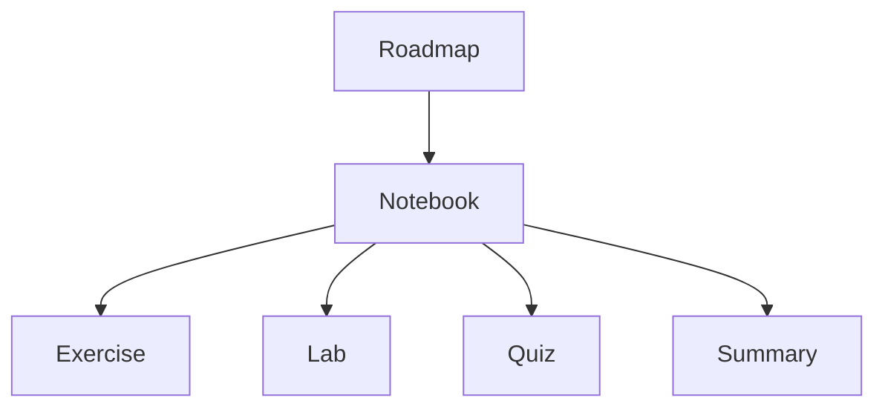

# Architecture

## Purpose

This document defines the architectural foundation of the **GitHub-DevOps-Learning-Path** repository.

Its purpose is to describe how the repository is organized, how educational content is structured, and which architectural principles guide its evolution.

The document serves as the primary technical reference for contributors and maintainers. It complements the README by focusing on repository architecture rather than course content.

---

# Repository Overview

The repository is designed as a content-first educational platform for learning Git, GitHub, CI/CD, and DevOps through practical, project-based learning.

The architecture separates educational materials, project governance, documentation, reusable resources, and release management into clearly defined areas. This separation allows the repository to grow incrementally while remaining understandable and maintainable.

The repository is intended to support:

- self-paced learning
- multilingual educational content
- practical exercises and labs
- AI-assisted content development
- incremental repository evolution

---

# Repository Structure

The repository follows a modular structure where each top-level directory has a single responsibility.

| Directory | Purpose |
|------------|---------|
| `notebooks/` | Primary educational content organized by language and chapter. |
| `exercises/` | Practice exercises reinforcing notebook concepts. |
| `labs/` | Guided hands-on implementations. |
| `quizzes/` | Knowledge assessments. |
| `docs/` | Repository documentation and architecture. |
| `planning/` | Project planning, backlog, decisions, and sprint tracking. |
| `templates/` | Reusable document and content templates. |
| `assets/` | Images, diagrams, and static resources. |
| `.github/` | GitHub configuration and community templates. |

Repository-level governance files remain at the repository root so they are easy to discover. The `README.md` is the entry point; `ROADMAP.md`, `project-manifest.md`, `course-rules.md`, and `ai-guidelines.md` define the course plan, project metadata, educational standards, and AI collaboration guidance respectively.

### Organization Principles

The repository architecture is based on the following principles:

- one responsibility per directory
- educational content separated from governance
- reusable resources centralized
- documentation independent from course material
- incremental scalability
- minimal structural complexity

---

# Educational Content Model

Learning content follows a consistent educational workflow.

*Figure 1. The roadmap defines chapter order; the notebook is the primary artifact that practice and assessment artifacts extend.*

Each chapter is designed to progress from theory to practical application.

## Artifact Relationships and Navigation

The roadmap is the authoritative course sequence. A published chapter begins with a notebook in `notebooks/<language>/`; related exercises, labs, and quizzes extend that notebook rather than duplicate its explanation.

| Artifact | Relationship | Navigation requirement |
|----------|--------------|------------------------|
| Roadmap entry | Defines the chapter's place and status in the learning path. | Links learners to the primary notebook when it is available. |
| Notebook | Primary learning artifact for a chapter. | Links to its related exercise, lab, quiz, or summary when those artifacts are available. |
| Exercise | Reinforces concepts introduced by its notebook. | Identifies the related chapter or notebook. |
| Lab | Applies one or more notebook concepts in a realistic scenario. | Identifies its prerequisites and related chapter. |
| Quiz | Assesses the learning objectives of its notebook. | Identifies the related chapter or notebook. |
| Summary | Consolidates the chapter's key learning objectives. | Links back to the primary notebook. |

Artifacts may be introduced incrementally. A chapter is not required to have every companion artifact before its notebook is published; unavailable artifacts must not be presented as completed content.

## Canonical Curriculum and Legacy Material

The roadmap is the source of truth for the current learning sequence. A chapter linked from the roadmap is canonical. Material retained for reference, experimentation, or translation support must be clearly labelled as legacy and must not be presented as a current numbered chapter or its companion artifact.

This distinction preserves useful multilingual material without allowing it to bypass the progressive curriculum.

## Content Metadata

Content metadata keeps the roadmap, repository navigation, and individual learning artifacts consistent without introducing a separate metadata system.

- The roadmap records chapter order and progress status.
- The repository root `project-manifest.md` records project-wide course, language, output, difficulty, and AI-framework metadata.
- Each published learning artifact uses a clear, ordered filename and states its language, chapter context, and prerequisites or related artifacts in its content.
- When an artifact is added, its navigation links and the corresponding roadmap status are reviewed together.

This lightweight approach makes relationships visible to learners and maintainers while preserving the current file-based architecture.

## Educational Artifacts

### Notebook

Introduces concepts, explanations, examples, and best practices.

### Exercise

Provides guided practice for recently introduced concepts.

### Lab

Offers realistic, hands-on scenarios.

### Quiz

Validates understanding of the chapter.

### Summary

Reinforces the key learning objectives.

---

# Governance Model

Repository governance is separated from educational content.

The following documents define project governance.

| Document | Responsibility |
|----------|----------------|
| [README](../../README.md) | Repository entry point and primary navigation |
| [ROADMAP](../../ROADMAP.md) | Authoritative learning progression and chapter status |
| [ARCHITECTURE](../architecture/ARCHITECTURE.md) |Repository architecture and artifact relationships |
| [project-manifest](../../project-manifest.md) | Project identity and course metadata |
| [course-rules](../../course-rules.md) | Educational standards |
| [ai-guidelines](../../ai-guidelines.md) | AI collaboration guidelines |
| [planning/DECISIONS](../../planning/DECISIONS.md) | Architectural decisions (ADR) |
| [planning/BACKLOG](../../planning/BACKLOG.md) | Planned work |
| [planning/SPRINTS](../../planning/SPRINTS.md) | Development progress |
| [planning/IDEAS](../../planning/IDEAS.md) | Captured improvement opportunities |
| [planning/CHANGELOG_INTERNAL](../../planning/CHANGELOG_INTERNAL.md) | Internal change record |
| [Release documentation](../releases/) | Release process, versioning, and release checklist |

This separation ensures that educational content can evolve independently from project management and repository governance.

---

# Architectural Principles

The repository follows these architectural principles.

## Content First

Educational content is the primary focus.

---

## Learning by Doing

Theory should always be reinforced by practical implementation.

---

## Separation of Concerns

Educational content, planning, documentation, and governance remain independent.

---

## Incremental Evolution

The repository grows through small, reviewable improvements rather than large restructurings.

---

## Consistency

All chapters should follow a predictable structure and naming convention.

---

## Simplicity

Architecture should remain understandable even as the repository grows.

---

## AI-Assisted Development

AI is used to accelerate development while architectural decisions remain under human control.

---

# Evolution Strategy

The architecture is intended to evolve gradually.

Future improvements may include:

- additional language support
- expanded DevOps learning paths
- richer assessment models
- automated content validation
- GitHub Actions integration
- generated documentation
- publishing workflows

Architectural changes should preserve existing repository organization whenever possible.

Large-scale restructuring should only be considered when incremental improvements can no longer satisfy project requirements.

---

# Architecture Summary

The GitHub-DevOps-Learning-Path repository follows a modular, content-first architecture designed for long-term maintainability and incremental growth.

The architecture emphasizes:

- clear separation of concerns
- predictable repository organization
- reusable educational artifacts
- scalable documentation
- AI-assisted development
- continuous improvement

The objective is to provide a stable foundation for developing a comprehensive, practical learning platform for Git and DevOps.
