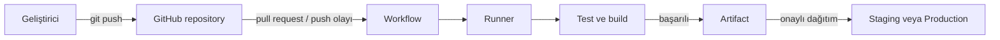

# 01 — GitHub ve DevOps Temelleri

> Seviye: Başlangıç · Süre: 90 dakika · Önkoşullar: Temel terminal kullanımı

## Öğrenme Hedefleri

Bu bölümün sonunda Git, GitHub ve DevOps’un farklı rollerini; bir değişikliğin commit’ten üretime giden yolunu; repository (depo), branch (dal), pull request (değişiklik önerisi) ve pipeline (iş hattı) kavramlarını açıklayabilecek, güvenli bir ekip akışı kurabileceksiniz.

## Motivasyon

Bir ekipte iki geliştirici aynı dosyayı değiştirirken, test edilmemiş kod müşteriye giderken veya hatalı sürümün kim tarafından ne zaman yayımlandığı bilinmezken sorun yalnızca “kod” değildir: değişimin yönetimi eksiktir. Git geçmişi kaydeder; GitHub bu geçmiş etrafında iş birliği sağlar; DevOps geliştirme ve operasyon ekiplerinin yazılımı güvenilir biçimde teslim etmesini hedefler.

Örnek: Bir Spring Boot ödeme düzeltmesi önce ayrı dalda geliştirilir, pull request ile incelenir, testlerden geçer ve onaylıysa staging ortamına dağıtılır. Böylece hatayı üretimde keşfetmek yerine teslimat zincirinde erken buluruz.

## Temel Kavramlar

| Kavram | Açıklama |
| --- | --- |
| Git | Dağıtık sürüm kontrol sistemi; dosyaların değil, değişim geçmişinin yönetimidir. |
| Repository (Depo) | Kod, belge, ayar ve geçmişin birlikte bulunduğu alan. |
| Commit (Kayıt) | Anlamlı bir değişiklik anının kimlikli kaydı. |
| Branch (Dal) | Ana akışı bozmadan çalışma alanı. |
| Pull Request (PR) | Değişikliğin incelenmesi ve birleştirilmesi isteği. |
| Workflow (İş akışı) | GitHub Actions’ın olayla başlayan YAML tanımı. |
| Job (İş) / Step (Adım) | Workflow içindeki çalışma birimi / onun sıralı komutu. |
| Runner (Çalıştırıcı) | Job’u çalıştıran makine veya konteyner. |
| Action (Eylem) | Yeniden kullanılabilir workflow adımı. |
| Artifact (Çıktı paketi) | Sonradan indirmek veya deploy etmek için saklanan build çıktısı. |
| Cache (Önbellek) | Tekrar indirilecek bağımlılıkları hız için saklama alanı. |
| Secret (Gizli değer) | Parola, anahtar veya token gibi loglanmaması gereken değer. |
| Environment (Ortam) | development, staging veya production gibi dağıtım hedefi ve kural kümesi. |

## Mimari



## Çalışma Mantığı

1. Geliştirici izole bir branch’te küçük, anlamlı commit’ler üretir.
2. `git push`, değişiklik ve commit geçmişini uzak GitHub deposuna gönderir.
3. PR açıldığında ekip farkı inceler; kurallar inceleme veya test isteyebilir.
4. GitHub Actions olayı algılar, YAML workflow’unu okur ve uygun runner’a job atar.
5. Runner kodu temiz bir çalışma alanına indirir, bağımlılıkları kurar, test/build çalıştırır.
6. Başarılı çıktı artifact olarak saklanabilir. Dağıtım, environment korumaları ve onaylardan sonra yapılır.

Önemli ayrım: GitHub kodu “kendiliğinden çalıştırmaz”; workflow tetiklenmeli ve runner çalıştırmalıdır.

## Sözdizimi (Syntax)

Kolay ama üretim mantığına yakın bir doğrulama workflow’u:

```yaml
name: doğrulama
on:
  pull_request:
    branches: [main]
permissions:
  contents: read
jobs:
  test:
    runs-on: ubuntu-latest
    steps:
      - uses: actions/checkout@v4
      - name: Testleri çalıştır
        run: ./gradlew test
```

| Satır | Neden var? |
| --- | --- |
| `name` | Actions ekranında okunabilir workflow adını verir. |
| `on` | Başlatan olayı tanımlar; burada `main`e açılan PR. |
| `pull_request` | Kod birleşmeden önce doğrulama yapar. |
| `branches` | Kontrolü yalnızca ana dal hedefliyken çalıştırır. |
| `permissions` | Varsayılan geniş yetki yerine yalnızca repo içeriğini okuma izni verir. |
| `jobs` / `test` | Çalışacak iş grubunu ve kimliğini tanımlar. |
| `runs-on` | GitHub-hosted Ubuntu runner seçer. |
| `steps` | Aynı runner üzerindeki sıralı adımları başlatır. |
| `actions/checkout@v4` | Runner’a repository dosyalarını indirir; sürüm sabitlenmiştir. |
| `name` | Loglarda adımın amacını görünür kılar. |
| `run` | Gradle test komutunu kabukta çalıştırır. |

## Uygulamalı Örnekler

### Kolay

```bash
git checkout -b docs/ilk-not
git add README.md
git commit -m "docs: başlangıç notunu ekle"
git push -u origin docs/ilk-not
```

İlk satır dalı oluşturur ve ona geçer. `add` yalnızca README’yi staging alanına koyar; `commit` açıklamalı kayıt üretir; `push -u` uzak dalı bağlar, sonraki push’ları kısaltır.

### Orta

Bir Python API PR’ında `pytest` çalıştıran workflow ekleyin. Test başarısızsa PR merge edilmemelidir; bunu branch protection (dal koruması) ile zorunlu durum kontrolü yaparak sağlayın.

### İleri

React uygulamasında test, build ve deploy’u ayrı job’lara bölün. Build çıktısını artifact olarak aktarın; deploy job’u yalnızca `main` push’unda ve `staging` environment onayı sonrası çalışsın. Job’lar arası bağımlılığı `needs` ile açıkça belirtin.

## Gerçek Şirket Senaryoları

| Ürün | Pipeline örneği | Operasyonel değer |
| --- | --- | --- |
| Spring Boot | PR: test → paketle → container image → staging deploy | Geriye uyumsuz API ve test hatalarını erken yakalar. |
| React | Lint → unit test → production build → CDN dağıtımı | Bozuk bundle’ın yayınlanmasını engeller. |
| Python | Ruff → pytest → paket → PyPI/AWS Lambda deploy | Tekrarlanabilir paket ve sürüm izi sağlar. |
| Docker | Image build → tarama → registry push | Çalışma ortamını geliştirici makinesinden bağımsızlaştırır. |
| Azure/AWS | IaC plan → onay → apply | Altyapı değişikliğini görünür ve denetlenebilir kılar. |

## Best Practices

- Küçük, tek amaçlı PR’lar açın; inceleme maliyeti düşer.
- `main` dalını koruyun; merge için test ve inceleme zorunlu olsun.
- Action sürümlerini sabitleyin; mümkünse commit SHA pinleme politikasına geçin.
- Pipeline başarısını değil, hızlı ve güvenilir geri bildirimi hedefleyin.
- Her deploy’u commit SHA, artifact ve environment ile ilişkilendirin.

## Sık Yapılan Hatalar

| Hata | Sonuç | Düzeltme |
| --- | --- | --- |
| Doğrudan `main`e push | İncelemesiz hata riski | Feature branch + PR kullanın. |
| `permissions: write-all` | Gereksiz saldırı yüzeyi | En düşük gerekli izni verin. |
| Secret’ı YAML’a yazmak | Sızma ve repo geçmişinde kalıcılık | Secret store ve environment kullanın. |
| Sadece “yeşil” pipeline’a güvenmek | Yanlış/eksik testler kaçabilir | Test kalitesini ve kritik senaryoları gözden geçirin. |

## Performans

Önce ölçün: gereksiz tüm testleri her dokunuşta çalıştırmak geri bildirimi yavaşlatır. Bağımlılık cache’i kullanın, job’ları bağımsızsa paralelleştirin ve büyük artifact’ları yalnızca gerektiğinde saklayın. Cache’i build çıktısı yerine indirilen bağımlılıklar için tercih edin; aksi halde eski çıktı hataları gizleyebilir.

## Güvenlik

Secret, log maskelense bile güvenli giriş değildir: dış katkılardan gelen kodu yüksek yetkiyle çalıştırmayın. Fork PR’larında token yetkilerini sınırlayın, `pull_request_target` olayını ancak güvenlik modelini anlayarak kullanın. Ortama özel secret ve zorunlu onay tanımlayın; deploy kimlik bilgileri için kısa ömürlü OIDC (OpenID Connect) kimlik doğrulamasını uzun ömürlü cloud anahtarlarına tercih edin.

## Hands-on Lab

Amaç: Bir GitHub repository’sinde PR doğrulaması kurmak.

1. Boş bir Java, Python veya Node projesi oluşturun ve `main` dalına ilk commit’i atın.
2. `.github/workflows/verify.yml` dosyasına üstteki workflow’u, kullandığınız dile uygun test komutuyla ekleyin.
3. `feature/first-ci` dalında kasıtlı olarak başarısız, sonra başarılı bir test commit’i yapın.
4. PR açın, Actions logunda iki sonucu da inceleyin.
5. Repository ayarlarında `main` için başarılı status check’i merge şartı yapın.

Başarı ölçütü: Başarısız test merge’i engeller; başarılı testten sonra PR inceleme ile merge edilir.

## Mini Proje

“Takım teslimat kapısı” oluşturun: örnek bir Spring Boot, React veya Python uygulaması seçin. README’ye geliştirme komutlarını yazın, test workflow’u ekleyin, en az bir artifact üretin ve `staging` environment için manuel onay kuralını belgeleyin. Teslimde pipeline diyagramı ve en az üç güvenlik kararının gerekçesi bulunmalıdır.

## Interview Questions

### Junior

1. Git ile GitHub arasındaki fark nedir?
2. Pull request neden doğrudan merge’den daha güvenlidir?
3. Runner ne yapar?

### Mid

1. Artifact ile cache ne zaman farklı amaçlara hizmet eder?
2. Branch protection hangi riski azaltır?
3. Bir workflow’un gereğinden geniş izinlerini nasıl fark eder ve azaltırsınız?

### Senior

1. Fork kaynaklı PR’lar için güvenlik modelini nasıl tasarlarsınız?
2. Hız, maliyet ve güvenilirlik arasında pipeline’ı nasıl dengelersiniz?
3. Bir dağıtımın izlenebilirliğini (traceability) nasıl sağlarsınız?

## Quiz

1. Commit’in temel amacı nedir?
2. Branch neden kullanılır?
3. PR hangi iki ekip pratiğini destekler?
4. Workflow’u hangi iki şey başlatır ve çalıştırır?
5. Job ile step arasındaki ilişki nedir?
6. Artifact ne için saklanır?
7. Cache neyi hızlandırır?
8. Least privilege (en az yetki) ne demektir?
9. Secret neden YAML içine yazılmamalıdır?
10. Branch protection hangi aşamada değer üretir?

## Quiz Cevapları

1. Anlamlı değişimin sürümlenmiş geçmiş kaydını oluşturmak.  
2. Ana akışı bozmadan izole çalışma yapmak.  
3. Kod inceleme ve kontrollü birleştirme.  
4. GitHub olayı tetikler; runner job’u çalıştırır.  
5. Job çalışma birimidir, step onun sıralı adımıdır.  
6. Build veya test çıktısını sonraki aşamaya/indirmeye taşımak için.  
7. Yeniden indirilecek bağımlılıkları.  
8. Yalnızca gerekli minimum erişimi vermek.  
9. Geçmişe, loglara veya fork’lara sızabilir.  
10. Merge öncesinde gerekli kalite kontrollerini zorunlu kılar.  

## Cheat Sheet

| İhtiyaç | Araç/kavram |
| --- | --- |
| İzole geliştirme | `git checkout -b <dal>` |
| Değişikliği paylaşma | `git push -u origin <dal>` |
| İnceleme | Pull Request |
| Otomasyon tanımı | `.github/workflows/*.yml` |
| Güvenli erişim | `permissions` + Secrets + Environment |
| Hız | Cache ve paralel job |
| Teslim izi | Commit SHA + artifact + deployment kaydı |

## Summary

- Git değişim geçmişini, GitHub ekip iş birliğini, DevOps güvenilir teslimatı destekler.
- Güvenli temel akış: branch → commit → PR → test → inceleme → merge/deploy.
- Actions’ta olay workflow’u başlatır, runner job/step’leri çalıştırır.
- Hız için cache, teslim için artifact kullanılır; ikisi aynı şey değildir.
- Otomasyonun güvenliği en az yetki, secret yönetimi ve environment korumalarıyla başlar.

Sonraki bölümde Git’in commit, branch ve merge modelini daha derinlemesine uygulayacağız.
