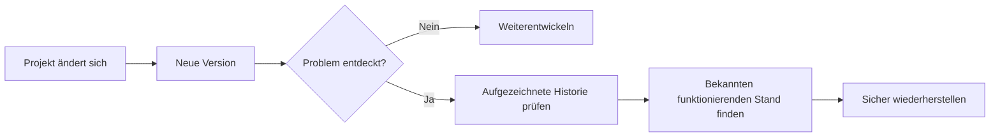
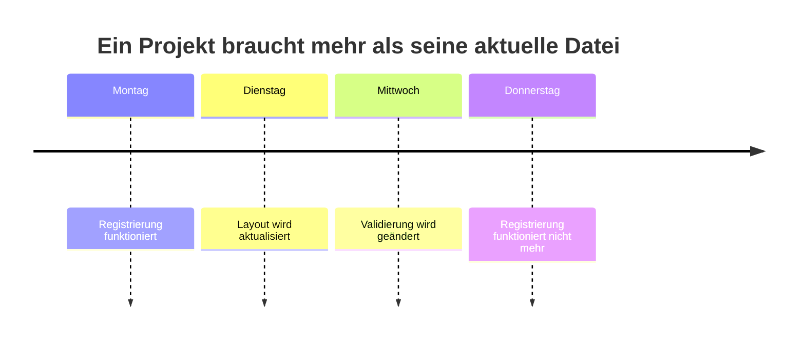
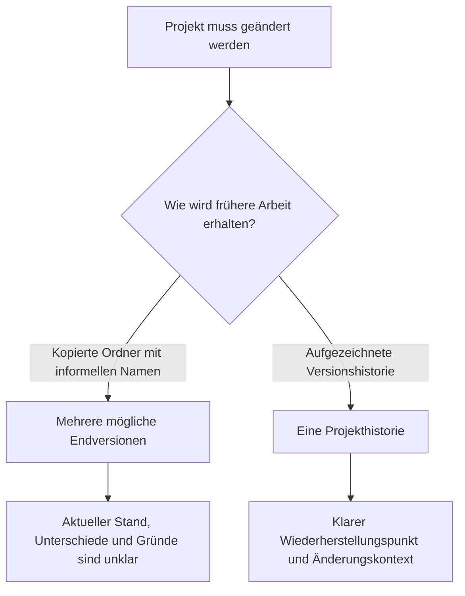
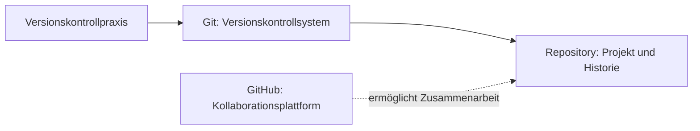

> **Navigation:** Vorheriges Kapitel: Nicht vorhanden | [Roadmap](../../ROADMAP.md) | Nächstes Kapitel 02: Demnächst
>
> **Niveau:** Einsteiger · **Geschätzte Zeit:** 60 Minuten · **Voraussetzungen:** Keine

# Warum Versionskontrolle?

## Lernziele

Am Ende dieses Kapitels kannst du:

- erklären, warum Versionskontrolle existiert und welche Probleme sie löst;
- ein Backup von einer nützlichen Änderungshistorie unterscheiden;
- Wiederherstellung, Nachvollziehbarkeit, sicheres Experimentieren und Zusammenarbeit auf ein Projektszenario anwenden;
- Git und GitHub auf einer konzeptionellen Ebene unterscheiden.

## Einführung

Maya aktualisiert am Abend vor einer Bewerbung das Kontaktformular ihrer Portfolio-Website. Sie ändert das Layout, passt die Validierung an und speichert. Die neue Version sieht schlechter aus und das Formular sendet nicht mehr. Die vorher funktionierende Version ist verschwunden.

Sie erinnert sich an eine Kopie von letzter Woche namens `portfolio-final-v2`. Eine weitere Kopie heißt `portfolio-final-final`. Keiner dieser Namen sagt, welche Kopie das funktionierende Formular enthält, was danach verändert wurde oder ob sie überhaupt aktuell ist.

Das ist kein ungewöhnliches Anfängerproblem. Es ist eine normale Folge davon, dass sich Software ohne verlässliche Aufzeichnung verändert. Versionskontrolle macht diese Veränderung beherrschbar.

## Visuelles Lernen



_Abbildung 1. Eine aufgezeichnete Historie verwandelt eine fehlerhafte Änderung in eine nachvollziehbare Untersuchung._



_Abbildung 2. Die Zeitleiste grenzt die Untersuchung zwischen dem letzten funktionierenden und dem ersten fehlerhaften Stand ein._

## Warum das wichtig ist

Software bleibt nie wirklich unverändert. Eine Portfolio-Seite erhält eine Projektseite, eine Hausarbeit wird nach Feedback korrigiert, ein Team behebt einen gemeldeten Fehler oder eine Konfiguration wird für eine neue Umgebung angepasst.

In jeder dieser Situationen reicht die neueste Datei nicht. Entwicklerinnen und Entwickler benötigen Antworten: Was wurde geändert? Warum? Wann? Von wem? Können wir zum funktionierenden Stand zurückkehren?

Professionelle Teams verwenden Versionskontrolle täglich, weil sie Änderungen eine belastbare Historie gibt. Das erleichtert Reviews, Fehlersuche, Wartung und gemeinsames Arbeiten. Sie ist für ein persönliches Portfolio ebenso nützlich wie für ein Teamprodukt.

## Schlüsselbegriffe

| Begriff             | Erklärung                                                                                                                   |
| ------------------- | --------------------------------------------------------------------------------------------------------------------------- |
| Versionskontrolle   | Ein System, das Projektänderungen über die Zeit aufzeichnet und frühere Zustände verständlich oder wiederherstellbar macht. |
| Versionshistorie    | Die geordnete Aufzeichnung bedeutungsvoller Projektänderungen.                                                              |
| Nachvollziehbarkeit | Die Fähigkeit, eine Änderung mit Anlass, Zeitpunkt und Quelle zu verbinden.                                                 |
| Repository          | Der konzeptionelle Ort eines Projekts und seiner Historie.                                                                  |
| Git                 | Ein Versionskontrollsystem zum Aufzeichnen und Verwalten der Projekthistorie.                                               |
| GitHub              | Eine Kollaborationsplattform rund um Git-Repositories.                                                                      |
| Backup              | Eine Kopie, die primär gegen Verlust oder Ausfall schützt.                                                                  |

## Theorie

### Änderungen brauchen Kontext

Stell dir vor, der Registrierungsbutton einer universitären Event-Website funktioniert nach einer Designänderung nicht mehr. Nur die aktuellen Dateien zu sehen zwingt das Team zum Raten. Eine brauchbare Historie hilft, die relevante Änderung und ihren Zweck zu finden.



_Abbildung 3. Manuelle Kopien erhalten Dateien; eine Versionshistorie erhält ihre Beziehung und ihren Kontext._

Für jede bedeutsame Änderung sollte ein zukünftiger Leser beantworten können:

- Was wurde geändert?
- Warum wurde es geändert?
- Wann wurde es geändert?
- Wer hat die Änderung vorgenommen oder angefordert?

Das ist keine Bürokratie. Nach einigen Wochen erinnert sich die Person, die eine Änderung vorgenommen hat, oft nicht mehr an alle Einzelheiten. Teammitglieder ohne diesen Kontext brauchen eine verständliche Aufzeichnung.

### Warum manuelle Kopien scheitern

Ohne Versionskontrolle erstellen Menschen vor riskanten Arbeiten oft Kopien:

```text
portfolio/
|- projekt-final/
|- projekt-final-v2/
|- projekt-final-final/
`- projekt-diese-version/
```

Solche Kopien können zunächst sicher wirken. Ihre Namen zeigen jedoch weder die genaue Differenz zwischen zwei Versionen noch den Grund einer Änderung oder den maßgeblichen Stand. Mit wachsender Zahl der Kopien wird es leicht, im falschen Ordner zu arbeiten, Arbeit zu verlieren oder einen veralteten Stand zu veröffentlichen.

### Was Versionskontrolle bietet

| Ohne Versionskontrolle                                           | Mit Versionskontrolle                                                      |
| ---------------------------------------------------------------- | -------------------------------------------------------------------------- |
| Dateinamen sollen Versionen beschreiben.                         | Das Projekt besitzt eine geordnete Änderungshistorie.                      |
| Es ist schwer, die aktuelle Kopie zu erkennen.                   | Es gibt eine gemeinsame, verlässliche Quelle.                              |
| Die Wiederherstellung hängt vom Finden des richtigen Ordners ab. | Aufgezeichnete Zustände können identifiziert und wiederhergestellt werden. |
| Gründe für Änderungen werden vergessen.                          | Änderungen können Kontext für spätere Leser enthalten.                     |
| Teammitglieder überschreiben oder duplizieren Arbeit.            | Arbeit wird rund um dieselbe Historie koordiniert.                         |

Versionskontrolle ermöglicht Wiederherstellung, Nachvollziehbarkeit, sicheres Experimentieren, Zusammenarbeit, eine gemeinsame Quelle und bessere Wartbarkeit.

### Backup ist nicht Versionskontrolle

Ein Backup schützt vor Datenverlust, etwa durch einen defekten Datenträger oder versehentliches Löschen. Es beantwortet vor allem die Frage: "Können wir unsere Daten zurückbekommen?"

Versionskontrolle beantwortet eine andere Frage: "Wie hat sich dieses Projekt verändert und wie arbeiten wir sicher mit dieser Historie?" Ein Backup kann den Ordner von gestern enthalten. Es erklärt meist nicht, welche Änderung einen Fehler eingeführt hat oder wie die Arbeit zweier Personen zusammenhängt. Beide Praktiken ergänzen sich.

### Die Rollen von Git und GitHub

Git ist ein Versionskontrollsystem. In den nächsten Kapiteln wird es die Projekthistorie aufzeichnen. GitHub ist nicht Git, sondern eine Kollaborationsplattform rund um Git-Repositories.



_Abbildung 4. Git verwaltet die Repository-Historie; GitHub unterstützt die Zusammenarbeit darum._

## Praktische Beispiele

### Portfolio-Website: Wiederherstellung

Alex entfernt beim Ändern der Navigation einer Portfolio-Seite versehentlich den Link zur Kontaktseite. Mit einer Historie kann Alex den letzten funktionierenden Stand finden, die Änderung vergleichen und den richtigen Zustand wiederherstellen.

### Studienarbeit: Nachvollziehbarkeit

Zwei Studierende überarbeiten vor der Abgabe einen Datenanalysebericht. Eine Person korrigiert eine Berechnung und ändert danach die Schlussfolgerung. Die Historie kann die neue Schlussfolgerung mit der Korrektur verbinden.

### Teamprojekt: Gemeinsame Quelle

Drei Entwickler arbeiten an einer Event-Registrierungsanwendung. Wenn sie Projektkopien über Nachrichten austauschen, kann jede Person eine andere "neueste" Version besitzen. Versionskontrolle gibt dem Team eine gemeinsame Projekthistorie.

## Selbst ausprobieren

1. Denke an eine Datei, die du mit Wörtern wie `final`, `neu`, `kopie` oder einem Datum benannt hast.
2. Notiere, was der Name über die Änderung aussagt und was nicht.
3. Formuliere eine Frage, die mit einer klaren Historie leichter zu beantworten wäre.

## Best Practices

- Behandle Änderungen als Teil des Projekts, nicht als Details, die in Dateinamen versteckt werden.
- Bewahre für ein Team eine gemeinsame verlässliche Quelle.
- Halte den Zweck bedeutsamer Änderungen fest, solange der Kontext bekannt ist.
- Nutze Backups gegen Verlust und Versionskontrolle zum Verstehen der Projektentwicklung.

## Häufige Fehler

| Fehler                                                    | Warum problematisch?                                                                | So vermeidest du ihn                                                       |
| --------------------------------------------------------- | ----------------------------------------------------------------------------------- | -------------------------------------------------------------------------- |
| Versionskontrolle nur als Backup verstehen                | Historie, Kontext und Zusammenarbeit werden übersehen.                              | Zeichne bedeutsame Änderungen auf und behalte Backups für den Verlustfall. |
| Namen wie `final`, `final-v2` und `final-final` verwenden | Die Namen sind mehrdeutig und zeigen keine tatsächlichen Unterschiede.              | Verwende eine vertrauenswürdige Historie statt konkurrierender Kopien.     |
| Denken, nur große Teams brauchten Versionskontrolle       | Auch persönliche Projekte ändern sich, brechen und müssen wiederhergestellt werden. | Beginne bei eigenen Projekten und Aufgaben früh damit.                     |
| Git und GitHub gleichsetzen                               | System und Kollaborationsplattform werden verwechselt.                              | Merke dir: Git verwaltet die Historie, GitHub unterstützt Zusammenarbeit.  |

## Zusammenfassung

- Die aktuelle Datei allein erklärt nicht, wie sich Software entwickelt hat.
- Versionskontrolle liefert Wiederherstellung, Nachvollziehbarkeit, sichere Experimente, Zusammenarbeit und Wartbarkeit.
- Manuelle Kopien skalieren nicht, weil ihnen Kontext fehlt.
- Backups schützen vor Verlust; Versionskontrolle verwaltet und erklärt die Projektentwicklung.
- Git ist ein Versionskontrollsystem, GitHub eine Kollaborationsplattform.

## Nächstes Kapitel

Du kennst jetzt den Zweck der Versionskontrolle. Im nächsten Kapitel entsteht ein mentales Modell dafür, wie Git Projekthistorie aufzeichnet.

### Verwandte Inhalte

- Vorheriges Kapitel: Nicht vorhanden
- Nächstes Kapitel: Kapitel 02 - Git-Architektur (demnächst)
- Übung: [Versionskontrolle analysieren](../../exercises/de/01-versionskontrolle-analysieren.md)
- Labor: [Labor zur manuellen Versionierung](../../labs/de/01-manuelle-versionierung-labor.md)
- Quiz: [Quiz: Warum Versionskontrolle?](../../quizzes/de/01-warum-versionskontrolle-quiz.md)

## Weiterführendes Lesen

- [Git Book: About Version Control](https://git-scm.com/book/en/v2/Getting-Started-About-Version-Control)
- [Git Book: What is Git?](https://git-scm.com/book/en/v2/Getting-Started-What-is-Git%3F)
- [GitHub Docs: About Git](https://docs.github.com/en/get-started/using-git/about-git)
