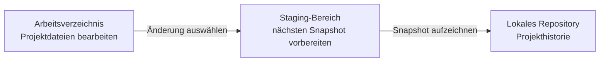
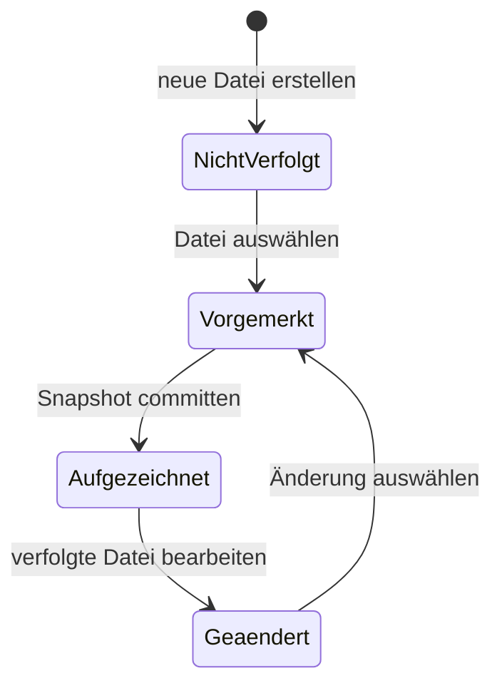
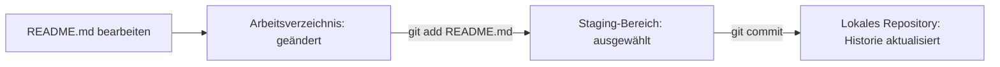

> **Navigation:** [Vorheriges Kapitel: 01](01-warum-versionskontrolle.md) | [Roadmap](../../ROADMAP.md) | Nächstes Kapitel 03: Demnächst
>
> **Niveau:** Einsteiger · **Geschätzte Zeit:** 75 Minuten · **Voraussetzungen:** [Kapitel 01: Warum Versionskontrolle?](01-warum-versionskontrolle.md)

# Git-Architektur

## Lernziele

Am Ende dieses Kapitels kannst du:

- Arbeitsverzeichnis, Staging-Bereich und lokales Repository unterscheiden;
- erklären, wie eine Änderung von einer bearbeiteten Datei in die Projekthistorie gelangt;
- mit `git status` den Zustand einer Änderung beschreiben;
- begründen, warum Git das Auswählen von Änderungen vom Speichern der Historie trennt.

## Einführung

Im ersten Kapitel hast du gelernt, warum Software eine zuverlässige Historie braucht. Git liefert diese Historie, behandelt aber nicht jede gespeicherte Bearbeitung sofort als dauerhaften Eintrag.

Stell dir vor, du aktualisierst deine Portfolio-Website. Du korrigierst einen Tippfehler in der README-Datei, probierst einen Text für das Kontaktformular aus und beginnst ein Menü-Redesign. Diese Änderungen gehören nicht alle in denselben historischen Eintrag. Die Dokumentationskorrektur kann fertig sein, während das Menü noch unfertig ist.

Die Git-Architektur schafft einen bewussten Weg von gewöhnlichen Dateibearbeitungen zu gespeicherter Historie. Diesen Weg zu verstehen ist wichtiger als Befehle auswendig zu lernen.

## Visuelles Lernen



_Abbildung 1. Git trennt Bearbeiten, Auswählen und Aufzeichnen, damit die Historie fokussiert bleibt._



_Abbildung 2. Eine neue oder geänderte Datei durchläuft Zustände, bevor ihre ausgewählte Version Teil der Historie wird._

## Warum das wichtig ist

In professioneller Softwarearbeit entstehen gleichzeitig viele Änderungen. Eine Entwicklerin kann einen Fehler beheben, Dokumentation anpassen und eine neue Funktion ausprobieren. Teams müssen eine sinnvolle Arbeitseinheit speichern können, ohne unfertige oder nicht zusammenhängende Änderungen versehentlich aufzunehmen.

Git trennt Bearbeiten, Auswählen und Aufzeichnen. Dadurch wird die Projekthistorie präziser und später leichter verständlich. Wenn ein Teammitglied einen Fehler untersucht oder Commits prüft, ist ein fokussierter Snapshot hilfreicher als ein Snapshot mit jeder Datei, die an diesem Tag berührt wurde.

## Schlüsselbegriffe

| Begriff                                | Erklärung                                                                    |
| -------------------------------------- | ---------------------------------------------------------------------------- |
| Arbeitsverzeichnis (working directory) | Die sichtbaren Projektdateien, die du bearbeiten kannst.                     |
| Staging-Bereich (staging area)         | Die überprüfbare Auswahl von Dateiversionen für den nächsten Commit.         |
| Lokales Repository (local repository)  | Die von Git verwaltete Projekthistorie auf deinem Computer.                  |
| Snapshot                               | Der aufgezeichnete Zustand ausgewählter Projektdateien zu einem Zeitpunkt.   |
| Commit                                 | Ein benannter Eintrag, der den ausgewählten Snapshot zur Historie hinzufügt. |
| `git status`                           | Ein Befehl, der nicht verfolgte, geänderte und vorgemerkte Dateien meldet.   |

## Theorie

### Arbeitsverzeichnis

Das Arbeitsverzeichnis ist der Projektordner, den du im Editor öffnest. Wenn du `index.html` veränderst, die README-Datei aktualisierst oder eine neue Datei erstellst, veränderst du das Arbeitsverzeichnis.

In diesem Moment existiert die Änderung nur in den aktuellen Dateien. Git kann sie erkennen, aber sie wurde noch nicht für den nächsten historischen Eintrag ausgewählt. Eine Datei zu speichern bedeutet nicht, eine Projektentscheidung aufzuzeichnen.

### Staging-Bereich

Der Staging-Bereich ist der bewusste Kontrollpunkt zwischen Bearbeitung und Historie. Er enthält die genaue Version jeder Datei, die Git für den nächsten Commit verwenden soll.

Wenn du einen Tippfehler in `README.md` korrigierst und gleichzeitig ein unfertiges Menü in `index.html` ausprobierst, kannst du nur die Dokumentationskorrektur auswählen. Der nächste Commit beschreibt dann einen einzigen, verständlichen Zweck.

Der Staging-Bereich wird manchmal _Index_ genannt. In diesem Kurs verwenden wir "Staging-Bereich", weil der Name seine Aufgabe klarer beschreibt: Er bereitet den nächsten Snapshot vor.

### Lokales Repository

Das lokale Repository ist die Projekthistorie auf deinem Computer. Wenn Git einen ausgewählten Snapshot aufzeichnet, entsteht dort ein Commit. Das lokale Repository ist kein zweiter Ordner, den du von Hand bearbeitest; Git verwaltet ihn.

Dieses Kapitel konzentriert sich auf die lokale Architektur. Das Teilen mit entfernten Diensten und die Zusammenarbeit mit GitHub folgen in späteren Kapiteln.

### Eine Datei, mehrere Zustände

Eine Datei kann in den Git-Bereichen verschiedene Versionen haben. Das Repository kann die README von gestern enthalten, der Staging-Bereich die ausgewählte Tippfehlerkorrektur und das Arbeitsverzeichnis einen späteren Entwurf mit einem zusätzlichen Absatz.

Wichtig ist: Git hält unfertige Arbeit, ausgewählte Arbeit und aufgezeichnete Historie getrennt.

### Warum Auswahl vor Historie kommt

| Situation                                           | Ohne Staging-Bereich                                  | Mit Staging-Bereich                                           |
| --------------------------------------------------- | ----------------------------------------------------- | ------------------------------------------------------------- |
| Fehlerkorrektur und Formatierung passieren zusammen | Beides kann in einem unklaren Commit landen.          | Die Korrektur kann getrennt ausgewählt werden.                |
| Eine Funktion ist noch nicht fertig                 | Jede gespeicherte Datei wirkt wie eine fertige Phase. | Nur fertige Arbeit wird für die Historie ausgewählt.          |
| Ein Teammitglied liest die Historie                 | Der Zweck eines großen Snapshots bleibt unklar.       | Jeder Commit repräsentiert eine verständliche Arbeitseinheit. |

Auswählen ist keine Bürokratie. Git sorgt damit dafür, dass die Historie Absicht ausdrückt.

## Praktische Beispiele

### Eine Änderung durch Git verfolgen

Angenommen, du korrigierst einen Tippfehler in `README.md` eines vorbereiteten Portfolio-Repositories.



_Abbildung 3. `git add` wählt die Dokumentationskorrektur aus; `git commit` schreibt die ausgewählte Version in die lokale Historie._

```bash
git status
git add README.md
git status
git commit -m "docs: Einrichtungsanleitung korrigieren"
git status
```

| Befehl                | Bedeutung in der Architektur                                              |
| --------------------- | ------------------------------------------------------------------------- |
| Erstes `git status`   | Zeigt die Änderung von README im Arbeitsverzeichnis.                      |
| `git add README.md`   | Wählt die aktuelle README-Version für den Staging-Bereich aus.            |
| Zweites `git status`  | Zeigt, dass die ausgewählte Version für den nächsten Commit bereit ist.   |
| `git commit -m "..."` | Zeichnet den ausgewählten Snapshot im lokalen Repository auf.             |
| Letztes `git status`  | Zeigt verbleibende Änderungen im Arbeitsverzeichnis oder Staging-Bereich. |

### Getrennte und unfertige Arbeit

Wenn das Menü-Redesign in `index.html` noch nicht fertig ist, kann der Status konzeptionell so aussehen:

```text
Zum Commit vorgemerkte Änderungen:
  geändert: README.md

Nicht zum Commit vorgemerkte Änderungen:
  geändert: index.html
```

Das Aufzeichnen der ausgewählten README-Version zeichnet die unfertige HTML-Arbeit nicht automatisch auf.

```mermaid
timeline
    title Fokussierte Dokumentationsänderung
    09:00 : README.md bearbeiten
    09:05 : Änderung im Arbeitsverzeichnis prüfen
    09:07 : README für nächsten Snapshot auswählen
    09:10 : Ausgewählten Snapshot lokal aufzeichnen
    09:11 : Unabhängige Menüarbeit fortsetzen
```

_Abbildung 4. Die ausgewählte Dokumentationsänderung wird Teil der Historie, bevor unabhängige Arbeit fertig ist._

## Probiere es selbst

1. Stelle dir vor, dass du in einem Projekt `README.md` und `index.html` änderst.
2. Entscheide, welche Datei eine fertige, erklärbare Änderung darstellt und welche noch in Arbeit ist.
3. Beschreibe, in welchem Git-Bereich jede Datei vor dem Commit liegen sollte.

## Best Practices

- Verwende den Staging-Bereich als Prüfpunkt und wähle Änderungen für einen klaren Zweck aus.
- Führe `git status` vor und nach dem Auswählen aus.
- Halte nicht zusammenhängende oder unfertige Arbeit möglichst aus einem Commit heraus.
- Beschreibe im Commit die Absicht der ausgewählten Änderung, nicht jede Bearbeitung des Tages.

## Häufige Fehler

| Fehler                                                         | Warum ist das problematisch?                                        | So vermeidest du ihn                                     |
| -------------------------------------------------------------- | ------------------------------------------------------------------- | -------------------------------------------------------- |
| Annehmen, dass jede gespeicherte Datei in der Git-Historie ist | Speichern verändert das Arbeitsverzeichnis, nicht die Historie.     | Prüfe den Zustand mit `git status`.                      |
| Den Staging-Bereich als zweite Projektkopie verstehen          | Seine Aufgabe bei der Auswahl des nächsten Snapshots wird verdeckt. | Betrachte ihn als Auswahlliste für einen Commit.         |
| Alle geänderten Dateien automatisch auswählen                  | Nicht zusammenhängende Änderungen erschweren Historie und Review.   | Wähle nur Dateien, die eine klare Änderung unterstützen. |
| Glauben, ein Commit teile Arbeit mit dem Team                  | Ein Commit zeichnet Historie nur lokal auf.                         | Trenne lokale Historie von entferntem Teilen.            |

## Zusammenfassung

- Git verwendet das Arbeitsverzeichnis für Bearbeitungen, den Staging-Bereich für ausgewählte Änderungen und das lokale Repository für aufgezeichnete Historie.
- Eine Datei kann geändert, vorgemerkt, aufgezeichnet und während weiterer Arbeit erneut geändert werden.
- Der Staging-Bereich ermöglicht fokussierte Commits, die unabhängige Arbeit ausschließen.
- `git status` ist der erste Befehl, um herauszufinden, wo Änderungen liegen.

## Nächstes Kapitel

Du kennst nun die lokalen Git-Bereiche. Das nächste Kapitel bereitet mit der Git-Installation die praktische Nutzung dieser Architektur vor.

### Weiterführende Inhalte

- Vorheriges Kapitel: [Kapitel 01 - Warum Versionskontrolle?](01-warum-versionskontrolle.md)
- Nächstes Kapitel: Kapitel 03 - Git installieren (demnächst)
- Übung: [Git-Bereiche klassifizieren](../../exercises/de/02-git-bereiche-klassifizieren.md)
- Labor: [Git-Änderungsfluss-Labor](../../labs/de/02-git-aenderungsfluss-labor.md)
- Quiz: [Git-Architektur-Quiz](../../quizzes/de/02-git-architektur-quiz.md)

## Weiterführende Quellen

- [Git Book: Recording Changes](https://git-scm.com/book/en/v2/Git-Basics-Recording-Changes-to-the-Repository)
- [Git Book: Viewing the Commit History](https://git-scm.com/book/en/v2/Git-Basics-Viewing-the-Commit-History)
