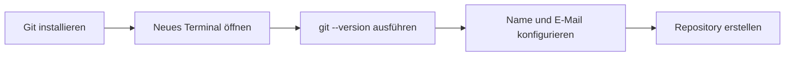
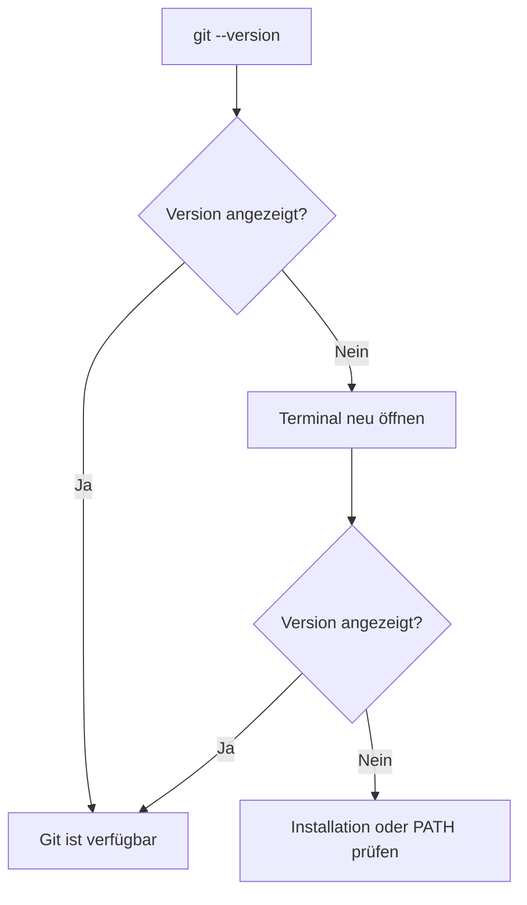
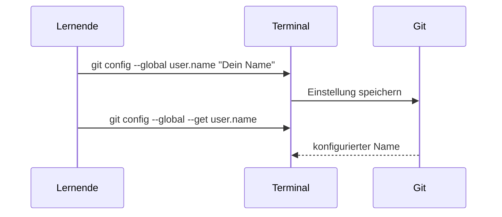

> **Navigation:** [Vorheriges Kapitel: 02](02-git-architektur.md) | [Roadmap](../../ROADMAP.md) | Nächstes Kapitel 04: Demnächst
>
> **Niveau:** Einsteiger · **Geschätzte Zeit:** 60 Minuten · **Voraussetzungen:** [Kapitel 02: Git-Architektur](02-git-architektur.md)

# Git installieren

## Lernziele

- Git passend zum Betriebssystem installieren.
- Git im aktuellen Terminal prüfen.
- Name und E-Mail-Adresse für künftige Commits konfigurieren.
- Einstellungen bewusst auslesen statt zu raten.

## Einführung

Git ist ein Programm auf deinem Computer. GitHub kann später Repositories hosten, ersetzt aber nicht das lokale Git-Programm, das Änderungen aufzeichnet. Vor dem ersten Repository muss dein Terminal `git` finden und Git benötigt eine Commit-Identität.

## Visuelles Lernen



_Abbildung 1. Einrichtung und Prüfung folgen einer klaren Reihenfolge._



_Abbildung 2. Prüfe das Terminal, das du wirklich verwenden wirst._

## Warum das wichtig ist

Eine unvollständige Einrichtung führt später zu verwirrenden Fehlern. Git kann beim ersten Commit anhalten, weil keine Autorin oder kein Autor konfiguriert ist. Ein Terminal, das vor der Installation geöffnet war, findet Git möglicherweise nicht. Die Prüfung jedes Schritts macht spätere Git-Befehle verständlicher.

## Schlüsselbegriffe

| Begriff               | Erklärung                                                     |
| --------------------- | ------------------------------------------------------------- |
| Installationsprogramm | Programm, das Software und erforderliche Dateien installiert. |
| Paketmanager          | Werkzeug zum Installieren und Aktualisieren von Paketen.      |
| Terminal              | Textbasierte Oberfläche zum Ausführen von Befehlen.           |
| PATH                  | Liste von Orten, an denen das Terminal Programme sucht.       |
| Globale Konfiguration | Git-Einstellungen für den aktuellen Benutzer.                 |
| Commit-Identität      | Name und E-Mail-Adresse in der Commit-Historie.               |

## Theorie

### Git für das Betriebssystem installieren

Wähle auf der offiziellen Git-Downloadseite die aktuelle, unterstützte Installation. Die genaue Version ändert sich; verwende keine alte Versionsnummer aus einem Tutorial.

| Betriebssystem | Empfohlener Weg                                          | Prüfung                                    |
| -------------- | -------------------------------------------------------- | ------------------------------------------ |
| Windows        | Git for Windows von der offiziellen Seite                | Git Bash, PowerShell oder Windows Terminal |
| macOS          | Entwicklerwerkzeuge oder vertrauenswürdiger Paketmanager | Terminal                                   |
| Linux          | Paketmanager der Distribution                            | Terminal                                   |

Lass unter Windows die Option aktiv, die Git über die Befehlszeile verfügbar macht, sofern die Organisation nichts anderes vorgibt. Schließe danach vorhandene Terminals und öffne ein neues, damit PATH geladen wird.

### Installation und Identität prüfen

```bash
git --version
git config --global user.name "Dein Name"
git config --global user.email "du@example.com"
git config --global --get user.name
git config --global --get user.email
```

`git --version` muss eine Version ausgeben. Die letzten beiden Befehle lesen die Commit-Identität zurück. `--global` speichert die Einstellung für den aktuellen Betriebssystembenutzer. Verwende keine E-Mail-Adresse, die nicht in einer Commit-Historie erscheinen soll.



_Abbildung 3. Nach einer Einstellung wird ihr exakter Wert ausgelesen._

## Praktische Beispiele

Unter Windows installierst du Git for Windows, öffnest danach ein neues Terminal und führst `git --version` aus. Unter macOS und Linux nutzt du die freigegebene Systemmethode und prüfst ebenfalls zuerst die Version.

## Probiere es selbst

1. Installiere Git mit der offiziellen Methode für dein Betriebssystem.
2. Öffne ein neues Terminal und führe `git --version` aus.
3. Konfiguriere Namen und E-Mail-Adresse.
4. Lies beide Werte mit `git config --global --get`.

## Best Practices

- Nutze die offizielle Git-Downloadseite oder den vertrauenswürdigen Paketmanager.
- Öffne nach der Installation ein neues Terminal.
- Prüfe die Commit-Identität vor dem ersten Commit.

## Häufige Fehler

| Fehler                                        | Ursache                                                 | Korrektur                          |
| --------------------------------------------- | ------------------------------------------------------- | ---------------------------------- |
| Altes Terminal verwenden                      | Neuer PATH-Wert ist nicht geladen.                      | Terminal schließen und neu öffnen. |
| `git --version` überspringen                  | Installation und Nutzung sind später schwer zu trennen. | Installation sofort prüfen.        |
| Platzhalter-E-Mail verwenden                  | Sie wird in die Historie aufgenommen.                   | Wert vor Commits auslesen.         |
| GitHub-Konto mit Git-Installation verwechseln | Hosting liefert keinen lokalen `git`-Befehl.            | Git lokal installieren und prüfen. |

## Zusammenfassung

- Git muss lokal installiert werden.
- `git --version` prüft Git im aktuellen Terminal.
- `user.name` und `user.email` kennzeichnen Commits.

## Nächstes Kapitel

Im nächsten Kapitel erstellst du dein erstes Repository und nutzt die Git-Architektur aus Kapitel 02.

### Weiterführende Inhalte

- Übung: [Git-Einrichtung prüfen](../../exercises/de/03-git-einrichtung-pruefen.md)
- Labor: [Git installieren und konfigurieren](../../labs/de/03-git-installieren-und-konfigurieren.md)
- Quiz: [Git installieren - Quiz](../../quizzes/de/03-git-installieren-quiz.md)

## Weiterführende Quellen

- [Git Downloads](https://git-scm.com/downloads)
- [Git Book: First-Time Git Setup](https://git-scm.com/book/en/v2/Getting-Started-First-Time-Git-Setup)
