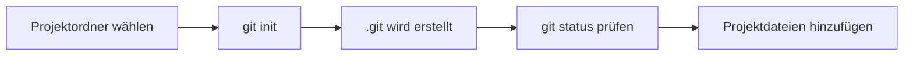

> **Navigation:** [Vorheriges Kapitel: 03](03-git-installieren.md) | [Roadmap](../../ROADMAP.md) | Nächstes Kapitel 05: Demnächst
>
> **Niveau:** Einsteiger · **Geschätzte Zeit:** 60 Minuten · **Voraussetzungen:** [Kapitel 03: Git installieren](03-git-installieren.md)

## Lernziele

Am Ende dieses Kapitels kannst du:

- einen bewussten Projektordner auswählen;
- mit `git init` ein lokales Repository erstellen;
- den Zustand mit `git status` prüfen;
- zwischen Projektdateien und dem versteckten `.git`-Ordner unterscheiden;
- erklären, warum ein Repository eine klare Grenze braucht.

## Einführung

Ein Git-Repository ist ein Projektordner mit zusätzlichem Versionsverwaltungswissen. Git speichert dieses Wissen im versteckten Ordner `.git`. Deine normalen Dateien bleiben sichtbar und können mit jedem Editor bearbeitet werden.

Der wichtigste erste Schritt ist nicht der Befehl, sondern der Ort. Führe `git init` nur in dem Ordner aus, der wirklich zu diesem Projekt gehört. Eine Initialisierung in einem übergeordneten Ordner kann fremde Projekte und persönliche Dateien in dieselbe Historie aufnehmen.

## Visuelles Lernen



_Abbildung 1. Ein Repository entsteht in einem bewusst gewählten Projektordner._

## Warum das wichtig ist

Eine klare Repository-Grenze macht Statusmeldungen, Commits und Zusammenarbeit verständlich. Wenn Git im falschen Ordner gestartet wird, erscheinen möglicherweise Dateien aus anderen Projekten als unversioniert. Das kann zu versehentlichen Commits führen.

## Schlüsselbegriffe

| Begriff            | Erklärung                                                              |
| ------------------ | ---------------------------------------------------------------------- |
| Repository         | Ordner mit Projektdateien und Git-Metadaten.                           |
| Arbeitsverzeichnis | Sichtbarer Bereich, in dem du Dateien bearbeitest.                     |
| `.git`             | Versteckter Ordner mit Git-Historie und Konfiguration.                 |
| Unversioniert      | Datei, die Git kennt, aber noch nicht in der Historie gespeichert hat. |
| Projektwurzel      | Der bewusst gewählte oberste Ordner eines Projekts.                    |

## Theorie

### Repository erstellen

```bash
mkdir team-handbook
cd team-handbook
git init
git status
```

`git init` erstellt die lokale Git-Struktur. `git status` zeigt danach, ob Dateien geändert, vorgemerkt oder unversioniert sind. Ein leeres Repository kann gültig sein, obwohl es noch keinen Commit besitzt.

### Eine unversionierte Datei beobachten

```bash
printf "# Team-Handbuch\n" > README.md
git status
```

`README.md` erscheint als unversionierte Datei. Git sieht die Datei, hat sie aber noch nicht in einem Commit aufgezeichnet. Das Hinzufügen und Committen folgt im nächsten Kapitel.

### Statusmeldungen lesen

`git status` ist ein Diagnosewerkzeug. Es beantwortet unter anderem:

- In welchem Branch befinde ich mich?
- Gibt es Änderungen?
- Welche Dateien sind unversioniert?
- Welche Dateien sind für den nächsten Commit vorgemerkt?

## Praktische Beispiele

### Beispiel 1: Projektgrenze prüfen

```bash
pwd
mkdir release-notes
cd release-notes
git init
git status
```

Prüfe vor `git init`, dass der aktuelle Pfad wirklich zum neuen Projekt gehört.

### Beispiel 2: Datei bewusst noch nicht speichern

```bash
echo "# Release Notes" > README.md
git status
```

Die Datei ist sichtbar, aber noch nicht Teil der Historie.

## Best Practices

- Vor `git init` immer den aktuellen Pfad prüfen.
- Ein Repository pro logisch eigenständigem Projekt verwenden.
- `git status` regelmäßig ausführen.
- Dateien erst nach Prüfung zum Commit vormerken.

## Häufige Fehler

- Git im übergeordneten Sammelordner initialisieren;
- annehmen, dass `git init` automatisch einen Commit erstellt;
- unversionierte Dateien mit bereits gespeicherten Dateien verwechseln;
- den Status nicht vor wichtigen Befehlen prüfen.

## Übungen und Lösungen

1. Erstelle einen Ordner `team-handbook` und initialisiere darin Git.
2. Lege eine `README.md` an und beschreibe ihre Statusmeldung.
3. Erkläre den Unterschied zwischen Arbeitsverzeichnis und `.git`.

**Lösung:** Der Projektordner enthält sichtbare Dateien, `.git` enthält die Verwaltungsdaten. Nach `git init` ist das Repository gültig, aber ohne Commit. Die neue README ist zunächst unversioniert.

## Zusammenfassung

`git init` erstellt ein lokales Repository im aktuellen Ordner. `git status` zeigt den Zustand des Arbeitsverzeichnisses. Eine bewusste Projektwurzel verhindert, dass fremde Dateien in die Historie gelangen.

## Nächstes Kapitel

Kapitel 05 zeigt, wie Änderungen mit Commits dauerhaft in der Git-Historie gespeichert werden.

### Verwandte Inhalte

- Übung: [Das erste Repository erstellen](../../exercises/de/04-erstes-repository-erstellen.md)
- Labor: [Ein Projekt-Repository initialisieren](../../labs/de/04-projekt-repository-initialisieren.md)
- Quiz: [Erstes Repository Quiz](../../quizzes/de/04-erstes-repository-quiz.md)
