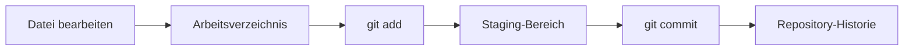

> **Navigation:** [Vorheriges Kapitel: 04](04-erstes-repository-erstellen.md) | [Roadmap](../../ROADMAP.md) | Nächstes Kapitel 06: Demnächst
>
> **Niveau:** Einsteiger · **Geschätzte Zeit:** 70 Minuten · **Voraussetzungen:** [Kapitel 04: Das erste Repository erstellen](04-erstes-repository-erstellen.md)

## Lernziele

- den Ablauf von Arbeitsverzeichnis, Staging-Bereich und Repository erklären;
- Änderungen mit `git add` für einen Commit vormerken;
- mit `git commit` einen dauerhaften Historienpunkt erstellen;
- Commits mit `git log` und `git show` untersuchen;
- kleine, verständliche Commits formulieren.

## Einführung

Ein Commit ist ein gespeicherter Schnappschuss ausgewählter Änderungen. Git speichert nicht jede Bewegung im Editor automatisch. Du entscheidest, welche Änderungen zum nächsten Historienpunkt gehören.

## Visuelles Lernen



_Abbildung 1. Änderungen werden bewusst vom Arbeitsverzeichnis bis zur Historie bewegt._

## Warum das wichtig ist

Gute Commits machen Entwicklung nachvollziehbar. Ein klarer Commit beantwortet: Was wurde geändert und warum? Kleine Einheiten lassen sich leichter prüfen, zurücksetzen und in Pull Requests erklären.

## Schlüsselbegriffe

| Begriff          | Erklärung                                                 |
| ---------------- | --------------------------------------------------------- |
| Commit           | Gespeicherter Historienpunkt mit ausgewählten Änderungen. |
| Staging-Bereich  | Vorbereitungsebene für den nächsten Commit.               |
| Commit-Nachricht | Kurze Erklärung der Änderung.                             |
| Historie         | Reihenfolge der Commits eines Repositorys.                |
| Diff             | Vergleich zwischen zwei Zuständen.                        |

## Theorie

### Eine Änderung committen

```bash
echo "# Release Notes" > README.md
git add README.md
git commit -m "Add release notes README"
git log --oneline
```

`git add` verändert noch nicht die Historie. Erst `git commit` speichert den vorgemerkten Zustand.

### Änderungen prüfen

```bash
git status
git diff
git diff --staged
git show --stat --oneline HEAD
```

`git diff` zeigt nicht vorgemerkte Änderungen. `git diff --staged` zeigt, was in den nächsten Commit aufgenommen würde.

### Gute Commit-Nachrichten

Eine Nachricht sollte mit einem Verb beginnen und eine kleine Änderung beschreiben, zum Beispiel `Add installation guide` oder `Fix broken link`. Vermeide Nachrichten wie `Änderungen` oder `Update`, wenn sie keine Information liefern.

## Praktische Beispiele

### Beispiel 1: Zwei getrennte Commits

```bash
git add README.md
git commit -m "Add project overview"
git add CONTRIBUTING.md
git commit -m "Add contribution guidance"
```

Zwei fachlich getrennte Änderungen bleiben unabhängig prüfbar.

### Beispiel 2: Vorgemerkte Änderung korrigieren

```bash
git reset README.md
git status
```

Damit wird die Datei aus dem Staging-Bereich entfernt, ohne die Arbeitsdatei zu löschen.

## Best Practices

- Vor `git add` den Diff prüfen.
- Einen Commit auf eine verständliche Änderung begrenzen.
- Aussagekräftige, konsistente Nachrichten verwenden.
- Nach dem Commit die Historie kontrollieren.

## Häufige Fehler

- `git add .` ohne Prüfung in einem großen Ordner verwenden;
- mehrere unabhängige Themen in einem Commit mischen;
- Commit-Nachrichten ohne Aussagekraft schreiben;
- glauben, dass `git add` bereits einen Commit erzeugt.

## Übungen und Lösungen

Erstelle drei kleine Änderungen und entscheide, ob sie in einen oder mehrere Commits gehören. Prüfe danach `git status`, `git diff --staged` und `git log --oneline`.

**Lösung:** Unabhängige Themen gehören in getrennte Commits. Vor dem Commit muss der Staging-Diff nur die gewünschte Änderung enthalten.

## Zusammenfassung

Commits entstehen durch den bewussten Ablauf `git add` und `git commit`. Der Staging-Bereich erlaubt eine genaue Auswahl. `git log`, `git diff` und `git show` machen die Historie prüfbar.

## Nächstes Kapitel

Kapitel 06 führt Branches und Strategien für parallele Entwicklung ein.

### Verwandte Inhalte

- Übung: [Fokussierte Commits erstellen](../../exercises/de/05-fokussierte-commits-erstellen.md)
- Labor: [Fokussierte Commits erstellen](../../labs/de/05-fokussierte-commits-erstellen.md)
- Quiz: [Commit-Quiz](../../quizzes/de/05-commit-quiz.md)
