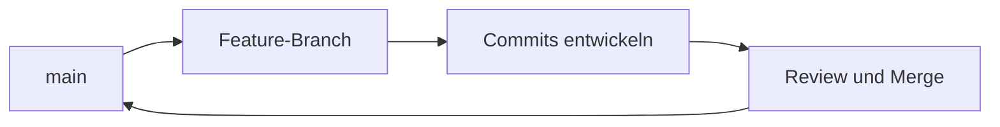

> **Navigation:** [Vorheriges Kapitel: 05](05-mit-commits-arbeiten.md) | [Roadmap](../../ROADMAP.md) | Nächstes Kapitel 07: Demnächst
>
> **Niveau:** Einsteiger · **Geschätzte Zeit:** 70 Minuten · **Voraussetzungen:** [Kapitel 05: Mit Commits arbeiten](05-mit-commits-arbeiten.md)

## Lernziele

- erklären, warum Branches parallele Arbeit ermöglichen;
- Branches mit `git switch` erstellen und wechseln;
- einen Branch sinnvoll benennen und aktuell halten;
- zwischen Haupt-, Feature- und kurzfristigen Branches unterscheiden;
- Branches nach dem Mergen sauber entfernen.

## Einführung

Ein Branch ist ein beweglicher Zeiger auf einen Commit. Er erlaubt dir, an einer Änderung zu arbeiten, ohne den stabilen Stand direkt zu verändern. Branches sind leichtgewichtig, aber ihre Namen und Lebensdauer beeinflussen die Zusammenarbeit.

## Visuelles Lernen



_Abbildung 1. Ein Feature-Branch isoliert Arbeit bis zur Integration._

## Warum das wichtig ist

Parallele Entwicklung ist unvermeidbar. Branches reduzieren das Risiko, dass unfertige Arbeit direkt in den gemeinsamen stabilen Branch gelangt. Eine einfache Strategie ist für Anfänger oft besser als ein kompliziertes Branching-Modell.

## Schlüsselbegriffe

| Begriff        | Erklärung                                                  |
| -------------- | ---------------------------------------------------------- |
| Branch         | Benannter, beweglicher Zeiger auf einen Commit.            |
| `main`         | Häufiger Name für den stabilen Standard-Branch.            |
| Feature-Branch | Kurzlebiger Branch für eine konkrete Änderung.             |
| Upstream       | Branch, auf dessen Basis ein Branch weiterentwickelt wird. |
| Merge          | Zusammenführen von Branches.                               |

## Theorie

### Branch erstellen und wechseln

```bash
git switch main
git switch -c feature/update-readme
git status
git branch --show-current
```

`git switch -c` erstellt den Branch und wechselt sofort dorthin. Der Name sollte den Zweck der Arbeit erklären.

### Branches anzeigen

```bash
git branch
git log --oneline --decorate --graph --all
```

Die graphische Ansicht zeigt, wie Branches aufeinander bezogen sind.

### Branch aktuell halten

Vor neuer Arbeit kann ein Feature-Branch mit dem aktuellen Ziel-Branch synchronisiert werden. Ob dafür Merge oder Rebase verwendet wird, sollte die Teamregel bestimmen. Für Einsteiger ist ein bewusster Merge oft leichter zu erklären.

### Branch abschließen

```bash
git switch main
git merge feature/update-readme
git branch -d feature/update-readme
```

Lösche einen Branch erst, wenn seine Änderungen integriert oder bewusst verworfen wurden.

## Praktische Beispiele

### Beispiel 1: Dokumentationsänderung isolieren

```bash
git switch -c docs/improve-installation
# Dateien bearbeiten
git add .
git commit -m "Improve installation guidance"
```

### Beispiel 2: Branch-Namen vergleichen

Gut: `feature/add-search`, `fix/broken-link`, `docs/update-guide`.

Schlecht: `test`, `work`, `branch2`, weil der Zweck nicht erkennbar ist.

## Best Practices

- Einen Branch pro zusammenhängende Änderung verwenden.
- Kurzlebige Branches regelmäßig integrieren.
- Vor dem Wechsel den Arbeitsstatus prüfen.
- Branch-Namen nach einer gemeinsamen Teamregel wählen.

## Häufige Fehler

- direkt auf `main` unfertige Arbeit entwickeln;
- vergessen, in welchem Branch man arbeitet;
- einen Branch mit unabhängigen Themen überladen;
- einen nicht integrierten Branch löschen.

## Übungen und Lösungen

Erstelle einen Feature-Branch, committe eine kleine Änderung und zeige danach die Branch-Historie. Erkläre, warum die Änderung vor dem Merge isoliert war.

**Lösung:** Der Feature-Branch hält die Arbeit getrennt von `main`. Nach Prüfung kann er gemergt und anschließend gelöscht werden.

## Zusammenfassung

Branches isolieren parallele Arbeit. `git switch -c` erstellt einen Branch, `git branch` zeigt Branches und `git merge` integriert Änderungen. Klare Namen und kurze Lebensdauer verbessern die Zusammenarbeit.

## Nächstes Kapitel

Kapitel 07 behandelt Merge-Vorgänge und den Umgang mit Konflikten.

### Verwandte Inhalte

- Übung: [Einen Feature-Branch erstellen](../../exercises/de/06-feature-branch-erstellen.md)
- Labor: [Branches erstellen und prüfen](../../labs/de/06-branches-erstellen-und-pruefen.md)
- Quiz: [Branching-Quiz](../../quizzes/de/06-branching-quiz.md)
