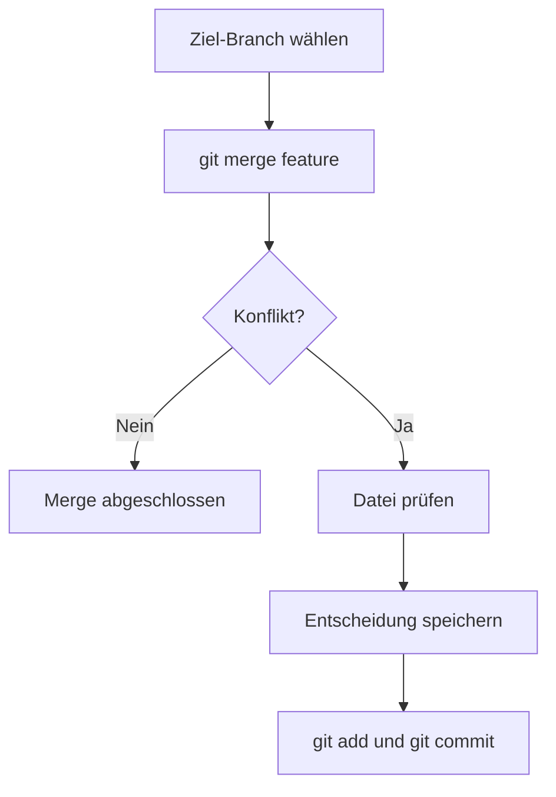

> **Navigation:** [Vorheriges Kapitel: 06](06-branching-strategien.md) | [Roadmap](../../ROADMAP.md) | Nächstes Kapitel 08: Demnächst
>
> **Niveau:** Einsteiger · **Geschätzte Zeit:** 75 Minuten · **Voraussetzungen:** [Kapitel 06: Branching-Strategien](06-branching-strategien.md)

## Lernziele

- einen Branch sicher mergen;
- einen Fast-Forward-Merge erkennen;
- Konfliktmarkierungen lesen und bearbeiten;
- einen Konflikt mit `git add` und `git commit` abschließen;
- einen Merge vorzeitig mit `git merge --abort` abbrechen.

## Einführung

Ein Merge verbindet die Historien zweier Branches. Wenn Git dieselben Zeilen nicht unabhängig zusammenführen kann, entsteht ein Konflikt. Ein Konflikt ist keine Beschädigung des Repositorys, sondern eine Entscheidung, die ein Mensch treffen muss.

## Visuelles Lernen



_Abbildung 1. Ein Konflikt wird durch Prüfung und einen bewussten Commit gelöst._

## Warum das wichtig ist

Konflikte treten in Teams regelmäßig auf. Wer den Ablauf kennt, muss nicht panisch reagieren. Wichtig ist, die gemeinsame Absicht zu verstehen und keine fremde Änderung blind zu überschreiben.

## Schlüsselbegriffe

| Begriff            | Erklärung                                                         |
| ------------------ | ----------------------------------------------------------------- |
| Merge              | Zusammenführen zweier Entwicklungsverläufe.                       |
| Fast-Forward       | Merge ohne neuen Verzweigungspunkt.                               |
| Konflikt           | Git kann konkurrierende Änderungen nicht automatisch entscheiden. |
| Konfliktmarkierung | Text, der konkurrierende Versionen kennzeichnet.                  |
| Merge-Commit       | Commit, der die zusammengeführten Verläufe verbindet.             |

## Theorie

### Merge vorbereiten

```bash
git switch main
git status
git merge feature/update-readme
```

Führe einen Merge mit sauberem Arbeitsverzeichnis und auf dem richtigen Ziel-Branch aus.

### Konfliktmarkierungen lesen

```text
<<<<<<< HEAD
Version aus dem aktuellen Branch
=======
Version aus dem einzufügenden Branch
>>>>>>> feature/update-readme
```

Entferne die Markierungen und behalte die fachlich richtige Endversion. Danach muss die Datei syntaktisch und inhaltlich geprüft werden.

### Konflikt abschließen

```bash
git add konflikt-datei.md
git status
git commit -m "Resolve merge conflict"
```

### Merge abbrechen

```bash
git merge --abort
```

Wenn die Situation unklar ist, bringt `--abort` den Zustand vor dem Merge zurück. Prüfe danach den Status.

## Praktische Beispiele

### Beispiel 1: Konflikt kontrolliert lösen

1. Lies beide Versionen.
2. Verstehe die Absicht beider Änderungen.
3. Schreibe eine gemeinsame Endversion.
4. Entferne alle Markierungen.
5. Prüfe die Datei.
6. Stage und committe die Lösung.

### Beispiel 2: Konflikt nicht blind lösen

Wenn du nicht weißt, welche Information korrekt ist, halte an und frage die verantwortlichen Personen. Ein technisch konfliktfreier Merge kann fachlich trotzdem falsch sein.

## Best Practices

- Vor dem Merge den Branch und Status prüfen.
- Konflikte klein halten durch regelmäßige Integration.
- Nach der Lösung Tests und Diff prüfen.
- Bei Unsicherheit den Merge abbrechen und Rücksprache halten.

## Häufige Fehler

- Konfliktmarkierungen im Commit lassen;
- nur eine Version blind übernehmen;
- im falschen Branch mergen;
- nach der Lösung keine Tests ausführen.

## Übungen und Lösungen

Erzeuge zwei Branches, ändere dieselbe Zeile und merge sie. Löse den Konflikt, prüfe den Diff und erkläre deine Entscheidung.

**Lösung:** Konfliktmarkierungen werden durch eine geprüfte gemeinsame Version ersetzt. Danach wird die Datei gestaged und der Merge-Commit erstellt.

## Zusammenfassung

Ein Merge verbindet Branches. Konflikte entstehen, wenn Git konkurrierende Änderungen nicht automatisch entscheiden kann. Der sichere Ablauf lautet: prüfen, entscheiden, Markierungen entfernen, testen, stagen und committen.

## Nächstes Kapitel

Kapitel 08 untersucht die internen Objekte, Referenzen und Verwaltungsdaten von Git.

### Verwandte Inhalte

- Übung: [Einen Merge-Konflikt lösen](../../exercises/de/07-merge-konflikt-loesen.md)
- Labor: [Einen Merge-Konflikt lösen](../../labs/de/07-merge-konflikt-loesen.md)
- Quiz: [Merge- und Konflikt-Quiz](../../quizzes/de/07-merge-und-konflikte-quiz.md)
