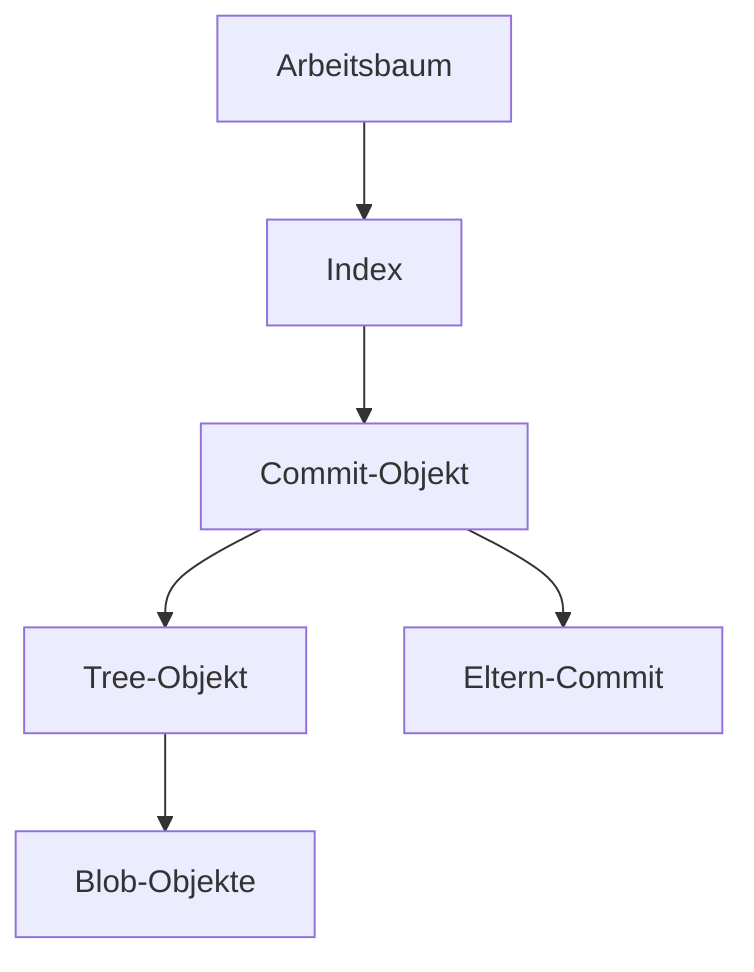

> **Navigation:** [Vorheriges Kapitel: 07](07-merges-und-merge-konflikte.md) | [Roadmap](../../ROADMAP.md) | Nächstes Kapitel 09: Demnächst
>
> **Niveau:** Fortgeschritten · **Geschätzte Zeit:** 75 Minuten · **Voraussetzungen:** [Kapitel 07: Merges und Merge-Konflikte](07-merges-und-merge-konflikte.md)

## Lernziele

- das Git-Objektmodell erklären;
- Blobs, Trees, Commits und Refs unterscheiden;
- Zweck und Inhalt von `.git` beschreiben;
- Objekte mit Plumbing-Befehlen untersuchen;
- erklären, warum Git frühere Zustände zuverlässig wiederfinden kann.

## Einführung

Befehle wie `git add` und `git commit` bilden nur die Benutzeroberfläche von Git. Darunter speichert Git Inhalte als Objekte und verbindet sie mit Referenzen. Das Repository ist dadurch eine inhaltsadressierbare Datenbank für Projektzustände.

## Visuelles Lernen



_Abbildung 1. Git verbindet Arbeitsbaum, Index, Snapshots und frühere Commits._

## Schlüsselbegriffe

| Begriff  | Erklärung                                                         |
| -------- | ----------------------------------------------------------------- |
| Blob     | Objekt, das den Inhalt einer Datei speichert.                     |
| Tree     | Objekt, das Verzeichnisse und Dateinamen mit Objekten verbindet.  |
| Commit   | Objekt mit Snapshot, Eltern und Autorinformationen.               |
| Ref      | Benannter Verweis auf einen Commit, etwa ein Branch.              |
| Index    | Staging-Bereich für den nächsten Commit.                          |
| Plumbing | Niedrige Git-Befehle zur direkten Untersuchung der Datenstruktur. |

## Theorie

### Das Objektmodell

Git speichert Inhalte nicht nur unter Dateinamen. Ein Blob enthält Dateiinhalte, ein Tree beschreibt eine Verzeichnisstruktur und ein Commit verweist auf einen Tree sowie seine Eltern. Ein Branch ist lediglich ein Ref, der auf einen Commit zeigt.

### `.git` untersuchen

```bash
ls -la .git
git rev-parse --show-toplevel
git rev-parse HEAD
git cat-file -t HEAD
git cat-file -p HEAD
```

`git cat-file` zeigt Typ und Inhalt eines Git-Objekts. Verändere Dateien in `.git` nicht manuell.

### Objekte auffinden

```bash
git ls-tree HEAD
git cat-file -p HEAD^{tree}
git count-objects -v
```

Diese Befehle machen sichtbar, wie ein Commit auf Tree- und Blob-Objekte zeigt.

### Refs und HEAD

`HEAD` beschreibt die aktuelle Position. Bei einem normalen Branch zeigt `HEAD` auf den Branch-Ref, der wiederum auf einen Commit zeigt. Beim Wechseln eines Branches ändert sich diese Kette, nicht der Inhalt der alten Commits.

## Praktische Beispiele

```bash
git log --oneline --decorate
git rev-parse HEAD
git show HEAD^{tree}
git ls-files --stage
```

Vergleiche Index, aktuellen Commit und Arbeitsbaum. So lässt sich erklären, warum eine Änderung noch nicht Teil der Historie ist.

## Best Practices

- `.git` nur lesend untersuchen, wenn du lernst.
- Vor Plumbing-Befehlen einen sicheren Übungsordner verwenden.
- Objekt-IDs nicht als dauerhaft lesbare Dateinamen interpretieren.
- Für alltägliche Änderungen weiterhin die normalen Porcelain-Befehle verwenden.

## Häufige Fehler

- Dateien direkt in `.git` bearbeiten;
- Branch, Commit und Tree gleichsetzen;
- glauben, dass ein Branch eine Kopie aller Dateien ist;
- Plumbing-Befehle ohne Erklärung in produktiven Repositories verwenden.

## Übungen und Lösungen

Erstelle einen Commit und untersuche `HEAD`, seinen Tree und die enthaltenen Dateien mit `git cat-file` und `git ls-tree`.

**Lösung:** `HEAD` ist ein Commit, der auf einen Tree zeigt. Der Tree verweist auf Blobs und weitere Trees. Ein Branch ist nur ein benannter Verweis auf diesen Verlauf.

## Zusammenfassung

Git basiert auf Blobs, Trees, Commits und Refs. `.git` enthält diese Objekte sowie Verwaltungsdaten. Das Objektmodell erklärt Branches, Wiederherstellung und zuverlässige Historie.

## Nächstes Kapitel

Kapitel 09 behandelt Wiederherstellung mit `restore`, `reset`, `revert`, `stash`, `reflog` und `cherry-pick`.

### Verwandte Inhalte

- Übung: [Git-Objekte untersuchen](../../exercises/de/08-git-objekte-untersuchen.md)
- Labor: [Git-Repository-Interna erkunden](../../labs/de/08-git-repository-interna-erkunden.md)
- Quiz: [Git-Interna Quiz](../../quizzes/de/08-git-interna-quiz.md)
