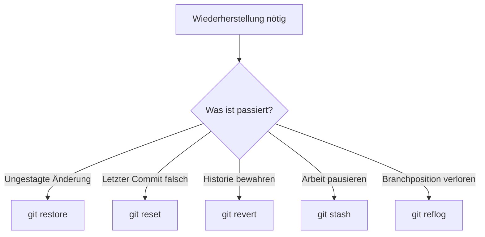

> **Navigation:** [Vorheriges Kapitel: 08](08-git-internals.md) | [Roadmap](../../ROADMAP.md) | Nächstes Kapitel 10: Demnächst
>
> **Niveau:** Fortgeschritten · **Geschätzte Zeit:** 80 Minuten · **Voraussetzungen:** [Kapitel 08: Git-Interna](08-git-internals.md)

## Lernziele

- `restore`, `reset` und `revert` unterscheiden;
- einen fehlerhaften Commit sicher behandeln;
- unfertige Arbeit mit `stash` zwischenlagern;
- `reflog` und `log` zur Wiederherstellung verwenden;
- einen einzelnen Commit mit `cherry-pick` übernehmen.

## Einführung

Erfahrene Git-Nutzer vermeiden Fehler nicht vollständig, sondern planen die Wiederherstellung. Die richtige Technik hängt davon ab, ob eine Arbeitsdatei, der letzte Commit, ein öffentlicher Verlauf oder nur eine temporäre Pause betroffen ist.

## Visuelles Lernen



_Abbildung 1. Die Situation bestimmt das passende Sicherheitswerkzeug._

## Theorie

### `restore`, `reset` und `revert`

- `git restore` verwirft oder stellt Arbeitsdateien beziehungsweise den Index wieder her.
- `git reset` verschiebt einen lokalen Zeiger und kann Änderungen aus dem Staging entfernen.
- `git revert` erstellt einen neuen Commit, der eine frühere Änderung umkehrt, ohne die öffentliche Historie umzuschreiben.

```bash
git restore README.md
git reset HEAD~1
git revert HEAD
```

Prüfe vor jedem Befehl, ob die Änderung bereits geteilt wurde.

### Temporär stashen

```bash
git stash push -m "Pause before review"
git stash list
git stash pop
```

`stash` ist für kurzfristige Unterbrechungen gedacht, nicht als langfristiges Archiv.

### Mit dem Reflog retten

```bash
git reflog
git show HEAD@{1}
git branch recovery HEAD@{1}
```

Der Reflog zeigt lokale Bewegungen von `HEAD` und kann einen scheinbar verlorenen Commit auffindbar machen.

### Cherry-Pick

```bash
git cherry-pick <commit-id>
```

Damit wird eine einzelne Änderung auf den aktuellen Branch übertragen. Prüfe Konflikte und die fachliche Eignung des Commits.

## Praktische Beispiele

Erstelle einen Übungsbranch, mache einen absichtlich falschen Commit und wähle anschließend bewusst zwischen `revert` und `reset`. Verwende `revert`, wenn die Historie geteilt wurde; verwende `reset` nur für geeignete lokale Korrekturen.

## Best Practices

- Vor destruktiven Befehlen `git status` und `git log` prüfen.
- Öffentliche Historie nicht leichtfertig umschreiben.
- Wiederherstellung zuerst in einem Übungsrepository testen.
- Nach jeder Reparatur Diff und Tests kontrollieren.

## Häufige Fehler

- `reset --hard` ohne Backup verwenden;
- `revert` und `reset` als identisch betrachten;
- Stashes über lange Zeit liegen lassen;
- Reflog mit einer öffentlichen Remote-Historie verwechseln.

## Übungen und Lösungen

Simuliere einen falschen Commit, parke eine unvollständige Änderung und finde einen früheren Zustand mit `reflog`.

**Lösung:** Für einen geteilten Fehler ist `revert` die sichere Wahl. Temporäre Arbeit wird mit `stash` geparkt. Der Reflog hilft, einen früheren lokalen Zeiger wiederzufinden.

## Zusammenfassung

`restore` bearbeitet Arbeitsdateien, `reset` verschiebt lokale Zustände, `revert` bewahrt die Historie durch einen Gegencommit. `stash`, `reflog` und `cherry-pick` erweitern Git um praktische Wiederherstellungs- und Auswahlwerkzeuge.

## Nächstes Kapitel

Kapitel 10 beginnt mit GitHub und verbindet lokale Git-Arbeit mit gemeinsamer Plattformarbeit.

### Verwandte Inhalte

- Übung: [Von einem schlechten Commit wiederherstellen](../../exercises/de/09-von-schlechtem-commit-wiederherstellen.md)
- Labor: [Mit Git wiederherstellen und debuggen](../../labs/de/09-mit-git-wiederherstellen-und-debuggen.md)
- Quiz: [Fortgeschrittene Git-Techniken Quiz](../../quizzes/de/09-fortgeschrittene-git-techniken-quiz.md)
