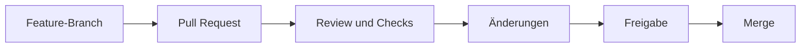

> **Navigation:** [Vorheriges Kapitel: 11](11-klonen-fork-und-remotes.md) | [Roadmap](../../ROADMAP.md) | Nächstes Kapitel 13: Demnächst
>
> **Niveau:** Einsteiger · **Voraussetzungen:** [Kapitel 11: Klonen, Fork und Remotes](11-klonen-fork-und-remotes.md)

## Lernziele

- einen Pull Request als Änderungsvorschlag erklären;
- Base- und Head-Branch unterscheiden;
- eine klare PR-Beschreibung schreiben;
- Review-Kommentare und Statusprüfungen einordnen;
- Merge-Entscheidungen nachvollziehbar treffen.

## Einführung

Ein Pull Request verbindet Entwicklungsarbeit mit Review. Ein Feature-Branch wird gegen einen Ziel-Branch vorgeschlagen. Andere Personen können Diff, Tests und Beschreibung prüfen, bevor die Änderung integriert wird.

## Theorie

Der Head-Branch enthält die vorgeschlagene Arbeit. Der Base-Branch ist das Ziel. Gute PRs erklären Kontext, Umfang, Tests und bekannte Einschränkungen.

### Review-Ergebnisse

Ein Review kann genehmigen, Kommentare hinterlassen oder Änderungen verlangen. Der Autor aktualisiert denselben Branch; der PR erhält die neuen Commits automatisch.

## Best Practices

- Pull Requests klein und fokussiert halten.
- Beschreibung mit Problem, Lösung und Tests schreiben.
- Kommentare sachlich und konkret formulieren.
- Vor dem Merge alle Checks und Konflikte prüfen.

## Häufige Fehler

- einen PR ohne Kontext erstellen;
- Base und Head vertauschen;
- Review-Kommentare ignorieren;
- unfertige Arbeit als stabil markieren.

## Zusammenfassung

Pull Requests machen Änderungen sichtbar, reviewbar und kontrollierbar. Base, Head, Diff, Reviews und Checks bilden den Kern der Zusammenarbeit.

## Nächstes Kapitel

Kapitel 13 führt GitHub Projects für Planung und Statusverfolgung ein.

### Verwandte Inhalte

- Übung: [Einen Pull-Request-Workflow prüfen](../../exercises/de/12-pull-request-workflow-pruefen.md)
- Labor: [Pull Request erstellen und mergen](../../labs/de/12-pull-request-erstellen-und-mergen.md)
- Quiz: [Pull-Requests Quiz](../../quizzes/de/12-pull-requests-quiz.md)
