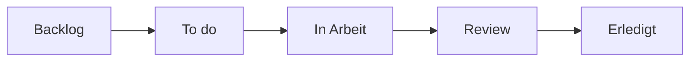

> **Navigation:** [Vorheriges Kapitel: 12](12-pull-requests.md) | [Roadmap](../../ROADMAP.md) | Nächstes Kapitel 14: Demnächst

## Lernziele

- GitHub Projects als Planungswerkzeug erklären;
- Issues und Pull Requests einem Projekt zuordnen;
- sinnvolle Workflow-Spalten erstellen;
- Status, Verantwortung und Fortschritt sichtbar machen;
- einfache Automatisierung einordnen.

## Einführung

GitHub Projects macht Arbeit sichtbar. Ein Board kann Aufgaben von Backlog über In Arbeit und Review bis Erledigt verfolgen. Es ersetzt keine Issues oder Pull Requests, verbindet sie aber mit einer gemeinsamen Planung.

## Visuelles Lernen



## Theorie

Issues beschreiben Aufgaben oder Fehler, Pull Requests beschreiben Codeänderungen. Beide können als Elemente in einem Project erscheinen. Spalten sollten echte Zustände ausdrücken und nicht nur Personen oder beliebige Kategorien darstellen.

Ein einfacher Ablauf ist:

```text
Backlog → To do → In Arbeit → Review → Erledigt
```

Labels, Verantwortliche, Meilensteine und Automatisierungen helfen bei der Pflege. Ein Board ist nur nützlich, wenn es aktuell bleibt.

## Praktische Beispiele

1. Erstelle ein Board für ein Dokumentationsprojekt.
2. Füge drei Issues hinzu.
3. Verschiebe eine Aufgabe nach **In Arbeit**.
4. Verknüpfe einen Pull Request mit **Review**.
5. Markiere die Aufgabe erst nach Validierung als **Erledigt**.

## Best Practices

- Wenige, eindeutige Spalten verwenden.
- Jede Aufgabe einem Verantwortlichen zuordnen.
- Issues und PRs mit dem Board verknüpfen.
- Blockierte Arbeit sichtbar machen.

## Häufige Fehler

Zu viele Spalten, veraltete Karten, fehlende Verantwortliche und ein Board als reine Ablage machen Planung unklar.

## Zusammenfassung

GitHub Projects verbindet Issues und Pull Requests mit einem sichtbaren Workflow. Ein einfaches, gepflegtes Board verbessert Planung und Teamtransparenz.

## Nächstes Kapitel

Kapitel 14 behandelt Issues und Discussions als Werkzeuge für Aufgaben, Fragen und Entscheidungen.

### Verwandte Inhalte

- Übung: [Ein Project-Board planen](../../exercises/de/13-project-board-planen.md)
- Labor: [Ein GitHub Project-Board erstellen](../../labs/de/13-github-project-board-erstellen.md)
- Quiz: [GitHub Projects Quiz](../../quizzes/de/13-github-projekte-quiz.md)
