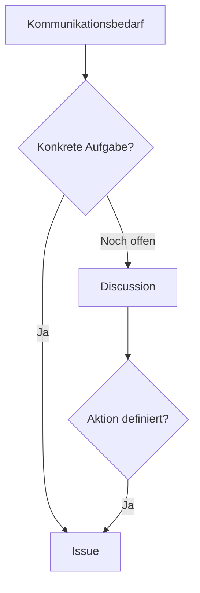

> **Navigation:** [Vorheriges Kapitel: 13](13-github-projekte.md) | [Roadmap](../../ROADMAP.md) | Nächstes Kapitel 15: Demnächst

## Lernziele

- Issues und Discussions unterscheiden;
- einen klaren Fehlerbericht schreiben;
- Labels, Assignees und Milestones verwenden;
- entscheiden, wann aus einer Diskussion ein Issue wird;
- Kommunikation mit einem Project und Pull Request verbinden.

## Einführung

Ein Issue verfolgt eine konkrete Aufgabe, einen Fehler oder eine Verbesserung. Eine Discussion eignet sich für offene Fragen, Ideen, Ankündigungen und gemeinsames Wissen. Die Wahl hängt vom gewünschten Ergebnis ab.

## Visuelles Lernen



## Theorie

Ein gutes Issue enthält einen präzisen Titel, Kontext, Schritte zur Reproduktion, erwartetes und tatsächliches Verhalten sowie Akzeptanzkriterien. Labels klassifizieren Arbeit, Assignees zeigen Verantwortung und Milestones bündeln Ziele.

Vor dem Erstellen sollte nach Duplikaten gesucht werden. Sicherheitsrelevante Informationen gehören nicht in öffentliche Issues.

## Praktische Beispiele

```text
Titel: Login-Schaltfläche bleibt nach gültiger Eingabe deaktiviert

Erwartet: Die Schaltfläche wird aktiv.
Tatsächlich: Sie bleibt deaktiviert.
Schritte: Seite öffnen, Zugangsdaten eingeben, Schaltfläche prüfen.
```

Eine offene Frage zur nächsten Architekturentscheidung passt zunächst besser in eine Discussion.

## Best Practices

- Ein Issue auf ein Ergebnis begrenzen.
- Reproduktionsschritte konkret schreiben.
- Status und Verantwortliche aktualisieren.
- Diskussionen bei klarer Aufgabe in Issues überführen.

## Zusammenfassung

Issues verfolgen Arbeit; Discussions fördern offene Kommunikation. Klare Texte und sinnvolle Metadaten machen beide Werkzeuge wirksam.

## Nächstes Kapitel

Kapitel 15 erklärt Tags, Release Notes und veröffentlichte Versionen.

### Verwandte Inhalte

- Übung: [Issues und Discussions klassifizieren](../../exercises/de/14-issues-und-diskussionen-klassifizieren.md)
- Labor: [GitHub Issues erstellen und organisieren](../../labs/de/14-github-issues-erstellen-und-organisieren.md)
- Quiz: [Issues und Discussions Quiz](../../quizzes/de/14-issues-und-diskussionen-quiz.md)
