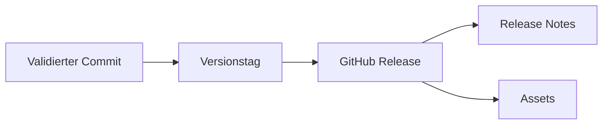

> **Navigation:** [Vorheriges Kapitel: 14](14-issues-und-diskussionen.md) | [Roadmap](../../ROADMAP.md) | Nächstes Kapitel 16: Demnächst

## Lernziele

- Commits, Tags und Releases verbinden;
- eine Version mit einem Annotated Tag markieren;
- verständliche Release Notes schreiben;
- Draft, Prerelease und stabile Version unterscheiden;
- Assets und Checksums einordnen.

## Einführung

Ein Tag bezeichnet einen genauen Commit. Ein GitHub Release ergänzt diesen Tag um Informationen für Menschen und optionale Download-Dateien. Nutzer erhalten dadurch eine klare Antwort auf die Fragen: Welche Version ist stabil und was hat sich geändert?

## Visuelles Lernen



## Theorie

```bash
git switch main
git pull origin main
git tag -a v1.2.0 -m "Release version 1.2.0"
git push origin v1.2.0
```

Semantic Versioning verwendet `MAJOR.MINOR.PATCH`: inkompatible Änderungen erhöhen MAJOR, neue kompatible Funktionen MINOR, rückwärtskompatible Fehlerkorrekturen PATCH.

Release Notes sollten Highlights, Fehlerkorrekturen, Breaking Changes, Migration und bekannte Einschränkungen enthalten. Ein Draft wird vorbereitet, ein Prerelease dient zum Testen, eine stabile Version ist für den normalen Gebrauch bestimmt.

## Praktische Beispiele

```powershell
Get-FileHash .\project-v1.2.0.zip -Algorithm SHA256
```

Eine veröffentlichte Checksum hilft, einen Download auf unbeabsichtigte Änderungen zu prüfen.

## Best Practices

- Nur geprüfte Commits veröffentlichen.
- Annotated Tags verwenden.
- Breaking Changes deutlich beschreiben.
- Assets und Checksums vor der Veröffentlichung prüfen.

## Zusammenfassung

Ein Release verbindet einen stabilen Git-Zustand mit verständlicher Kommunikation und Distribution. Versionierung, Notes und Assets müssen zusammenpassen.

## Nächstes Kapitel

Kapitel 16 behandelt GitHub Security und sichere Repository-Praktiken.

### Verwandte Inhalte

- Übung: [Ein GitHub Release vorbereiten](../../exercises/de/15-github-release-vorbereiten.md)
- Labor: [Ein GitHub Release taggen und veröffentlichen](../../labs/de/15-github-release-taggen-und-veroeffentlichen.md)
- Quiz: [GitHub Releases Quiz](../../quizzes/de/15-github-releases-quiz.md)
