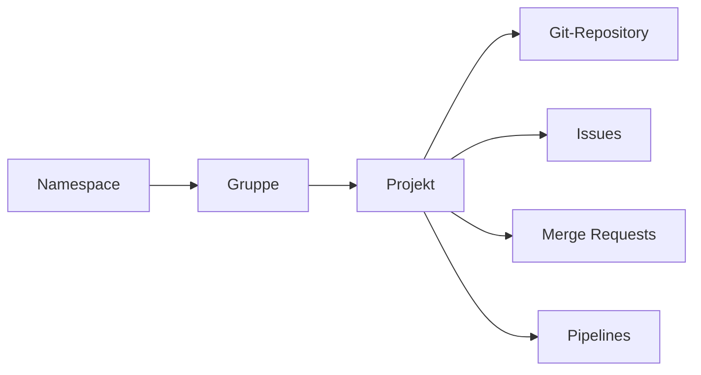

> **Navigation:** [Vorheriges Kapitel: 16](16-github-sicherheit.md) | [Roadmap](../../ROADMAP.md) | Nächstes Kapitel 18: Demnächst
>
> **Niveau:** Einsteiger | **Geschätzte Zeit:** 75 Min. | **Voraussetzungen:** [Kapitel 16: GitHub-Sicherheit](16-github-sicherheit.md)

## Lernziele

- GitLab als Plattform für Quellcode, Zusammenarbeit und Automatisierung erklären;
- Namespace, Gruppe, Projekt und Repository unterscheiden;
- Sichtbarkeit, Mitglieder und Rollen als Zugriffsmodell einordnen;
- den Zweck von Issues, Merge Requests und Pipelines in einem GitLab-Workflow beschreiben.

## Einführung

GitLab ist eine DevOps-Plattform rund um Git-Repositories. Teams können darin Arbeit planen, Änderungen diskutieren, Code prüfen und wiederholbare Prüfungen automatisieren. Git bleibt dabei das Versionskontrollsystem; GitLab ergänzt die gemeinsame Arbeitsumgebung.

## Visuelles Lernen



_Abbildung 1. Ein GitLab-Projekt verbindet ein Repository mit Zusammenarbeit und Automatisierung._

## Warum das wichtig ist

GitLab bringt Fragen zu Arbeit, Zugriff, Code-Review und automatischen Tests an einen gemeinsamen Ort. Dadurch kann ein Team nachvollziehen, warum eine Änderung nötig ist, wer sie geprüft hat und ob die vereinbarten Prüfungen erfolgreich waren.

## Wichtige Begriffe

| Begriff       | Bedeutung                                                                             |
| ------------- | ------------------------------------------------------------------------------------- |
| Namespace     | Der Pfad, der Benutzer, Gruppen und Projekte in GitLab organisiert.                   |
| Gruppe        | Ein Container für zusammengehörige Projekte und deren Mitglieder.                     |
| Projekt       | Ein Arbeitsbereich mit Repository und Funktionen für Zusammenarbeit und Auslieferung. |
| Repository    | Die Git-Historie mit Dateien, Branches und Tags eines Projekts.                       |
| Rolle         | Eine Berechtigungsstufe für ein Mitglied.                                             |
| Issue         | Ein nachverfolgbarer Arbeitsauftrag, Fehler oder Verbesserungswunsch.                 |
| Merge Request | Ein Vorschlag, Änderungen eines Branches in einen Ziel-Branch zu übernehmen.          |
| Pipeline      | Eine Folge automatisierter Jobs, etwa zum Testen oder Bauen.                          |

## Theorie

### Namespace, Gruppen und Projekte

Der Pfad `acme/plattform/shop` beschreibt das Projekt `shop` in der Gruppe `plattform` innerhalb des Namespace `acme`. Gruppen bündeln verwandte Projekte und können Mitgliedschaften gemeinsam verwalten. Untergruppen helfen großen Teams, ihre fachliche Struktur abzubilden.

### Sichtbarkeit und Rollen

Sichtbarkeit bestimmt, wer ein Projekt finden oder lesen kann. Rollen bestimmen, welche Aktionen ein berechtigtes Mitglied ausführen darf. GitLab kennt unter anderem Guest, Reporter, Developer, Maintainer und Owner. Welche Aktion eine Rolle genau erlaubt, hängt von Edition und Konfiguration ab.

Vergib nach dem Prinzip der geringsten Berechtigung nur die Rechte, die für eine Aufgabe nötig sind. Ein Contributor, der Änderungen über Merge Requests einreicht, benötigt nicht automatisch Verwaltungsrechte für Projekt oder Mitglieder.

### Issues, Merge Requests und Pipelines

Ein Issue hält Problem, Kontext und gewünschtes Ergebnis fest. Ein Merge Request zeigt anschließend die konkrete Umsetzung: Diff, Beschreibung, Diskussionen, Freigaben und Status der Pipeline.

Eine Pipeline führt wiederholbare Jobs aus, die meist in `.gitlab-ci.yml` definiert sind. Sie kann Tests, Formatprüfungen oder Builds ausführen. Eine erfolgreiche Pipeline ist wichtige technische Evidenz, ersetzt aber kein sorgfältiges Review.

## Praktische Beispiele

### Beispiel 1: Repository klonen

```bash
git clone https://gitlab.com/acme/plattform/shop.git
cd shop
git remote -v
```

Der Befehl erzeugt eine lokale Arbeitskopie. `git remote -v` zeigt, wohin `origin` beim Pushen und Abrufen verweist.

### Beispiel 2: Änderung für ein Review vorbereiten

```bash
git switch -c docs/setup-anleitung
git add README.md
git commit -m "docs: Setup-Anleitung präzisieren"
git push -u origin docs/setup-anleitung
```

Danach öffnest du einen Merge Request zum richtigen Ziel-Branch. Beschreibe darin Kontext, Änderung und Prüfung.

### Beispiel 3: Fehlgeschlagene Pipeline behandeln

Wenn ein Pipeline-Job fehlschlägt, lies zuerst dessen Ausgabe. Korrigiere die Ursache auf demselben Source-Branch, teste die Änderung und pushe einen neuen Commit. Der Merge Request und die Pipeline aktualisieren sich.

## Selbst ausprobieren

1. Öffne ein GitLab-Projekt, das du ansehen darfst.
2. Notiere Projektpfad, Standard-Branch und sichtbare Bereiche für Issues, Merge Requests und CI/CD.
3. Erkläre, welche Information jede dieser Funktionen zum Teamworkflow beiträgt.

## Best Practices

- Nutze Gruppen für dauerhafte Teammitgliedschaften und verwandte Projekte.
- Halte Issues und Merge Requests klein, eindeutig und beschreibend.
- Prüfe Pipeline-Ergebnisse, bevor du einen Merge freigibst.
- Überprüfe Rollen regelmäßig und vermeide unnötige Maintainer-Rechte.

## Häufige Fehler

| Fehler                                 | Folge                                                         | Vermeidung                                                                |
| -------------------------------------- | ------------------------------------------------------------- | ------------------------------------------------------------------------- |
| Gruppe und Projekt gleichsetzen        | Zugriff und Verantwortlichkeit werden unübersichtlich.        | Verwende Gruppen für Organisation, Projekte für konkrete Arbeitsbereiche. |
| Jedem Mitglied Maintainer-Rechte geben | Einstellungen und geschützte Branches sind unnötig gefährdet. | Vergib die niedrigste passende Rolle.                                     |
| Fehlgeschlagene Pipeline ignorieren    | Fehler oder Regelverstöße können in den Ziel-Branch gelangen. | Lies den Job-Log, behebe die Ursache und prüfe erneut.                    |

## Zusammenfassung

- GitLab verbindet Git-Hosting mit Planung, Review, Zugriffsverwaltung und Automatisierung.
- Namespace, Gruppen und Projekte schaffen eine nachvollziehbare Struktur.
- Issues erklären Arbeit, Merge Requests prüfen Änderungen und Pipelines liefern wiederholbare technische Rückmeldung.

## Nächstes Kapitel

Kapitel 18 vertieft Gruppen, Projekte, Mitglieder und Berechtigungen.

### Verwandte Inhalte

- Vorheriges Kapitel: [GitHub-Sicherheit](16-github-sicherheit.md)
- Übung: [GitLab-Projektgrundlagen erkunden](../../exercises/de/17-gitlab-projektgrundlagen-erkunden.md)
- Labor: [GitLab-Änderung erstellen und prüfen](../../labs/de/17-gitlab-aenderung-erstellen-und-pruefen.md)
- Quiz: [GitLab-Grundlagen-Quiz](../../quizzes/de/17-gitlab-grundlagen-quiz.md)
