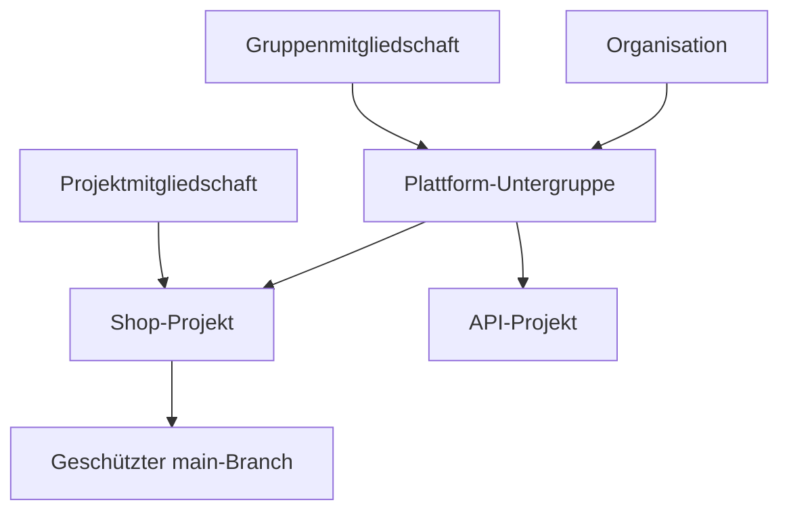

> **Navigation:** [Vorheriges Kapitel: 17](17-gitlab-grundlagen.md) | [Übung](../../exercises/de/18-gitlab-projektzugriff-planen.md) | [Labor](../../labs/de/18-gitlab-projektzugriff-konfigurieren.md) | [Quiz](../../quizzes/de/18-gitlab-gruppen-projekte-mitglieder-und-berechtigungen-quiz.md) | [Roadmap](../../ROADMAP.md)

## Lernziele

- zusammengehörige Arbeit mit Gruppen, Untergruppen und Projekten organisieren;
- Sichtbarkeit, Mitgliedschaft und rollenbasierte Berechtigungen unterscheiden;
- geringste Berechtigung, Zugriffsprüfung und geschützte Branches anwenden.

## Einführung

Ein durchdachtes Zugriffsmodell beginnt mit einer klaren Struktur. Gruppen bündeln verwandte Projekte, Untergruppen bilden Verantwortungsbereiche ab und Projekte enthalten Repository und Zusammenarbeit. So erhält jede Person nur den Zugriff, den sie wirklich benötigt.

## Visuelles Lernen



_Abbildung 1. Gruppenmitgliedschaften können Zugriff vererben; Branch-Schutz ist eine zusätzliche Kontrolle._

## Wichtige Begriffe

| Begriff                | Bedeutung                                                          |
| ---------------------- | ------------------------------------------------------------------ |
| Gruppe                 | Container für verwandte Projekte und gemeinsame Mitgliedschaften.  |
| Untergruppe            | Gruppe innerhalb einer anderen Gruppe für eine genauere Struktur.  |
| Sichtbarkeit           | Wer eine Gruppe oder ein Projekt finden oder lesen kann.           |
| Mitgliedschaft         | Zugewiesener Zugriff eines Benutzers auf Gruppe oder Projekt.      |
| Rolle                  | Erlaubte Aktionen eines Mitglieds, etwa Developer oder Maintainer. |
| Geringste Berechtigung | Nur die für eine Aufgabe nötigen Rechte vergeben.                  |
| Geschützter Branch     | Branch mit Regeln für Push, Merge oder Freigaben.                  |

## Theorie

### Struktur und Sichtbarkeit

Nutze Gruppen für stabile Teams oder Produktbereiche und Untergruppen für kleinere Verantwortungsgrenzen. Projekte stehen für einzelne Repositories oder Lieferobjekte. Die Sichtbarkeit public, internal oder private steuert Auffindbarkeit und Lesbarkeit; die genaue Bedeutung hängt von der GitLab-Instanz ab.

### Mitgliedschaften und Rollen

Gruppenmitgliedschaften eignen sich für Personen mit ähnlichem Zugriff auf mehrere Projekte. Projektmitgliedschaften sind präziser für Ausnahmen. Rollen wie Guest, Reporter, Developer, Maintainer und Owner erlauben unterschiedliche Aktionen. Prüfe die aktuelle Instanzkonfiguration, bevor du eine Rolle vergibst.

### Geringste Berechtigung und Zugriffsprüfung

Beginne mit der niedrigsten Rolle für die dokumentierte Aufgabe. Entferne temporären Zugriff nach Abschluss und prüfe regelmäßig direkte Projektmitglieder, geerbte Gruppenmitglieder, Servicekonten und externe Benutzer. Frage bei jeder Prüfung: Ist der Zweck noch gültig und passt die Rolle noch?

### Geschützte Branches

Schütze den Standard-Branch, damit normale Änderungen über überprüfbare Merge Requests einfließen. Lege fest, wer pushen, mergen oder freigeben darf. Der Branch-Schutz ergänzt Rollen: Ein Developer kann beitragen, ohne Kontrollen auf `main` zu umgehen.

## Praktische Beispiele

### Beispiel 1: Hierarchie planen

```text
acme
└── plattform
    ├── shop
    └── zahlungen
```

Die Untergruppe `plattform` kann Teamzugriff bündeln. Jedes Projekt kann dennoch eigene Sichtbarkeit und Branch-Regeln besitzen.

### Beispiel 2: Zugriff nach Aufgabe vergeben

| Person                     | Bedarf                   | Passende Entscheidung                    |
| -------------------------- | ------------------------ | ---------------------------------------- |
| Dokumentations-Contributor | Branch und Merge Request | Niedrigste passende Rolle                |
| Release-Verantwortliche    | Merge-Regeln verwalten   | Maintainer nur im verantworteten Bereich |
| Ehemaliger Dienstleister   | Keine aktuelle Aufgabe   | Mitgliedschaft entfernen                 |

## Selbst ausprobieren

1. Wähle eine Gruppe mit mindestens zwei verwandten Projekten.
2. Notiere direkte und geerbte Mitglieder eines Projekts.
3. Erkläre, wer auf den Standard-Branch pushen oder mergen darf.

## Best Practices

- Bilde dauerhafte Verantwortung zuerst mit Gruppen und Untergruppen ab.
- Vergib die niedrigste Rolle für eine dokumentierte Aufgabe.
- Prüfe Zugriff regelmäßig sowie bei Team- oder Anbieterwechseln.
- Schütze wichtige Branches und nutze Merge Requests.

## Häufige Fehler

| Fehler                              | Folge                                                         | Vermeidung                                                  |
| ----------------------------------- | ------------------------------------------------------------- | ----------------------------------------------------------- |
| Allen Contributors Maintainer geben | Einstellungen und wichtige Branches sind unnötig gefährdet.   | Niedrigere Rolle wählen, sofern keine Verwaltung nötig ist. |
| Geerbte Mitgliedschaft übersehen    | Zugriff kann über eine übergeordnete Gruppe bestehen bleiben. | Gruppen- und Projektmitgliedschaften gemeinsam prüfen.      |
| Direkte Pushes auf `main` erlauben  | Review und Prüfungen können umgangen werden.                  | Branch schützen und Merge Requests nutzen.                  |

## Zusammenfassung

- Gruppen und Untergruppen bilden Verantwortung ab und erleichtern gemeinsamen Zugriff.
- Sichtbarkeit, Mitgliedschaft, Rollen und Branch-Schutz sind getrennte Kontrollen.
- Geringste Berechtigung und regelmäßige Prüfungen halten Zugriff angemessen.

### Verwandte Inhalte

- Vorheriges Kapitel: [GitLab-Grundlagen](17-gitlab-grundlagen.md)
- Übung: [GitLab-Projektzugriff planen](../../exercises/de/18-gitlab-projektzugriff-planen.md)
- Labor: [GitLab-Projektzugriff konfigurieren](../../labs/de/18-gitlab-projektzugriff-konfigurieren.md)
- Quiz: [GitLab-Gruppen, Projekte, Mitglieder und Berechtigungen Quiz](../../quizzes/de/18-gitlab-gruppen-projekte-mitglieder-und-berechtigungen-quiz.md)
- [Roadmap](../../ROADMAP.md)
