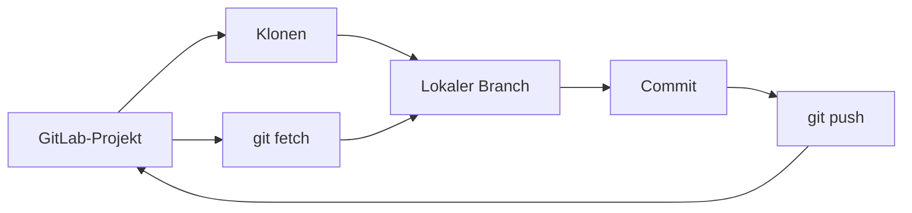

> **Navigation:** [Übung](../../exercises/de/19-gitlab-remote-untersuchen.md) | [Labor](../../labs/de/19-gitlab-projekt-klonen-beitragen-und-synchronisieren.md) | [Quiz](../../quizzes/de/19-gitlab-repositoryzugriff-klonen-und-remote-workflows-quiz.md) | [Roadmap](../../ROADMAP.md)

## GitLab-Repositoryzugriff, Klonen und Remote-Workflows

> **Niveau:** Einsteiger | **Geschätzte Zeit:** 60 Min. | **Vorheriges Thema:** Kapitel 18, Gruppen, Projekte, Mitglieder und Berechtigungen

## Lernziele

- einen Repository-URL erst nach Prüfung des erlaubten Projektzugriffs auswählen;
- HTTPS und SSH als Git-Transporte ohne Zugangsdaten-Anleitung erklären;
- ein Projekt klonen, `origin` prüfen und `fetch`, `pull` und `push` unterscheiden;
- Standard-Branches und optionale Fork-Workflows einordnen.

## Einführung

GitLab speichert die gemeinsame Kopie eines Repositorys, Git arbeitet mit einer lokalen Kopie. Ein sicherer Ablauf beginnt mit Projektpfad, Sichtbarkeit und Rolle. Den freigegebenen Klon-URL kopierst du aus dem Bereich **Code**; die von deiner Organisation genehmigte Zugriffsmethode übernimmt die Anmeldung.

## Wichtige Begriffe

| Begriff         | Bedeutung                                                    |
| --------------- | ------------------------------------------------------------ |
| Klonen          | Lokale Kopie eines Remote-Repositorys mit Historie.          |
| Remote          | Benannte Verbindung zwischen lokalem und anderem Repository. |
| `origin`        | Üblicher Name für das beim Klonen angelegte Remote.          |
| Standard-Branch | Zentraler Integrations-Branch eines Projekts.                |
| Fork            | Separate Serverkopie für manche Beitragsmodelle.             |

## Theorie

### HTTPS und SSH

HTTPS und SSH sind Transportprotokolle, über die Git GitLab kontaktieren kann. Die **Code**-Seite eines Projekts kann beide URL-Typen anbieten. Wähle nur die von deiner Organisation erlaubte Variante. Passwörter, Tokens, private Schlüssel oder andere Geheimnisse gehören nie in Befehle, Commits oder Dokumentation. Bei einem Zugriffsfehler nutze den vorgesehenen Supportweg.

### Klonen, Remotes und Synchronisieren

```bash
git clone https://gitlab.example.com/team/demo-app.git
cd demo-app
git remote -v
git branch --show-current
```

Beim Klonen entsteht meist `origin`. `git fetch origin` lädt Remote-Informationen, ohne Arbeitsdateien zu ändern. `git pull --ff-only` ruft Änderungen ab und integriert nur einen sicheren Fast-Forward. `git push origin feature/readme-hinweis` veröffentlicht den genannten Branch, wenn du dazu berechtigt bist.



### Standard-Branch und Forks

Setze nicht voraus, dass der Standard-Branch `main` heißt. Prüfe ihn in GitLab, bevor du ein Ziel wählst. Geschützte Standard-Branches verlangen häufig einen Merge Request statt eines direkten Pushs.

Wenn Forks aktiviert sind, kann ein Beitragender den eigenen Fork klonen, das Original als `upstream` hinzufügen, `upstream` abrufen und den Feature-Branch zum eigenen Fork pushen. Der Merge Request geht dann an das Originalprojekt. Regeln und Verfügbarkeit sind projektspezifisch.

## Praktische Beispiele

### Beispiel 1: Remote vor einer Änderung prüfen

```bash
git remote -v
git fetch origin
git branch -r
```

Prüfe zuerst, ob `origin` zum erwarteten Projekt gehört. Fetch ist eine risikoarme Möglichkeit, Remote-Änderungen vor einer Integration zu sehen.

### Beispiel 2: Feature-Branch aktualisieren und veröffentlichen

```bash
git switch feature/readme-hinweis
git pull --ff-only
git push origin feature/readme-hinweis
```

Führe `pull --ff-only` nur für den Branch aus, den du aktualisieren möchtest. Schlägt der Fast-Forward fehl, halte an und prüfe die Historie statt eine Integration zu erzwingen.

## Best Practices

- Prüfe Projektpfad und Remote-URL vor Clone, Fetch oder Push.
- Hole Änderungen zuerst ab und nutze `--ff-only`, wenn kein Merge beabsichtigt ist.
- Behandle den Standard-Branch als geschützt, sofern Projektregeln nichts anderes sagen.
- Benenne Fork-Remotes eindeutig: `origin` für den Fork, `upstream` für das Original.
- Nutze nur freigegebene Zugriffsmethoden und melde Zugriffsprobleme über den vorgesehenen Weg.

## Häufige Fehler

| Fehler                             | Folge                                        | Vermeidung                              |
| ---------------------------------- | -------------------------------------------- | --------------------------------------- |
| Vor dem Push `origin` nicht prüfen | Ein Branch kann im falschen Projekt landen.  | Zuerst `git remote -v` ausführen.       |
| `fetch` und `pull` gleichsetzen    | `pull` kann den aktuellen Branch ändern.     | Erst abrufen, dann bewusst integrieren. |
| Forks überall voraussetzen         | Forks können deaktiviert oder geregelt sein. | Beitragsregeln des Projekts lesen.      |

## Zusammenfassung

- Zugriff beginnt mit Berechtigung und einem freigegebenen Klon-URL.
- HTTPS und SSH sind Transportoptionen, keine Orte für Geheimnisse.
- `fetch` prüft, `pull` integriert und `push` veröffentlicht einen Branch.
- Standard-Branches und Forks folgen den Einstellungen des jeweiligen Projekts.

## Nächster Schritt

Bearbeite die [Übung](../../exercises/de/19-gitlab-remote-untersuchen.md) und anschließend das [Labor](../../labs/de/19-gitlab-projekt-klonen-beitragen-und-synchronisieren.md).
