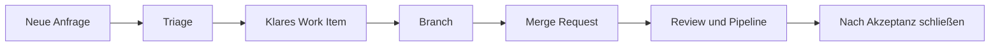

> **Navigation:** [Roadmap](../../ROADMAP.md)

## Lernziele

- Work Items oder Issues mit Titel, Beschreibung und Akzeptanzkriterien formulieren;
- Labels, Assignees, Milestones und verfügbare Planungsansichten einsetzen;
- eingehende Arbeit triagieren und priorisieren;
- Arbeit nachvollziehbar mit Branch und Merge Request verbinden.

## Einführung

GitLab Work Items und Issues machen aus einer Anfrage sichtbare, nachverfolgbare Arbeit. Bezeichnungen und Planungsansichten können je nach Edition und Konfiguration variieren. Das Prinzip bleibt gleich: Ergebnis beschreiben, priorisieren, Verantwortung klären und die Auslieferung verknüpfen.

## Wichtige Begriffe

| Begriff                 | Bedeutung                                                            |
| ----------------------- | -------------------------------------------------------------------- |
| Work Item / Issue       | Ein Eintrag für Aufgabe, Fehler, Anfrage oder Verbesserung.          |
| Akzeptanzkriterien      | Beobachtbare Bedingungen, die Fertigstellung zeigen.                 |
| Label                   | Wiederverwendbare Einordnung, etwa `bug` oder `priority::high`.      |
| Assignee                | Die Person mit der aktuellen Verantwortung für den Eintrag.          |
| Milestone               | Eine Sammlung verwandter Arbeit für einen Zeitraum oder ein Ziel.    |
| Board / Planungsansicht | Eine Ansicht, die Arbeit zum Beispiel nach Status oder Label ordnet. |

## Theorie

### Mit einem Ergebnis beginnen

Ein guter Titel benennt das Ergebnis. `Login verbessern` ist unklar; `Neutrale Meldung bei ungültigen Zugangsdaten anzeigen` ist prüfbar. Die Beschreibung liefert Kontext, Ziel, Nicht-Ziele und Links. Akzeptanzkriterien beschreiben, woran das Team die Fertigstellung erkennt.

### Triage schafft eine verlässliche Warteschlange

Bei der Triage prüft das Team neue Einträge: Ist die Anfrage verständlich? Gibt es Duplikate? Welche Labels, Priorität und welchen nächsten Schritt braucht sie? Priorität richtet sich nach Wirkung, Dringlichkeit, Risiko und Aufwand, nicht nach der Lautstärke einer Anfrage.

### Planung mit verfügbaren Funktionen

Labels und Milestones sind breit nutzbar. Boards oder andere Planungsansichten können Arbeit nach Status, Priorität oder Iteration sichtbar machen, wenn sie im Projekt unterstützt werden. Pflege nur Felder, die das Team wirklich aktuell hält.

### Arbeit mit der Auslieferung verbinden

Lege einen fokussierten Branch wie `123-login-meldung` an und verweise im Merge Request auf das Work Item. GitLab kann unterstützte Schließreferenzen erkennen; prüfe jedoch die Regeln des Projekts und den Ziel-Branch, bevor du dich auf automatisches Schließen verlässt.



## Praktisches Beispiel

```text
Titel: Neutrale Meldung bei ungültigen Zugangsdaten anzeigen
Labels: type::bug, area::authentication, priority::high
Milestone: Zuverlässigkeit September
Akzeptanzkriterien:
- Ungültige Daten zeigen eine verständliche neutrale Meldung.
- Die Meldung verrät nicht, ob ein Konto existiert.
- Automatisierte Tests prüfen den Fehlerpfad.
```

## Best Practices

- Formuliere Kriterien als beobachtbare Ergebnisse.
- Nutze einen kleinen, gemeinsamen Label-Wortschatz.
- Ordne eine verantwortliche Person zu und halte Mitarbeit offen.
- Bewerte Prioritäten neu, wenn sich Wirkung oder Fristen ändern.
- Verknüpfe Work Item, Branch und Merge Request.

## Häufige Fehler

| Fehler                                  | Folge                               | Vermeidung                         |
| --------------------------------------- | ----------------------------------- | ---------------------------------- |
| Titel lautet nur "Fehler beheben"       | Das Backlog ist nicht überblickbar. | Benenne das erwartete Ergebnis.    |
| Kriterium lautet "funktioniert richtig" | Fertigstellung bleibt subjektiv.    | Beschreibe Verhalten und Nachweis. |
| Jedes Item ist dringend                 | Eine sinnvolle Reihenfolge fehlt.   | Vergleiche Wirkung und Zeitdruck.  |

## Zusammenfassung

- Work Items und Issues geben Arbeit einen gemeinsamen Kontext.
- Titel, Beschreibung und Kriterien definieren das Ergebnis.
- Labels, Assignees, Milestones und Ansichten strukturieren die Planung.
- Branches und Merge Requests liefern die Verbindung zur Umsetzung.

## Übung

Triagiere drei Anfragen in der [zugehörigen Übung](../../exercises/de/20-gitlab-work-items-triagieren.md).

## Labor

Plane eine kleine Auslieferung im [zugehörigen Labor](../../labs/de/20-kleine-gitlab-auslieferung-planen.md).

## Quiz

Prüfe dein Wissen mit dem [Quiz zu Kapitel 20](../../quizzes/de/20-gitlab-work-items-issues-und-planung-quiz.md).
