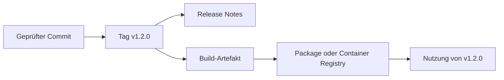

> **Navigation:** [Übung](../../exercises/de/22-versioniertes-release-planen.md) | [Labor](../../labs/de/22-versioniertes-package-veroeffentlichen-und-nutzen.md) | [Quiz](../../quizzes/de/22-releases-packages-und-container-registry-quiz.md) | [Roadmap](../../ROADMAP.md)

## Lernziele

- erklären, warum ein Release einen stabilen Auslieferungspunkt schafft;
- Grundlagen der semantischen Versionierung anwenden und Tags von Releases unterscheiden;
- Package- und Container-Registries, Besitz, Zugriffe und unveränderliche Versionen beschreiben;
- einen sicheren Veröffentlichungs- und Nutzungsablauf ohne Zugangsdaten planen.

## Einführung

Ein Release bezeichnet eine Version, die Nutzende zuverlässig einsetzen können. Registries speichern die Packages oder Container-Images dieser Version. Gemeinsam machen sie Auslieferungen nachvollziehbar, wiederholbar und leichter rückrollbar.

## Zentrale Begriffe

| Begriff                 | Bedeutung                                                                              |
| ----------------------- | -------------------------------------------------------------------------------------- |
| Semantische Version     | `MAJOR.MINOR.PATCH`: inkompatible Änderung, kompatibles Feature, kompatible Korrektur. |
| Tag                     | Git-Referenz auf einen Commit, zum Beispiel `v1.2.0`.                                  |
| Release                 | Veröffentlichter Auslieferungsnachweis mit Version und Release Notes.                  |
| Registry                | Dienst zum Speichern versionierter Packages oder Container-Images.                     |
| Unveränderliche Version | Veröffentlichte Version, deren Inhalt nicht ersetzt wird.                              |

## Theorie

### Tags und Releases

Ein Tag zeigt auf Quellcode. Ein Release erklärt, was für Nutzende bereitsteht: Version, Release Notes, Artefakte und bekannte Grenzen. Erstelle ein Release aus einem geprüften Tag, damit Quelle und Auslieferung verbunden bleiben.

### Semantische Versionen

Bei `2.4.1` steht `2` für eine inkompatible öffentliche Änderung, `4` für ein kompatibles Feature und `1` für eine kompatible Korrektur. Die Nummer beschreibt die erwartete Kompatibilität, nicht den Aufwand.

### Registries und unveränderliche Artefakte

Eine Package Registry speichert Bibliotheken, eine Container Registry Images wie `registry.example/team/api:1.2.0`. Veröffentliche erst nach der Prüfung. Nutzende sollten eine feste Version statt eines beweglichen Labels wie `latest` beziehen.

### Besitz und Zugriff

Projekt oder Gruppe besitzen den Registry-Namensraum. Gib Veröffentlichungsrechte nur an notwendige Personen oder Automatisierung und Leserechte nur an Verbrauchende. Nutze geschützte CI-Variablen, Tokens oder Workload Identity; Zugangsdaten gehören nie in Quellcode, Release Notes oder Image-Layer.

## Grundablauf

1. Umfang abstimmen und `v1.2.0` nach Kompatibilität wählen.
2. Commit testen, passenden Tag erstellen und nutzerorientierte Release Notes schreiben.
3. `1.2.0` über berechtigte Automatisierung veröffentlichen.
4. Genau `1.2.0` beziehen, Quelle oder Digest prüfen und Abhängigkeit dokumentieren.

## Best Practices

- Tag, Release Notes und Registry-Artefakt als zusammengehörige Auslieferung behandeln.
- Veröffentlichte Versionen nie ersetzen; für Korrekturen eine neue Patch-Version erzeugen.
- Notes zu Wirkung, Upgrade, Korrekturen und bekannten Grenzen schreiben.
- Packages per Version und Images per Version oder Digest fixieren.
- Besitz sowie Lese- und Schreibrechte regelmäßig prüfen.

## Häufige Fehler

| Fehler                                                  | Besserer Weg                                                      |
| ------------------------------------------------------- | ----------------------------------------------------------------- |
| `1.2.0` mit geändertem Inhalt erneut veröffentlichen    | Neue Version wie `1.2.1` veröffentlichen.                         |
| Tag mit vollständiger Release-Kommunikation verwechseln | Verständliche Release Notes ergänzen.                             |
| `latest` produktiv nutzen                               | Geprüfte feste Version oder Digest angeben.                       |
| Zugangsdaten dokumentieren                              | Autorisierten CI-Zugriff außerhalb des Repositorys konfigurieren. |

## Zusammenfassung

- Releases kommunizieren nutzbare Versionen, Tags markieren Quell-Commits.
- Semantische Versionen zeigen Kompatibilitätserwartungen.
- Registries verteilen Packages und Images mit kontrolliertem Zugriff.
- Unveränderliche Versionen und minimale Rechte machen die Nutzung wiederholbar.

## Praxis

Weiter mit [Übung](../../exercises/de/22-versioniertes-release-planen.md), [Labor](../../labs/de/22-versioniertes-package-veroeffentlichen-und-nutzen.md) und [Quiz](../../quizzes/de/22-releases-packages-und-container-registry-quiz.md).
