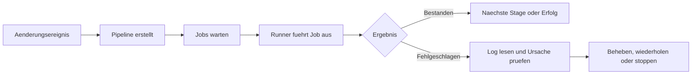

> **Level:** Beginner | **Estimated Time:** 60 min

## Lernziele

- Pipelines, Jobs, Stages, Runner und Pipeline-Status erklaeren;
- typische Ausloeser und die daraus entstehende Feedback-Schleife erkennen;
- fehlgeschlagene Jobs untersuchen und sichere Wiederholungen entscheiden.

## Einleitung

GitLab CI/CD liefert einem Team schnell Belege zu einer Aenderung. Eine Pipeline fuehrt nach einem Ereignis wie Push oder Merge Request definierte Pruefungen aus. Dieses Kapitel erklaert das Betriebsmodell; die Konfiguration in `.gitlab-ci.yml` folgt erst in spaeteren Kapiteln.

## Zentrale Begriffe

| Begriff           | Bedeutung                                                              |
| ----------------- | ---------------------------------------------------------------------- |
| Pipeline          | Der gesamte automatisierte Lauf fuer eine Aenderung oder ein Ereignis. |
| Job               | Eine fokussierte Arbeitseinheit, etwa ein Test oder Qualitaetscheck.   |
| Stage             | Eine geordnete Gruppe von Jobs.                                        |
| Runner            | Der Worker, der einen Job in einer verfuegbaren Umgebung ausfuehrt.    |
| Feedback-Schleife | Der Weg von Aenderung ueber Ergebnis zur naechsten Entscheidung.       |

## Theorie

### Vom Ausloeser zum Ergebnis

Ein Push, Merge Request, Zeitplan oder eine manuelle Aktion kann eine Pipeline ausloesen. Jobs laufen auf Runnern und melden etwa `pending`, `running`, `passed`, `failed`, `canceled`, `skipped` oder `manual`. Ein fehlgeschlagener Job laesst die Pipeline fehlschlagen, sofern das Projekt ihn nicht bewusst anders behandelt.



### Stages ordnen Risiken

Teams platzieren schnelle Checks oft vor langsameren oder riskanteren Checks. Eine Test-Stage soll Feedback geben, bevor eine Auslieferungs-Stage fortfaehrt. Eine Stage ist eine Koordinationsgrenze, keine Zusage gleicher Laufzeiten.

### Vor dem Wiederholen diagnostizieren

Oeffne den fehlgeschlagenen Job. Lies den ersten aussagekraeftigen Fehler, den fehlgeschlagenen Befehl und den Kontext. Wiederhole nur bei Belegen fuer eine temporaere Ursache, etwa Runner-Unterbrechung oder Netzwerkfehler. Korrigiere reproduzierbare Test-, Build- oder Policy-Fehler statt sie zu verdecken.

## Praktisches Beispiel

```text
Push feature/login-message
  -> Pipeline startet
  -> Lint-Job besteht
  -> Test-Job scheitert: neutrale Meldung erwartet
  -> Entwickler korrigiert Verhalten und pusht einen Commit
  -> neue Pipeline liefert aktuelle Belege
```

Die neue Pipeline ist wertvoller als wiederholtes Retry, weil der Fehler reproduzierbar auf einen Produktfehler zeigt.

## Best Practices

- Interpretiere ein Pipeline-Ergebnis immer fuer Commit und Zielkontext.
- Lies Job-Logs vor einer Retry-Entscheidung.
- Mache Feedback in Merge Requests sichtbar.
- Eskaliere blockierte oder wiederholt fehlschlagende Runner mit Log-Belegen.

## Haeufige Fehler

| Fehler                              | Problem                                     | Vermeidung                                          |
| ----------------------------------- | ------------------------------------------- | --------------------------------------------------- |
| Jeden Fehler dem Runner zuschreiben | Der Befehl kann einen echten Defekt zeigen. | Fehlgeschlagenen Job untersuchen.                   |
| Ohne Grund wiederholen              | Das kostet Zeit und verdeckt Instabilitaet. | Nur bei plausibler temporaerer Ursache wiederholen. |
| `pending` mit `running` verwechseln | Arbeit kann noch nicht begonnen haben.      | Queue und Runner-Verfuegbarkeit pruefen.            |

## Zusammenfassung

- Eine Pipeline ist ein koordinierter Satz aus Jobs.
- Jobs laufen auf Runnern; Stages ordnen den Ablauf.
- Status und Logs erzeugen eine Feedback-Schleife.
- Temporaere Fehler darf man wiederholen, reproduzierbare Fehler behebt man.

## Uebung

Ordne Pipeline-Ergebnisse in der [zugehoerigen Uebung](../../exercises/de/23-gitlab-pipeline-ergebnisse-diagnostizieren.md) ein.

## Labor

Uebe eine sichere Fehlerreaktion im [zugehoerigen Labor](../../labs/de/23-gitlab-pipeline-fehler-untersuchen.md).

## Quiz

Pruefe dein Wissen mit dem [Kapitel-23-Quiz](../../quizzes/de/23-gitlab-cicd-grundlagen-quiz.md).
