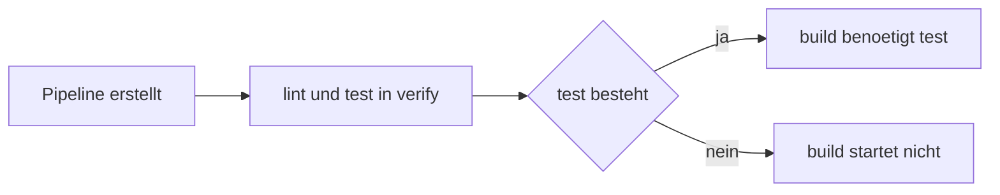

> **Navigation:** [Kapitel 23](23-gitlab-cicd-grundlagen.md) | [Uebung](../../exercises/de/24-eine-gitlab-ci-pipeline-schreiben.md) | [Labor](../../labs/de/24-eine-gitlab-ci-pipeline-pruefen.md) | [Quiz](../../quizzes/de/24-gitlab-ci-yml-pipelines-stages-und-jobs-quiz.md) | [Roadmap](../../ROADMAP.md)

> **Level:** Beginner | **Geschaetzte Zeit:** 90 min | **Voraussetzung:** [GitLab CI/CD Grundlagen](23-gitlab-cicd-grundlagen.md)

## Lernziele

- eine kleine gueltige `.gitlab-ci.yml` schreiben und lesen;
- erklaeren, wie Stages Jobs ordnen und warum Jobs derselben Stage parallel laufen koennen;
- einfache `rules`, `workflow: rules` und `needs` gezielt einsetzen;
- eine Pipeline ohne Geheimnisse oder Deployment-Schritte validieren und untersuchen.

## Einleitung

Die Datei `.gitlab-ci.yml` ist das Pipeline-Rezept von GitLab. Beim Erstellen einer Pipeline liest GitLab sie aus dem betreffenden Commit und erzeugt daraus Jobs. Die Datei liegt im Wurzelverzeichnis des Repositorys, also beispielsweise neben `package.json`. Eine gleich benannte Datei in einem Unterordner ist nicht der uebliche Einstiegspunkt.

## Zentrale Begriffe

| Begriff  | Bedeutung                                                    |
| -------- | ------------------------------------------------------------ |
| YAML     | Textformat, das Maps und Listen durch Einrueckung darstellt. |
| Pipeline | Der gesamte automatisierte Lauf fuer einen Commit.           |
| Stage    | Eine geordnete Gruppe von Jobs.                              |
| Job      | Eine benannte Arbeitseinheit auf einem Runner.               |
| `rules`  | Bedingungen, die ueber die Aufnahme eines Jobs entscheiden.  |
| `needs`  | Explizite Abhaengigkeiten als Job-Graph.                     |

## YAML-Grundlagen

YAML nutzt Einrueckung fuer die Struktur. Eine Map verbindet einen Schluessel mit einem Wert; eine Liste kennzeichnet jedes Element mit `-`. Verwende durchgehend Leerzeichen, bevorzugt zwei. Tabs sind keine gueltige Einrueckung.

```yaml
lint:
  stage: verify
  script:
    - npm run lint
    - npm run format:check
```

`lint` ist ein Map-Schluessel mit einer Job-Map als Wert. `script` ist eine Liste mit zwei Befehlen. Die ausgerichtete Einrueckung zeigt, welche Angaben zum selben Job gehoeren.

### Haeufige YAML-Syntaxfehler

```yaml
lint:
 stage: verify       # Falsch: uneinheitliche Einrueckung.
	script: npm run lint # Falsch: Tabulator verwendet.
  script             # Falsch: Doppelpunkt fehlt.
    - npm run lint
```

Ein YAML-Fehler kann die Erstellung der Pipeline verhindern, bevor ein Job startet. Richte gleichrangige Schluessel aus, setze Doppelpunkte und setze Werte bei mehrdeutigen Sonderzeichen wie `:` in Anfuehrungszeichen. Ein YAML-Validator prueft die Syntax; GitLab CI Lint prueft zusaetzlich GitLab-Schluessel.

## Von der Datei zur Pipeline

Ohne `stages` verwendet GitLab die Standardreihenfolge `.pre`, `build`, `test`, `deploy`, `.post`. Explizite Stages dokumentieren den beabsichtigten Ablauf klarer. Ein Job ohne `stage` verwendet standardmaessig `test`.

```yaml
stages:
  - verify
  - build

lint:
  stage: verify
  script:
    - npm run lint
```

Die Konfiguration definiert zwei Stages. `lint` laeuft in `verify`; fuer `build` fehlt noch ein Job. GitLab wartet mit normalen Jobs der spaeteren Stage, bis die ausfuehrbaren Jobs der frueheren Stage beendet sind. Jobs innerhalb von `verify` koennen bei verfuegbaren Runnern parallel laufen. Parallel bedeutet nicht dieselbe Endreihenfolge.

## Aufbau eines Jobs

```yaml
lint:
  image: node:22-alpine
  stage: verify
  before_script:
    - npm ci
  script:
    - npm run lint
  after_script:
    - echo "Lint-Job beendet; den Status im Log pruefen."
```

Der Jobname `lint` erscheint in der Pipeline-Ansicht. `image` waehlt das Container-Image. `before_script` bereitet mit einer reproduzierbaren Installation vor. `script` enthaelt die Hauptarbeit. `after_script` laeuft auch nach einem Fehler und eignet sich fuer sichere Diagnoseausgaben oder Aufraeumen, darf aber keinen Fehler verdecken. `stage` ordnet den Job ein.

## Fortschreitendes Node.js-Beispiel

Beginne mit einem kleinen Check:

```yaml
lint:
  image: node:22-alpine
  script:
    - npm ci
    - npm run lint
```

Ohne `stage` nutzt dieser Job die Standard-Stage `test`. Das ist gueltig, beschreibt den Ablauf aber noch nicht deutlich.

```yaml
stages:
  - verify
  - build

lint:
  image: node:22-alpine
  stage: verify
  before_script:
    - npm ci
  script:
    - npm run lint

test:
  image: node:22-alpine
  stage: verify
  before_script:
    - npm ci
  script:
    - npm test
```

`lint` und `test` liegen in derselben Stage und duerfen daher parallel laufen. Beide Jobs installieren ihre Abhaengigkeiten selbst. Caching wird bewusst nicht eingerichtet: Kapitel 25 gibt darauf einen Ausblick und behandelt Cache sowie Artifacts gesondert.

```yaml
workflow:
  rules:
    - if: '$CI_PIPELINE_SOURCE == "merge_request_event"'
    - if: '$CI_PIPELINE_SOURCE == "push"'
    - when: never

stages:
  - verify
  - build

default:
  image: node:22-alpine
  before_script:
    - npm ci

lint:
  stage: verify
  script:
    - npm run lint

test:
  stage: verify
  script:
    - npm test
  rules:
    - if: '$CI_PIPELINE_SOURCE == "merge_request_event"'
    - if: '$CI_PIPELINE_SOURCE == "push"'

build:
  stage: build
  needs:
    - test
  script:
    - npm run build
  after_script:
    - echo "Build-Job beendet; Ergebnis im Job-Log pruefen."
```

`workflow: rules` entscheidet, ob GitLab ueberhaupt eine Pipeline erzeugt. Dieses Beispiel erlaubt Merge-Request-Ereignisse und Pushes; `when: never` lehnt alle anderen Quellen ab. Die Bedingung `if: '$CI_PIPELINE_SOURCE == "merge_request_event"'` ist ein Vergleich, kein Shell-Befehl. Job-`rules` entscheiden erst danach, ob ein bestimmter Job aufgenommen wird.

`default` teilt Image und Vorbereitung, ohne die Aufgabe einzelner Jobs zu verbergen. `build` liegt in der spaeteren Stage und deklariert zusaetzlich `needs: [test]`. Stelle dir eine Kante `test -> build` vor: Build darf erst nach erfolgreichem Test beginnen. In groesseren Graphen macht `needs` fachlich notwendige Abhaengigkeiten sichtbar; verwende es nur fuer wirklich erforderliche Nachweise.

## Ausfuehrung, Status und Logs



GitLab zeigt Jobs etwa als `pending`, `running`, `passed`, `failed`, `canceled`, `skipped` oder `manual`. Suche im fehlgeschlagenen Job den ersten fehlerhaften Befehl, dessen Meldung und den Kontext. Die letzte rote Zeile ist oft nur eine Zusammenfassung. Ein uebersprungener Job kann wegen nicht passender Regeln erwartet sein.

## Sicher validieren und untersuchen

1. Pruefe lokal Einrueckung, Maps, Listen und Doppelpunkte.
2. Pruefe die gesamte Konfiguration mit GitLab CI Lint und die aufgeloesten Regeln.
3. Lies den Pipeline-Graphen, bevor du eine Reihenfolge als korrekt annimmst.
4. Erzeuge mit einer kleinen Aenderung in Branch oder Merge Request eine harmlose Pipeline und pruefe ihre Logs.
5. Reproduziere einen eindeutigen Befehl lokal, behebe die Ursache und starte eine neue Pipeline.

Schreibe keine Passwoerter, Tokens, privaten URLs oder Geheimwerte in `.gitlab-ci.yml` oder Logs. Dieses Kapitel konfiguriert kein Deployment. Bei einem nachweislich temporaeren Runner- oder Netzwerkproblem ist ein dokumentierter einmaliger Retry sinnvoll; reproduzierbare Lint-, Test- und Buildfehler werden behoben.

## Best Practices

- Halte Jobs fokussiert: Lint, Test und Build beantworten verschiedene Fragen.
- Definiere Stages explizit, wenn der Ablauf verstaendlich sein soll.
- Setze Regel-Ausdruecke in Anfuehrungszeichen.
- Lies zuerst Graph und erste aussagekraeftige Fehlermeldung.
- Lass Cache-Konfiguration fuer Kapitel 25.

## Haeufige Fehler

| Fehler                                        | Problem                                   | Besserer Weg                                       |
| --------------------------------------------- | ----------------------------------------- | -------------------------------------------------- |
| Tabs und Leerzeichen mischen                  | YAML kann nicht geparst werden.           | Ausschliesslich gleichmaessige Leerzeichen nutzen. |
| Serielle Ausfuehrung annehmen                 | Jobs einer Stage duerfen parallel laufen. | Jobs unabhaengig gestalten.                        |
| `workflow: rules` und Job-`rules` verwechseln | Sie entscheiden auf verschiedenen Ebenen. | Die passende Ebene waehlen.                        |
| Jeden Fehler wiederholen                      | Reproduzierbare Fehler bleiben bestehen.  | Log lesen und Ursache korrigieren.                 |

## Zusammenfassung

- `.gitlab-ci.yml` im Repository-Wurzelverzeichnis definiert die Pipeline.
- YAML-Einrueckung, Maps und Listen bestimmen ihre Struktur.
- Stages geben eine grobe Reihenfolge vor; gleiche Stages duerfen parallel laufen.
- `rules`, `workflow: rules` und `needs` machen Entscheidungen und Abhaengigkeiten explizit.
- Logs und CI Lint ermoeglichen eine sichere, belegbasierte Fehlersuche.

## Ueben

Schreibe eine Pipeline in der [Uebung](../../exercises/de/24-eine-gitlab-ci-pipeline-schreiben.md), pruefe eine fehlerhafte Konfiguration im [Labor](../../labs/de/24-eine-gitlab-ci-pipeline-pruefen.md) und kontrolliere dein Wissen im [Quiz](../../quizzes/de/24-gitlab-ci-yml-pipelines-stages-und-jobs-quiz.md).
