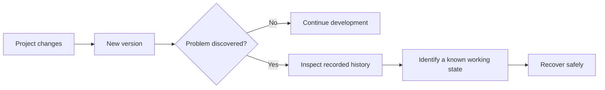
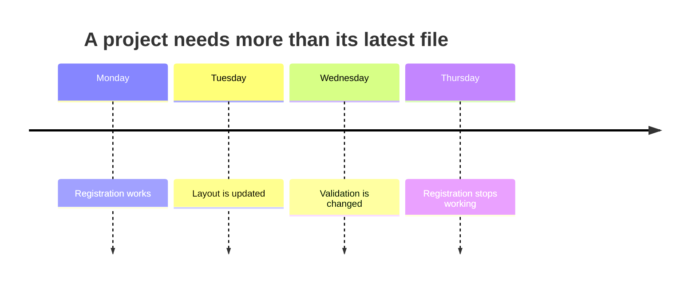
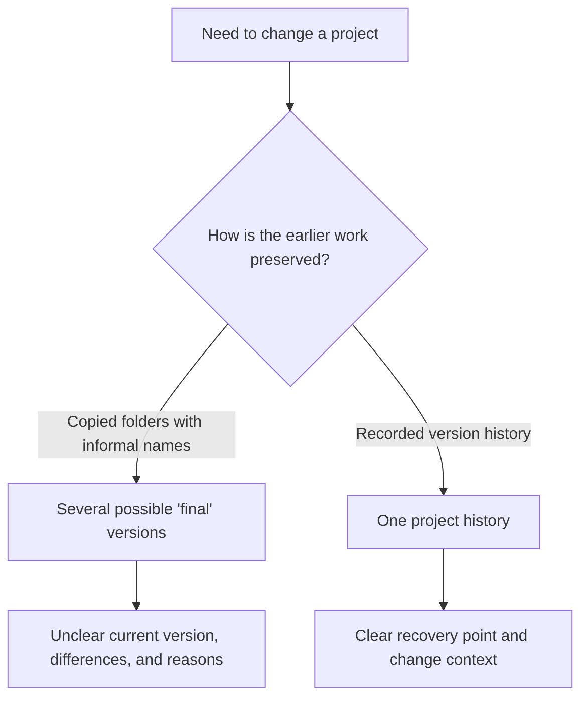
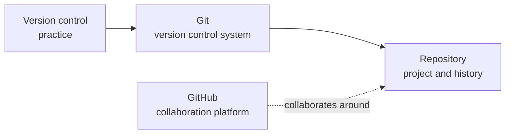

> **Navigation:** Previous: Not available | [Roadmap](../../ROADMAP.md) | [Next: Chapter 02](02-git-architecture.md)
>
> **Level:** Beginner · **Estimated Time:** 60 min · **Prerequisites:** None

## Learning Objectives

By the end of this chapter, you will be able to:

- Explain why version control exists and the problems it solves.
- Distinguish a backup from a useful history of project changes.
- Describe how version control supports recovery, experimentation, traceability, and collaboration.
- Explain, at a conceptual level, the difference between Git and GitHub.

## Introduction

Maya is updating the contact form on her portfolio website the evening before a job application deadline. She changes the form layout, adjusts its validation, and saves her work. The new version looks worse and the form no longer submits. Her earlier working version is gone.

She remembers making a copy last week, but its name is `portfolio-final-v2`. Another copy is called `portfolio-final-final`. Neither name tells her which one contained the working form, what changed afterward, or whether the copy is even the latest version.

This is not an unusual beginner problem. It is a normal consequence of software changing over time without a reliable record of those changes. Version control exists to make that change manageable.

This chapter starts with the problem rather than a tool. You will learn why professional developers record the history of their work before learning how Git records it.

## Why This Matters

Software is never truly static. A portfolio site gains a project page. A university assignment is corrected after feedback. A team fixes a bug reported by a customer. A configuration file changes so an application can run in a new environment.

In each case, a developer needs more than the newest copy of a file. They need answers: What changed? Why was it changed? When did it change? Who made the change? Can we return to the version that worked?

Professional teams use version control every day because it gives changes a dependable history. That history makes work easier to review, diagnose, maintain, and share. It is useful for a one-person portfolio today and becomes essential when several people work on the same product tomorrow. Version control is one of the first skills expected from every professional software developer, regardless of programming language or technology stack.

## Key Terms

| Term            | Definition                                                                                                                          |
| --------------- | ----------------------------------------------------------------------------------------------------------------------------------- |
| Version control | A system for recording changes to a project over time so earlier states and the context of changes can be understood and recovered. |
| Version history | The ordered record of a project's meaningful changes.                                                                               |
| Traceability    | The ability to connect a change with its reason, time, and author or source.                                                        |
| Repository      | The conceptual home for a project and its version history.                                                                          |
| Git             | A version control system used to record and manage project history.                                                                 |
| GitHub          | A collaboration platform built around Git repositories.                                                                             |
| Backup          | A copy kept primarily to protect against loss or failure.                                                                           |

## Theory

Software evolves continuously. Even a small project can change many times in a day: a spelling correction, a new feature, a bug fix, an updated dependency, or a revised requirement. Saving the current file preserves only the latest state. It does not explain how the project reached that state.



_Figure 1. Recorded history turns a failed change into a recoverable investigation._

### Change Needs Context

Imagine that a team discovers a bug in its university event website: the registration button stopped working after a design update. Seeing only the current files leaves the team guessing. A useful history helps them locate the relevant change and understand its purpose.



_Figure 2. A change timeline identifies the investigation window between the last working state and the failure._

The timeline makes the investigation boundary visible: the useful question is not “what is in the file now?” but “what changed between the last working state and the first failing state?” Version history preserves that path.

Every meaningful change benefits from context. A future reader should be able to answer questions such as:

- What was changed?
- Why was it changed?
- When was it changed?
- Who made or requested the change?

This is not paperwork for its own sake. Context reduces repeated investigation. Six weeks later, the developer who made a change may no longer remember its details. A teammate who was not involved needs an understandable record.

### Why Manual File Copies Fail

Without version control, people often create copies before risky work:

```text
portfolio/
├── project-final/
├── project-final-v2/
├── project-final-final/
└── project-final-use-this/
```

Copies can feel safe at first because they preserve something. The problem is that filenames carry very little reliable information. They do not show the exact difference between two versions, the reason for a change, or which file is authoritative. As files multiply, it becomes easy to edit the wrong copy, lose a colleague's work, or deploy an outdated version.

Manual copies also become costly when a project contains many folders and files. Copying only one file can separate it from the related changes it depends on. Copying the whole project creates clutter and uncertainty. Neither approach gives a clear, searchable change history.



_Figure 3. Manual copies preserve files, while recorded history preserves their relationship and context._

This is a decision about information, not storage space. Both approaches can retain old files; only a recorded history makes the relationship between those versions clear.

### What Version Control Provides

Version control treats change as something worth recording rather than something to hide inside replacement files. It maintains a history of meaningful project states and the changes between them.

That history provides several practical benefits:

- **Recovery:** Return to a known working version after a mistake or failed experiment.
- **Traceability:** Understand what changed and the reason it was changed.
- **Safe experimentation:** Try an idea while preserving a dependable earlier state.
- **Collaboration:** Coordinate work instead of passing conflicting file copies around.
- **Shared source of truth:** Give the project one trusted history rather than several competing “final” folders.
- **Maintainability:** Make future fixes easier by preserving the decisions behind earlier changes.

Think of a version-controlled project as a laboratory notebook. A good laboratory notebook does not merely show the current result; it records observations and decisions so someone can understand or reproduce the work. Version history does the same for software.

### Without Version Control vs With Version Control

| Without Version Control                                                | With Version Control                                                  |
| ---------------------------------------------------------------------- | --------------------------------------------------------------------- |
| File names attempt to describe versions.                               | A project has an ordered history of recorded changes.                 |
| It is difficult to know which copy is current.                         | The project has a shared source of truth.                             |
| Recovering an earlier working state depends on finding the right copy. | Earlier recorded states can be identified and restored.               |
| The reason for a change is often forgotten.                            | Changes can carry useful context for future readers.                  |
| Team members may overwrite or duplicate one another's work.            | Work can be coordinated around the same project history.              |
| A backup may exist, but it may not explain how the project changed.    | History explains the evolution of the project, not only its survival. |

### Backup Is Not Version Control

A backup protects against loss: a broken laptop, accidental deletion, or a failed drive. It is important, but its main question is, “Can we get our data back?”

Version control answers a different question: “How did this project change, and can we safely work with that history?” A backup might contain yesterday's website folder. It usually does not show which edit introduced a bug, why a change was made, or how two contributors' work relates.

The two practices work well together. Backups protect availability; version control manages the evolution of a project. One is not a replacement for the other.

### A Familiar Mental Model

You may already have seen a form of version control. Google Docs revision history lets you inspect earlier versions of a document and restore one when needed. Microsoft Word Track Changes shows proposed edits and their authors. These tools make change visible instead of silently replacing the old text.

Save points in games are another helpful analogy. Before attempting a difficult section, you save a state that you trust. You can explore without losing your progress. Version control gives software work a more detailed and collaborative form of that safety.

For teams, construction blueprint revisions are a useful comparison. Builders should not rely on several files named “latest-plan.” They need to know which revision is authoritative and what changed between revisions. Software teams need the same clarity, even though their plans are code, documentation, and configuration.

### Where Git and GitHub Fit

Git is a version control system. It is the tool that will help you record and work with a project's history in the next chapters.

GitHub is not Git. GitHub is a collaboration platform built around Git repositories. Teams commonly use it to share projects and work together, but the fundamental idea in this chapter—recording and understanding change—comes first.

A repository is the conceptual home of both the project and its history. You do not need to know how to create one yet. For now, remember the purpose: it keeps the project and its recorded evolution connected.



_Figure 4. Git manages repository history; GitHub supports collaboration around Git repositories._

## Practical Examples

### A Portfolio Website: Recovery

Alex changes the navigation on a portfolio site and accidentally removes the link to the contact page. With only the latest file, Alex must recreate the earlier navigation from memory. With version history, Alex can find the last working state, compare it with the current one, and recover the correct change.

The value is not simply having an old copy. It is being able to identify a known working point in the project's history.

### A University Assignment: Traceability

Two students revise a data-analysis report before submitting it. One changes the conclusions after correcting a calculation. Later, the instructor asks why the conclusion changed.

Version history can connect the revised conclusion to the corrected calculation. This makes the work explainable. A folder containing `report-newest.docx` and `report-newest-revised.docx` does not provide the same confidence.

### A Team Project: Shared Source of Truth

Three developers work on a small event-registration application. One updates the event page, another fixes an email-validation bug, and a third updates the README. If they exchange copies of the project through messages, each person can end up with a different “latest” version.

Version control gives the team one project history to coordinate around. Instead of deciding which ZIP file is correct, they can see the recorded changes that make up the current project.

### Finding a Regression

An online shop's discount code worked on Monday but fails on Thursday. The current code alone shows the failure, not when it began. A change history narrows the investigation: look at the changes made between the last known working state and the first failing state.

This is why history supports maintainability. It turns “something broke” into a more focused question: “What changed while it was working?”

## Try It Yourself

Complete this short observation before continuing.

1. Think of a file you have renamed with words such as `final`, `new`, `copy`, or a date.
2. Write down what its name tells you and what it does not tell you about the change.
3. List one question you could answer more easily if the file had a clear history, such as why it changed or which version worked.

The goal is not to organize the file yet. It is to notice the information that manual version names fail to preserve.

## Best Practices

- Treat changes as part of the project, not as temporary clutter to be hidden in filenames; future maintenance depends on understanding them.
- Preserve a shared source of truth for a project; teams should not have to guess which copy is authoritative.
- Record the purpose of meaningful changes; a short explanation can save substantial debugging time later.
- Use backups as protection against loss and version control to understand project evolution; both have distinct roles.

## Common Mistakes

| Mistake                                              | Why it causes problems                                                   | How to avoid it                                                                           |
| ---------------------------------------------------- | ------------------------------------------------------------------------ | ----------------------------------------------------------------------------------------- |
| Treating version control as only a backup            | It overlooks history, context, and collaboration.                        | Use version control to record meaningful project changes; keep backups for loss recovery. |
| Naming copies `final`, `final-v2`, and `final-final` | Names become ambiguous and do not show the actual differences.           | Keep one trusted project history instead of competing copies.                             |
| Assuming only large teams need version control       | Individual projects also change, break, and need recovery.               | Start using version control on personal projects and assignments.                         |
| Believing Git and GitHub are the same product        | This confuses the version-control system with a collaboration platform.  | Remember: Git manages history; GitHub builds collaboration around Git repositories.       |
| Waiting until a project is “finished” to track it    | The most valuable history is created while decisions and changes happen. | Begin tracking as soon as a project has work worth preserving.                            |

### Learning Check

Pause before the summary and reflect on your own experience:

- Have you ever lost code or overwritten a file that was working?
- Have you ever had several files that all looked like the final version?
- Have you forgotten why you changed a line, setting, or document?
- If a bug appeared today, could you identify what changed since it last worked?

If any answer is yes, you have already encountered the problem version control is designed to solve.

## Summary

- Software evolves continuously, so the current file alone is not enough to explain a project.
- Version control records meaningful change history, enabling recovery, traceability, safe experimentation, collaboration, and maintainability.
- Manual file copies do not scale because they create ambiguity and lose the context behind changes.
- Backups protect against loss; version control manages and explains project evolution.
- Git is a version control system, while GitHub is a collaboration platform built around Git repositories.
- Version control is not about saving files. It is about understanding and managing change.

## Exercise

### Exercise Objective

Analyze the limitations of manually versioned project files and explain how version control resolves the identified problems.

### Exercise Task

You inherit this folder from a classmate who was preparing a portfolio website:

```text
portfolio-site/
├── portfolio-final/
├── portfolio-final-v2/
├── portfolio-final-v2-fixed/
├── portfolio-final-use-this/
└── notes.txt
```

`notes.txt` says only, “Changed the form and fixed the home page.” Write a short analysis that answers the following:

1. Which folder would you treat as the current version, and what evidence supports that choice?
2. What important questions cannot be answered from the folder names and note?
3. Identify two risks if another developer begins work from one of these copies.
4. Explain how version history, traceability, recovery, and a shared source of truth would improve this situation.

### Exercise Expected Outcome

You can explain why a collection of manually named copies is not a reliable project history and describe the version-control capabilities that address each problem.

## Lab

### Lab Objective

Experience the confusion of manual versioning in a small, realistic project and identify why version control is needed. This lab deliberately uses no Git.

### Lab Requirements

- A text editor and file manager.
- A new empty folder for the lab.
- Completion of this notebook.

### Lab Tasks

1. Create a small project folder named `campus-events-site` containing an `index.html` file and a `README.md` file. Add a simple event title and a short setup note. Copy the folder and rename the copy `campus-events-site-final`.
2. In the original folder, change the event title and add a registration note. Then introduce a deliberate mistake: remove a line that made the registration note understandable. Copy this folder as `campus-events-site-final-v2`.
3. In `campus-events-site-final`, fix the registration note but also change the README. Create one more copy named `campus-events-site-use-this`. Now answer: Which folder contains the intended event title? Which has the correct registration note? Which README is current? What changed in each copy, and why?
4. Write a short reflection describing the information you could not determine confidently. Map each uncertainty to a version-control benefit: history, recovery, traceability, experimentation, collaboration, or shared source of truth.

### Lab Expected Outcome

You have several plausible “final” project copies and a written explanation of the uncertainty they create. You can connect that confusion to the practical need for version control without using any Git commands.

## Quiz

1. A developer keeps daily copies of a project but cannot tell which change introduced a bug. What capability is missing, and why?
2. True or false: A backup and version control serve exactly the same purpose. Explain your answer.
3. A teammate asks why a configuration file changed last month. Which version-control benefit is most useful, and what information should it provide?
4. Why is `project-final-final-use-this` an unreliable way to identify the authoritative project state?
5. In your own words, explain the difference between Git and GitHub.
6. A developer wants to try a risky design change without losing a stable version. Which version-control benefit helps, and how?
7. Imagine you are working alone on a personal project. Convince a friend that version control is still valuable.

## Next Chapter

Now that you understand why version control exists, the next chapter introduces the tool that solves these problems: Git. You will begin building a mental model of how Git records project history, without needing to memorize a collection of commands first.

### Related Content

- Previous chapter: Not available
- Next chapter: [Chapter 02 — Git Architecture](02-git-architecture.md)
- Related exercise: [Version Control Analysis](../../exercises/en/01-version-control-analysis.md)
- Related lab: [Manual Versioning Lab](../../labs/en/01-manual-versioning-lab.md)
- Related quiz: [Why Version Control Quiz](../../quizzes/en/01-why-version-control-quiz.md)

## Further Reading

- [Git documentation: About Version Control](https://git-scm.com/book/en/v2/Getting-Started-About-Version-Control)
- [Git documentation: What is Git?](https://git-scm.com/book/en/v2/Getting-Started-What-is-Git%3F)
- [GitHub Docs: About Git](https://docs.github.com/en/get-started/using-git/about-git)

## AI Tip _(Optional)_

Prompt example:

"Give me a realistic example that shows the difference between a backup and version control, without using Git commands. Then ask me two questions to check my understanding."
