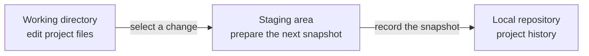
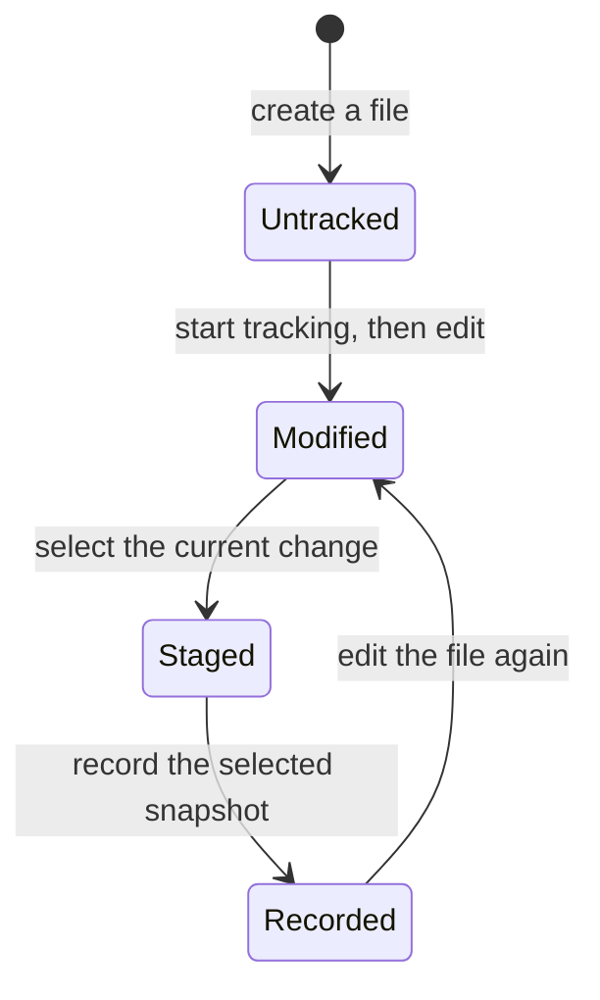
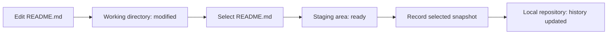

> **Navigation:** [Previous: Chapter 01](01-why-version-control.md) | [Roadmap](../../ROADMAP.md) | Next: Chapter 03 (coming soon)

> **Level:** Beginner · **Estimated Time:** 75 min · **Prerequisites:** [Chapter 01: Why Version Control?](01-why-version-control.md)

## Learning Objectives

By the end of this chapter, you will be able to:

- Identify Git’s working directory, staging area, and local repository.
- Explain how a change moves from an edited file into recorded project history.
- Use `git status` to describe the state of a change in a prepared repository.
- Explain why Git separates selecting changes from recording them.

## Introduction

In Chapter 01, you learned why software needs a reliable history. Git provides that history, but it does not treat every saved edit as a permanent record.

Consider a developer updating a portfolio site. They correct a typo, experiment with a new contact-form message, and begin a larger navigation redesign. These changes do not necessarily belong in one historical record. The typo may be ready to preserve now, while the navigation work is still incomplete.

Git’s architecture gives developers a deliberate path from ordinary file edits to recorded history. Understanding that path matters more than memorizing a command sequence. Once you can see where a change is, Git becomes much easier to reason about.

## Visual Learning

This chapter uses a local change-flow diagram, a command workflow, a state diagram, and a timeline. Each visual answers a specific question: where a change is, how it moves, what `git status` reports, and when it becomes history.

## Why This Matters

Professional software work includes many changes at once. A developer may fix a bug, revise documentation, and explore a feature during the same afternoon. Teams need a way to record one meaningful piece of work without accidentally including unrelated or unfinished edits.

Git separates editing, selecting, and recording. This makes project history more precise and easier to understand later. When a teammate investigates a bug or reviews a change, a focused record is far more useful than a snapshot containing every file touched that day.

This architecture also supports careful work on personal projects. You can decide which changes represent a completed step before they become part of the project’s permanent history.

## Key Terms

| Term | Definition |
| --- | --- |
| Working directory | The files currently visible in your project folder and available to edit. |
| Staging area | A reviewable selection of changes that are prepared for the next recorded history entry. |
| Local repository | The Git-managed history stored on your own computer. |
| Snapshot | The recorded state of selected project files at a point in time. |
| Commit | A named record that adds a selected snapshot to project history. |
| `git status` | A command that reports which files are unchanged, modified, staged, or untracked. |

## Theory

Git manages a project through three local areas. You work with ordinary files in the working directory. You select the changes that belong together in the staging area. You then record that selected snapshot in the local repository.



*Figure 1. Git separates editing, selecting, and recording so a project history can contain focused changes.*

### The Working Directory

The working directory is the project folder you open in an editor. When you change `index.html`, update a README, or create a new file, you are changing the working directory.

At this point, the change exists only in the current project files. Git can detect it, but it has not yet been chosen for the next historical record. Editing a file is therefore not the same as recording a project decision.

### The Staging Area

The staging area is a deliberate checkpoint between editing and history. It holds the exact version of each selected file that Git will use for the next commit.

This separation solves a practical problem. Suppose you fix a typo in `README.md` while also experimenting with a half-finished redesign in `index.html`. You can select the documentation fix without selecting the unfinished redesign. The next history entry can then explain one coherent change.

The staging area is sometimes called the *index*. For this course, use “staging area” because it describes its job: it is where you prepare the next snapshot.

### The Local Repository

The local repository is the project history maintained on your computer. When Git records a selected snapshot, it creates a commit in this history.

This is not a separate folder you edit by hand. Git manages it for you. What matters now is the mental model: the local repository contains recorded history, while the working directory contains the work still in progress.

This chapter focuses on local architecture. Sharing work with a remote service and collaborating through GitHub are introduced later in the learning path.

### One File, Several States

A single file can have a different version in each area. For example, the repository may contain yesterday’s README, the staging area may contain a selected typo fix, and the working directory may contain an additional paragraph you are still drafting.



*Figure 2. A file can move through Git states as it is created, selected, recorded, and edited again.*

The diagram is a simplified learning model. The important idea is that Git can distinguish unfinished work from selected work and recorded work.

### Why Selection Comes Before History

The staging area may feel like an extra step at first. Its value becomes clear when several changes are happening at once.

| Situation | Without a staging area | With a staging area |
| --- | --- | --- |
| A bug fix and a formatting change happen together | Both may be recorded as one unclear change. | The bug fix can be selected and recorded separately. |
| A feature is incomplete | Saving files can accidentally look like a finished milestone. | Only the ready part is selected for history. |
| A teammate reads the history later | The purpose of a broad snapshot is difficult to infer. | Each record can represent one understandable unit of work. |

Selection is not bureaucracy. It is how Git lets history express intent.

## Practical Examples

### Follow One Change Through Git

Assume a prepared repository contains a portfolio project. You correct a typo in `README.md` and want that correction to become a focused history entry.



*Figure 3. A focused documentation correction moves from an edit to a selected snapshot and then to local history.*

The following commands demonstrate the architecture. If Git is not installed yet, read them as a trace of where the change moves; installation and repository creation are covered in later chapters.

```bash
git status
git add README.md
git status
git commit -m "docs: correct setup instruction"
git status
```

| Command | Architectural meaning |
| --- | --- |
| `git status` before selection | Shows that `README.md` changed in the working directory. |
| `git add README.md` | Selects the current version of `README.md` for the staging area. |
| `git status` after selection | Shows that the selected version is ready for the next commit. |
| `git commit -m "..."` | Records the selected snapshot in the local repository. |
| `git status` after recording | Confirms whether the working directory and staging area have remaining changes. |

### A Separate Unfinished Change

Now assume you also edited `index.html`, but the navigation redesign is incomplete. A status report may conceptually look like this:

```text
Changes to be committed:
  modified: README.md

Changes not staged for commit:
  modified: index.html
```

The report tells you that the documentation correction is selected, while the navigation work remains only in the working directory. Recording the selected README change does not automatically record the unfinished `index.html` work.

### Reading the Flow as a Timeline

```mermaid
timeline
    title A focused documentation change
    09:00 : Edit README.md
    09:05 : Inspect the working-directory change
    09:07 : Select README.md for the next snapshot
    09:10 : Record the selected snapshot locally
    09:11 : Continue unrelated navigation work
```

*Figure 4. The selected documentation change becomes history without waiting for unrelated work to be finished.*

This is the discipline that makes history useful: one record communicates one meaningful step.

## Try It Yourself

Use this thought experiment before moving to the practice sections.

1. Imagine that you changed `README.md` and `index.html` in the same project.
2. Decide which file represents a complete, explainable change and which is still in progress.
3. State which Git area should contain each file before you record a history entry.

Your answer should distinguish the working directory from the staging area. You do not need to run Git yet.

## Best Practices

- Treat the staging area as a review point; select changes that belong to one clear purpose.
- Use `git status` before and after selection so you know where each change is.
- Keep unrelated or incomplete work out of a history entry whenever possible.
- Write commit messages that explain the selected change, not every edit made that day.

## Common Mistakes

| Mistake | Why it causes problems | How to avoid it |
| --- | --- | --- |
| Assuming every saved file is already in Git history | Saving changes the working directory but does not record history. | Check the file’s state with `git status`. |
| Treating the staging area as a second copy of the project | This hides its role as the planned next snapshot. | Think of it as a selection list for one history entry. |
| Selecting every changed file automatically | Unrelated changes make history difficult to understand and review. | Select only the files that support one meaningful change. |
| Believing a commit shares work with a team | A commit records history locally; sharing is introduced in later chapters. | Separate local history from remote collaboration in your mental model. |

## Summary

- Git uses a working directory for edits, a staging area for selected changes, and a local repository for recorded history.
- A file can be modified, staged, recorded, and modified again as work continues.
- The staging area lets you record a focused change while leaving unrelated work in progress.
- `git status` is the first command to use when you need to understand where changes are.

### Key Takeaways

- Editing files and recording history are different actions.
- Selection gives a history entry a clear purpose.
- A local repository stores history on your computer; remote collaboration comes later.

## Exercise

### Objective

Classify project changes by Git area and explain which changes should be selected for one focused history entry.

### Task

You are working on a portfolio site and have made these changes:

- Corrected a broken link in `README.md`.
- Added an unfinished navigation redesign to `index.html`.
- Created `notes.txt` with temporary ideas that should not be kept.

For each file, state whether it should remain in the working directory, be placed in the staging area, or be represented in the local repository after recording a documentation fix. Explain your reasoning in one or two sentences per file.

### Expected Outcome

You can distinguish edited work, selected work, and recorded history, and can justify why unrelated or temporary files should not be included in a focused change.

## Lab

### Objective

Use a prepared practice repository to observe the movement of one change through Git’s three local areas.

### Requirements

- Git installed on your computer.
- A prepared repository supplied by an instructor or created in a later chapter.
- A text editor and terminal.

### Tasks

1. Edit `README.md` in the prepared repository by correcting one sentence. Run `git status` and record what it reports about the file.
2. Run `git add README.md`, then run `git status` again. Compare the two outputs and identify the Git area that changed.
3. Record the selected README change with a concise commit message. Run `git status` a final time and explain what moved into the local repository.
4. Make a small unfinished change to `index.html` without selecting it. Use `git status` to verify that the recorded README change and unfinished HTML work are in different states.

### Expected Outcome

You can provide three `git status` observations that show a file moving from the working directory to the staging area and then into local history, while unrelated work remains unselected.

## Quiz

1. Which Git area contains the files you edit in your project folder?
2. What is the purpose of the staging area?
3. A file is staged and then changed again in the working directory. Which version is prepared for the next commit?
4. What does `git status` help you understand?
5. Why is it useful to record a documentation fix separately from an unfinished feature?
6. True or false: Creating a commit automatically shares the change with teammates. Explain your answer.
7. A project has a selected README fix and an unselected `index.html` redesign. Which file should a focused documentation commit include, and why?

## Next Chapter

You now understand the local areas that make Git history possible. The next chapter prepares your machine to use Git, so you can begin applying this architecture in a real project.

### Related Content

- Previous chapter: [Chapter 01 — Why Version Control?](01-why-version-control.md)
- Next chapter: Chapter 03 — Installing Git (coming soon)
- Related exercise: Included in this notebook
- Related lab: Included in this notebook
- Related quiz: Included in this notebook

## Further Reading

- [Git documentation: Git Basics — Recording Changes](https://git-scm.com/book/en/v2/Git-Basics-Recording-Changes-to-the-Repository)
- [Git documentation: Git Basics — Viewing the Commit History](https://git-scm.com/book/en/v2/Git-Basics-Viewing-the-Commit-History)
- [GitHub Docs: About Git](https://docs.github.com/en/get-started/using-git/about-git)

## AI Tip *(Optional)*

Prompt example:

"Use a portfolio website example to explain the working directory, staging area, and local repository. Ask me to classify three changes without giving the answer first."
