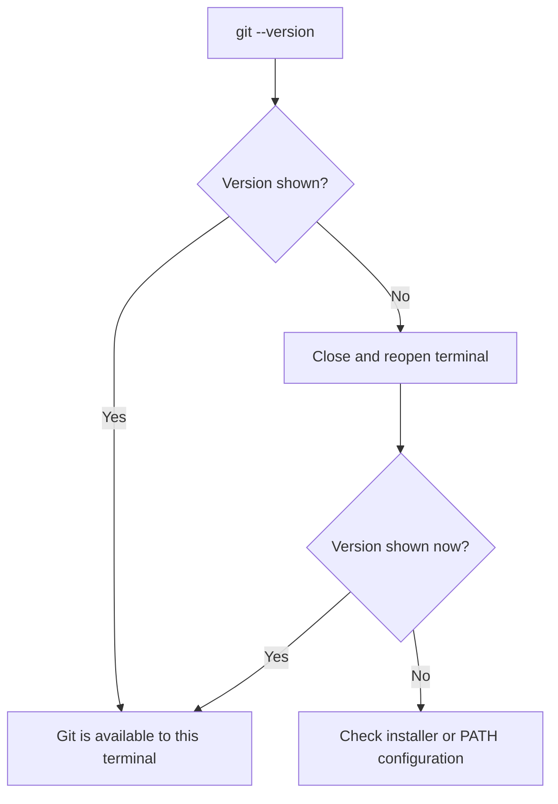
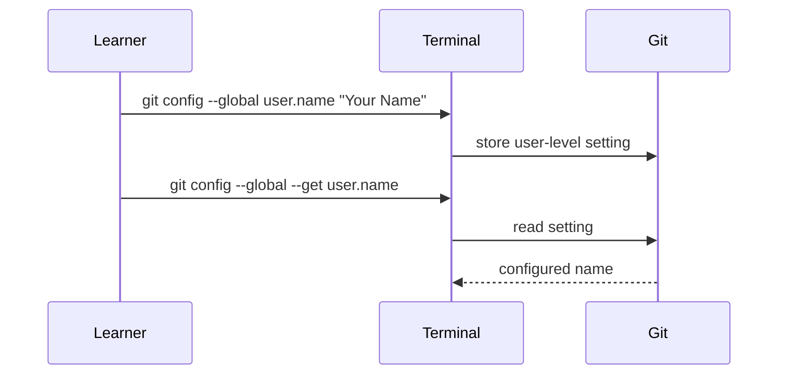

> **Navigation:** [Previous: Chapter 02](02-git-architecture.md) | [Roadmap](../../ROADMAP.md) | [Next: Chapter 04](04-creating-your-first-repository.md)
>
> **Level:** Beginner · **Estimated Time:** 60 min · **Prerequisites:** [Chapter 02: Git Architecture](02-git-architecture.md)

# Installing Git

## Learning Objectives

By the end of this chapter, you will be able to:

- install Git using an appropriate installer or package manager for your operating system;
- verify that the terminal can run Git;
- configure a name and email address for new commits;
- inspect configuration without exposing or changing unrelated settings.

## Introduction

Git is a program on your computer. A website such as GitHub can host repositories later, but it does not replace the local Git program that records your work. Before creating a repository, your terminal needs to find the `git` command and Git needs an identity for the commits you create.

This chapter keeps the setup deliberately small: install Git, confirm the installation, and configure the information that identifies your commits. Repository creation follows in the next chapter.

## Visual Learning


_Figure 1. A reliable setup is a short sequence with a clear verification point after installation._



_Figure 2. Verify the actual terminal you will use instead of assuming installation succeeded._

## Why This Matters

An incomplete setup creates confusing failures later. A repository may work locally until the first commit, when Git stops because it cannot identify the author. A terminal opened before installation may not find Git at all. Verifying each stage now makes later Git commands easier to understand and troubleshoot.

Commit identity is also part of project history. It helps future readers understand who created an entry. Use an identity you are comfortable sharing in repository history, especially when you will publish to a remote service.

## Key Terms

| Term                 | Definition                                                                  |
| -------------------- | --------------------------------------------------------------------------- |
| Installer            | A program that installs software and its required files.                    |
| Package manager      | A tool that installs and updates software packages for an operating system. |
| Terminal             | A text-based interface for running commands.                                |
| PATH                 | A list of locations the terminal searches for executable programs.          |
| Global configuration | Git settings that apply to the current user across local repositories.      |
| Commit identity      | The name and email address Git records with a commit.                       |

## Theory

### Install Git for Your Operating System

Use the official Git download page to choose the current supported installer for your operating system. The exact installer version changes over time, so do not rely on a version number copied from an old tutorial.

| Operating system | Recommended approach                                                            | Verification terminal                     |
| ---------------- | ------------------------------------------------------------------------------- | ----------------------------------------- |
| Windows          | Install Git for Windows from the official download page.                        | Git Bash, PowerShell, or Windows Terminal |
| macOS            | Install the developer command-line tools or install Git with a package manager. | Terminal                                  |
| Linux            | Install Git with the distribution package manager.                              | Terminal                                  |

During a Windows installation, keep the default option that makes Git available from the command line unless your organization gives different instructions. After installation, close existing terminals and open a new one so the new PATH setting is loaded.

### Verify the Installation

Run this command in a new terminal:

```bash
git --version
```

Git should print its version, for example `git version 2.x.y`. The exact numbers are not important for this lesson. What matters is that the command completes and reports a version.

If the terminal reports that `git` is not recognized or not found, Git is not yet available to that terminal. First reopen the terminal. If the problem remains, review the installer result or the operating system's PATH configuration.

### Configure Commit Identity

Git records an author name and email address with every commit. Configure them before creating your first repository:

```bash
git config --global user.name "Your Name"
git config --global user.email "you@example.com"
```

The `--global` option stores these values for your current operating-system user. You can later override them for one repository when a project requires a different approved identity.

Do not use an email address you should not expose in a repository's commit history. Check your team's policy when working on organizational repositories.

### Inspect, Do Not Guess

Use these commands to read the configured identity:

```bash
git config --global --get user.name
git config --global --get user.email
```



_Figure 3. Configure a value, then read the exact setting to confirm it._

## Practical Examples

### Windows with Git for Windows

1. Download Git for Windows from the official Git website.
2. Run the installer and retain the option that enables command-line use.
3. Close PowerShell or Windows Terminal, then open a new window.
4. Run `git --version`.

### macOS or Linux Terminal

Install Git through your approved system method, then verify it in a new terminal:

```bash
git --version
git config --global user.name "Your Name"
git config --global user.email "you@example.com"
git config --global --get user.name
git config --global --get user.email
```

The final two commands should print the values you set. They confirm configuration; they do not create a repository or a commit.

## Try It Yourself

1. Install Git using the official method for your operating system.
2. Open a new terminal and run `git --version`.
3. Configure a suitable name and email address.
4. Read both settings with `git config --global --get`.

## Best Practices

- Prefer the official Git download page or your operating system's trusted package manager.
- Open a new terminal after installation before concluding that Git is unavailable.
- Verify the exact identity Git will use before you create commits.
- Use a deliberate, appropriate email address for shared or public history.

## Common Mistakes

| Mistake                                           | Why it causes problems                                                 | How to avoid it                                       |
| ------------------------------------------------- | ---------------------------------------------------------------------- | ----------------------------------------------------- |
| Using an already-open terminal after installation | It may not have the updated PATH value.                                | Close it and open a new terminal before checking Git. |
| Skipping `git --version`                          | Later failures do not clearly distinguish installation from Git usage. | Verify installation immediately.                      |
| Configuring a placeholder email by accident       | The placeholder becomes part of commit history.                        | Read the configured value before committing.          |
| Treating GitHub login as Git installation         | A hosting account does not provide the local `git` command.            | Install and verify Git on the computer first.         |

## Summary

- Git must be installed locally before its commands can record project history.
- `git --version` verifies that the current terminal can run Git.
- `user.name` and `user.email` identify future commits.
- `git config --global --get` reads configuration without creating a repository.

## Next Chapter

Git is now ready to record local work. The next chapter creates a first repository and applies the architecture from Chapter 02.

### Related Content

- Previous chapter: [Chapter 02 - Git Architecture](02-git-architecture.md)
- Next chapter: [Chapter 04 - Creating Your First Repository](04-creating-your-first-repository.md)
- Exercise: [Verify a Git Setup](../../exercises/en/03-verify-git-setup.md)
- Lab: [Install and Configure Git](../../labs/en/03-install-and-configure-git.md)
- Quiz: [Installing Git Quiz](../../quizzes/en/03-installing-git-quiz.md)

## Further Reading

- [Git Downloads](https://git-scm.com/downloads)
- [Git Book: First-Time Git Setup](https://git-scm.com/book/en/v2/Getting-Started-First-Time-Git-Setup)
