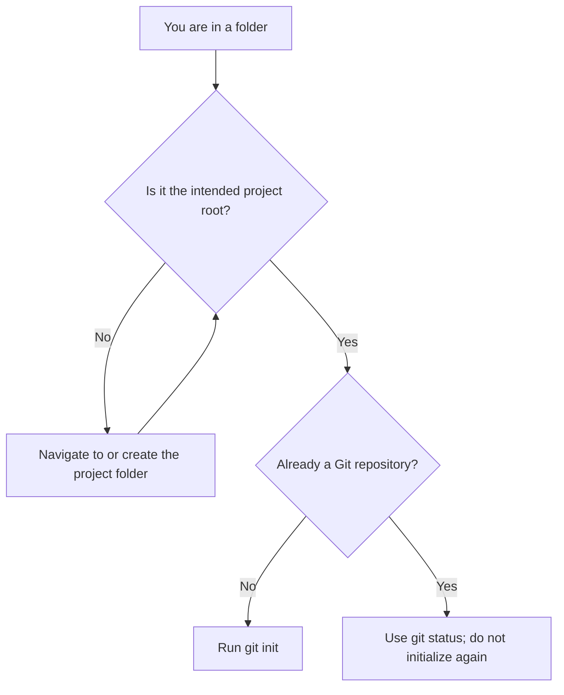
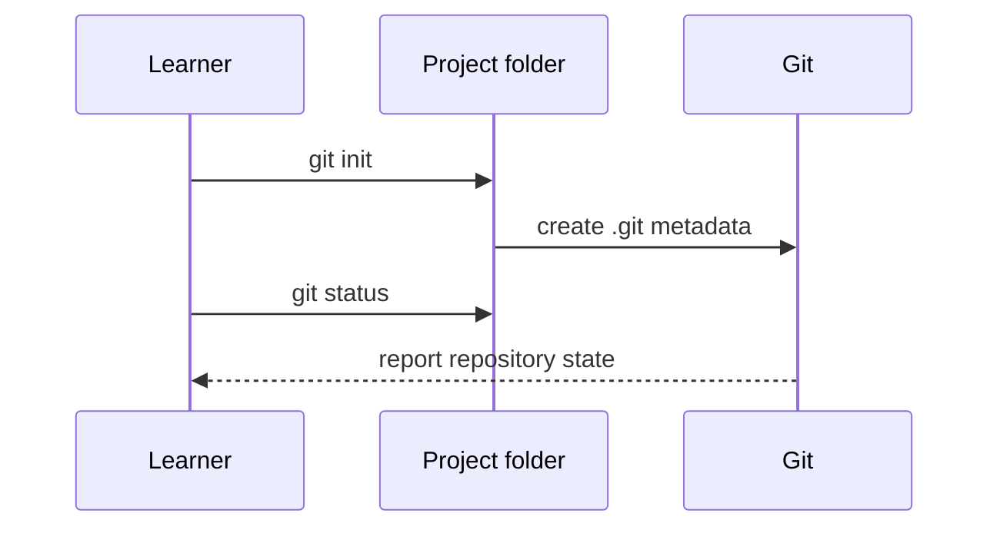

> **Navigation:** [Previous: Chapter 03](03-installing-git.md) | [Roadmap](../../ROADMAP.md) | [Next: Chapter 05](05-working-with-commits.md)
>
> **Level:** Beginner · **Estimated Time:** 60 min · **Prerequisites:** [Chapter 02: Git Architecture](02-git-architecture.md) and [Chapter 03: Installing Git](03-installing-git.md)

# Creating Your First Repository

## Learning Objectives

By the end of this chapter, you will be able to:

- create an empty local Git repository with `git init`;
- distinguish a project folder from the hidden `.git` directory;
- use `git status` to inspect a repository without changing it;
- recognize when a folder is already a Git repository;
- choose a clear project directory before initializing Git.

## Introduction

A Git repository is a project directory that Git can track. The visible files remain your project: source code, notes, configuration, and documentation. Git stores its repository data separately in a hidden `.git` directory inside that project folder.

Creating a repository is intentionally a small step. This chapter creates and checks the repository; Chapter 05 introduces the commit workflow that records a deliberate snapshot. Keeping those jobs separate makes it easier to understand what each command changes.

## Visual Learning


_Figure 1. `git init` turns one selected project folder into a local repository._



_Figure 2. Confirm the location before asking Git to create repository metadata._

## Why This Matters

Git tracks a repository, not an abstract idea of a project. Running `git init` in the wrong folder can make unrelated files appear in `git status`, including parent directories containing several projects. Choosing a small, purposeful project root makes later staging, commits, ignores, and collaboration easier to manage.

The `.git` directory is the local repository described in Chapter 02. Deleting it removes the repository history and configuration from that folder. Treat it as Git-managed metadata rather than a normal project directory.

## Key Terms

| Term              | Definition                                                  |
| ----------------- | ----------------------------------------------------------- |
| Project root      | The top-level folder for one project.                       |
| Local repository  | Git's local record of a project and its history.            |
| `.git` directory  | Hidden directory that stores the local repository metadata. |
| Initialize        | Create the repository metadata in a selected folder.        |
| Working directory | The visible project files you edit.                         |
| Untracked file    | A file Git can see but is not yet tracking.                 |

## Theory

### What `git init` Does

Run `git init` inside a project directory to create a repository there:

```bash
git init
```

Git creates `.git` and reports that it initialized an empty repository. The command does not upload anything, create a GitHub repository, or create a commit. It only creates local metadata that lets Git understand this folder as a repository.

### Create a Folder First or Let Git Create One

You can create and enter a folder before initialization:

```bash
mkdir learning-notes
cd learning-notes
git init
```

Or ask Git to create a new directory and initialize it:

```bash
git init learning-notes
cd learning-notes
```

Both approaches produce a repository in `learning-notes`. For beginners, creating the folder explicitly makes the current location easier to verify before using Git.

### Inspect the Repository with `git status`

After initialization, run:

```bash
git status
```

An empty repository normally reports that there is nothing to commit. This is expected: the repository exists, but it has no project files or commits yet. `git status` is a safe inspection command. It tells you Git's current view without changing files, staging content, or creating history.



_Figure 3. Initialization changes repository metadata; status reads the resulting state._

### Do Not Reinitialize by Habit

`git init` is safe to run in an existing repository in many cases, but it is rarely the right first response. It can update repository configuration or confuse the learning process. Run `git status` first when you are unsure whether the current directory already belongs to a repository.

## Practical Examples

### Example 1: Create an Empty Repository

```bash
mkdir recipe-book
cd recipe-book
git init
git status
```

Expected result: Git reports an initialized repository, then reports an empty working tree. The folder is now ready for project files.

### Example 2: Initialize an Existing Project Folder

Suppose `weather-dashboard` already contains files you created outside Git:

```bash
cd weather-dashboard
git init
git status
```

Expected result: `git status` lists the existing files as untracked. Git sees them but has not yet added them to history. Chapter 05 explains how to review, stage, and commit those files.

### Example 3: Check Before Initializing

```bash
git status
```

If Git reports that the directory is not a repository, move to the intended project root and initialize there. If Git reports a branch and repository state, you are already inside a repository and should not create a second one.

## Try It Yourself

1. Create a new folder named `git-practice-repository`.
2. Enter that folder and run `git init`.
3. Run `git status` and read the complete message.
4. Create a plain text file named `README.md` without adding or committing it yet.
5. Run `git status` again and identify the untracked file.

## Best Practices

- Initialize Git at one intentional project root, not in a broad parent folder such as your home directory.
- Run `git status` before and after a new Git command to understand its effect.
- Keep `.git` managed by Git; do not edit or delete its internal files for routine work.
- Use a meaningful folder name that describes the project.

## Common Mistakes

| Mistake                                  | Why it causes problems                                        | How to avoid it                                                    |
| ---------------------------------------- | ------------------------------------------------------------- | ------------------------------------------------------------------ |
| Running `git init` in a parent folder    | Git can include several unrelated projects in one repository. | Confirm the project root with your terminal before initialization. |
| Expecting `git init` to create a commit  | Initialization creates metadata, not history.                 | Use Chapter 05 for staging and committing.                         |
| Deleting `.git` to solve a small problem | It removes local repository history and configuration.        | Inspect with `git status` and solve the specific issue.            |
| Treating untracked files as errors       | New project files are untracked until you choose to add them. | Read the `git status` output before taking action.                 |

## Summary

- `git init` creates local repository metadata in the chosen project folder.
- `.git` stores the repository; visible files remain the working directory.
- `git status` safely reports whether a folder is a repository and what Git can see.
- Repository creation is separate from creating the first commit.

## Next Chapter

The repository now has a place to store history. Chapter 05 introduces the working directory, staging area, and commit as a deliberate record of a change.

### Related Content

- Previous chapter: [Chapter 03 - Installing Git](03-installing-git.md)
- Next chapter: [Chapter 05 - Working with Commits](05-working-with-commits.md)
- Exercise: [Create Your First Repository](../../exercises/en/04-create-your-first-repository.md)
- Lab: [Initialize a Project Repository](../../labs/en/04-initialize-a-project-repository.md)
- Quiz: [Creating Your First Repository Quiz](../../quizzes/en/04-creating-your-first-repository-quiz.md)

## Further Reading

- [Git Book: Getting a Git Repository](https://git-scm.com/book/en/v2/Git-Basics-Getting-a-Git-Repository)
- [Git Reference: git-init](https://git-scm.com/docs/git-init)
