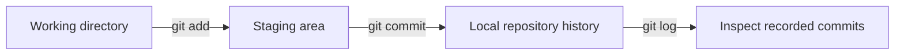
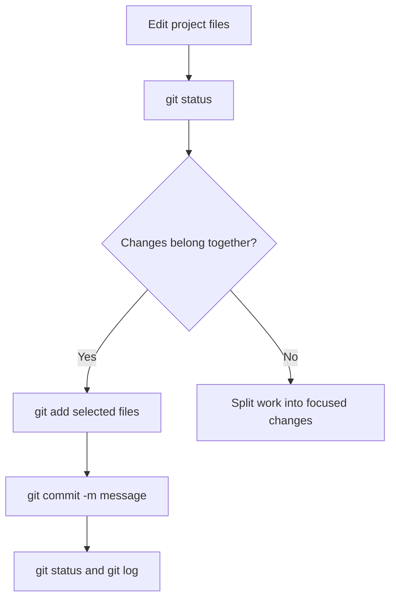
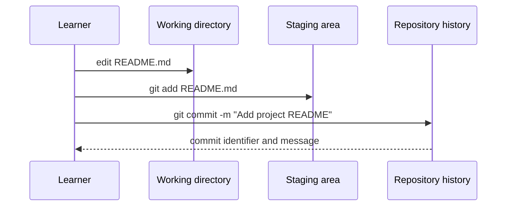

> **Navigation:** [Previous: Chapter 04](04-creating-your-first-repository.md) | [Roadmap](../../ROADMAP.md) | [Next: Chapter 06](06-branching-strategies.md)
>
> **Level:** Beginner · **Estimated Time:** 75 min · **Prerequisites:** [Chapter 02: Git Architecture](02-git-architecture.md) and [Chapter 04: Creating Your First Repository](04-creating-your-first-repository.md)

# Working with Commits

## Learning Objectives

By the end of this chapter, you will be able to:

- inspect changed, staged, and committed content with `git status`;
- select an intentional snapshot with `git add`;
- create a commit with a concise, meaningful message;
- inspect recent history with `git log`;
- separate unrelated changes into different commits.

## Introduction

A commit is a recorded snapshot of deliberately selected project changes. It is not an automatic backup of everything in a folder. Git gives you a staging area between your working directory and the repository history so you can decide exactly what belongs in the next snapshot.

This chapter uses one small project file and one focused change. The same pattern scales to teams: inspect the work, select related changes, describe their purpose, then verify the recorded history.

## Visual Learning



_Figure 1. A commit records staged content, not every change in the working directory._



_Figure 2. Inspect before and after each state-changing command._

## Why This Matters

Commit history is a communication tool. A clear commit lets a teammate, reviewer, or future you understand what changed and why. Small, focused commits are easier to review, revert, troubleshoot, and combine with other work than one large snapshot of unrelated edits.

The staging area is what makes that discipline possible. You may edit several files while exploring a problem, then stage only the files that form one complete change. Do not treat `git add .` as a reflex; first check what it would include.

## Key Terms

| Term           | Definition                                                 |
| -------------- | ---------------------------------------------------------- |
| Change         | A difference between a file and its last recorded version. |
| Staging area   | The selected content Git will place in the next commit.    |
| Stage          | Select a file or part of a change for the next commit.     |
| Commit         | A named snapshot recorded in local repository history.     |
| Commit message | A concise description of the purpose of a commit.          |
| History        | The ordered sequence of commits in a repository.           |

## Theory

### Inspect Before You Stage

Use `git status` frequently:

```bash
git status
```

It groups files by their state. Untracked files have not been added to Git yet. Changes not staged for commit are tracked files with edits in the working directory. Changes to be committed are already in the staging area.

### Stage Deliberately with `git add`

Stage one file by naming it:

```bash
git add README.md
```

Then inspect again:

```bash
git status
```

The file should move to the section labeled "Changes to be committed." `git add .` stages many files beneath the current directory. It can be appropriate only after you have inspected the complete list and confirmed every change belongs in the same commit.

### Record the Snapshot with `git commit`

Create a commit from staged content:

```bash
git commit -m "Add project README"
```

The message starts with a verb and describes the change's purpose. It should not merely repeat a filename or use a vague message such as `updates`. A commit uses only staged content; unstaged changes remain in the working directory for a later decision.



_Figure 3. The commit is created from the staging area after a deliberate selection._

### Verify the Result

After a commit, inspect both current state and history:

```bash
git status
git log --oneline
```

`git status` should report a clean working tree if no further changes exist. `git log --oneline` displays each commit on one line with a short identifier and its message. The exact identifier differs on every computer.

## Practical Examples

### Example 1: Create the First Commit

From the repository created in Chapter 04, create `README.md` and then run:

```bash
git status
git add README.md
git commit -m "Add project README"
git log --oneline
```

Expected result: the commit history contains one commit named `Add project README`.

### Example 2: Keep an Unrelated Change Unstaged

Suppose you update `README.md` and also create a temporary `notes.txt` file. To commit only the README change:

```bash
git add README.md
git status
git commit -m "Clarify project setup"
```

Expected result: the README change is committed while `notes.txt` remains untracked. This is useful when the files represent different work.

### Example 3: Correct a Staging Decision

If you staged a file too early, remove it from the staging area without discarding its working-directory changes:

```bash
git restore --staged notes.txt
git status
```

Expected result: `notes.txt` is no longer staged, but its content remains on disk. Read `git status` after the command to confirm the state.

## Try It Yourself

1. Open the practice repository from Chapter 04.
2. Add a heading and one sentence to `README.md`.
3. Run `git status`, then stage only `README.md`.
4. Create a commit with a message beginning with a verb.
5. Run `git status` and `git log --oneline` to verify the result.

## Best Practices

- Check `git status` before staging and before committing.
- Stage named files when you are learning or when the change must remain focused.
- Write commit messages that explain the purpose of the change.
- Keep unrelated work out of the same commit.
- Verify history after meaningful work instead of assuming the commit succeeded.

## Common Mistakes

| Mistake                                     | Why it causes problems                               | How to avoid it                                   |
| ------------------------------------------- | ---------------------------------------------------- | ------------------------------------------------- |
| Running `git commit` before staging         | Git has no selected content to record.               | Use `git status`, then stage the intended files.  |
| Using `git add .` without inspection        | Unrelated files can become part of the commit.       | Review `git status` and name files deliberately.  |
| Writing `update` as a commit message        | History does not explain what changed or why.        | Start with a clear verb and describe the purpose. |
| Assuming a staged file is already committed | The staging area is only the next snapshot proposal. | Run `git log --oneline` after committing.         |

## Summary

- `git status` explains the current working and staging state.
- `git add` selects content for the next commit.
- `git commit -m` records only staged content with a message.
- `git log --oneline` verifies local history.
- Focused commits make future collaboration safer and clearer.

## Next Chapter

The next chapter introduces branches, which let you develop a focused line of work without changing the main line directly.

### Related Content

- Previous chapter: [Chapter 04 - Creating Your First Repository](04-creating-your-first-repository.md)
- Next chapter: [Chapter 06 - Branching Strategies](06-branching-strategies.md)
- Exercise: [Create a Focused Commit](../../exercises/en/05-create-a-focused-commit.md)
- Lab: [Create Focused Commits](../../labs/en/05-create-focused-commits.md)
- Quiz: [Working with Commits Quiz](../../quizzes/en/05-working-with-commits-quiz.md)

## Further Reading

- [Git Book: Recording Changes to the Repository](https://git-scm.com/book/en/v2/Git-Basics-Recording-Changes-to-the-Repository)
- [Git Reference: git-commit](https://git-scm.com/docs/git-commit)
