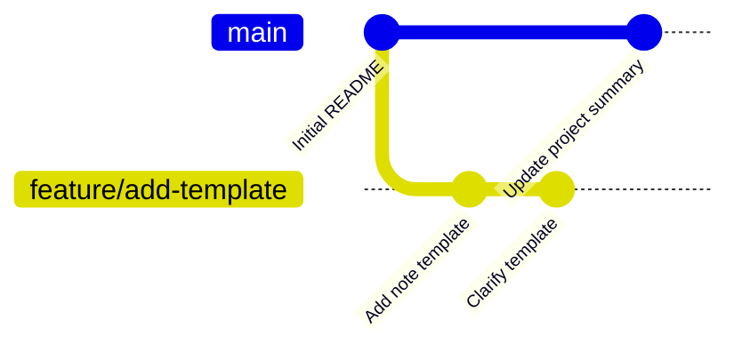
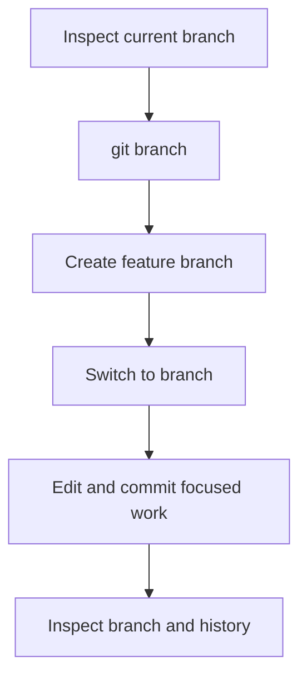
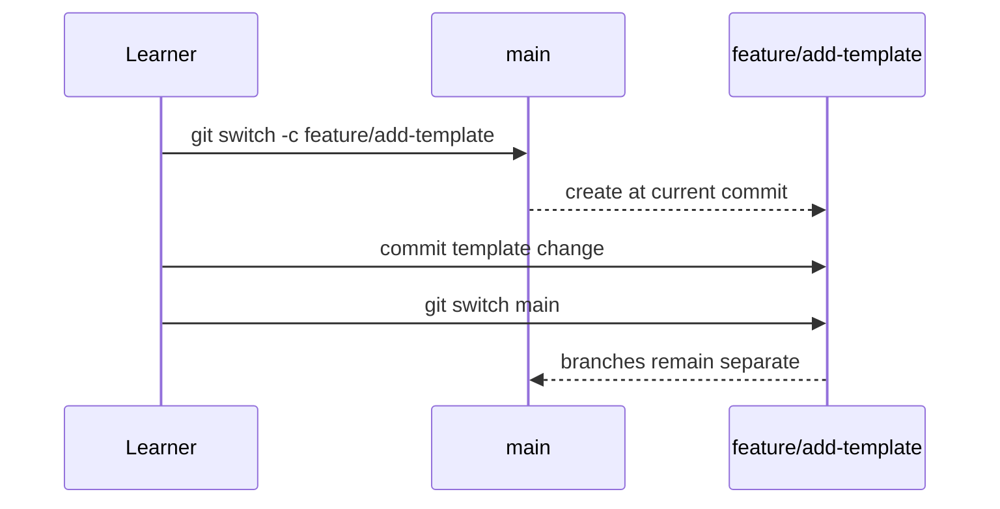

> **Navigation:** [Previous: Chapter 05](05-working-with-commits.md) | [Roadmap](../../ROADMAP.md) | [Next: Chapter 07](07-merge-and-merge-conflicts.md)
>
> **Level:** Beginner · **Estimated Time:** 75 min · **Prerequisites:** [Chapter 05: Working with Commits](05-working-with-commits.md)

# Branching Strategies

## Learning Objectives

By the end of this chapter, you will be able to:

- explain why branches protect a stable line of work;
- list and inspect local branches;
- create and switch to a feature branch;
- create focused commits on the correct branch;
- choose clear, purpose-based branch names.

## Introduction

A branch is a named line of development in one Git repository. It lets you work on a feature, fix, or experiment without changing the branch that represents the current stable project state. Git branches are lightweight references to commits, not separate copies of every project file.

This chapter concentrates on creating and using branches safely. Bringing changes back together through merge and resolving competing changes are the subjects of Chapter 07.

## Visual Learning



_Figure 1. Branches let related work progress from a shared starting point without changing `main` directly._



_Figure 2. Confirm where you are before recording a branch-specific change._

## Why This Matters

Teams use branches to keep the main line stable while work is reviewed, tested, or still incomplete. A focused branch makes it clear which commits belong to one task. It also gives you a safe place to experiment without mixing that work into unrelated changes.

Branch names are communication. A name such as `feature/add-template` gives reviewers and teammates more useful context than `new-branch`. Naming conventions vary by team; the important habit is to make the purpose readable and keep one branch focused on one goal.

## Key Terms

| Term           | Definition                                                     |
| -------------- | -------------------------------------------------------------- |
| Branch         | A named reference to a line of commits.                        |
| `main`         | Common name for a repository's primary branch.                 |
| Feature branch | A branch used for one focused enhancement.                     |
| Checkout       | Switch the working directory to a branch.                      |
| HEAD           | Git's reference to the currently checked-out commit or branch. |
| Divergence     | The point where branch histories contain different commits.    |

## Theory

### Inspect Branches Before Creating One

List local branches:

```bash
git branch
```

Git marks the current branch with `*`. Check it before making a branch or a commit. In a new repository, the primary branch is commonly `main`, but a repository can use a different configured name.

### Create and Switch to a Feature Branch

Create a branch, then switch to it:

```bash
git branch feature/add-template
git switch feature/add-template
```

Or use a single command:

```bash
git switch -c feature/add-template
```

`-c` means create. The new branch begins at the commit currently checked out. It does not upload anything or merge any work.

### Work on One Purpose per Branch

After switching, make and commit only changes related to the branch purpose:

```bash
git status
git add template.md
git commit -m "Add note template"
```

The commit belongs to the feature branch because that is the branch currently checked out. Use `git status` and `git branch` to verify location before each meaningful commit.



_Figure 3. Switching branches changes the active line; it does not merge their work._

### Compare Branch History

Use a compact graph to inspect all local branch commits:

```bash
git log --oneline --graph --all
```

The output shows commit identifiers and branch lines. The exact drawing differs with each repository, but branch-specific commits should appear on their own line until a later merge.

## Practical Examples

### Example 1: Create a Documentation Branch

```bash
git switch -c docs/add-installation-note
git branch
```

Expected result: the new branch is marked with `*`. The `main` branch remains available and unchanged.

### Example 2: Make a Focused Branch Commit

```bash
git add installation.md
git commit -m "Add installation note"
git status
```

Expected result: the commit is recorded on the current documentation branch. A clean status means there are no remaining local changes on that branch.

### Example 3: Return to the Main Line

```bash
git switch main
git log --oneline --graph --all
```

Expected result: the working directory returns to the main branch state. The feature branch commit still exists, but it has not been merged into `main`.

## Try It Yourself

1. Open the practice repository from Chapter 05 and ensure `git status` is clean.
2. Create `feature/add-template` with `git switch -c`.
3. Add a small `template.md` file and commit it.
4. Switch back to the primary branch.
5. Use `git log --oneline --graph --all` to identify the feature commit.

## Best Practices

- Start a branch from a known, clean commit when possible.
- Use names that identify the type and purpose of the work.
- Verify the current branch before committing.
- Keep one branch focused on one change or task.
- Keep unfinished branch work out of `main` until it is ready to integrate.

## Common Mistakes

| Mistake                                     | Why it causes problems                             | How to avoid it                                        |
| ------------------------------------------- | -------------------------------------------------- | ------------------------------------------------------ |
| Committing on `main` by accident            | Incomplete work changes the primary line directly. | Run `git branch` or `git status` before committing.    |
| Naming a branch `test` or `new`             | The purpose is unclear to collaborators.           | Use a descriptive name such as `feature/add-template`. |
| Treating a branch as a full repository copy | It makes Git's shared history confusing.           | Remember that branches are references to commits.      |
| Expecting a switch to merge changes         | Switching only changes the active branch.          | Learn integration and merge behavior in Chapter 07.    |

## Summary

- A branch is a separate named line of commits in one repository.
- `git branch` lists branches and marks the active branch.
- `git switch -c <name>` creates and checks out a branch.
- Focused names and focused commits keep branch purpose clear.
- Branch work remains separate until a later integration step.

## Next Chapter

Chapter 07 brings branch work together with merges and explains why conflicts occur when branches change the same content differently.

### Related Content

- Previous chapter: [Chapter 05 - Working with Commits](05-working-with-commits.md)
- Next chapter: [Chapter 07 - Merge & Merge Conflicts](07-merge-and-merge-conflicts.md)
- Exercise: [Create a Feature Branch](../../exercises/en/06-create-a-feature-branch.md)
- Lab: [Create and Inspect Branches](../../labs/en/06-create-and-inspect-branches.md)
- Quiz: [Branching Strategies Quiz](../../quizzes/en/06-branching-strategies-quiz.md)

## Further Reading

- [Git Book: Git Branching](https://git-scm.com/book/en/v2/Git-Branching-Branches-in-a-Nutshell)
- [Git Reference: git-switch](https://git-scm.com/docs/git-switch)
