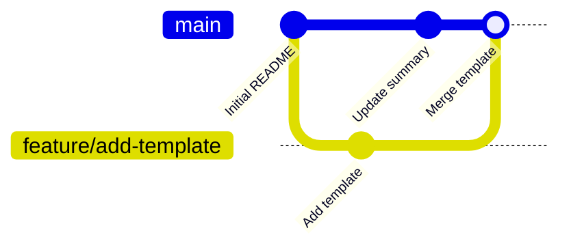
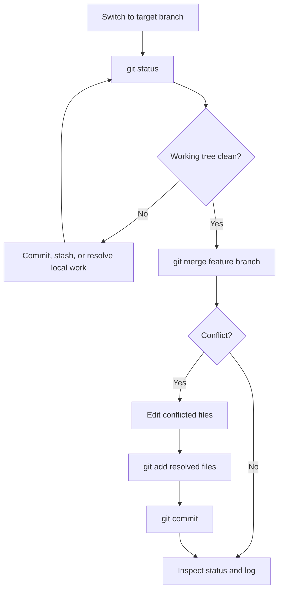
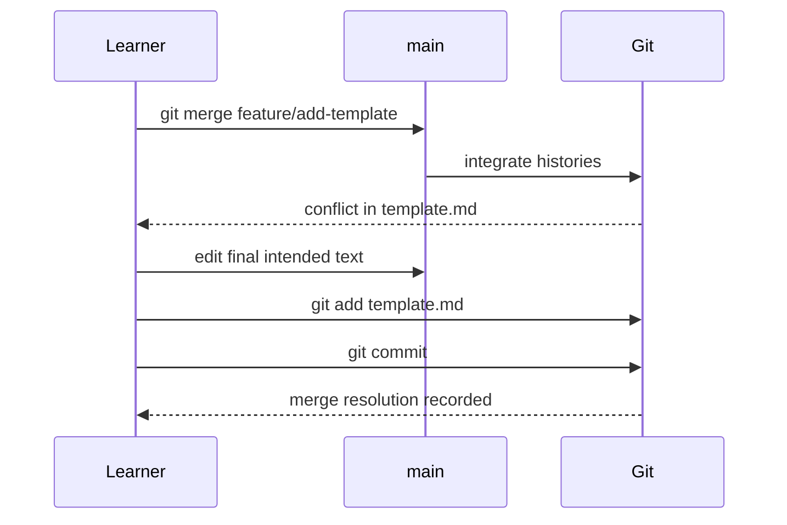

> **Navigation:** [Previous: Chapter 06](06-branching-strategies.md) | [Roadmap](../../ROADMAP.md) | Next: Chapter 08 coming soon
>
> **Level:** Beginner · **Estimated Time:** 90 min · **Prerequisites:** [Chapter 06: Branching Strategies](06-branching-strategies.md)

# Merge and Merge Conflicts

## Learning Objectives

By the end of this chapter, you will be able to:

- explain what a merge integrates and what it does not do;
- prepare a clean working tree before merging;
- merge a focused branch into the current branch;
- identify and resolve a simple text conflict deliberately;
- verify the merge result in status and history.

## Introduction

Branches keep work separate; a merge brings a completed line of work into another branch. The usual beginner workflow is to switch to `main`, merge a ready feature branch, then inspect the resulting history. A merge is local until a later chapter introduces remotes and push operations.

A merge conflict is not a failure to be feared or hidden. It is Git asking for a human decision because two branches changed overlapping content in different ways. Git preserves both versions in the file so you can choose the intended final text.

## Visual Learning



_Figure 1. A merge integrates a feature branch's commits into the target branch._



_Figure 2. A conflict is a controlled pause for a human decision, followed by normal staging and committing._

## Why This Matters

Merging is how independently developed work becomes a shared project state. A clean, focused merge makes a change easier to review and recover. Checking the target branch and working tree before merging prevents accidental integration in the wrong place.

Conflicts are part of collaboration. The dangerous behavior is accepting one side blindly or deleting markers without reading both changes. The correct resolution reflects the intended product behavior, not merely the fastest way to make Git continue.

## Key Terms

| Term            | Definition                                                        |
| --------------- | ----------------------------------------------------------------- |
| Target branch   | The checked-out branch that receives merged work.                 |
| Source branch   | The branch whose commits are being integrated.                    |
| Fast-forward    | A merge where the target can move directly to the source commit.  |
| Merge commit    | A commit that records the integration of divergent histories.     |
| Conflict        | Git's request for a human decision about overlapping changes.     |
| Conflict marker | Text Git inserts to show competing versions in a conflicted file. |

## Theory

### Merge from the Intended Target Branch

To integrate a feature into `main`, first check out `main` and verify state:

```bash
git switch main
git status
git merge feature/add-template
```

`git merge` integrates the named source branch into the current branch. It does not delete the source branch, upload changes, or automatically make unrelated working-directory changes safe.

### Fast-forward and Merge Commits

If `main` has no new commits since the feature branch started, Git may fast-forward: it moves the `main` reference to the feature commit. If both lines have commits, Git may create a merge commit. Both results can be valid; inspect the graph rather than assuming one history shape.

```bash
git log --oneline --graph --all
```

### Read Conflict Markers Before Editing

When Git cannot combine changes automatically, a file can contain markers like these:

```text
<<<<<<< HEAD
Current text from the target branch
=======
Incoming text from the source branch
>>>>>>> feature/add-template
```

`HEAD` identifies the version from the current target branch. The lower label identifies the incoming source branch. Replace the complete marked region with the final intended content, including either side or a newly composed version. Then stage and commit the resolution.



_Figure 3. A conflict resolution becomes part of repository history only after it is staged and committed._

### Abort Only When You Need to Start Over

If you decide not to complete the merge, use:

```bash
git merge --abort
```

This returns the repository to its pre-merge state when possible. It is not a substitute for understanding the conflict; use it when the merge was started on the wrong target or needs a different plan.

## Practical Examples

### Example 1: Merge a Ready Feature

```bash
git switch main
git status
git merge feature/add-template
git log --oneline --graph --all
```

Expected result: the template commit is reachable from `main`, and status reports a clean working tree.

### Example 2: Resolve One Text Conflict

After a conflict in `README.md`, edit the file until no `<<<<<<<`, `=======`, or `>>>>>>>` markers remain. Then run:

```bash
git add README.md
git status
git commit
```

Expected result: Git records the resolution with the merge. Read the final file before staging to ensure the text represents the intended outcome.

### Example 3: Abort an Accidental Merge

```bash
git merge --abort
git status
```

Expected result: the merge attempt is abandoned and the repository returns to the prior state. Check the branch before trying again.

## Try It Yourself

1. Start from a clean repository with a feature branch containing one commit.
2. Switch to the primary branch and run `git status`.
3. Merge the feature branch.
4. Run `git log --oneline --graph --all` and explain the resulting history.
5. For a practice conflict, make different edits to the same README line on two branches, then merge and resolve the final text deliberately.

## Best Practices

- Confirm the target branch before every merge.
- Merge only with a clean working tree unless you understand the local changes.
- Read both conflict versions before choosing the final content.
- Remove every conflict marker before staging a resolution.
- Inspect status and history after a merge.

## Common Mistakes

| Mistake                                           | Why it causes problems                            | How to avoid it                                            |
| ------------------------------------------------- | ------------------------------------------------- | ---------------------------------------------------------- |
| Merging while on the feature branch               | The intended target may not receive the work.     | Switch to and verify the target branch first.              |
| Deleting conflict markers without reading content | Valid work from one branch can be lost.           | Decide the final behavior, then rewrite the marked region. |
| Committing before all conflicts are resolved      | Git cannot complete the merge cleanly.            | Use `git status` to find every unmerged path.              |
| Assuming a merge pushes to a remote               | Local history and remote publishing are separate. | Learn remote workflows in the GitHub chapters.             |

## Summary

- Merge a source branch into the branch currently checked out.
- A clean status and correct target branch are prerequisites for a safe merge.
- Conflicts expose competing edits and require an intentional final version.
- Stage and commit resolved files, then inspect status and history.
- `git merge --abort` is available when a merge must be abandoned.

## Next Chapter

Chapter 08 explores the internal objects and references that make commits, branches, and merges reliable.

### Related Content

- Previous chapter: [Chapter 06 - Branching Strategies](06-branching-strategies.md)
- Next chapter: Chapter 08 - Git Internals (coming soon)
- Exercise: [Merge a Feature Branch](../../exercises/en/07-merge-a-feature-branch.md)
- Lab: [Resolve a Merge Conflict](../../labs/en/07-resolve-a-merge-conflict.md)
- Quiz: [Merge and Merge Conflicts Quiz](../../quizzes/en/07-merge-and-merge-conflicts-quiz.md)

## Further Reading

- [Git Book: Basic Branching and Merging](https://git-scm.com/book/en/v2/Git-Branching-Basic-Branching-and-Merging)
- [Git Reference: git-merge](https://git-scm.com/docs/git-merge)
