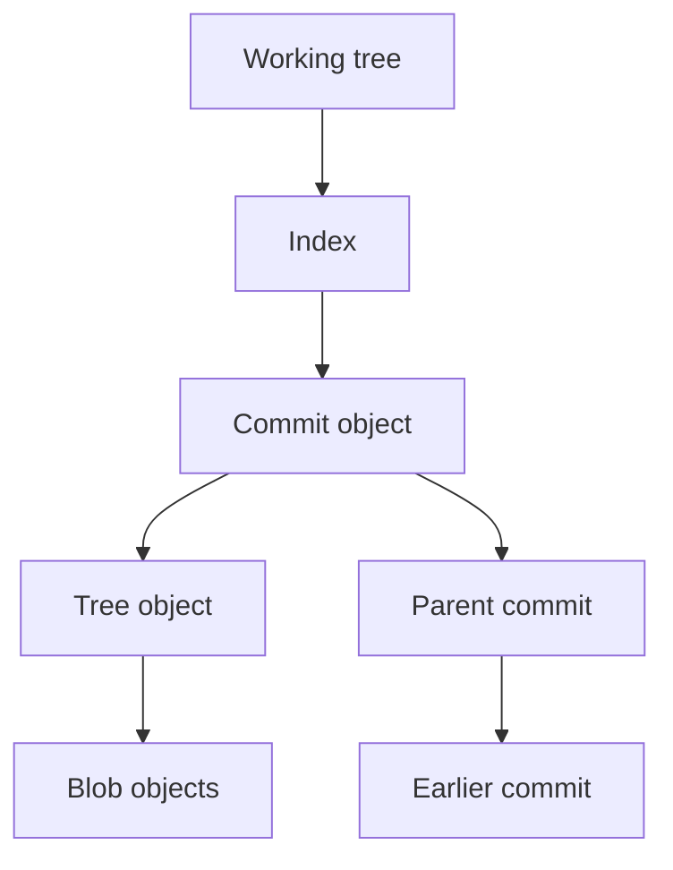
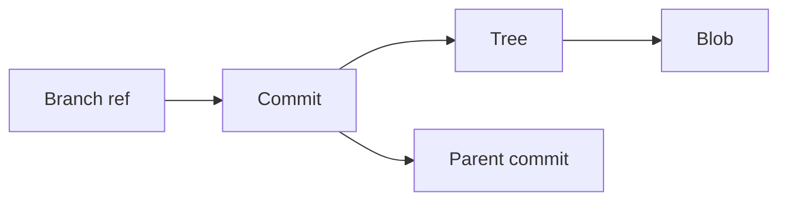

> **Navigation:** [Previous: Chapter 07](07-merge-and-merge-conflicts.md) | [Roadmap](../../ROADMAP.md) | Next: Chapter 09 coming soon
>
> **Level:** Intermediate · **Estimated Time:** 75 min · **Prerequisites:** [Chapter 07: Merge and Merge Conflicts](07-merge-and-merge-conflicts.md)

## Learning Objectives

By the end of this chapter, you will be able to:

- explain the core Git object model and how it stores project history;
- distinguish blobs, trees, commits, and refs in a repository;
- identify the purpose of `.git` and explain how branch pointers work;
- inspect repository objects using Git plumbing commands;
- understand why Git can recover content and history reliably.

## Introduction

A Git repository often feels like a system of commands: `git add`, `git commit`, `git branch`, and `git merge`. Those commands are powerful, but they are only the user-facing layer. Underneath them, Git stores data in a simple, durable object model.

This chapter moves below the command surface and explains the structure that makes Git reliable. You will see that Git is not an abstract “version tracker” only. It is a content-addressable database of objects, references, and metadata that records project snapshots and their connections.

Understanding the internals helps you reason about why Git can recover earlier versions, combine branches, and detect changes without relying on file names like `final-v2` or `backup-old`.

## Visual Learning



_Figure 1. A commit points to a tree, which points to file content, while parent commits form the historic chain._



_Figure 2. Branches are references to commits, and commits structure the repository history._

## Why This Matters

The more confident you become with Git, the more often you will encounter situations where a simple command is not enough. You may need to understand why a branch is pointing somewhere unexpected, why a file disappeared, or why a commit hash matters.

Git internals are not only for advanced users. They explain the reason Git works so well in real projects:

- commits are immutable snapshots of project state;
- hashes provide integrity checks for content;
- branch names are lightweight pointers to commit history;
- the index acts as the staging area before a commit;
- repository metadata is stored in a hidden `.git` directory.

When a team relies on Git for release coordination, debugging, and collaboration, these underlying concepts are exactly what make the workflow dependable.

## Key Terms

| Term            | Definition                                                                                   |
| --------------- | -------------------------------------------------------------------------------------------- |
| Blob            | A Git object storing file content without filename metadata.                                 |
| Tree            | A Git object representing a directory and the names of files or subdirectories within it.    |
| Commit          | A Git object that records metadata such as author, message, timestamp, and parent commit(s). |
| Ref             | A pointer such as a branch name or tag that points to a commit.                              |
| HEAD            | The symbolic reference that tells Git which branch or commit is currently checked out.       |
| Index           | The staging area where changes are prepared before a commit.                                 |
| Object database | The `.git/objects` directory where Git stores internal content-addressed objects.            |
| Hash            | A content-based identifier used to name Git objects and verify integrity.                    |

## Theory

### Git Stores Content, Not Only Files

Git treats project history as a set of immutable objects. When you save a file and commit it, Git stores:

- the file content as a blob;
- a tree that records the file path and references the blob;
- a commit that references the tree and the parent commit.

This is different from storing a list of text differences only. Git stores snapshots and then uses the relationships between snapshots to reconstruct history.

```bash
git init
echo "hello" > hello.txt
git add hello.txt
git commit -m "Add hello file"
```

In that flow, the repository keeps the content of the file, the directory structure, and the commit metadata. Git does not need to guess which version came earlier because the stored objects are connected by commit ancestry.

### The Four Core Git Objects

Git's object model is built around four major ideas:

| Object Type | Purpose                                      | Example                       |
| ----------- | -------------------------------------------- | ----------------------------- |
| Blob        | stores file contents                         | the raw text of `README.md`   |
| Tree        | stores directory structure and file names    | `src/` and `README.md`        |
| Commit      | stores metadata and parent links             | author, date, message, parent |
| Tag         | optional named pointer to a commit or object | release version marker        |

A blob does not know the filename. It only stores the content. The filename and path are tracked by a tree object, which is why Git can rename or move files without losing the content history.

A commit then points to a tree, which keeps the state of the repository at that moment. The commit also points to its parent commit, creating a chain of project history.

### Commit History Is a Linked Chain

Each new commit stores its parent or parents. This gives Git a chain of snapshots. If you inspect a commit, you can see the previous state and understand what changed.

```bash
git log --oneline --decorate --graph --all
```

A merge commit has more than one parent because it joins two histories. A normal commit usually has exactly one parent.

The graph is not decorative. It is the actual structure of the repository's history.

### Branches Are Just Pointers

A branch name such as `main` or `feature/login-form` is simply a reference to a commit. When you run `git branch`, Git is not creating a complete second copy of the project. It is creating a lightweight pointer.

This is why creating a new branch is generally cheap: it points to an existing commit rather than duplicating all files.

```bash
git branch feature/layout-fix
git log --oneline --decorate --graph --all
```

When you move a branch forward with a new commit, the branch pointer moves. The underlying objects remain the same unless new content is created.

### HEAD Points to the Current State

`HEAD` is Git's way of telling you which branch or commit is currently checked out. It is often a symbolic reference to `refs/heads/main`.

```bash
git rev-parse HEAD
git symbolic-ref HEAD
```

The first command prints the current commit hash. The second prints the branch name. This is a practical distinction: the branch and the commit are related, but they are not the same concept.

### The Index Stages Changes Before Commit

Before `git commit`, Git stages content in the index. The index is a temporary snapshot used to assemble the next commit. It is not the same as the working directory, and it is not the same as the last commit.

```bash
git status
```

The index is why Git can separate “edited files” from “files prepared to be committed.” This staging step gives more control over what enters the next snapshot.

### The `.git` Directory Is the Repository

A Git repository contains a hidden `.git` directory with several important parts:

```text
.git/
├── HEAD
├── config
├── description
├── index
├── hooks/
├── info/
├── objects/
├── refs/
└── packed-refs
```

The most important directories are:

- `objects/`: stores blobs, trees, commits, and tags;
- `refs/`: stores branch and tag references;
- `HEAD`: tells Git which branch or commit is checked out;
- `index`: tracks staged content.

This hidden directory is the real repository data store. The files you work with in the project folder are the working tree; `.git` stores the history and metadata that make that work versioned.

### Hashes Make Content Identifiable

Git uses SHA-1 or SHA-256 based on the object content (depending on the configured repository), producing a hash that uniquely identifies the object. This hash is used as the object name.

```bash
git hash-object README.md
```

The same content should produce the same hash in the same repository context. Git can therefore detect whether content is already stored and avoid unnecessary duplication. This is one reason Git is efficient even for large projects.

### Plumbing Commands Reveal the Internal View

The everyday commands are user-friendly, but Git also includes low-level plumbing commands for inspecting internals.

```bash
git cat-file -t HEAD
git cat-file -p HEAD
git ls-tree -r HEAD
git rev-list --max-count=5 HEAD
```

These commands expose the raw objects behind the Git workflow. They are especially useful when you need to debug repository state or understand exactly what has been recorded.

## Practical Examples

### Example 1: Inspect a Commit Object

```bash
git init
echo "Hello, Git" > notes.txt
git add notes.txt
git commit -m "Add notes"
git cat-file -t HEAD
git cat-file -p HEAD
```

Expected result: `git cat-file -t HEAD` returns `commit`, and `git cat-file -p HEAD` prints the commit metadata and parent information.

### Example 2: Inspect a Tree and Blob

```bash
git ls-tree -r HEAD
git rev-parse HEAD
git cat-file -p HEAD^{tree}
```

Expected result: you see the files in the tree and the object identity of the current snapshot. The commit points to a tree; the tree points to the stored blobs.

### Example 3: Compare Hashes and Content

```bash
git hash-object notes.txt
git rev-parse HEAD
git status
```

Expected result: the file content hash and the current commit hash are different concepts. The blob hash identifies file content; the commit hash identifies the record of that state and its metadata.

### Example 4: View the Current Branch Pointer

```bash
git symbolic-ref HEAD
git rev-parse --abbrev-ref HEAD
```

Expected result: Git prints the branch name the repository is currently pointing to.

## Try It Yourself

1. Initialize a new repository and create a short file.
2. Add and commit the file.
3. Run `git cat-file -t HEAD` and `git cat-file -p HEAD`.
4. Run `git ls-tree -r HEAD`.
5. Explain in your own words what the commit, tree, and blob objects represent.

Write down the object names you see. Then answer: what is the relationship between the file content, the tree, and the commit?

## Best Practices

- Use `git status` before exploring internals so you understand whether the working tree is clean.
- Treat branch names as symbolic references, not as copies of the project.
- Use `git cat-file` and `git ls-tree` to inspect the repository instead of guessing about its state.
- Remember that commit history is a linked graph, not a list of unrelated snapshots.
- Understand `.git` as the repository data store rather than a hidden accident of Git.

## Common Mistakes

| Mistake                                            | Why it causes problems                                   | How to avoid it                                                             |
| -------------------------------------------------- | -------------------------------------------------------- | --------------------------------------------------------------------------- |
| Confusing a branch name with a copy of the project | It hides the fact that branches are pointers to commits. | Think of a branch as a label pointing at a commit.                          |
| Assuming the file system is the whole repository   | Important metadata lives in `.git`.                      | Work with the repository as a combination of working tree and Git metadata. |
| Ignoring the index                                 | Staged files are not the same as committed files.        | Use `git status` before and after `git add`.                                |
| Thinking Git stores only diffs                     | Git stores snapshots and their relationships.            | Understand blobs, trees, and commits together.                              |
| Treating hashes as random values                   | They are deterministic identifiers for content.          | Use hashes to check content identity and integrity.                         |

## Summary

- Git records project state as objects: blobs, trees, commits, and refs.
- A commit points to a tree, which points to blob content, and parent commits form history.
- Branches are lightweight references to commits rather than full duplicate copies.
- `HEAD` identifies the currently checked-out branch or commit.
- The index holds staged changes before a commit is created.
- The `.git` directory stores the repository's internal metadata and object database.
- Plumbing commands such as `git cat-file` and `git ls-tree` reveal the real structure behind Git commands.

## Exercise

### Objective

Inspect the repository internals of your own project and connect them to the commit history.

### Task

1. Create a small repository with at least two commits.
2. Run `git log --oneline --graph --all`.
3. Run `git rev-parse HEAD` and `git symbolic-ref HEAD`.
4. Run `git ls-tree -r HEAD`.
5. Run `git cat-file -t HEAD` and `git cat-file -p HEAD`.
6. Write a short explanation of what each command revealed.

### Expected Outcome

You can explain how a commit references the project state, how a branch points to a commit, and how Git stores file content internally.

## Lab

### Objective

Explore a repository from the object store outward and relate the internal model to everyday Git commands.

### Requirements

- Git installed locally
- A repository with at least one commit
- Basic familiarity with `git status`, `git log`, and `git add`

### Tasks

1. Initialize a repository and create two files.
2. Commit the files and inspect the commit object with `git cat-file -p HEAD`.
3. Use `git ls-tree -r HEAD` to inspect the repository tree.
4. Use `git rev-list --max-count=5 HEAD` to examine commit ancestry.
5. Create a new branch and ensure the pointer moves to the current commit.
6. Compare your understanding with `git status` and `git log --oneline`.

### Expected Outcome

You can explain the relationship between the working tree, the index, the branch pointer, and the internal object model without relying on guesswork.

## Quiz

1. Which Git object stores file content without naming the file itself?
2. What does a branch name point to in Git?
3. What is the role of the index before a commit?
4. Which command prints the internal metadata of the current commit?
5. Why is `HEAD` important when working with a repository?

### Expected Answers

1. A blob.
2. A commit.
3. It stages the next snapshot before the commit is created.
4. `git cat-file -p HEAD`.
5. It tells Git which branch or commit is currently checked out.

## Next Chapter

Chapter 09 continues the Git Foundations part by moving from repository structure to more advanced Git workflows, recovery techniques, and practical collaboration patterns.

### Related Content

- Previous chapter: [Chapter 07 - Merge and Merge Conflicts](07-merge-and-merge-conflicts.md)
- Next chapter: Chapter 09 (coming soon)
- Exercise: [Inspect Git Objects](../../exercises/en/08-inspect-git-objects.md)
- Lab: [Explore Git Repository Internals](../../labs/en/08-explore-git-repository-internals.md)
- Quiz: [Git Internals Quiz](../../quizzes/en/08-git-internals-quiz.md)

## Further Reading

- [Git Book: Git Objects](https://git-scm.com/book/en/v2/Git-Internals-Git-Objects)
- [Git Documentation: git-cat-file](https://git-scm.com/docs/git-cat-file)
- [Git Documentation: git-ls-tree](https://git-scm.com/docs/git-ls-tree)
- [Git Documentation: git-branch](https://git-scm.com/docs/git-branch)
