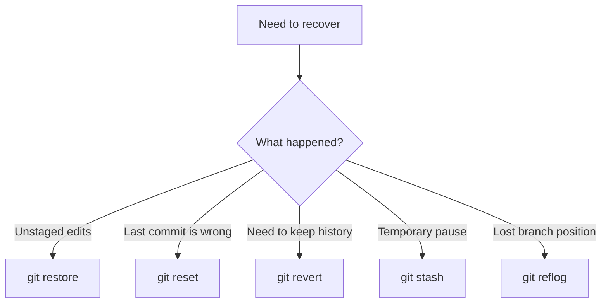
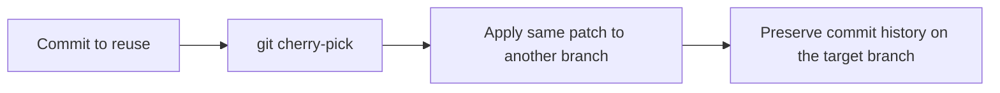

> **Navigation:** [Previous: Chapter 08](08-git-internals.md) | [Roadmap](../../ROADMAP.md) | Next: Chapter 10 coming soon
>
> **Level:** Intermediate · **Estimated Time:** 80 min · **Prerequisites:** [Chapter 08: Git Internals](08-git-internals.md)

## Learning Objectives

By the end of this chapter, you will be able to:

- explain when to use `git restore`, `git reset`, and `git revert`;
- recover work from a bad commit or accidental edit without losing the overall project history;
- temporarily store unfinished changes using `git stash`;
- inspect the recent history of a repository with `git reflog` and `git log`;
- selectively apply a commit with `git cherry-pick` and understand when that is useful.

## Introduction

Experienced Git users do not avoid mistakes; they plan for them. A repository is not only a place to save work. It is also a system for recovering from mistakes, comparing states, and moving a useful change to the correct place.

This chapter focuses on the practical techniques that make Git resilient in everyday development. You will learn the difference between undoing a change, discarding a change, and preserving an earlier working state. You will also discover how to inspect Git's recent record of movement when a branch pointer or commit has changed unexpectedly.

The goal is not memorizing every command. The goal is knowing which Git safety tool matches the kind of mistake you made.

## Visual Learning



_Figure 1. Recovery tools are chosen according to the kind of mistake and whether history should be preserved or rewritten._



_Figure 2. `git cherry-pick` moves the effect of one commit to another branch without copying the whole branch history._

## Why This Matters

Real projects do not proceed without mistakes. A developer may commit before finishing a feature, accidentally remove a key line, or realize the wrong branch was updated. The cost of a mistake is not only the lost work; it is the time needed to reconstruct intent and decision-making.

Git gives you methods to handle these situations deliberately:

- `git restore` can undo a file back to the last committed or staged version;
- `git reset` can move a branch pointer backward when history is intentionally rewritten;
- `git revert` creates a new commit that reverses an earlier change while preserving history;
- `git stash` lets you park unfinished work temporarily;
- `git reflog` shows recent branch movements and recoverable references;
- `git cherry-pick` applies the commit effect to a different target branch.

These are everyday practices in real engineering teams because they reduce risk while making the repository history clear and understandable.

## Key Terms

| Term         | Definition                                                                                       |
| ------------ | ------------------------------------------------------------------------------------------------ |
| Reset        | Moves a branch or index reference backward to a chosen commit.                                   |
| Restore      | Restores a file or working tree to a previous state without rewriting commit history by default. |
| Revert       | Creates a new commit that reverses the effect of an earlier commit.                              |
| Stash        | Temporarily stores uncommitted changes so you can switch context safely.                         |
| Reflog       | A local record of branch and HEAD movement that helps recover recent state changes.              |
| Cherry-pick  | Applies the change introduced by one commit to another branch.                                   |
| Working tree | The files currently checked out in the project directory.                                        |

## Theory

### Understand the Recovery Question Before Choosing a Command

The first step is not “Which command is shortest?” but “What should happen to the history?” There are three common situations:

1. You want to undo the change in the current file but keep the project history.
2. You want to remove the most recent commit from the branch and move the branch pointer backward.
3. You want to reverse a change while leaving the original commit in the history.

These are different intentions and require different commands.

### Restore: Undo the Working Copy or Index

`git restore` is the safest and most explicit command for returning a file to a known state.

```bash
git restore README.md
```

This restores the file in the working tree to its last tracked version. If you want to undo a staged file, use:

```bash
git restore --staged README.md
```

You can also restore from another commit:

```bash
git restore --source HEAD~1 README.md
```

This is useful when you want to compare a file with an earlier version without rewriting branch history.

### Reset: Move the Branch Pointer Backward

`git reset` changes where a branch points. It is therefore a history-rewriting command. Use it carefully when the change is still local and you are intentionally correcting the repository state.

```bash
git reset --soft HEAD~1
git reset --mixed HEAD~1
git reset --hard HEAD~1
```

The modes differ:

- `--soft`: moves the branch pointer back but keeps changes staged;
- `--mixed`: moves the branch pointer back and unstages the changes;
- `--hard`: moves the branch pointer back and discards the changes in the working tree.

`--hard` is powerful but dangerous. It removes the changes from the working directory as well. Use it only when you are certain the work is no longer needed.

### Revert: Preserve History While Undoing a Change

A revert is safer than a reset when the commit is already shared or part of a public branch history. `git revert` creates a new commit that reverses the effect of an earlier commit without erasing its existence.

```bash
git revert HEAD
```

This keeps the original commit visible while adding the corrective commit. That makes it a better choice for team environments where the project history should remain transparent and reviewable.

### Stash: Temporarily Put Work Aside

Sometimes you need to stop working on a branch and switch to a different task without committing unfinished changes. `git stash` lets you save the current working state and return later.

```bash
git stash
```

Then later:

```bash
git stash list
git stash pop
```

You can also stash with a message:

```bash
git stash push -m "work in progress on CLI parser"
```

This is helpful when you need to switch branches, fix an urgent issue, or review another part of the project without losing context.

### Reflog: Recover from Recent Movement

`git reflog` records recent HEAD and branch movements in the local repository. This makes it especially useful when you accidentally reset or moved a branch and need to find the exact previous position.

```bash
git reflog
```

A reflog entry may show a prior branch pointer value such as `HEAD@{1}` or a reset point. You can then recover that state:

```bash
git reset --hard HEAD@{1}
```

This is one of the most practical recovery tools for local mistakes because it offers a trail of recent repository movements.

### Cherry-pick: Apply One Commit Elsewhere

Sometimes a bug fix or feature commit is useful in another branch without taking the entire branch history. `git cherry-pick` applies the change from one commit to the current branch.

```bash
git cherry-pick <commit-hash>
```

This creates a new commit with the same patch but a different commit hash. It is often used when a fix must be applied to a release branch or a hotfix branch while preserving the main branch's separate line of development.

### When to Use Which Command

| Situation                                                                | Recommended command | Why                                                             |
| ------------------------------------------------------------------------ | ------------------- | --------------------------------------------------------------- |
| You want to undo a specific file change in the working tree              | `git restore`       | It returns the file to a known state without rewriting history. |
| You want to move the current branch backward                             | `git reset`         | It changes the branch pointer intentionally.                    |
| You need to undo a published or shared commit safely                     | `git revert`        | It preserves history and adds a corrective commit.              |
| You need to pause work temporarily                                       | `git stash`         | It saves work without committing it.                            |
| You accidentally moved the branch and need to find the previous position | `git reflog`        | It records recent local Git movements.                          |
| You want to copy one commit's effect to another branch                   | `git cherry-pick`   | It applies the patch without merging the whole branch.          |

## Practical Examples

### Example 1: Undo a File Before Committing

```bash
git status
git restore README.md
git status
```

Expected result: the file changes are discarded in the working tree and the repository returns to the last tracked version.

### Example 2: Remove the Most Recent Commit Carefully

```bash
git log --oneline -n 3
git reset --soft HEAD~1
```

Expected result: the last commit is removed from the branch pointer, but the changes remain staged so you can review or rework them before creating a new commit.

### Example 3: Reverse a Change Without Erasing History

```bash
git revert HEAD
```

Expected result: Git creates a new commit that reverses the effect of the last commit while preserving the original one in history.

### Example 4: Pause Work and Resume Later

```bash
git stash push -m "temporary login work"
git stash list
git stash pop
```

Expected result: the unfinished work is saved and can later be restored without needing to commit half-finished work.

### Example 5: Recover from a Mistaken Reset

```bash
git reflog
git reset --hard HEAD@{1}
```

Expected result: Git returns the repository to a previous branch position recorded in the reflog.

## Try It Yourself

1. Create a repository with two or three commits.
2. Modify a file but do not commit it.
3. Use `git restore` to return it to the last committed state.
4. Commit a small bug fix.
5. Use `git revert HEAD` to reverse it while preserving the original commit history.
6. Create a new temporary change and stash it.
7. Run `git reflog` and identify the last branch movement you can recover.

Write a short note explaining which command you used and why that specific command was appropriate.

## Best Practices

- Use `git restore` before a commit when you want a reversible, low-risk undo.
- Prefer `git revert` over `git reset` when the commit may already be shared or reviewed by others.
- Use `git reflog` as a safety net before discarding work or moving a branch too far backwards.
- Reserve `git reset --hard` for very deliberate local cleanup, not routine recovery.
- Keep stash messages descriptive so you can restore the correct work later.

## Common Mistakes

| Mistake                                             | Why it causes problems                                       | How to avoid it                                            |
| --------------------------------------------------- | ------------------------------------------------------------ | ---------------------------------------------------------- |
| Using `git reset --hard` casually                   | It discards local changes immediately.                       | Confirm that the work is no longer needed before using it. |
| Reverting a commit without understanding the change | The wrong change may be reversed.                            | Inspect the diff first with `git show` or `git diff`.      |
| Stashing without a message                          | Future context becomes hard to recover.                      | Use `git stash push -m "purpose"`.                         |
| Ignoring the reflog                                 | Recent branch movements may be lost without a recovery path. | Check `git reflog` before assuming a branch is gone.       |
| Cherry-picking without checking the target branch   | A fix may be applied in the wrong place.                     | Confirm the current branch before copying a commit.        |

## Summary

- Recovery in Git depends on whether the project history should be preserved or rewritten.
- `git restore` is for undoing uncommitted or staged file changes safely.
- `git reset` rewrites branch history and should be used deliberately.
- `git revert` preserves history while undoing a commit.
- `git stash` temporarily saves unfinished work.
- `git reflog` helps recover from recent mistakes and accidental branch movement.
- `git cherry-pick` applies one commit's effect to another branch without moving the entire branch.

## Exercise

### Objective

Practice the recovery workflow without losing the ability to explain the choice of command.

### Task

1. Create a small repository with at least three commits.
2. Edit a file and use `git restore` to undo it.
3. Make a commit, then use `git revert HEAD` to reverse it.
4. Save work in a stash, switch branches, and restore the stash.
5. Use `git reflog` to identify the most recent branch movement.

### Expected Outcome

You can explain why each recovery command was chosen and when each one should be used.

## Lab

### Objective

Use a realistic workflow to recover from a mistake while preserving evidence in the repository history.

### Requirements

- Git installed locally
- A repository with at least one tracked file
- Comfortable using `git status`, `git log`, and `git diff`

### Tasks

1. Create a working file with a small project description.
2. Add a mistaken line and commit it.
3. Revert the commit using `git revert HEAD`.
4. Make a second change but do not commit it; stash it with a descriptive message.
5. Switch back to the branch and restore the stash.
6. Inspect `git reflog` and explain what the most recent movement tells you.

### Expected Outcome

You can recover from a failed or mistaken change while keeping a clear and understandable Git history.

## Quiz

1. Which command should you use to undo a modified file before the commit without rewriting history?
2. Which command changes the current branch pointer and is therefore a history-rewriting action?
3. What is the main safety benefit of `git revert`?
4. Why is `git reflog` useful after a mistaken reset?
5. When is `git cherry-pick` more useful than a normal merge?

### Expected Answers

1. `git restore`.
2. `git reset`.
3. It preserves the original commit while creating a corrective commit.
4. It records recent branch and HEAD movements so you can restore a previous state.
5. When you need the effect of one commit on another branch without merging the whole branch history.

## Next Chapter

Chapter 10 introduces the collaborative workflows used on GitHub, including cloning, remotes, forks, and the relationship between local Git history and remote repositories.

### Related Content

- Previous chapter: [Chapter 08 - Git Internals](08-git-internals.md)
- Next chapter: Chapter 10 (coming soon)
- Exercise: [Recover from a Bad Commit](../../exercises/en/09-recover-from-a-bad-commit.md)
- Lab: [Recover and Debug with Git](../../labs/en/09-recover-and-debug-with-git.md)
- Quiz: [Advanced Git Techniques Quiz](../../quizzes/en/09-advanced-git-techniques-quiz.md)

## Further Reading

- [Git Book: Undoing Things](https://git-scm.com/book/en/v2/Git-Basics-Undoing-Things)
- [Git Documentation: git-reset](https://git-scm.com/docs/git-reset)
- [Git Documentation: git-revert](https://git-scm.com/docs/git-revert)
- [Git Documentation: git-stash](https://git-scm.com/docs/git-stash)
