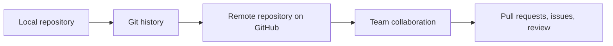
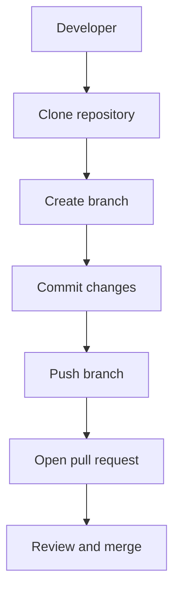

> **Navigation:** [Previous: Chapter 09](09-advanced-git-techniques.md) | [Roadmap](../../ROADMAP.md) | Next: Chapter 11 coming soon
>
> **Level:** Beginner · **Estimated Time:** 75 min · **Prerequisites:** [Chapter 09: Advanced Git Techniques](09-advanced-git-techniques.md)

## Learning Objectives

By the end of this chapter, you will be able to:

- explain the difference between Git and GitHub;
- describe what a repository is and why it is the center of collaboration;
- recognize the role of remotes, clones, and pushes in shared development;
- explain how GitHub supports visibility, review, and coordination across a team;
- identify the difference between local work and remote collaboration.

## Introduction

Git gives developers a way to record and manage project history locally. GitHub adds a shared platform around that history so teams can review work, coordinate changes, and publish software more safely.

This chapter introduces the GitHub concepts that make version control useful beyond a single machine. You will move from local repository work to a collaborative model where code, issues, branches, and review workflows are visible to other people.

A good mental model is this: Git controls the history of a project; GitHub gives that history a place to live, share, and discuss.

## Visual Learning



_Figure 1. GitHub turns a local Git repository into a shared project history used by a team._



_Figure 2. A typical GitHub workflow begins with cloning and ends with a reviewed merge._

## Why This Matters

A project does not become collaborative simply because a developer creates a branch. Real collaboration requires a shared remote location, a clear review process, and a way to coordinate work across time zones and teams.

GitHub provides those capabilities around Git repositories:

- a central place to host a repository;
- a public or private remote for sharing code;
- branch visibility for contributors;
- pull requests for review and discussion;
- issue tracking for tasks and bugs;
- integration points for automation and release workflows.

Without this platform layer, Git is still powerful locally, but it is much harder to coordinate team work, review changes, and maintain a shared source of truth.

## Key Terms

| Term         | Definition                                                                   |
| ------------ | ---------------------------------------------------------------------------- |
| Repository   | A project and its stored history in Git, often hosted on GitHub.             |
| Remote       | A named reference to another Git repository, usually the GitHub-hosted copy. |
| Clone        | A local copy of a remote repository with its history and configuration.      |
| Push         | Upload local commits to a remote repository.                                 |
| Pull         | Fetch and integrate remote changes into the local branch.                    |
| Fork         | A personal copy of someone else's repository under your own account.         |
| Pull request | A proposed change that invites review before merging.                        |
| Branch       | A named line of development within a repository.                             |

## Theory

### Git and GitHub Are Related but Not the Same

Git is the version control system. It manages snapshots, commit history, branches, tags, and references locally on a machine.

GitHub is a hosting and collaboration platform built around Git repositories. It allows teams to store remote copies of a project, review contributions, track issues, and manage release workflows.

The simplest distinction is:

- Git = the engine that records and moves history;
- GitHub = the platform that shares that history and enables collaboration.

### A Repository Is the Center of Collaboration

A repository is more than a folder. It is the complete project context: code, history, branch references, issue discussions, and contribution workflow. In GitHub, a repository is usually the owner of the project and the point from which contributors work.

A repository often contains:

- files and directories for the project;
- commit history and branch structure;
- a README or documentation;
- issue and discussion records;
- release and automation configuration.

### Local Work and Remote Work Are Separate States

A local repository is yours on your machine. A remote repository is the shared copy hosted on GitHub. They can be in different states, and that is normal.

This is why commands such as these matter:

```bash
git clone <repository-url>
git status
git add .
git commit -m "Update documentation"
git push origin main
```

A clone creates a local copy of the remote repository. The push command sends your local commits to the remote repository. Until you push, your teammates cannot see the changes.

### Remotes Connect Local and Shared History

A remote is a named location used by Git. The most common default name is `origin`.

```bash
git remote -v
```

This command shows the configured remote URLs. In a team workflow, `origin` usually points to the shared GitHub repository.

You can add or change remotes as needed:

```bash
git remote add upstream https://github.com/example/project.git
```

This is especially useful when contributing to open-source projects, where `upstream` may refer to the original repository and your fork is a separate personal copy.

### Cloning Creates a Working Copy

`git clone` downloads the repository and initializes a local working tree with all the branch and commit metadata from the remote.

```bash
git clone https://github.com/user/project.git
cd project
git status
```

The clone gives you a copy of the project and a connection back to the remote. You can now create new branches, make commits, and later publish changes.

### Push and Pull Keep the Shared State in Sync

When a project is shared, local changes must be pushed to the remote repository so others can see or review them.

```bash
git push origin feature/login-page
```

When you want the latest remote changes on your machine, you pull from a branch or fetch remote information first.

```bash
git fetch origin
git pull origin main
```

The important idea is not only moving work around; it is keeping local and remote history synchronized without losing context.

### GitHub Adds Collaboration Features Around Git

GitHub makes the repository visible and reviewable:

- branch protection can prevent direct writes to a sensitive branch;
- pull requests allow discussion before merge;
- issues support bug tracking and feature planning;
- code review tools help compare exact changes;
- actions can automate builds and deployment checks.

These features do not replace Git; they sit on top of Git to coordinate team workflows and approval processes.

### Forks Are a Common Public Contribution Pattern

A fork is a personal copy of someone else's repository. It allows you to make changes independently and then submit those changes back through a pull request.

This pattern is common in open-source work because the original repository owner may not want every contributor to push directly to the main project. A fork creates a clear separation between the original source and the contributor's proposed changes.

## Practical Examples

### Example 1: Clone a Repository and Inspect Remotes

```bash
git clone https://github.com/example/project.git
cd project
git remote -v
```

Expected result: Git downloads the repository and shows the configured remote URLs, usually including `origin`.

### Example 2: Create a Branch and Push It

```bash
git switch -c feature/update-readme
# make a documentation change
git add README.md
git commit -m "Improve project setup guide"
git push origin feature/update-readme
```

Expected result: the branch is created locally, committed, and published to the GitHub repository.

### Example 3: Open a Pull Request

A contributor pushes a feature branch and opens a pull request in GitHub. The project maintainers can review the changes, ask for edits, and merge the branch only after it meets team standards.

This is the point where GitHub moves beyond raw version tracking into team coordination and review.

### Example 4: Pull the Latest Remote Changes

```bash
git fetch origin
git switch main
git pull origin main
```

Expected result: the local branch reflects the latest shared state from GitHub.

## Try It Yourself

1. Create a GitHub account and a small public repository if available.
2. Clone the repository to your local machine.
3. Run `git remote -v` and identify the remote names.
4. Create a branch, make a small change, commit it, and push it.
5. Open the repository in GitHub and inspect the branch and commit history.

Write down the difference between the local activity and the remote branch you see in GitHub.

## Best Practices

- Keep the remote repository as the shared source of truth for team work.
- Use descriptive branch names that explain purpose, not just temporary labels.
- Pull the latest changes before starting important work on a shared branch.
- Review before merging; pull requests are not only transport mechanisms but also communication tools.
- Keep commits focused so reviewers can understand them quickly.

## Common Mistakes

| Mistake                                             | Why it causes problems                             | How to avoid it                                                                     |
| --------------------------------------------------- | -------------------------------------------------- | ----------------------------------------------------------------------------------- |
| Confusing Git and GitHub                            | The tools are related but not interchangeable.     | Remember: Git stores and moves history; GitHub hosts and coordinates collaboration. |
| Pushing directly to a shared branch without review  | Changes may bypass team control.                   | Use feature branches and pull requests.                                             |
| Ignoring `git status` before pushing                | You may push incomplete or unintended work.        | Check the working tree and branch before publishing.                                |
| Forgetting to fetch or pull first                   | You may build on stale remote history.             | Sync your local branch regularly.                                                   |
| Treating a fork as if it were the source repository | The contributor and original project are distinct. | Understand which repository is the upstream and which is your fork.                 |

## Summary

- Git is the local version control system; GitHub is the shared collaboration platform built around Git.
- A repository is the central project object that contains code, history, and collaboration metadata.
- Remotes connect a local repository to the shared GitHub location.
- Cloning creates a working copy, while pushing and pulling synchronize local and remote changes.
- GitHub adds review, visibility, and coordination tools such as pull requests and issue tracking.
- Collaboration works best when local changes are published through clear branches and review workflows.

## Exercise

### Objective

Connect the concepts of local Git history to a real GitHub workflow.

### Task

1. Create a new repository in GitHub or use an existing one.
2. Clone it to your local machine.
3. Run `git remote -v` and note the remote name.
4. Create a feature branch and make a small change.
5. Commit the change and push it to GitHub.
6. Open the repository in the browser and verify the remote history and branch view.

### Expected Outcome

You can describe how the local Git workflow matches the shared remote repository and identify the relationship between the local repository and the GitHub host.

## Lab

### Objective

Practice the full GitHub interaction loop: clone, create a branch, commit, push, and inspect the remote repository.

### Requirements

- Git installed locally
- A GitHub account and repository access
- A terminal with network access

### Tasks

1. Clone a repository from GitHub.
2. Create a new branch with a descriptive name.
3. Make a small change such as updating README text or a configuration note.
4. Commit the change and push the branch to GitHub.
5. Open the repository in the browser and inspect the branch, commit history, and remote state.
6. Compare what you see locally with the GitHub view and summarize the difference.

### Expected Outcome

You can explain how a local repository becomes a shared collaborative project when connected to GitHub.

## Quiz

1. What is the main difference between Git and GitHub?
2. What is a remote in Git?
3. Why is a pull request useful in a team workflow?
4. What does `git clone` create?
5. What is the purpose of a fork?

### Expected Answers

1. Git manages local version history; GitHub hosts and shares repositories for collaboration.
2. A remote is a named connection to another repository, usually the GitHub-hosted copy.
3. It creates a reviewable change proposal before merging.
4. A local copy of the repository with its history and branch metadata.
5. It creates a personal copy of someone else's repository for independent changes and proposals.

## Next Chapter

Chapter 11 introduces clone, fork, and remote workflows in more detail, including how local and remote repositories interact during contribution and synchronization.

### Related Content

- Previous chapter: [Chapter 09 - Advanced Git Techniques](09-advanced-git-techniques.md)
- Next chapter: Chapter 11 (coming soon)
- Exercise: [Explore a GitHub Repository](../../exercises/en/10-explore-a-github-repository.md)
- Lab: [Clone and Push a Repository](../../labs/en/10-clone-and-push-a-repository.md)
- Quiz: [GitHub Fundamentals Quiz](../../quizzes/en/10-github-fundamentals-quiz.md)

## Further Reading

- [GitHub Docs: About repositories](https://docs.github.com/en/repositories/creating-and-managing-repositories/about-repositories)
- [GitHub Docs: About branches](https://docs.github.com/en/pull-requests/collaborating-with-pull-requests/proposing-changes-to-your-work-with-pull-requests/about-pull-requests)
- [GitHub Docs: Cloning a repository](https://docs.github.com/en/repositories/creating-and-managing-repositories/cloning-a-repository)
- [Git Book: Git Basics](https://git-scm.com/book/en/v2/Git-Basics-Getting-a-Git-Repository)
