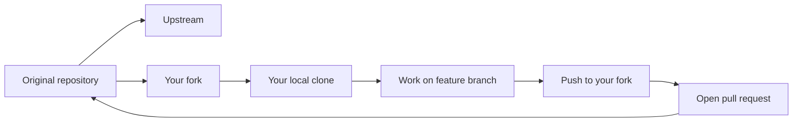
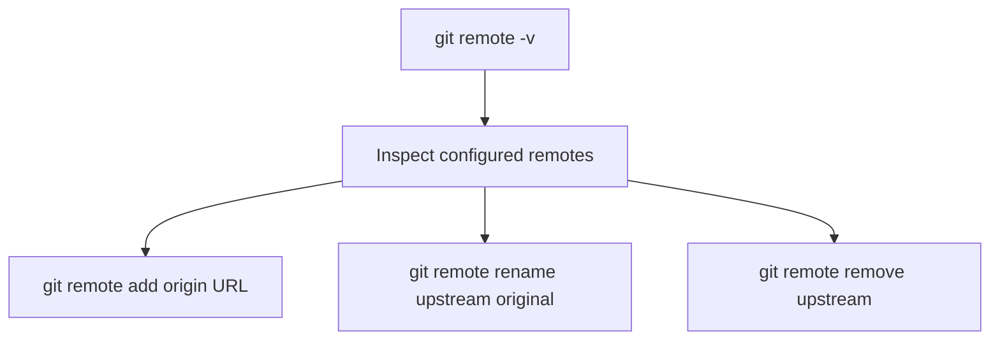

> **Navigation:** [Previous: Chapter 10](10-github-fundamentals.md) | [Roadmap](../../ROADMAP.md) | Next: Chapter 12 coming soon
>
> **Level:** Beginner · **Estimated Time:** 75 min · **Prerequisites:** [Chapter 10: GitHub Fundamentals](10-github-fundamentals.md)

## Learning Objectives

By the end of this chapter, you will be able to:

- explain the purpose of a Git remote and how it connects to GitHub;
- distinguish between a clone and a fork;
- use `git remote` commands to inspect, add, rename, and remove remotes;
- understand how a local repository can track upstream and origin repositories;
- explain how contributors usually synchronize work with a shared project on GitHub.

## Introduction

Once a project is hosted on GitHub, contributors need a practical way to get a local copy and keep it in sync. That is where clone, fork, and remote workflows become essential.

This chapter introduces the command patterns that connect a local repository to the shared remote repository. You will see how a project can be copied locally, how a personal fork can be created, and how multiple remotes can be used to keep your work aligned with the original project.

The key idea is that GitHub collaboration is not just about pushing commits. It is also about managing ownership, tracking relationships between repositories, and keeping your branch synchronized with the correct upstream source.

## Visual Learning



_Figure 1. A common open-source workflow uses an upstream repository, a fork, and a local clone._



_Figure 2. Remote management keeps local Git aligned with the proper repository locations._

## Why This Matters

A repo on GitHub is only useful when people can download it, work on it, and merge changes safely. Git has commands for this, but the real-world team workflow is more nuanced: a contributor may work from a fork, maintain an upstream remote, or update a local branch after team work has moved forward.

You will encounter these situations in real engineering work:

- you need to clone an existing project to begin work;
- you want to contribute without changing the upstream repository directly;
- you need to sync a local branch with the newest remote state;
- you need to manage multiple remotes for your own fork and the original project.

Understanding these patterns prevents confusion and keeps the working flow predictable.

## Key Terms

| Term     | Definition                                                               |
| -------- | ------------------------------------------------------------------------ |
| Remote   | A named connection from your local repository to another Git repository. |
| Clone    | A local copy created from an existing repository.                        |
| Fork     | Your own copy of another person’s repository under your account.         |
| Upstream | The original repository that you follow or contribute to.                |
| Origin   | The default remote name for the repository you cloned or your fork.      |
| Fetch    | Download remote changes without integrating them.                        |
| Pull     | Fetch and merge remote changes into the current branch.                  |

## Theory

### The Remote Is the Connection to Another Repository

A remote is a record in Git that tells your repository where another repository exists. You can view it with:

```bash
git remote -v
```

This displays the remote names and their URLs. The default name is often `origin`, which usually points to your GitHub repository or your fork.

If you have not configured any remotes yet, the repository is still a valid local Git repository, but it is not connected to a shared collaboration source.

### A Clone Creates a Local Copy of a Repository

`git clone` copies the repository and sets up the remote automatically. It creates a working copy and downloads the project history.

```bash
git clone https://github.com/example/project.git
cd project
```

After cloning, Git is already configured to track the remote and the branch information. This is the starting point for daily work in a team or on a public project.

### A Fork Creates an Independent Contribution Space

A fork is different from a clone. A clone copies the repository to your machine; a fork creates a new repository under your own GitHub account based on someone else's project.

Typical open-source flow:

1. Fork the original repository to your GitHub account.
2. Clone your fork to your local machine.
3. Add the original repository as `upstream`.
4. Create a feature branch.
5. Push to your fork.
6. Open a pull request to the upstream repository.

This pattern preserves the original project while letting contributors make changes safely in their own space.

### The Upstream and Origin Pattern Is Very Common

When contributing to a project, you often have two remotes:

```bash
git remote -v
```

Example output:

```bash
origin  https://github.com/your-user/project.git (fetch)
origin  https://github.com/your-user/project.git (push)
upstream  https://github.com/project-owner/project.git (fetch)
upstream  https://github.com/project-owner/project.git (push)
```

This means:

- `origin` is your personal copy or your fork;
- `upstream` is the official or parent repository.

This distinction matters when you want to pull the latest changes from the original project while keeping your own copy separate.

### Adding, Renaming, and Removing Remotes

The `git remote` family of commands helps manage these relationships.

```bash
git remote add upstream https://github.com/project-owner/project.git
git remote rename origin github-origin
git remote remove upstream
```

Common tasks include:

- add a remote to connect to another repository;
- rename a remote when the naming is confusing;
- remove a remote when it is no longer needed.

These commands are straightforward, but they are essential because repository collaboration often depends on remote names being clear and consistent.

### Fetch and Pull Keep Your Local Branch Current

You may not always work alone. A teammate may merge changes into the shared branch while you are working on your own branch. To stay current, use:

```bash
git fetch origin
git pull origin main
```

`git fetch` downloads the latest remote state without changing your current branch. `git pull` fetches and merges the remote changes into your checked-out branch.

This is usually the safest approach when you want to update a branch with the latest project changes.

### Pull Requests Use the Remote Workflow

After you push a branch from your fork, GitHub lets you create a pull request. The pull request compares your branch against the target branch of the upstream repository.

This creates a clear review process:

- the maintainer sees the proposed change;
- conversation and review happen in GitHub;
- the code is checked before merge;
- the public repository stays clean and reviewable.

### Remote Names Are Just Labels, Not Magic

A remote name such as `origin` is only a label. The important part is the URL and your intent.

You are free to name remotes meaningfully, for example:

```bash
git remote add team https://github.com/organization/project.git
```

This can make a workflow easier to understand, especially when multiple repositories are involved.

## Practical Examples

### Example 1: Clone a Project

```bash
git clone https://github.com/example/project.git
cd project
git remote -v
```

Expected result: Git downloads the repository and sets up a remote connection, usually with `origin`.

### Example 2: Add an Upstream Remote

```bash
git remote add upstream https://github.com/original/project.git
git remote -v
```

Expected result: the project now knows about both your fork and the original project repository.

### Example 3: Fetch the Latest Upstream Changes

```bash
git fetch upstream
git switch main
git merge upstream/main
```

Expected result: your local main branch reflects the latest changes from the upstream project.

### Example 4: Rename a Remote

```bash
git remote rename origin my-fork
```

Expected result: the remote label changes, but the repository URL stays the same.

## Best Practices

- Use clear remote names like `origin` and `upstream` whenever possible.
- Pull from the correct source; do not confuse your fork with the original project.
- Keep a feature branch separate from your main branch while working on a change.
- Check `git remote -v` regularly to confirm which repository the Git commands are targeting.
- When contributing to a public project, prefer the fork-and-pull-request pattern unless the workflow explicitly allows push access.

## Common Mistakes

| Mistake                                           | Why it causes problems                                               | How to avoid it                                                     |
| ------------------------------------------------- | -------------------------------------------------------------------- | ------------------------------------------------------------------- |
| Confusing your fork with the original repository  | You may push or pull from the wrong place.                           | Use `origin` for your fork and `upstream` for the original project. |
| Forgetting to fetch before merging                | You may work with stale remote data.                                 | Use `git fetch` or `git pull` before important work.                |
| Renaming remotes without understanding the effect | Commands may target the wrong repository.                            | Check `git remote -v` before and after changing remotes.            |
| Treating a clone as a fork                        | A clone is a local copy; a fork is a remote copy under your account. | Understand the share ownership model.                               |

## Summary

- A remote is a named link from your local Git repository to another repository.
- A clone gives you a local working copy of a project.
- A fork creates a separate repository under your own GitHub account.
- `origin` usually points to your personal remote, while `upstream` often refers to the original project.
- `git fetch` and `git pull` help keep your branch synchronized with the latest remote state.
- The fork-and-pull-request pattern is the standard way to contribute to many open-source projects.

## Exercise

### Objective

Practice remote management with a real GitHub project.

### Task

1. Clone a repository from GitHub.
2. Run `git remote -v` and record the configured remote names.
3. Add `upstream` as the original repository if the project is a fork.
4. Run `git fetch upstream` and inspect the branch list.
5. Summarize the difference between `origin` and `upstream` in your own words.

### Expected Outcome

You can identify which repository is the local project, which one is the personal fork, and which one is the upstream source of truth.

## Lab

### Objective

Work through a realistic contributor workflow using clone, fork, remote, and synchronization.

### Requirements

- Git installed locally
- A GitHub account
- Access to a public repository or a project you can fork

### Tasks

1. Fork a public repository to your GitHub account.
2. Clone your fork locally.
3. Add the upstream repository as a remote.
4. Run `git remote -v` and verify the configuration.
5. Fetch and inspect updates from `upstream`.
6. Create a branch, commit a change, and push it to your fork.
7. Open a pull request to the upstream repository.

### Expected Outcome

You can explain and perform the full fork-and-pull-request workflow with correct remote management.

## Quiz

1. What is a remote in Git?
2. What is the difference between a clone and a fork?
3. Why is `upstream` often used in a contributor workflow?
4. What command shows the configured remotes for a repository?
5. Why is `git fetch` useful before updating a branch?

### Expected Answers

1. A remote is a named link to another repository, usually on GitHub.
2. A clone creates a local copy; a fork creates a separate repository under your account.
3. It refers to the original project repository you are contributing to.
4. `git remote -v`.
5. It downloads the latest remote state without automatically changing your local branch.

## Next Chapter

Chapter 12 focuses on pull requests, review flow, and the team practices that turn repository changes into collaborative decisions.

### Related Content

- Previous chapter: [Chapter 10 - GitHub Fundamentals](10-github-fundamentals.md)
- Next chapter: Chapter 12 (coming soon)
- Exercise: [Inspect a Remote Repository](../../exercises/en/11-inspect-remote-repository.md)
- Lab: [Fork and Sync a Repository](../../labs/en/11-fork-and-sync-a-repository.md)
- Quiz: [Clone, Fork & Remote Quiz](../../quizzes/en/11-clone-fork-and-remote-quiz.md)

## Further Reading

- [GitHub Docs: About repositories](https://docs.github.com/en/repositories/creating-and-managing-repositories/about-repositories)
- [GitHub Docs: Cloning a repository](https://docs.github.com/en/repositories/creating-and-managing-repositories/cloning-a-repository)
- [GitHub Docs: About forks](https://docs.github.com/en/get-started/quickstart/fork-a-repo)
- [Git Book: Working with Remotes](https://git-scm.com/book/en/v2/Git-Basics-Working-with-Remotes)
