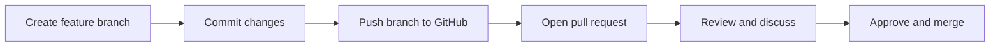
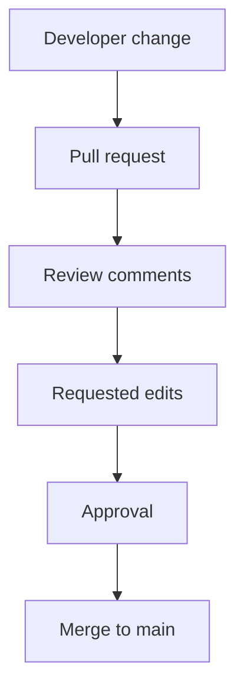

> **Navigation:** [Previous: Chapter 11](11-clone-fork-and-remote.md) | [Roadmap](../../ROADMAP.md) | Next: Chapter 13 coming soon
>
> **Level:** Beginner · **Estimated Time:** 80 min · **Prerequisites:** [Chapter 11: Clone, Fork & Remote](11-clone-fork-and-remote.md)

## Learning Objectives

By the end of this chapter, you will be able to:

- explain what a pull request is and why it matters in team collaboration;
- describe the review process used before merging a change into a shared branch;
- understand the difference between a branch, a commit, and a pull request;
- identify good review practices and common PR problems;
- explain how pull requests support quality checks and team communication.

## Introduction

A repository becomes much more useful when changes are reviewed before they are accepted. A pull request is the GitHub mechanism used for that review process.

Instead of moving code directly into the main branch, a contributor proposes a change in a separate branch and asks the team to inspect it. The pull request creates a visible discussion thread around the change, the specific diff, and the intent of the work.

This chapter focuses on the collaborative side of GitHub. You will move beyond pushing commits and into the decisions that happen around those commits: review, discussion, approval, and merge.

## Visual Learning



_Figure 1. A pull request formalizes the review and approval path between a feature branch and the target branch._



_Figure 2. Pull requests create a structured path from proposed work to validated integration._

## Why This Matters

Without a review workflow, code changes are easy to merge too quickly. A pull request introduces a controlled step where a contributor explains what changed, reviewers inspect the diff, and concerns are addressed before the branch is merged.

This matters because:

- a project often has more than one developer;
- mistakes are easier to catch in review than after deployment;
- review comments create a record of why a decision was made;
- branches can be updated and corrected before final merge;
- the team can maintain a clearer and more reliable main branch.

In a real development environment, pull requests are not just a technical feature. They are part of the team’s quality process.

## Key Terms

| Term         | Definition                                                      |
| ------------ | --------------------------------------------------------------- |
| Pull request | A proposed change to a branch, reviewed before merge.           |
| Review       | Human inspection of the code or content changes in a PR.        |
| Base branch  | The destination branch a PR is meant to merge into.             |
| Head branch  | The branch containing the proposed changes.                     |
| Approval     | Team confirmation that the changes are acceptable.              |
| Merge        | The action of integrating the PR branch into the target branch. |
| Diff         | The exact changes between two versions of a file or branch.     |

## Theory

### A Pull Request Is a Collaborative Proposal

A pull request (PR) is a request to merge a branch into another branch, usually a main or release branch. It includes the differences between the source branch and the target branch.

The key idea is simple: the change exists first on a feature branch, and the team reviews it before accepting it.

This is different from directly committing to the main branch. A PR turns a change into a reviewable unit of work.

### The Base Branch and Head Branch Are Important

Every PR compares two branches:

- the base branch: the branch you want to merge into;
- the head branch: the branch containing the proposed changes.

Example:

```text
base: main
head: feature/add-login-form
```

GitHub shows the exact diff between these two states. Reviewers can inspect the changes, add comments, and decide whether the PR should be merged.

### Review Is Not Just Syntax Checking

A good review checks more than formatting or typos. It may also review:

- logic and behavior;
- edge cases;
- code clarity and maintainability;
- consistency with branch goals;
- whether the change fits the project’s direction.

This is why pull requests are valuable: the discussion is often as important as the code itself.

### Review Comments Help Improve the Change

During a PR review, people may leave comments such as:

- “This logic is correct but missing a null check.”
- “Could we rename this variable to explain its purpose?”
- “This branch needs a rebase before merge.”

These comments do not mean the work is bad. They are part of a quality process that helps the change become clearer, safer, and more maintainable.

### A Branch May Need Updates Before Merge

Sometimes a PR is opened while other work has already been merged into the target branch. In that case, the branch may need to be updated to include the latest changes.

This is commonly done with:

```bash
git fetch origin
git switch feature/update-login
git rebase origin/main
```

or by merging the latest target branch into the feature branch. The goal is to keep the PR based on current project state and avoid messy conflicts.

### Merge Strategies Affect History

When a PR is merged, GitHub may use different merge strategies:

- merge commit;
- squash merge;
- rebase and merge.

Each strategy changes how history is recorded. A merge commit keeps branch context. A squash merge produces one combined commit. A rebase-and-merge rewrites the branch history into a linear sequence.

Teams choose the strategy that best supports clarity and maintainability in the project.

### Pull Requests Improve Team Communication

The PR discussion becomes a record of intent and decisions. Future developers can inspect the conversation and understand why the change was made, which problems it solved, and what trade-offs were considered.

This helps especially when a project grows beyond a small team or when someone revisits work months later.

## Practical Examples

### Example 1: Open a Pull Request from a Feature Branch

```bash
git switch -c feature/login-form
git add .
git commit -m "Add login form"
git push origin feature/login-form
```

Then open the repository in GitHub, choose **Compare & pull request**, and fill in the PR title and description.

Expected result: the branch is reviewed against the project’s target branch before merge.

### Example 2: Review Requested Changes

A reviewer may leave a comment like:

> “Please add validation for empty input before submitting.”

The author can update the branch, commit the fix, and push again. GitHub shows the updated state in the same PR.

Expected result: the PR evolves until the team is satisfied with the quality of the change.

### Example 3: Merge After Approval

Once the reviewer approves and the checks pass, the maintainer merges the PR into the base branch.

Expected result: the feature branch changes become part of the shared project history.

## Best Practices

- Keep pull requests small and focused so they are easier to review.
- Write a clear title and short description explaining the motivation and scope.
- Review the diff carefully before approving.
- Ask for clarification when the change is not clear.
- Rebase or merge the latest base branch before final merge when necessary.
- Do not merge without checking whether the changes align with project standards.

## Common Mistakes

| Mistake                                  | Why it causes problems                           | How to avoid it                                          |
| ---------------------------------------- | ------------------------------------------------ | -------------------------------------------------------- |
| Opening a huge PR with unrelated changes | Review becomes difficult and error-prone.        | Split work into smaller, focused branches.               |
| Writing a weak PR description            | Reviewers cannot understand the intent quickly.  | State the problem, solution, and testing clearly.        |
| Merging without review                   | Quality control is bypassed.                     | Require approval or a verified review process.           |
| Ignoring stale branch updates            | The branch may conflict badly with current main. | Sync with the base branch before final merge.            |
| Approving without checking the diff      | Important issues may be missed.                  | Review the actual changes and ask questions when needed. |

## Summary

- A pull request is a collaborative review mechanism for proposed changes.
- It compares a head branch against a base branch and allows discussion before merge.
- Review comments improve quality and clarify intent.
- Branch updates and merge strategy decisions affect how the project history is preserved.
- Pull requests help teams maintain safer and more understandable collaboration.

## Exercise

### Objective

Practice creating and reviewing a pull request workflow.

### Task

1. Create a feature branch in a local Git repository.
2. Make a small, focused change and commit it.
3. Push the branch to GitHub.
4. Open a pull request comparing the feature branch to the main branch.
5. Add a short description explaining the change.
6. Write a short review comment as if you were the reviewer.

### Expected Outcome

You can describe the purpose of the pull request and explain how it supports code review before change integration.

## Lab

### Objective

Use a realistic branch lifecycle to create, review, and merge a pull request.

### Requirements

- Git installed locally
- A GitHub repository with write access or a forked repository
- Access to a branch-based workflow

### Tasks

1. Create a feature branch from the main project branch.
2. Make a small but meaningful change.
3. Push the branch to GitHub.
4. Open a pull request against the target branch.
5. Review the PR diff and add at least one comment.
6. Update the branch if requested and merge after approval.

### Expected Outcome

You can explain how a PR helps structure review and merge decisions in a collaborative project.

## Quiz

1. What is a pull request?
2. What is the difference between a base branch and a head branch?
3. Why are pull requests useful in a team environment?
4. What is a common reason to update a feature branch before merging?
5. What role do review comments play in a PR?

### Expected Answers

1. A pull request is a proposed change from one branch to another, reviewed before merge.
2. The base branch is the target branch; the head branch contains the proposed change.
3. They create a structured, reviewable step that helps maintain quality and communication.
4. To include the latest changes from the target branch and reduce merge conflicts.
5. They help clarify intent, spot issues, and improve the quality of the final change.

## Next Chapter

Chapter 13 introduces GitHub Project planning and issue tracking workflows, showing how pull-request-based work connects to project management and delivery visibility.

### Related Content

- Previous chapter: [Chapter 11 - Clone, Fork & Remote](11-clone-fork-and-remote.md)
- Next chapter: Chapter 13 (coming soon)
- Exercise: [Review a Pull Request Workflow](../../exercises/en/12-review-a-pull-request-workflow.md)
- Lab: [Create and Merge a Pull Request](../../labs/en/12-create-and-merge-a-pull-request.md)
- Quiz: [Pull Requests Quiz](../../quizzes/en/12-pull-requests-quiz.md)

## Further Reading

- [GitHub Docs: About pull requests](https://docs.github.com/en/pull-requests/collaborating-with-pull-requests/proposing-changes-to-your-work-with-pull-requests/about-pull-requests)
- [GitHub Docs: Reviewing proposed changes in pull requests](https://docs.github.com/en/pull-requests/collaborating-with-pull-requests/reviewing-changes-in-pull-requests/about-pull-request-reviews)
- [GitHub Docs: Merging a pull request](https://docs.github.com/en/pull-requests/collaborating-with-pull-requests/incorporating-changes-from-a-pull-request/merging-a-pull-request)
