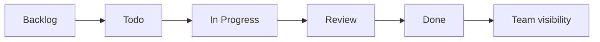
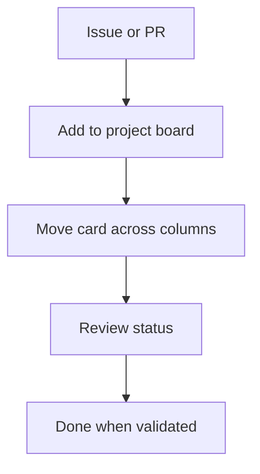

> **Navigation:** [Previous: Chapter 12](12-pull-requests.md) | [Roadmap](../../ROADMAP.md) | Next: Chapter 14 coming soon
>
> **Level:** Beginner · **Estimated Time:** 70 min · **Prerequisites:** [Chapter 12: Pull Requests](12-pull-requests.md)

## Learning Objectives

By the end of this chapter, you will be able to:

- explain what GitHub Projects are and why they are useful for planning work;
- describe the difference between issues, pull requests, and project board items;
- create project columns that represent the stages of a workflow;
- connect work items to delivery progress and team visibility;
- explain how automation can reduce manual project management overhead.

## Introduction

A repository is not only a place for code. It is also a place where work is discussed, planned, prioritized, and tracked. GitHub Projects gives teams a lightweight way to manage that work without leaving the GitHub ecosystem.

This chapter focuses on project boards: visual workflows that help developers and teams see what is planned, in progress, blocked, and completed. You will learn how issues and pull requests become visible on a project board and how a board can act as a living view of delivery progress.

The important idea is that a project board is not just a dashboard. It is a structured workflow for coordinating tasks, reducing confusion, and making progress visible to everyone involved.

## Visual Learning



_Figure 1. A simple GitHub Project board maps work to the stages of delivery._



_Figure 2. Work items move through stages and reveal the current state of a project._

## Why This Matters

In a software team, work usually moves through several stages:

- idea or request;
- task definition;
- implementation;
- review;
- completion.

Without a visible workflow, information becomes fragmented. People may not know which tasks are blocked, which tasks are high priority, or what is ready for review.

GitHub Projects helps solve that problem. It gives a team a shared board where tasks are visible, prioritized, and updated as they move forward. This is especially useful when a team works across multiple repositories or when a project needs more organization than a simple issue list alone.

## Key Terms

| Term           | Definition                                                                     |
| -------------- | ------------------------------------------------------------------------------ |
| GitHub Project | A board for tracking work items and workflow stages.                           |
| Project board  | A visual planning surface that displays work in columns.                       |
| Issue          | A task, bug, enhancement, or discussion item tied to a repository.             |
| Pull request   | A proposed change that can be associated with a project board.                 |
| Workflow       | The ordered series of states a task moves through.                             |
| Automation     | Rules that automatically move or update project items when conditions are met. |

## Theory

### GitHub Projects Turn Work into Visible Flow

A project board organizes work into columns such as:

- Todo
- In Progress
- Review
- Done

Each item on the board is often an issue, a pull request, or another tracked task. The board helps a team see what is happening right now and what still needs attention.

This visibility matters because it prevents work from being hidden in private conversations or scattered across chat tools.

### Issues and Pull Requests Are the Main Work Items

GitHub Projects usually track work through GitHub items rather than standalone documents. Common examples include:

- bug reports created as issues;
- feature ideas tracked as issues;
- pull requests that represent in-progress development work;
- tasks that need review before they are merged.

This means project management in GitHub usually starts from the same places where engineers already work: issues and pull requests.

### Work Is Moved Through Stages

The board is most useful when each column represents a meaningful project state. Example stages:

```text
Backlog
→ To Do
→ In Progress
→ In Review
→ Done
```

This makes the status of work easy to read at a glance. It also helps the team decide where attention is needed.

### Automation Can Reduce Manual Updates

GitHub Projects supports automation rules such as:

- automatically add issues to a project when they are opened;
- move cards when a pull request is opened or closed;
- update status based on labels or review state;
- preserve workflow consistency across a repository.

Automation is helpful because it reduces repetitive updates and makes the board more reliable.

### Boards Are Good for Team Transparency

A GitHub Project is not just a personal checklist. It is a communication tool that supports the team. A board lets stakeholders answer questions like:

- what is currently in progress?
- which items are blocked?
- what is ready for review?
- what is complete?

This visibility supports planning, reporting, and coordination.

## Practical Examples

### Example 1: Create a Basic Project Board

1. Open a repository on GitHub.
2. Click the **Projects** tab.
3. Choose **New project**.
4. Select a board template such as **Table** or **Board**.
5. Name the board and add a description.

Result: a new project board appears with columns that represent the workflow.

### Example 2: Add Work Items

You can add:

- an issue for a bug report;
- an issue for a feature request;
- a pull request for a branch under review.

Then drag the card into a stage such as **To do** or **In progress**.

This makes the task visible to the rest of the team.

### Example 3: Use a Review Workflow

A common sequence is:

```text
Backlog → In Progress → In Review → Done
```

A developer completes a feature, opens a pull request, moves the card to **In Review**, and then the team changes it to **Done** after merge.

This reflects the real engineering lifecycle more accurately than a static to-do list.

## Best Practices

- Keep columns simple and meaningful.
- Define the workflow clearly before adding many tasks.
- Use issues for work items that need discussion or tracking.
- Use pull requests for code changes that are under review.
- Keep card ownership clear so people know who is responsible.
- Review the board regularly instead of treating it as a one-time setup.

## Common Mistakes

- creating too many columns without clear purpose;
- using the project board as a storage dump instead of an active workflow;
- forgetting to connect issues and pull requests to the project;
- leaving tasks in a confusing state for long periods;
- using labels but not updating board status.

## Exercises

### Exercise 1: Design a Project Flow

Create a simple project board for a team project with the following columns:

1. Backlog
2. In Progress
3. Review
4. Done

Then add at least three sample tasks.

### Exercise 2: Match a Work Item to a Stage

Decide which column each of the following should belong to:

- a bug report waiting for triage;
- a feature branch already being developed;
- a branch waiting for reviewer feedback;
- a merged PR with documentation updated.

### Exercise 3: Explain the Purpose of the Board

Write a short paragraph explaining how a project board helps a team work more transparently.

## Solutions

### Solution 1: Design a Project Flow

A clean flow could be:

```text
Backlog
→ In Progress
→ Review
→ Done
```

This is easy to understand and easy to maintain.

### Solution 2: Match a Work Item to a Stage

- bug report waiting for triage → Backlog
- feature branch being implemented → In Progress
- branch awaiting feedback → Review
- merged PR with docs updated → Done

### Solution 3: Purpose of the Board

A project board makes work visible, clarifies responsibilities, and gives a shared view of progress. It reduces confusion and helps a team coordinate effectively across tasks and repositories.

## Summary

GitHub Projects is a practical way to organize team work inside GitHub. It helps teams represent delivery stages visually, track issues and pull requests, and maintain a shared understanding of progress.

A project board is most effective when it reflects a clear workflow, uses meaningful columns, and stays updated. When paired with labels and automation, it creates a stronger collaboration system without adding extra tools.

## Next Chapter

Chapter 14 introduces Issues and Discussions, showing how teams capture feedback, coordinate requests, and support conversation around planned work and product decisions.

### Related Content

- Previous chapter: [Chapter 12 - Pull Requests](12-pull-requests.md)
- Next chapter: Chapter 14 (coming soon)
- Exercise: [Plan a Project Board](../../exercises/en/13-plan-a-project-board.md)
- Lab: [Create and Manage a GitHub Project Board](../../labs/en/13-create-and-manage-a-github-project-board.md)
- Quiz: [GitHub Projects Quiz](../../quizzes/en/13-github-projects-quiz.md)

## Further Reading

- [GitHub Docs: About Projects](https://docs.github.com/en/issues/planning-and-tracking-with-projects/learning-about-projects/about-projects)
- [GitHub Docs: Customizing a project board in GitHub](https://docs.github.com/en/issues/planning-and-tracking-with-projects/customizing-views-in-your-project)
- [GitHub Docs: Automating project workflows](https://docs.github.com/en/issues/planning-and-tracking-with-projects/automating-your-project)
