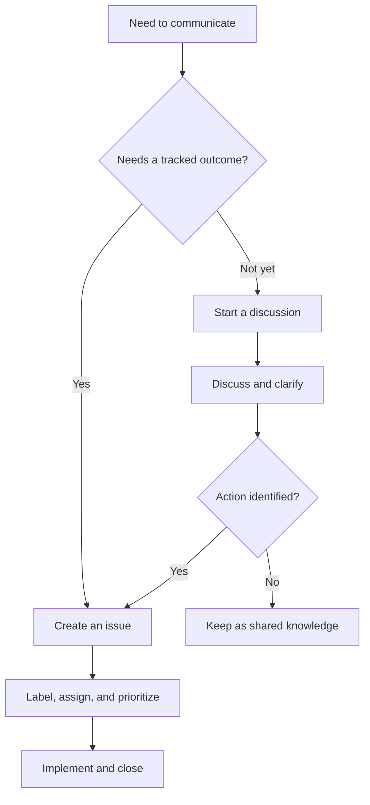
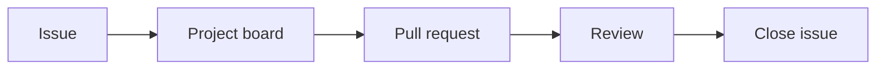

> **Navigation:** [Previous: Chapter 13](13-github-projects.md) | [Roadmap](../../ROADMAP.md) | Next: Chapter 15 coming soon
>
> **Level:** Beginner · **Estimated Time:** 70 min · **Prerequisites:** [Chapter 13: GitHub Projects](13-github-projects.md)

## Learning Objectives

By the end of this chapter, you will be able to:

- explain the purpose of GitHub Issues and Discussions;
- distinguish a trackable work item from an open-ended conversation;
- write a clear issue with context, expected behavior, and acceptance criteria;
- use labels, assignees, milestones, and links to organize work;
- choose the right GitHub communication surface for a request.

## Introduction

Successful collaboration depends on more than code and pull requests. Teams also need a place to report bugs, propose improvements, ask questions, and make decisions. GitHub provides two related tools for this work: Issues and Discussions.

Issues are designed for work that should be tracked toward an outcome. Discussions are designed for conversation, questions, ideas, and community knowledge that may not yet be a defined task.

Choosing the right tool helps a team keep its project organized. A clear bug report should not disappear inside a conversation, while an early design question does not always need to become an issue immediately.

## Visual Learning



_Figure 1. Discussions can clarify an idea before it becomes a trackable issue._



_Figure 2. A well-defined issue can connect planning, implementation, review, and completion._

## Why This Matters

A team needs a reliable way to answer questions such as:

- What is broken?
- What should be improved?
- Who is responsible for the next step?
- Which work is urgent?
- Where was an important decision discussed?

Issues and Discussions make these answers visible and searchable. They reduce duplicated questions, preserve project knowledge, and provide a shared context for contributors.

## Key Terms

| Term                | Definition                                                                        |
| ------------------- | --------------------------------------------------------------------------------- |
| Issue               | A trackable request, bug report, task, or enhancement.                            |
| Discussion          | An open conversation for questions, ideas, announcements, or community knowledge. |
| Label               | A category used to classify and filter issues.                                    |
| Assignee            | A person responsible for moving an issue forward.                                 |
| Milestone           | A group of issues connected to a larger delivery target.                          |
| Acceptance criteria | Conditions that describe when the requested work is complete.                     |
| Close               | The action that marks an issue or discussion as resolved or no longer active.     |

## Theory

### Issues Track Work

An issue represents work that needs attention and a recognizable outcome. Common examples include:

- a reproducible bug;
- a requested feature;
- a documentation improvement;
- a maintenance task;
- a question that requires a concrete change.

A useful issue gives the team enough information to understand the problem and decide what should happen next.

### Discussions Support Open Conversation

A discussion is better suited to topics that need conversation before a task is defined. Examples include:

- asking how a project is used;
- proposing an early idea;
- sharing an announcement;
- comparing possible designs;
- building community knowledge.

A discussion may eventually lead to an issue, but it does not need to begin with a fixed implementation plan.

### The Choice Depends on the Desired Outcome

Use an issue when the primary goal is to track work. Use a discussion when the primary goal is to exchange information or explore possibilities.

| Situation                                  | Better choice | Reason                                               |
| ------------------------------------------ | ------------- | ---------------------------------------------------- |
| A login button crashes                     | Issue         | The problem needs investigation and a fix.           |
| Should the project support a new platform? | Discussion    | The team needs to explore options first.             |
| Update the installation guide              | Issue         | The requested change has a concrete result.          |
| How do I run the project locally?          | Discussion    | The question can be answered and shared with others. |

### A Good Issue Contains Context

A clear issue usually includes:

1. a concise title;
2. a description of the current situation;
3. steps to reproduce the problem, when relevant;
4. expected and actual behavior;
5. acceptance criteria or a definition of done;
6. supporting logs, screenshots, or links when useful.

The goal is not to write a long document. The goal is to provide enough context that another contributor can understand the request without guessing.

### Labels, Assignees, and Milestones Add Structure

Metadata makes a growing issue list easier to manage.

- Labels classify work, such as `bug`, `documentation`, or `enhancement`.
- Assignees make responsibility visible.
- Milestones group issues toward a release or project goal.
- Project links connect the issue to a workflow board.

These features should clarify the work. Adding too many categories can make the system harder to use.

### Linking Work Creates Traceability

An issue can be connected to a pull request and a project board. This creates a visible path from request to delivery:

```text
Issue → Project → Branch → Pull Request → Merge → Closed issue
```

When a pull request references an issue using supported closing keywords, GitHub can close the issue automatically after the change is merged. Teams should use this carefully and verify that the linked work is genuinely complete.

## Practical Examples

### Example 1: Write a Bug Issue

```text
Title: Login button stays disabled after valid credentials are entered

Expected behavior:
The button becomes enabled after a valid email and password are entered.

Actual behavior:
The button remains disabled and no error message is shown.

Steps to reproduce:
1. Open the login page.
2. Enter a valid email address.
3. Enter a valid password.
4. Observe the button.
```

This issue is useful because it describes the expected result, observed result, and reproduction steps.

### Example 2: Start a Discussion

```text
Question: Should the project provide a Docker-based development setup?

Context:
Several contributors use different local environments. A container-based setup
might make onboarding easier. What advantages and concerns should we consider?
```

This belongs in a discussion because the team is exploring an idea rather than requesting an already-defined implementation.

### Example 3: Organize an Issue

After creating an issue, you might:

1. add the `documentation` label;
2. assign it to a contributor;
3. attach it to the current milestone;
4. add it to the GitHub Project;
5. link the pull request that implements the change.

This turns an isolated request into visible, trackable project work.

## Best Practices

- Search existing issues and discussions before opening a duplicate.
- Use a specific title that describes the problem or desired outcome.
- Include enough context for another contributor to reproduce or understand the request.
- Keep one issue focused on one main outcome.
- Use respectful, factual language in public conversations.
- Close or update items when the situation changes.
- Convert a discussion into an issue when a concrete task has been identified.

## Common Mistakes

- filing a vague issue such as `It does not work`;
- opening duplicate issues without searching first;
- using a discussion for an urgent, trackable bug;
- assigning work without clarifying what completion means;
- adding labels that do not communicate useful information;
- closing an issue before the linked work is actually validated.

## Exercises

### Exercise 1: Classify the Communication

Choose **Issue** or **Discussion** for each situation:

1. A contributor wants to know whether the project supports Windows.
2. The documentation has an incorrect installation command.
3. The team is considering two different deployment strategies.
4. A release process fails with a reproducible error.

### Exercise 2: Improve an Issue

Rewrite this issue title and description so that another contributor can act on it:

```text
Title: App broken

Description: The app crashes sometimes. Please fix it.
```

Include a clearer title, reproduction steps, expected behavior, and actual behavior.

### Exercise 3: Choose Useful Metadata

For a documentation bug that should be fixed before the next release, choose:

- one suitable label;
- an assignee role;
- a milestone;
- one project board stage.

## Solutions

### Solution 1: Classify the Communication

1. Discussion, unless the answer requires a documentation or code change.
2. Issue, because the documentation needs a concrete correction.
3. Discussion, because the team is comparing options.
4. Issue, because the failure is reproducible and needs investigation.

### Solution 2: Improve an Issue

```text
Title: Application crashes when an empty configuration file is loaded

Steps to reproduce:
1. Start the application with an empty configuration file.
2. Open the settings screen.
3. Save the settings.

Expected behavior:
The application shows a validation message and remains available.

Actual behavior:
The application exits unexpectedly.
```

This version gives the contributor a specific problem, a reproducible path, and a clear target behavior.

### Solution 3: Choose Useful Metadata

- Label: `documentation`
- Assignee: documentation maintainer
- Milestone: next release
- Project stage: `Todo` or `Backlog`

## Summary

GitHub Issues are used to track work with a concrete outcome. GitHub Discussions are used to ask questions, explore ideas, and share knowledge before the work is fully defined.

Clear titles, useful context, focused scope, and sensible metadata make collaboration easier. Issues and Discussions become even more valuable when they connect to project boards and pull requests.

## Next Chapter

Chapter 15 introduces GitHub Releases, tags, release notes, and the process of communicating a stable version to users.

### Related Content

- Previous chapter: [Chapter 13 - GitHub Projects](13-github-projects.md)
- Next chapter: Chapter 15 (coming soon)
- Exercise: [Classify Issues and Discussions](../../exercises/en/14-classify-issues-and-discussions.md)
- Lab: [Create and Organize GitHub Issues](../../labs/en/14-create-and-organize-github-issues.md)
- Quiz: [Issues and Discussions Quiz](../../quizzes/en/14-issues-and-discussions-quiz.md)

## Further Reading

- [GitHub Docs: About issues](https://docs.github.com/en/issues/tracking-your-work-with-issues/about-issues)
- [GitHub Docs: About discussions](https://docs.github.com/en/discussions/collaborating-with-your-community-using-discussions/about-discussions)
- [GitHub Docs: Linking a pull request to an issue](https://docs.github.com/en/issues/tracking-your-work-with-issues/linking-a-pull-request-to-an-issue)
