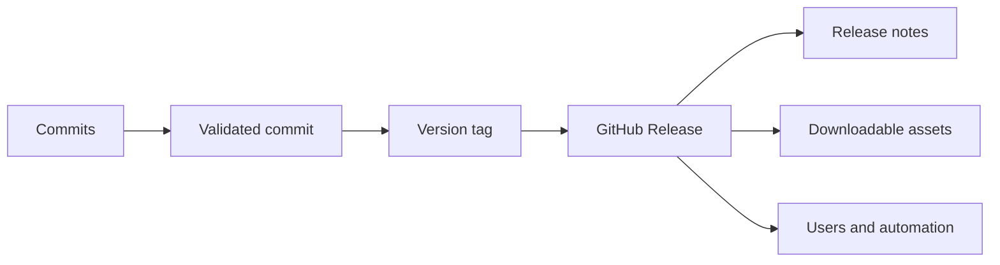
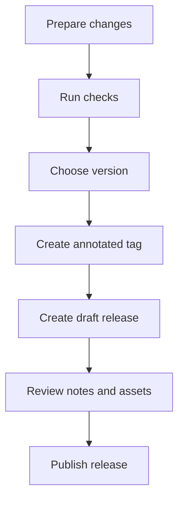

> **Navigation:** [Previous: Chapter 14](14-issues-and-discussions.md) | [Roadmap](../../ROADMAP.md) | Next: Chapter 16 coming soon
>
> **Level:** Beginner · **Estimated Time:** 70 min · **Prerequisites:** [Chapter 14: Issues & Discussions](14-issues-and-discussions.md)

## Learning Objectives

By the end of this chapter, you will be able to:

- explain the relationship between commits, tags, and GitHub Releases;
- create a meaningful version tag for a stable project state;
- write release notes that communicate changes clearly;
- distinguish a draft, prerelease, and stable release;
- describe how assets and checksums help users consume a release safely.

## Introduction

A project can contain many commits, branches, and pull requests. Users, however, usually need a simpler answer: which version should I use, and what changed in it? GitHub Releases provide a public way to communicate stable project versions.

A release normally points to a Git tag. The tag identifies one exact commit, while the release page adds human-readable information such as highlights, bug fixes, breaking changes, installation instructions, and downloadable assets.

This chapter connects Git history with software distribution. You will learn why a release is more than a label and how careful release notes help users, maintainers, and automation systems understand a version.

## Visual Learning



_Figure 1. A GitHub Release packages one identified point in Git history with communication and distribution information._



_Figure 2. A release workflow should validate the version before it is published._

## Why This Matters

Releases help answer important questions:

- Which exact source state is recommended?
- What changed since the previous version?
- Are there known breaking changes?
- Which files should users download?
- Is this version ready for production use?

Without a release process, users may have to guess which commit is stable. Clear releases also make rollback, support, documentation, and automated deployment easier.

## Key Terms

| Term          | Definition                                                               |
| ------------- | ------------------------------------------------------------------------ |
| Tag           | A named reference to a specific commit, often used for a version.        |
| Annotated tag | A tag that stores metadata such as a message, tagger, and date.          |
| Release       | A GitHub page that communicates and distributes a version.               |
| Release notes | A summary of changes, fixes, known issues, and upgrade information.      |
| Asset         | A file attached to a release, such as an archive, installer, or package. |
| Draft release | A release prepared privately until it is ready to publish.               |
| Prerelease    | A version shared for testing before it is considered stable.             |
| Checksum      | A value used to verify that a downloaded file was not changed.           |

## Theory

### A Tag Identifies One Exact Commit

A tag is a name attached to a specific point in Git history. A version tag such as `v1.2.0` lets people refer to the same source state consistently.

Create an annotated tag after the intended commit has been validated:

```bash
git switch main
git pull origin main
git tag -a v1.2.0 -m "Release version 1.2.0"
git push origin v1.2.0
```

The tag does not contain the release notes by itself. It identifies the source state that the GitHub Release will describe.

### Annotated Tags Are Useful for Releases

A lightweight tag is only a name pointing at a commit. An annotated tag stores additional information and is usually a better choice for published versions.

Inspect a tag with:

```bash
git show v1.2.0
```

This helps verify which commit the tag identifies and what message was recorded.

### Version Numbers Communicate Change Size

Many projects use Semantic Versioning:

```text
MAJOR.MINOR.PATCH
```

- `MAJOR` changes may include incompatible behavior;
- `MINOR` adds functionality while preserving compatibility;
- `PATCH` contains backward-compatible fixes.

For example, changing from `1.4.2` to `2.0.0` signals a larger compatibility boundary than changing from `1.4.2` to `1.4.3`. A project should document its own versioning policy because not every project follows Semantic Versioning exactly.

### A Release Adds Human Context

The tag answers **where** the version comes from. Release notes explain **what** the version means.

Useful release notes often include:

- a short summary;
- notable new features;
- bug fixes;
- breaking changes;
- migration instructions;
- known limitations;
- links to relevant issues and pull requests.

Good notes help users decide whether and how to upgrade.

### Draft, Prerelease, and Stable Releases Have Different Signals

A draft release is still being prepared and is not yet published as an official version. A prerelease is available for testing but is not presented as the final stable release. A stable release is the version the project recommends for normal use.

The label should match the quality and intent of the version. Publishing an unfinished build as stable can create confusion and support problems.

### Assets Extend the Release

A release can include files such as:

- source archives;
- compiled binaries;
- installers;
- container metadata;
- package files;
- checksums or signature files.

Users should receive clear instructions for choosing an asset. Maintainers should verify that the files correspond to the tagged commit.

### Checksums Support Download Verification

A checksum lets users compare the downloaded file with a value published by the maintainer. For example, on Windows PowerShell:

```powershell
Get-FileHash .\project-v1.2.0.zip -Algorithm SHA256
```

The computed hash should match the trusted checksum published with the release. A checksum does not prove who created a file, but it can reveal accidental corruption or an altered download.

### Release Notes Connect the Delivery Story

A release often connects several existing GitHub objects:

```text
Issues → Pull Requests → Merged commits → Tag → Release notes → Assets
```

This makes the version traceable. A maintainer can explain why a change was made, which code implemented it, and which exact version contains it.

## Practical Examples

### Example 1: Create and Inspect a Tag

```bash
git switch main
git pull origin main
git tag -a v1.0.0 -m "Initial stable release"
git show v1.0.0
git push origin v1.0.0
```

The tag points to the validated `main` commit and is then pushed so GitHub can use it for a release.

### Example 2: Write Release Notes

```markdown
## Highlights

- Added GitHub project planning examples.
- Improved installation guidance.

## Fixed

- Corrected the remote synchronization example.

## Upgrade Notes

- No breaking changes.

## Contributors

- Thank you to everyone who reviewed the documentation.
```

These notes are easier to scan than a raw list of commit messages because they group changes by user impact.

### Example 3: Prepare a Prerelease

A team may publish `v2.0.0-rc.1` as a release candidate. Users can test it before the final `v2.0.0` release.

The release should clearly state:

- that it is not yet stable;
- what testing is requested;
- how feedback should be reported;
- what may still change before the final version.

## Best Practices

- Release only from a commit that has passed the required checks.
- Prefer annotated tags for published versions.
- Use a consistent versioning policy.
- Review the tag and release target before publishing.
- Write notes for users, not only for developers.
- Mention breaking changes and migration steps explicitly.
- Verify release assets and checksums before publishing.
- Link important issues and pull requests where they add useful context.

## Common Mistakes

- tagging a local commit that was not pushed or validated;
- reusing an existing version tag for different content;
- publishing a prerelease as stable by mistake;
- copying raw commit messages without explaining user impact;
- attaching the wrong build artifact to a release;
- forgetting to document breaking changes;
- deleting or moving a published tag without communicating the impact.

## Exercises

### Exercise 1: Choose the Version

Choose a suitable next version for each change under a Semantic Versioning policy:

1. A backward-compatible bug fix.
2. A new optional feature that does not break existing users.
3. A change that removes a previously supported configuration format.

### Exercise 2: Design Release Notes

Write release notes for a version that includes:

- one new feature;
- two bug fixes;
- one known limitation;
- no breaking changes.

### Exercise 3: Release Readiness Checklist

Create a checklist with at least six checks that should happen before publishing a stable release.

## Solutions

### Solution 1: Choose the Version

1. Patch version, for example `1.2.3` to `1.2.4`.
2. Minor version, for example `1.2.3` to `1.3.0`.
3. Major version, for example `1.2.3` to `2.0.0`.

### Solution 2: Design Release Notes

A suitable structure is:

```markdown
## Added

- Added the new project export command.

## Fixed

- Fixed incorrect path handling on Windows.
- Fixed missing validation for empty input.

## Known limitation

- Export currently supports one project at a time.

## Compatibility

- No breaking changes in this release.
```

### Solution 3: Release Readiness Checklist

Possible checks include:

- all required tests pass;
- the target branch is up to date;
- the version number follows the project policy;
- the annotated tag points to the intended commit;
- release notes have been reviewed;
- assets were built from the tagged source;
- checksums were generated and verified;
- known issues and migration steps are documented.

## Summary

A GitHub Release combines a version tag with human-readable communication and optional downloadable assets. Tags identify an exact commit; release notes explain the changes and upgrade implications.

A reliable release process validates the source, chooses a clear version, prepares accurate notes, verifies assets, and distinguishes draft, prerelease, and stable states. This gives users a trustworthy way to consume project versions.

## Next Chapter

Chapter 16 introduces GitHub Security, including repository security settings, dependency alerts, secret protection, and secure collaboration practices.

### Related Content

- Previous chapter: [Chapter 14 - Issues & Discussions](14-issues-and-discussions.md)
- Next chapter: Chapter 16 (coming soon)
- Exercise: [Prepare a GitHub Release](../../exercises/en/15-prepare-a-github-release.md)
- Lab: [Tag and Publish a GitHub Release](../../labs/en/15-tag-and-publish-a-github-release.md)
- Quiz: [GitHub Releases Quiz](../../quizzes/en/15-github-releases-quiz.md)

## Further Reading

- [GitHub Docs: About releases](https://docs.github.com/en/repositories/releasing-projects-on-github/about-releases)
- [GitHub Docs: Managing releases in a repository](https://docs.github.com/en/repositories/releasing-projects-on-github/managing-releases-in-a-repository)
- [Semantic Versioning](https://semver.org/)
