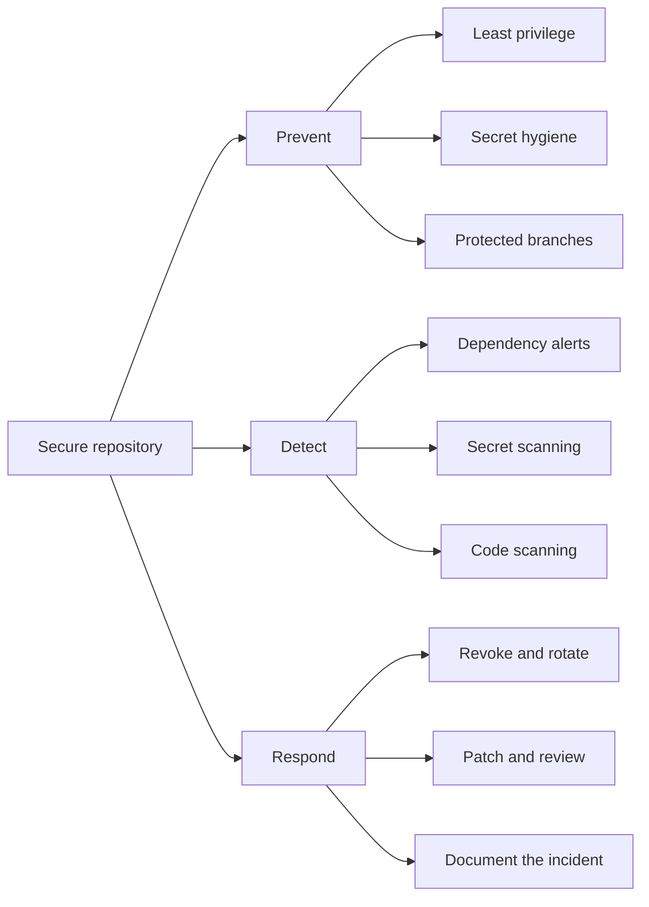
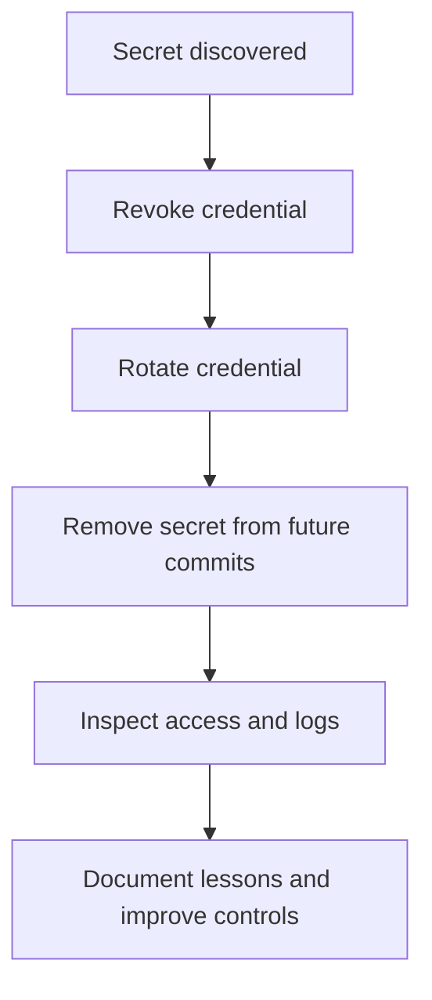

> **Navigation:** [Previous: Chapter 15](15-github-releases.md) | [Roadmap](../../ROADMAP.md) | Next: Chapter 17 coming soon
>
> **Level:** Beginner · **Estimated Time:** 80 min · **Prerequisites:** [Chapter 15: GitHub Releases](15-github-releases.md)

## Learning Objectives

By the end of this chapter, you will be able to:

- explain the shared-responsibility model for repository security;
- protect sensitive values from being committed or exposed;
- describe dependency alerts, Dependabot, and code scanning;
- apply branch protection and least-privilege collaboration practices;
- respond appropriately when a secret or vulnerability is discovered.

## Introduction

GitHub security is not one setting or one tool. It is a collection of practices that protect source code, dependencies, credentials, workflows, and the people who maintain a repository.

A secure repository starts with simple habits: keep secrets out of source control, review permissions, update dependencies, protect important branches, and investigate security alerts. GitHub provides features that support these habits, but a team still needs clear rules and responsible decisions.

This chapter introduces the main security surfaces a beginner will encounter in GitHub. It focuses on prevention, detection, and response rather than on treating security as a final step after development.

## Visual Learning



_Figure 1. Repository security combines prevention, detection, and response._



_Figure 2. A leaked secret requires immediate containment before cleanup and learning._

## Why This Matters

A compromised repository can expose more than source code. It may reveal:

- cloud credentials;
- API keys and tokens;
- private customer data;
- vulnerable dependencies;
- deployment permissions;
- workflow secrets.

Security controls reduce the chance that a mistake becomes an incident. They also make response faster when something goes wrong.

Security is a team responsibility. Developers, reviewers, maintainers, and administrators all influence the safety of a repository.

## Key Terms

| Term                | Definition                                                                            |
| ------------------- | ------------------------------------------------------------------------------------- |
| Secret              | A sensitive value such as a password, token, or private key.                          |
| Secret scanning     | Detection of credentials or secret-like values in repository content.                 |
| Dependency alert    | A notification that a dependency may contain a known vulnerability.                   |
| Dependabot          | GitHub automation that can identify dependency updates and open update pull requests. |
| Code scanning       | Automated analysis that identifies potential coding vulnerabilities.                  |
| Branch protection   | Rules that require conditions before changes can reach an important branch.           |
| Least privilege     | Giving a person or process only the access it needs.                                  |
| Security policy     | Repository guidance for reporting vulnerabilities responsibly.                        |
| Credential rotation | Replacing a credential with a new value after exposure or according to policy.        |

## Theory

### Security Begins with Access Control

Repository access should match a person’s responsibility. Review who can:

- read private code;
- create or approve pull requests;
- push directly to protected branches;
- manage repository settings;
- access actions secrets;
- publish releases.

Least privilege limits the impact of a compromised account or accidental action. Teams should regularly review collaborators, teams, apps, and tokens.

### Protect Important Branches

A protected default branch can require conditions such as:

- pull request review before merging;
- passing status checks;
- conversation resolution;
- restrictions on force pushes;
- restrictions on branch deletion;
- signed commits, when required by the project.

Branch protection does not replace review. It makes the expected workflow enforceable.

### Never Store Secrets in Source Code

Do not commit passwords, access tokens, private keys, or production credentials. Use an appropriate secret store or GitHub Actions secrets for values that workflows need.

This is unsafe:

```text
API_TOKEN=real-production-token
```

A safer pattern is to reference a configured secret without writing its value into the repository:

```yaml
env:
  API_TOKEN: ${{ secrets.API_TOKEN }}
```

The secret value must still be protected from logs, pull requests from untrusted sources, and unnecessary workflow exposure.

### Secret Scanning Helps Detect Exposure

Secret scanning checks repository content for known credential patterns and other sensitive values. Detection is useful, but it is not permission to commit secrets. Prevention remains the first responsibility.

If a secret is detected, assume it may be compromised until proven otherwise. Removing the line from the latest commit is not enough if the secret remains in Git history or was already copied.

### The Correct Response to a Leaked Secret

Follow the project’s incident process. The common sequence is:

1. revoke or disable the exposed credential;
2. rotate it by creating a replacement;
3. identify where it was used;
4. remove it from current content and history when appropriate;
5. inspect logs and access activity;
6. document the incident and improve controls.

Do not paste the secret into an issue, pull request, chat message, or support request while reporting the incident.

### Dependency Alerts Identify Known Risk

Projects depend on libraries maintained by other teams. A dependency alert can indicate that a version is affected by a known vulnerability.

A useful response includes:

- understanding which dependency and version are affected;
- checking whether the vulnerable code path is used;
- reviewing the available patched version;
- testing the update;
- merging the update through the normal review workflow.

Ignoring an alert is a decision that should be understood and documented, not an invisible default.

### Dependabot Supports Dependency Maintenance

Dependabot can check dependency manifests and propose update pull requests. These updates still require review because a newer version may change behavior or introduce compatibility concerns.

Good dependency maintenance includes:

- keeping manifests and lockfiles consistent;
- reviewing changelogs for major updates;
- running tests and security checks;
- removing unused dependencies;
- prioritizing fixes based on severity and exposure.

### Code Scanning Finds Potential Coding Problems

Code scanning analyzes source code and reports patterns that may lead to vulnerabilities. Findings need human review because automated analysis can produce false positives or miss context.

A team should define how findings are triaged:

- Which findings block a merge?
- Who owns remediation?
- Which results are accepted as false positives?
- How are exceptions documented and revisited?

### Security Policies Tell People How to Report Problems

A `SECURITY.md` file can explain:

- which versions are supported;
- how to report a vulnerability privately;
- what information a report should contain;
- expected response timelines;
- whether a security advisory process is used.

Do not ask people to publish sensitive vulnerability details in a public issue when private reporting is appropriate.

### Security Checks Must Include Workflows

GitHub Actions workflows may have access to secrets and repository write permissions. Review:

- permissions granted to the workflow token;
- actions and versions used by the workflow;
- whether untrusted pull request code can access secrets;
- whether third-party actions are pinned or reviewed;
- whether logs could expose sensitive values.

Use the smallest permissions required and avoid printing secret-bearing environment variables.

## Practical Examples

### Example 1: Review Repository Access

Create a short review table:

| Principal   | Access needed                | Review result                      |
| ----------- | ---------------------------- | ---------------------------------- |
| Maintainer  | Repository administration    | Required for settings and releases |
| Contributor | Branch and pull request work | No direct protected-branch push    |
| CI workflow | Test and report status       | Read access plus required checks   |

The goal is to make each permission intentional.

### Example 2: Configure a Protected Branch

A team might require:

1. pull requests instead of direct changes;
2. at least one approving review;
3. successful automated checks;
4. no force pushes;
5. resolved review conversations.

These rules protect the branch while preserving the normal contribution workflow.

### Example 3: Respond to a Dependency Alert

```text
1. Read the alert and identify the affected package.
2. Check the patched version and release notes.
3. Update the manifest and lockfile.
4. Run tests and security checks.
5. Review the pull request.
6. Merge and confirm that the alert is resolved.
```

This response treats the alert as actionable maintenance rather than as a notification to ignore.

### Example 4: Report a Secret Exposure

A concise internal report should state:

- what type of credential was exposed;
- where it was found, without reproducing the value;
- when it may have been accessible;
- whether it has been revoked and rotated;
- what follow-up actions are required.

The actual secret should never be included in the report.

## Best Practices

- Use least privilege for people, applications, and workflows.
- Keep secrets in approved secret-management systems.
- Enable security alerts and review them regularly.
- Protect the default branch with review and status requirements.
- Keep dependencies updated and remove unused packages.
- Review workflow permissions and third-party actions.
- Provide a private vulnerability-reporting path.
- Treat security findings as work that needs ownership and follow-up.

## Common Mistakes

- committing a token because it is only used for testing;
- assuming deleting a secret from the latest file removes it from history;
- granting broad write permissions to every workflow;
- merging dependency updates without testing compatibility;
- publishing vulnerability details in a public issue too early;
- ignoring alerts because the repository is small;
- treating a green security check as proof that no vulnerabilities exist.

## Exercises

### Exercise 1: Identify the Control

Match each risk with the most relevant control:

1. A contributor can push directly to `main`.
2. A cloud token is accidentally committed.
3. A library version has a known vulnerability.
4. A workflow has more permissions than it needs.
5. A security researcher needs to report a private vulnerability.

### Exercise 2: Write an Incident Response

Describe the steps you would take after discovering an API token in a public commit. Do not include a real token.

### Exercise 3: Review a Workflow Permission

Explain why a workflow that only runs tests should not automatically receive write access to repository contents.

## Solutions

### Solution 1: Identify the Control

1. Branch protection and required pull request reviews.
2. Secret scanning plus immediate revocation and rotation.
3. Dependency alerts and a tested dependency update.
4. Least-privilege workflow permissions.
5. A private security reporting process documented in `SECURITY.md`.

### Solution 2: Write an Incident Response

Revoke the token immediately, rotate it, identify affected systems, remove the value from current content and history where appropriate, inspect access logs, notify the responsible maintainers, and document improvements. The token should not appear in the incident report.

### Solution 3: Review a Workflow Permission

A test workflow does not need to modify repository contents. Excess write access increases the damage an attacker could cause if the workflow or a dependency were compromised. Read access and status reporting are usually enough for that task.

## Summary

GitHub Security is a layered practice. Access control and branch protection prevent unsafe changes, while secret scanning, dependency alerts, and code scanning help detect problems. Security policies and incident response practices help teams act when prevention fails.

The most important habits are simple: never commit secrets, use least privilege, review alerts, protect important branches, update dependencies, and make security ownership explicit.

## Next Chapter

Chapter 17 begins the GitLab DevOps track by comparing GitLab’s platform model, repositories, collaboration features, and DevOps workflow foundations.

### Related Content

- Previous chapter: [Chapter 15 - GitHub Releases](15-github-releases.md)
- Next chapter: Chapter 17 (coming soon)
- Exercise: [Review GitHub Security Controls](../../exercises/en/16-review-github-security-controls.md)
- Lab: [Harden a GitHub Repository](../../labs/en/16-harden-a-github-repository.md)
- Quiz: [GitHub Security Quiz](../../quizzes/en/16-github-security-quiz.md)

## Further Reading

- [GitHub Docs: About securing your repository](https://docs.github.com/en/code-security/getting-started/securing-your-repository)
- [GitHub Docs: About secret scanning](https://docs.github.com/en/code-security/secret-scanning/introduction/about-secret-scanning)
- [GitHub Docs: About Dependabot alerts](https://docs.github.com/en/code-security/dependabot/dependabot-alerts/about-dependabot-alerts)
- [GitHub Docs: About code scanning](https://docs.github.com/en/code-security/code-scanning/introduction-to-code-scanning/about-code-scanning)
