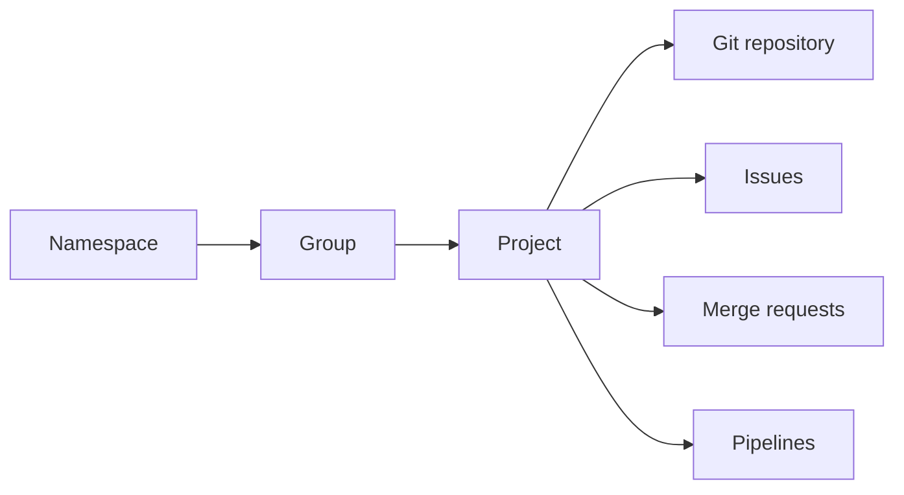
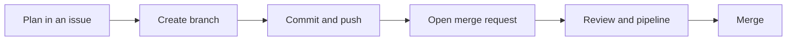

> **Navigation:** [Previous: Chapter 16](16-github-security.md) | [Roadmap](../../ROADMAP.md) | Next: Chapter 18 coming soon
>
> **Level:** Beginner | **Estimated Time:** 75 min | **Prerequisites:** [Chapter 16: GitHub Security](16-github-security.md)

## Learning Objectives

By the end of this chapter, you will be able to:

- explain GitLab's role as a platform for source code, collaboration, and delivery automation;
- distinguish a namespace, group, project, and repository;
- describe how members, roles, and visibility influence access;
- identify the purpose of issues, merge requests, and pipelines in a GitLab workflow.

## Introduction

GitLab is a DevOps platform built around Git repositories. Teams can plan work, collaborate on changes, automate tests, publish packages, and manage deployments in one connected environment.

Git remains the version-control system underneath. GitLab adds the shared services around it: remote project hosting, access management, discussions, merge requests, and CI/CD pipelines. This chapter introduces the vocabulary and workflow before later chapters examine each feature in detail.

## Visual Learning



_Figure 1. A GitLab project combines a Git repository with collaboration and automation features._



_Figure 2. A small GitLab change follows a visible, reviewable workflow._

## Why This Matters

A remote repository is more useful when a team can also answer these questions in the same place:

- What work is planned?
- Who may change a project?
- What changed and why?
- Did automated checks pass?
- Is a change ready to merge or deploy?

GitLab connects those questions to the repository. Understanding its basic objects helps a team organize access and avoid treating source code, planning, review, and automation as unrelated tools.

## Key Terms

| Term          | Definition                                                                                       |
| ------------- | ------------------------------------------------------------------------------------------------ |
| Namespace     | The path that organizes groups, users, and projects in GitLab.                                   |
| Group         | A container for related projects and their members. Groups can contain subgroups.                |
| Project       | A GitLab workspace that usually contains one Git repository plus planning and delivery features. |
| Repository    | The Git history, branches, tags, and files stored for a project.                                 |
| Member        | A user who has been granted access to a group or project.                                        |
| Role          | A permission level that controls what a member can view or change.                               |
| Issue         | A tracked unit of work, question, defect, or improvement.                                        |
| Merge request | A proposal to merge changes from one branch into another.                                        |
| Pipeline      | A sequence of automated jobs, often used to build, test, or deliver software.                    |

## Theory

### GitLab Is More Than a Git Remote

Git commands such as `clone`, `branch`, `commit`, `push`, `pull`, and `merge` work with a GitLab repository in the same way they work with other Git hosting services. GitLab then presents the remote repository as a project with additional features.

The project is the central workspace. It can contain the repository, issues, merge requests, CI/CD configuration, releases, packages, documentation, and security information. A project does not make Git unnecessary; it makes team work around Git visible and coordinated.

### Namespaces, Groups, and Projects

Every project has a path. For example, `acme/platform/storefront` can describe a project named `storefront` inside the `platform` group, which belongs to the `acme` namespace.

Groups help teams collect related projects. A group can represent an organization, a department, a product area, or a training cohort. Members can receive access through the group, so a maintainer does not need to add the same people separately to every project. Subgroups allow larger organizations to retain that structure without putting every project in one flat list.

### Visibility and Access Must Be Intentional

Projects and groups can use different visibility levels. A public project is visible to anyone, while private projects require access. Internal visibility may exist on self-managed or organization-managed instances, but its exact meaning depends on the instance configuration.

Visibility answers who can discover or read a project. Roles answer what an authorized member may do. GitLab provides role levels such as Guest, Reporter, Developer, Maintainer, and Owner. The available actions can vary by GitLab edition and configuration, so teams should review their own permission settings rather than assume a role grants every action.

Apply least privilege: grant only the access required for a person's task. Use groups for stable team membership, remove access that is no longer needed, and protect important branches from direct changes.

### Issues Turn Work into Shared Context

An issue records work that the team can discuss and track. It may describe a defect, a feature, a question, or a maintenance task. A useful issue states the context, expected result, scope, and acceptance criteria.

Issues do not replace commits. They explain why a change is needed, while commits record the technical changes. Later chapters cover planning and work-item practices in more detail.

### Merge Requests Make Changes Reviewable

A merge request compares a source branch with a target branch. It provides a title, description, diff, discussion, approvals, and pipeline status in one place.

The usual sequence is:

1. create a branch for a focused change;
2. make and test the change locally;
3. push the branch to GitLab;
4. open a merge request toward the correct target branch;
5. review comments and pipeline results;
6. update the same branch when changes are requested;
7. merge only when the project requirements are met.

A merge request is not merely a button before merging. It is the team record of intent, review, automated evidence, and the final decision.

### Pipelines Introduce Automation

A GitLab pipeline is a collection of automated jobs. A project commonly defines these jobs in a `.gitlab-ci.yml` file. For example, a pipeline may install dependencies, run tests, check formatting, build an application, and publish an artifact.

At this stage, the important idea is feedback: a pipeline runs repeatable checks for a specific commit or merge request. A green pipeline is useful evidence, but it does not replace careful review. The structure and configuration of pipelines are covered in later chapters.

## Practical Examples

### Example 1: Read a Project Path

```text
acme/platform/storefront
```

This path identifies the `storefront` project. `acme` is the top-level namespace and `platform` is a group or subgroup. The exact hierarchy lets a team recognize ownership and locate related projects.

### Example 2: Clone a GitLab Project

```bash
git clone https://gitlab.com/acme/platform/storefront.git
cd storefront
git remote -v
```

`git clone` creates a local copy of the project repository. `git remote -v` confirms the remote URL named `origin`. Use the URL from the project's **Code** page and use an authentication method approved by the project.

### Example 3: Create a Focused Merge Request

```bash
git switch -c docs/setup-guide
git add README.md
git commit -m "docs: clarify local setup"
git push -u origin docs/setup-guide
```

After pushing, open a merge request from `docs/setup-guide` to the intended target branch. Its description should explain what was clarified and how the change was checked. The branch name and commit describe one focused purpose, making review easier.

### Example 4: Interpret Pipeline Feedback

```text
Merge request: docs/setup-guide -> main
Pipeline: failed
Job: markdown-lint
Result: README.md contains a heading-level warning
```

Do not merge just because the content change looks small. Read the failed job output, correct the heading, commit the fix to the same source branch, and push it. The merge request and pipeline then update automatically.

## Try It Yourself

1. Open a GitLab project you can view.
2. Identify its project path, visibility, default branch, and member list if you have permission.
3. Locate the Issues, Merge requests, and Build or CI/CD areas.
4. Explain in one sentence what each area contributes to the team workflow.

## Best Practices

- Use groups to manage access for teams rather than adding the same members to many individual projects.
- Keep issues and merge requests focused so their purpose can be understood quickly.
- Use descriptive branch names and merge-request descriptions that state context, change, and verification.
- Review pipeline results before merging, and investigate failed jobs instead of bypassing them.
- Grant the smallest appropriate role and periodically review group and project membership.

## Common Mistakes

| Mistake                                           | Why it causes problems                                                          | How to avoid it                                                                                |
| ------------------------------------------------- | ------------------------------------------------------------------------------- | ---------------------------------------------------------------------------------------------- |
| Treating a group and a project as the same object | Access and ownership become difficult to organize.                              | Use groups for related projects and shared membership; use projects for the actual workspaces. |
| Giving every contributor Maintainer access        | An accidental or compromised account can change settings or protected branches. | Choose the least privileged role that supports the task.                                       |
| Opening a merge request without a description     | Reviewers must infer the intent and test evidence from the diff.                | State the problem, solution, and verification.                                                 |
| Ignoring a failed pipeline                        | Defects or policy violations can reach the target branch.                       | Read the job output, fix the cause, and rerun the required checks.                             |

## Summary

- GitLab combines Git hosting with planning, review, access management, and delivery automation.
- Namespaces, groups, and projects organize ownership and access around repositories.
- Issues provide work context; merge requests provide review context; pipelines provide repeatable automated feedback.
- Clear access rules and focused merge requests support safe collaboration.

## Exercise

### Objective

Inspect a GitLab project and explain how its project path, access, and collaboration features fit together.

### Task

Use the related exercise to classify project elements and review a proposed access decision.

### Expected Outcome

You can identify the project hierarchy and justify an appropriate role for a contributor.

## Lab

### Objective

Create and review a small GitLab change through an issue, branch, merge request, and pipeline check.

### Requirements

- Access to a GitLab project where you may create a branch and merge request.
- Git installed and configured with an approved authentication method.

### Tasks

1. Create an issue and a focused feature branch.
2. Commit and push a small documentation update.
3. Open and review a merge request, including its pipeline result.

### Expected Outcome

You have a complete, reviewable record of a small change in GitLab.

## Quiz

1. What is the main difference between a group and a project?
2. Why should a project use the least privileged role for each member?
3. What information does a merge request bring together before a merge?

## Next Chapter

Chapter 18 builds on these foundations by examining groups, projects, members, and permissions in more detail.

### Related Content

- Previous chapter: [GitHub Security](16-github-security.md)
- Next chapter: Groups, Projects, Members & Permissions (coming soon)
- Related exercise: [Explore GitLab Project Fundamentals](../../exercises/en/17-explore-gitlab-project-fundamentals.md)
- Related lab: [Create and Review a GitLab Change](../../labs/en/17-create-and-review-a-gitlab-change.md)
- Related quiz: [GitLab Fundamentals Quiz](../../quizzes/en/17-gitlab-fundamentals-quiz.md)

## Further Reading

- [GitLab Documentation: Get started](https://docs.gitlab.com/get-started/)
- [GitLab Documentation: Members of a group or project](https://docs.gitlab.com/user/project/members/)
- [GitLab Documentation: Merge requests](https://docs.gitlab.com/user/project/merge_requests/)
