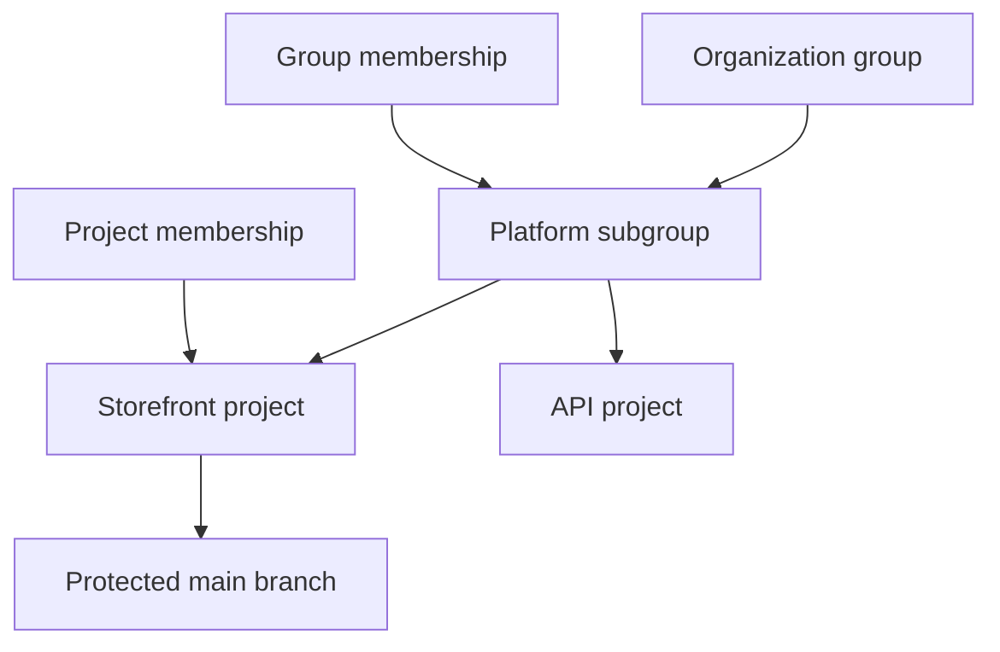

> **Navigation:** [Previous: Chapter 17](17-gitlab-fundamentals.md) | [Exercise](../../exercises/en/18-plan-gitlab-project-access.md) | [Lab](../../labs/en/18-configure-gitlab-project-access.md) | [Quiz](../../quizzes/en/18-gitlab-groups-projects-members-and-permissions-quiz.md) | [Roadmap](../../ROADMAP.md)

## Learning Objectives

- organize related work with groups, subgroups, and projects;
- distinguish visibility, membership, and role-based permissions;
- apply least privilege, access reviews, and protected-branch rules.

## Introduction

GitLab access design starts with structure. Groups collect related projects, subgroups reflect ownership boundaries, and projects hold the repositories and delivery work. Clear structure makes it easier to grant only the access a person needs.

## Visual Learning



_Figure 1. Group membership can provide access to projects while protected branches add a separate control._

## Key Terms

| Term             | Definition                                                           |
| ---------------- | -------------------------------------------------------------------- |
| Group            | A container for related projects and shared membership.              |
| Subgroup         | A group inside another group for a more precise structure.           |
| Visibility       | Who can discover or read a group or project.                         |
| Membership       | A user's granted relationship to a group or project.                 |
| Role             | The permitted actions for a member, such as Developer or Maintainer. |
| Least privilege  | Giving only the minimum access required for a task.                  |
| Protected branch | A branch with rules that restrict who may push or merge.             |

## Theory

### Structure and Visibility

Use a group for a stable team or product area and a subgroup when a smaller ownership boundary is useful. Create projects for distinct repositories or delivery units. Public, internal, and private visibility control discovery and reading; the meanings available depend on the GitLab instance configuration.

### Membership and Roles

Group membership is useful for people who need comparable access across several projects. Project membership is more precise for an exception. Roles such as Guest, Reporter, Developer, Maintainer, and Owner have different capabilities; verify the instance's current permissions before assigning one. Do not use visibility as a substitute for authorization.

### Least Privilege and Reviews

Start with the lowest role that enables the task. Record temporary access, remove it when work ends, and periodically review direct project members, inherited group members, service accounts, and external users. An access review should ask whether each membership still has a business purpose and whether its role is still appropriate.

### Protected Branches

Protect the default branch so normal work reaches it through reviewed merge requests. Configure who may push, merge, or approve according to the team's policy. Protection complements roles: a Developer may contribute on a branch without being able to bypass the controls on `main`.

## Practical Examples

### Example 1: Design a hierarchy

```text
acme
└── platform
    ├── storefront
    └── payments
```

`platform` is a subgroup that can share a team membership. Each project can still have its own visibility and protected-branch settings.

### Example 2: Assign by task

| Person                    | Need                              | Suitable decision                                         |
| ------------------------- | --------------------------------- | --------------------------------------------------------- |
| Documentation contributor | Create a branch and merge request | Lowest configured contributor role that permits this work |
| Release lead              | Manage merge policy               | Maintainer only for the responsible project or group      |
| Former contractor         | No current task                   | Remove membership                                         |

## Try It Yourself

1. Choose a group that contains at least two related projects.
2. List inherited and direct members for one project, if you have permission.
3. Identify the default branch and explain who may push or merge to it.

## Best Practices

- Model durable ownership with groups and subgroups before adding many direct project members.
- Grant the lowest role that meets a documented task.
- Review access on a schedule and after role, team, or vendor changes.
- Protect important branches and require the configured review and pipeline checks.

## Common Mistakes

| Mistake                               | Why it causes problems                                     | How to avoid it                                        |
| ------------------------------------- | ---------------------------------------------------------- | ------------------------------------------------------ |
| Giving all contributors Maintainer    | Settings and protected branches have unnecessary exposure. | Assign a lower role unless administration is required. |
| Forgetting inherited membership       | A user may retain access through a parent group.           | Review both project and group membership.              |
| Allowing direct default-branch pushes | Review and automated checks can be bypassed.               | Protect the branch and use merge requests.             |

## Summary

- Groups and subgroups express ownership and enable shared access.
- Visibility, membership, roles, and branch protection are separate controls.
- Least privilege and recurring reviews keep access aligned with real work.

## Exercise

Plan access for a small GitLab product area and justify each role decision.

## Lab

Configure a project membership and protected default-branch workflow in a permitted practice project.

## Quiz

Explain why a Developer role and protected branch controls work together.

### Related Content

- Previous chapter: [GitLab Fundamentals](17-gitlab-fundamentals.md)
- Exercise: [Plan GitLab Project Access](../../exercises/en/18-plan-gitlab-project-access.md)
- Lab: [Configure GitLab Project Access](../../labs/en/18-configure-gitlab-project-access.md)
- Quiz: [GitLab Groups, Projects, Members, and Permissions Quiz](../../quizzes/en/18-gitlab-groups-projects-members-and-permissions-quiz.md)
- [Roadmap](../../ROADMAP.md)
