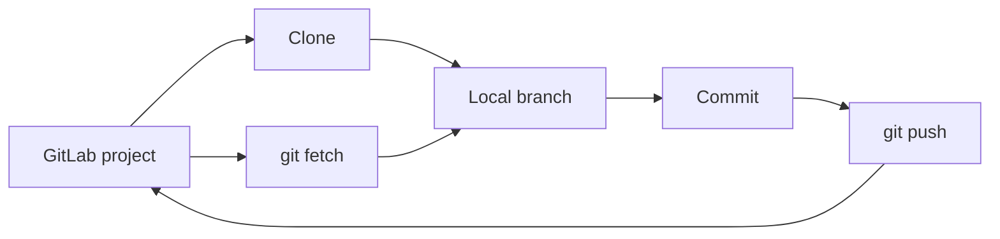

> **Navigation:** [Exercise](../../exercises/en/19-inspect-a-gitlab-remote.md) | [Lab](../../labs/en/19-clone-contribute-and-sync-a-gitlab-project.md) | [Quiz](../../quizzes/en/19-gitlab-repository-access-clone-and-remote-workflows-quiz.md) | [Roadmap](../../ROADMAP.md)

## GitLab Repository Access, Clone and Remote Workflows

> **Level:** Beginner | **Estimated Time:** 60 min | **Previous topic:** Chapter 18, Groups, Projects, Members and Permissions

## Learning Objectives

- choose a repository URL only after confirming you are allowed to use the project;
- explain HTTPS and SSH as Git transport choices without handling credentials;
- clone a project, inspect `origin`, and distinguish `fetch`, `pull`, and `push`;
- recognize a default branch and an optional fork workflow.

## Introduction

GitLab hosts the shared copy of a repository; Git works with a local copy. A safe workflow begins by checking the project path, visibility, and your permitted role. Then you copy the approved clone URL from GitLab's **Code** area and let your organization's approved authentication method handle access.

## Key Terms

| Term           | Definition                                                              |
| -------------- | ----------------------------------------------------------------------- |
| Clone          | A local copy of a remote repository and its history.                    |
| Remote         | A named connection from a local repository to another repository.       |
| `origin`       | The conventional name for the remote created by `git clone`.            |
| Default branch | The branch GitLab presents as the project's primary integration branch. |
| Fork           | A separate server-side copy used by some contribution models.           |

## Theory

### HTTPS and SSH

HTTPS and SSH are transport protocols that Git can use to contact GitLab. A project's **Code** page may offer both URL types. Choose the URL type your organization approves and never place passwords, access tokens, private keys, or other secrets in commands, commits, or documentation. If access fails, use the approved support process rather than guessing at permissions.

### Clone, Remotes, and Synchronization

```bash
git clone https://gitlab.example.com/team/demo-app.git
cd demo-app
git remote -v
git branch --show-current
```

Cloning adds `origin`, usually pointing to the project you cloned. `git fetch origin` downloads remote information without changing your files. `git pull --ff-only` fetches and integrates a safe fast-forward update into the current branch. `git push origin feature/readme-note` publishes the named local branch when you are authorized to do so.



### Default Branches and Forks

Do not assume the default branch is named `main`. Read the project page or inspect the remote before choosing a target. Protected default branches commonly require a merge request instead of direct pushes.

When a project enables forks, a contributor may clone their fork, add the original project as `upstream`, fetch `upstream`, and push their feature branch to their fork. The merge request then proposes that branch to the original project. Fork availability and contribution rules are project-specific.

## Practical Examples

### Inspect Before Changing

```bash
git remote -v
git fetch origin
git branch -r
```

Confirm that `origin` is the intended project, then inspect remote branches. Fetching is a low-risk way to learn what changed remotely before integrating anything.

### Update and Publish a Feature Branch

```bash
git switch feature/readme-note
git pull --ff-only
git push origin feature/readme-note
```

Run `pull --ff-only` only on the branch you intend to update. If it cannot fast-forward, stop and review the branch history instead of forcing a merge. Push the explicit feature branch, not a branch selected by habit.

## Best Practices

- Verify the project path and remote URL before cloning, fetching, or pushing.
- Fetch before making integration decisions; use `--ff-only` when a merge is not intended.
- Treat the default branch as protected unless the project rules explicitly say otherwise.
- Keep fork remotes clearly named: `origin` for your fork and `upstream` for the original project.
- Use only organization-approved access methods and report access problems through approved channels.

## Common Mistakes

| Mistake                                  | Why it causes problems                       | How to avoid it                                      |
| ---------------------------------------- | -------------------------------------------- | ---------------------------------------------------- |
| Pushing before checking `origin`         | A branch can be sent to the wrong project.   | Run `git remote -v` first.                           |
| Treating `fetch` and `pull` as identical | `pull` can also change the current branch.   | Fetch to inspect; pull only when ready to integrate. |
| Assuming every project accepts forks     | Forks can be disabled or governed by policy. | Read the project contribution guidance.              |

## Summary

- Access starts with authorization and an approved clone URL.
- HTTPS and SSH are transport choices, not places to expose secrets.
- `fetch` inspects remote changes, `pull` integrates them, and `push` publishes a branch.
- Default branches and forks follow the rules configured by each project.

## Next Step

Complete the [exercise](../../exercises/en/19-inspect-a-gitlab-remote.md), then use the [lab](../../labs/en/19-clone-contribute-and-sync-a-gitlab-project.md) to practice the full workflow.
