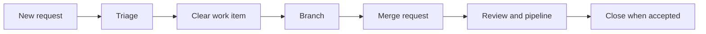

> **Level:** Beginner | **Estimated Time:** 60 min

## Learning Objectives

- write work items or issues with a clear title, description, and acceptance criteria;
- use labels, assignees, milestones, and planning views to make work visible;
- triage and prioritize incoming work consistently;
- connect an approved item to a branch and merge request.

## Introduction

GitLab work items and issues turn a request into shared, trackable work. Names and available planning views can differ by GitLab edition and configuration, but the planning principles are stable: describe the outcome, decide priority, assign responsibility, and connect delivery evidence.

## Key Terms

| Term                  | Definition                                                                             |
| --------------------- | -------------------------------------------------------------------------------------- |
| Work item / issue     | A record for a task, defect, request, or improvement.                                  |
| Acceptance criteria   | Observable conditions that show the item is complete.                                  |
| Label                 | A reusable classification such as `bug`, `priority::high`, or `area::docs`.            |
| Assignee              | The person currently responsible for moving the item forward.                          |
| Milestone             | A time-boxed or outcome-focused collection of related work.                            |
| Board / planning view | A visual view of work grouped by status, label, iteration, or other configured fields. |

## Theory

### Start with an Outcome

A useful title names the result, not only an activity. Compare `Improve login` with `Show a clear message when login credentials are invalid`. The description should state the context, intended change, non-goals, and relevant links. Acceptance criteria make the expected result testable before implementation begins.

### Triage Makes the Queue Trustworthy

Triage is the short review of incoming work. Confirm that an item is understandable, remove duplicates, choose labels, estimate urgency and impact, and decide whether it belongs in a milestone or backlog. Priority should reflect consequences and time sensitivity, not who asked most recently.

### Plan Without Pretending Every View Exists

Use labels and milestones everywhere they are supported. Boards and other planning views can then show items by workflow state, priority, or iteration. Configure only the fields the team will maintain. A stale board is less useful than a small, accurate one.

### Link Planning to Delivery

Create a focused branch from the item, such as `123-invalid-login-message`, and mention the item in the merge request. GitLab can recognize supported closing references in merge-request descriptions, subject to project configuration. Verify the target branch and closure behavior before relying on automation.



## Practical Example

```text
Title: Show a clear message for invalid login credentials
Labels: type::bug, area::authentication, priority::high
Milestone: September reliability
Acceptance criteria:
- Invalid credentials show a neutral, understandable message.
- The message does not reveal whether an account exists.
- Automated tests cover the invalid-credential path.
```

The item explains the outcome and the safety constraint. During triage, the team can assign an owner, place it in a milestone, and move it through a board column such as `Ready` or `In progress`.

## Best Practices

- Write acceptance criteria as observable results, not implementation guesses.
- Use a small shared label vocabulary and document its meaning.
- Assign one accountable owner while allowing collaborators to participate.
- Reassess priority when impact, evidence, or deadlines change.
- Link the work item, branch, and merge request so decisions remain traceable.

## Common Mistakes

| Mistake                        | Why it causes problems                       | How to avoid it                             |
| ------------------------------ | -------------------------------------------- | ------------------------------------------- |
| Title says only "Fix issue"    | Nobody can scan the backlog meaningfully.    | Name the user-visible or technical outcome. |
| Criteria say "works correctly" | Reviewers cannot decide what complete means. | Specify observable conditions and checks.   |
| Labels are invented per item   | Filtering and reporting become inconsistent. | Reuse agreed label names.                   |
| Every request is urgent        | The team loses a usable delivery order.      | Compare impact, urgency, risk, and effort.  |

## Summary

- A work item or issue provides the shared context for delivery.
- Titles, descriptions, and acceptance criteria define a reviewable outcome.
- Labels, assignees, milestones, and planning views organize the queue.
- Links to branches and merge requests preserve delivery traceability.

## Exercise

Practice triaging three incoming work items in the [related exercise](../../exercises/en/20-triage-gitlab-work-items.md).

## Lab

Plan a small delivery from an issue through a merge request in the [related lab](../../labs/en/20-plan-a-small-gitlab-delivery.md).

## Quiz

Check your understanding with the [Chapter 20 quiz](../../quizzes/en/20-gitlab-work-items-issues-and-planning-quiz.md).
