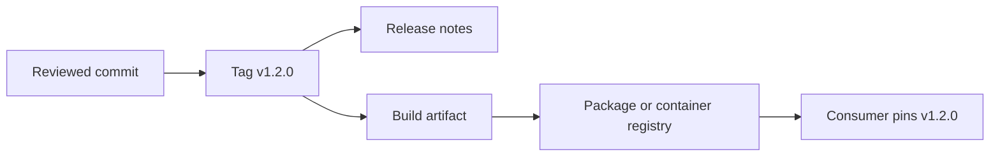

> **Navigation:** [Exercise](../../exercises/en/22-plan-a-versioned-release.md) | [Lab](../../labs/en/22-publish-and-consume-a-versioned-package.md) | [Quiz](../../quizzes/en/22-releases-packages-and-container-registry-quiz.md) | [Roadmap](../../ROADMAP.md)

## Learning Objectives

- explain why a release gives users a stable delivery point;
- apply basic semantic versioning and distinguish tags from releases;
- describe package and container registries, access ownership, and immutable versions;
- outline a safe publish and consume flow without exposing credentials.

## Introduction

A release identifies a version that users can adopt with confidence. Registries store the packages or container images used by that version. Together they make delivery traceable, repeatable, and easier to roll back.

## Key Concepts

| Concept           | Meaning                                                                     |
| ----------------- | --------------------------------------------------------------------------- |
| Semantic version  | `MAJOR.MINOR.PATCH`: breaking change, compatible feature, compatible fix.   |
| Tag               | A Git reference that marks one commit, such as `v1.2.0`.                    |
| Release           | A published delivery record, commonly connected to a tag and release notes. |
| Registry          | A service that stores versioned packages or container images.               |
| Immutable version | A published version whose contents are never replaced.                      |

## Theory

### Tags and Releases Have Different Jobs

A tag points to source code. A release communicates what is ready for users: its version, notes, downloads or artifacts, and known limits. Create a release from a reviewed tag so source and delivery record remain connected.

### Read Semantic Versions Carefully

For `2.4.1`, `2` means a breaking public change, `4` a backward-compatible feature, and `1` a backward-compatible fix. The version is a promise about compatibility, not a measure of effort.

### Registries Preserve Build Outputs

A package registry can store libraries; a container registry can store images such as `registry.example/team/api:1.2.0`. Publish a version only after validation. Consumers should request a specific immutable version, not a moving label such as `latest`.

### Ownership and Access

The project or group owns its registry namespace. Give publishers only the access needed to publish, and consumers only the access needed to read. Use the platform's protected variables, tokens, or workload identity in CI; never place credentials in source, release notes, or image layers.

## Practical Flow

1. Agree on the change scope and choose `v1.2.0` according to compatibility.
2. Test the commit, create the matching tag, and write user-focused release notes.
3. Build and publish `1.2.0` to the appropriate registry through authorized automation.
4. Consume exactly `1.2.0`, verify its source or digest, and record the dependency.

## Best Practices

- Treat a tag, release notes, and registry artifact as one traceable delivery.
- Keep published versions immutable; publish a new patch instead of replacing one.
- Write notes around user impact, upgrades, fixes, and known limitations.
- Pin packages by version and container images by trusted version or digest.
- Review namespace ownership and reader/publisher permissions regularly.

## Common Mistakes

| Mistake                                          | Better approach                                        |
| ------------------------------------------------ | ------------------------------------------------------ |
| Reusing `1.2.0` for a changed artifact           | Publish `1.2.1` or another new version.                |
| Treating a tag as complete release communication | Add concise, user-focused release notes.               |
| Consuming `latest` in production                 | Pin a tested immutable version or digest.              |
| Sharing registry credentials in documentation    | Configure authorized CI access outside the repository. |

## Summary

- Releases communicate a usable version; tags identify the source commit.
- Semantic versions express compatibility expectations.
- Registries distribute packages and images under controlled ownership.
- Immutable versions and least-privilege access make consumption safer and repeatable.

## Practice

Continue with the [exercise](../../exercises/en/22-plan-a-versioned-release.md), [lab](../../labs/en/22-publish-and-consume-a-versioned-package.md), and [quiz](../../quizzes/en/22-releases-packages-and-container-registry-quiz.md).
