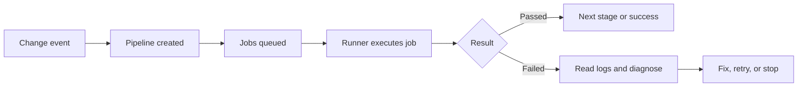

> **Level:** Beginner | **Estimated Time:** 60 min

## Learning Objectives

- explain pipelines, jobs, stages, runners, and pipeline statuses;
- identify common pipeline triggers and the feedback loop they create;
- diagnose a failed job and decide whether retrying is safe.

## Introduction

GitLab CI/CD gives a team fast evidence about a change. A pipeline runs defined checks after an event such as a push or merge request. This chapter explains the operating model, not the `.gitlab-ci.yml` configuration details that follow in later chapters.

## Key Terms

| Term          | Definition                                                                  |
| ------------- | --------------------------------------------------------------------------- |
| Pipeline      | The complete automated run started for a change or event.                   |
| Job           | One focused unit of work, such as a test or quality check.                  |
| Stage         | An ordered group of jobs; later stages wait for earlier ones when required. |
| Runner        | The worker that receives a job and executes it in an available environment. |
| Feedback loop | The cycle from change to automated result to an informed next action.       |

## Theory

### From Trigger to Result

A push, merge request, schedule, or manual action can start a pipeline, depending on project rules. Jobs run on runners and report statuses such as `pending`, `running`, `passed`, `failed`, `canceled`, `skipped`, or `manual`. A failed job makes the pipeline fail unless the project intentionally treats that job differently.



### Stages Organize Risk

Teams often place quick checks before slower or higher-risk checks. For example, a test stage should provide useful feedback before a delivery stage can proceed. A stage is a coordination boundary, not a guarantee that every job has the same duration.

### Diagnose Before Retrying

Open the failed job and read the first meaningful error, the command that failed, and the surrounding context. Retry only when evidence suggests a transient cause, such as a runner interruption or temporary network failure. Do not retry to hide a reproducible test, build, or policy failure; correct the change or escalate the environment problem instead.

## Practical Example

```text
Push feature/login-message
  -> pipeline starts
  -> lint job passes
  -> test job fails: expected neutral message, received account-specific message
  -> developer fixes behavior and pushes a new commit
  -> new pipeline provides updated evidence
```

The second pipeline is more valuable than repeatedly retrying the first one because the failure is reproducible and points to a product defect.

## Best Practices

- Treat a pipeline result as evidence for a specific commit and target context.
- Read job logs before deciding on a retry.
- Keep feedback visible in merge requests and discuss failures early.
- Escalate blocked or repeatedly failing runners with the relevant log evidence.

## Common Mistakes

| Mistake                                      | Why it causes problems                      | How to avoid it                                           |
| -------------------------------------------- | ------------------------------------------- | --------------------------------------------------------- |
| Calling every failed pipeline a runner issue | A failing command may expose a real defect. | Inspect the failing job and reproduce when practical.     |
| Retrying without a reason                    | It wastes time and can conceal instability. | Retry only after identifying a plausible transient cause. |
| Treating `pending` as `running`              | No work may have started yet.               | Check runner availability and queue information.          |

## Summary

- A pipeline is a coordinated set of jobs triggered by project events.
- Jobs run on runners and stages order the broader lifecycle.
- Statuses and logs turn automation into a feedback loop.
- Retry transient failures; fix reproducible failures.

## Exercise

Classify pipeline results in the [related exercise](../../exercises/en/23-diagnose-gitlab-pipeline-results.md).

## Lab

Practice a safe failure-response workflow in the [related lab](../../labs/en/23-investigate-a-gitlab-pipeline-failure.md).

## Quiz

Check your understanding with the [Chapter 23 quiz](../../quizzes/en/23-gitlab-cicd-foundations-quiz.md).
