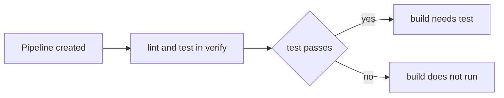

> **Navigation:** [Chapter 23](23-gitlab-cicd-foundations.md) | [Exercise](../../exercises/en/24-write-a-gitlab-ci-pipeline.md) | [Lab](../../labs/en/24-review-a-gitlab-ci-pipeline.md) | [Quiz](../../quizzes/en/24-gitlab-ci-yml-pipelines-stages-and-jobs-quiz.md) | [Roadmap](../../ROADMAP.md)

> **Level:** Beginner | **Estimated Time:** 90 min | **Prerequisites:** [GitLab CI/CD Foundations](23-gitlab-cicd-foundations.md)

## Learning Objectives

- write and read a small valid `.gitlab-ci.yml` file;
- explain how stages order jobs and why jobs in one stage can run in parallel;
- use basic `rules`, `workflow: rules`, and `needs` deliberately;
- validate and debug a pipeline without exposing secrets or adding deployment steps.

## Introduction

The repository file `.gitlab-ci.yml` is GitLab's pipeline recipe. When GitLab creates a pipeline, it reads this file from the relevant commit and turns its YAML data into jobs. The file belongs in the repository root, beside files such as `package.json`; a similarly named file in a subfolder is not the normal pipeline entry point.

## Key Terms

| Term     | Meaning                                                             |
| -------- | ------------------------------------------------------------------- |
| YAML     | A text format that represents maps and lists through indentation.   |
| Pipeline | The complete automated run created from a commit and configuration. |
| Stage    | An ordered group of jobs.                                           |
| Job      | A named unit of work executed by a runner.                          |
| `rules`  | Conditions that decide whether a job is added to a pipeline.        |
| `needs`  | Explicit dependencies that form a job dependency graph.             |

## YAML Fundamentals

YAML uses indentation to show structure. A map connects a key to a value; a list uses `-` for each item. Use spaces consistently, preferably two spaces. Tabs are not valid indentation.

```yaml
lint:
  stage: verify
  script:
    - npm run lint
    - npm run format:check
```

`lint` is a map key whose value is a job map. `script` is a list, so each command begins with `-`. The job has one `stage` value and two script commands.

### Common YAML Syntax Mistakes

```yaml
lint:
 stage: verify       # Wrong: indentation is inconsistent.
	script: npm run lint # Wrong: a tab is used.
  script             # Wrong: the colon is missing.
    - npm run lint
```

YAML errors can prevent pipeline creation before any job starts. Keep sibling keys aligned, add colons after keys, and quote a value when characters such as `:` could make its meaning unclear. A YAML validator can confirm syntax, but GitLab's CI Lint is the final configuration check because it also understands GitLab keywords.

## From File to Pipeline

If `stages` is omitted, GitLab uses its default stage order: `.pre`, `build`, `test`, `deploy`, `.post`. Declaring stages is clearer for a teaching or production pipeline because it documents the intended lifecycle. Jobs without a `stage` key use the default `test` stage.

```yaml
stages:
  - verify
  - build

lint:
  stage: verify
  script:
    - npm run lint
```

This configuration declares two stages. `lint` belongs to `verify`; the `build` stage has no job yet. GitLab completes runnable jobs in `verify` before starting normal jobs in `build`. Jobs within `verify` can run in parallel when runners are available. Parallel does not mean a predictable finish order.

## Job Anatomy

```yaml
lint:
  image: node:22-alpine
  stage: verify
  before_script:
    - npm ci
  script:
    - npm run lint
  after_script:
    - echo "Lint job finished; inspect the log for its final status."
```

The job name, `lint`, identifies this work in the pipeline UI. `image` selects a container image for the job. `before_script` prepares the environment, here with a reproducible dependency install. `script` contains the main command. `after_script` runs after the main script, including after a failure, so it suits safe cleanup or diagnostic messages; it must not hide a failed command. The `stage` connects the job to the pipeline order.

## Progressive Node.js Example

Start with the smallest useful check:

```yaml
lint:
  image: node:22-alpine
  script:
    - npm ci
    - npm run lint
```

Because no stage is declared, this job uses GitLab's default `test` stage. It is valid, but the pipeline's intent is not yet obvious.

Now make the lifecycle explicit and add independent verification:

```yaml
stages:
  - verify
  - build

lint:
  image: node:22-alpine
  stage: verify
  before_script:
    - npm ci
  script:
    - npm run lint

test:
  image: node:22-alpine
  stage: verify
  before_script:
    - npm ci
  script:
    - npm test
```

`lint` and `test` are in the same stage, so GitLab may run them together. Each job installs dependencies independently; cache setup is intentionally not introduced here. Chapter 25 previews caching and artifacts after the pipeline structure is understood.

Here is the complete small-project configuration, with a build that waits only for the test evidence it requires:

```yaml
workflow:
  rules:
    - if: '$CI_PIPELINE_SOURCE == "merge_request_event"'
    - if: '$CI_PIPELINE_SOURCE == "push"'
    - when: never

stages:
  - verify
  - build

default:
  image: node:22-alpine
  before_script:
    - npm ci

lint:
  stage: verify
  script:
    - npm run lint

test:
  stage: verify
  script:
    - npm test
  rules:
    - if: '$CI_PIPELINE_SOURCE == "merge_request_event"'
    - if: '$CI_PIPELINE_SOURCE == "push"'

build:
  stage: build
  needs:
    - test
  script:
    - npm run build
  after_script:
    - echo "Build job completed; use the job log to review the result."
```

`workflow: rules` decides whether GitLab creates a pipeline at all. This example permits merge request event and push pipelines; the final `when: never` rejects every other source. The condition `if: '$CI_PIPELINE_SOURCE == "merge_request_event"'` is a comparison, not a shell command. Job-level `rules` decide whether that particular job is included after a pipeline exists. Here, `test` explicitly permits the same two sources.

`default` shares the image and setup across jobs, avoiding repeated YAML while keeping each job's purpose visible. `build` is in the later `build` stage and also declares `needs: [test]`. Think of `needs` as an edge from `test` to `build`: build may start as soon as test succeeds, subject to its rules and runner availability. In larger graphs, `needs` can make safe dependencies explicit instead of relying only on broad stage barriers. Do not add `needs` simply to make a graph look clever; every dependency should represent real required evidence.

## Execution, Statuses, and Logs



GitLab displays jobs as `pending`, `running`, `passed`, `failed`, `canceled`, `skipped`, or `manual`. Open a failed job and find the first command that failed, its error, and the nearby context. The final red line is often only a summary. A skipped job may be expected because its rules did not match; it is not automatically a defect.

## Safe Validation and Debugging Workflow

1. Validate YAML indentation, maps, lists, and required colons locally.
2. Use GitLab CI Lint to check the complete configuration and expanded rules.
3. Review the pipeline graph before treating a job order as correct.
4. Make a small branch or merge-request change, then inspect the pipeline and its logs.
5. Reproduce a deterministic command locally when practical; fix the cause and create a new pipeline.

Do not put passwords, tokens, private URLs, or secret values in `.gitlab-ci.yml` or job logs. This chapter does not configure deployment. For a transient runner or network failure, record the evidence and retry once; for a reproducible lint, test, or build error, change the code or configuration instead.

## Best Practices

- Keep jobs focused: lint, test, and build should answer different questions.
- Declare stages when the lifecycle needs to be understandable.
- Use quoted rule expressions so YAML clearly treats them as text.
- Read the pipeline graph and the first meaningful log error before changing configuration.
- Keep cache configuration for the dedicated Chapter 25 topic.

## Common Mistakes

| Mistake                                      | Why it causes problems                                            | Better approach                  |
| -------------------------------------------- | ----------------------------------------------------------------- | -------------------------------- |
| Mixing tabs and spaces                       | YAML parsing can fail.                                            | Use consistent spaces only.      |
| Assuming jobs run one by one                 | Same-stage jobs can run concurrently.                             | Design jobs to be independent.   |
| Confusing `workflow: rules` with job `rules` | One controls pipeline creation; the other controls job inclusion. | Decide at the correct level.     |
| Retrying every failure                       | Reproducible errors remain unresolved.                            | Read logs and correct the cause. |

## Summary

- `.gitlab-ci.yml` in the repository root defines the pipeline.
- YAML indentation, maps, and lists determine the configuration structure.
- Stages provide broad order; same-stage jobs may run in parallel.
- `rules`, `workflow: rules`, and `needs` make creation and dependencies explicit.
- Logs and CI Lint support safe, evidence-based debugging.

## Practice

Write a small configuration in the [exercise](../../exercises/en/24-write-a-gitlab-ci-pipeline.md), review a deliberately flawed pipeline in the [lab](../../labs/en/24-review-a-gitlab-ci-pipeline.md), and check your understanding in the [quiz](../../quizzes/en/24-gitlab-ci-yml-pipelines-stages-and-jobs-quiz.md).
