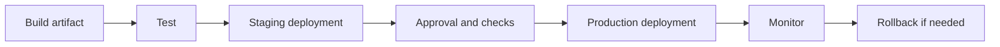

> **Navigation:** [Chapter 25](25-gitlab-runners-variables-caching-and-artifacts.md) | [Exercise](../../exercises/en/26-map-gitlab-environments.md) | [Lab](../../labs/en/26-plan-a-controlled-gitlab-deployment.md) | [Quiz](../../quizzes/en/26-gitlab-environments-and-deployments-quiz.md) | [Roadmap](../../ROADMAP.md)

## Learning Objectives

- distinguish an environment from a pipeline job;
- describe a controlled promotion from test to production;
- use deployment evidence, approvals, and rollback planning to reduce risk.

## Introduction

An environment is a named target where an application version runs, such as `review`, `staging`, or `production`. A deployment is the act of delivering one version to that target. GitLab can record this relationship so teams know what is running where and which pipeline created it.

## Key Terms

| Term        | Meaning                                                |
| ----------- | ------------------------------------------------------ |
| Environment | A named deployment target.                             |
| Deployment  | A recorded delivery of a version to an environment.    |
| Review app  | A temporary environment for a branch or merge request. |
| Staging     | A production-like environment used for validation.     |
| Production  | The live environment used by real users.               |
| Rollback    | Restoring a known safe version after a failed release. |

## Theory

### Promotion Is a Decision, Not Just a Command

Build once, test the same artifact, and promote it through environments when evidence is sufficient. A typical path is review -> staging -> production. Not every project needs every environment, but each must have a clear purpose, owner, and access policy.



Production deployments require a stronger trust boundary than test jobs. Use protected environments, protected branches, approved variables, and manual approval where the project risk requires them. A manual job is a deliberate gate, not proof that a deployment is safe.

### Minimal Configuration

```yaml
deploy_staging:
  stage: deploy
  environment:
    name: staging
  script:
    - ./scripts/deploy.sh staging

deploy_production:
  stage: deploy
  environment:
    name: production
  when: manual
  script:
    - ./scripts/deploy.sh production
```

The commands are project-specific; do not copy a deployment script without understanding it. The environment names let GitLab display deployment history. Configure secrets outside the repository and make production access stricter than staging.

### Verification and Rollback

Before promotion, verify the tested artifact, pipeline status, change scope, and required approval. After deployment, check a small set of meaningful signals such as health endpoint, error rate, and user-critical flow. A rollback plan states the last known good version, who may initiate it, and how success is confirmed. Never improvise an irreversible production action during an incident.

## Practical Example

For a web service, deploy build artifact `v1.4.2` to staging, run a smoke test, approve the same `v1.4.2` for production, then record the result. If the health check fails, return to `v1.4.1` and document the incident. Rebuilding a different artifact during promotion weakens traceability.

## Best Practices

- Give each environment a purpose, owner, and access policy.
- Promote tested artifacts instead of rebuilding for production.
- Protect production environments and keep deployment permissions narrow.
- Define verification and rollback before releasing.

## Common Mistakes

| Mistake                                      | Better approach                                                   |
| -------------------------------------------- | ----------------------------------------------------------------- |
| Deploying directly from an unreviewed branch | Require review and successful checks before promotion.            |
| Treating staging as identical to production  | Use it to reduce risk, while documenting meaningful differences.  |
| Having no rollback decision                  | Record a known-good version and recovery owner before deployment. |

## Summary

Environments make deployment targets visible. Controlled promotion, protected production access, observable verification, and a planned rollback turn a pipeline into a safer delivery process.

### Related Content

- Exercise: [Map GitLab Environments](../../exercises/en/26-map-gitlab-environments.md)
- Lab: [Plan a Controlled GitLab Deployment](../../labs/en/26-plan-a-controlled-gitlab-deployment.md)
- Quiz: [Environments & Deployments Quiz](../../quizzes/en/26-gitlab-environments-and-deployments-quiz.md)
