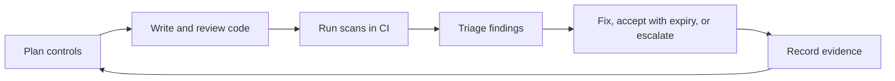

> **Navigation:** [Chapter 26](26-gitlab-environments-and-deployments.md) | [Exercise](../../exercises/en/27-triage-a-gitlab-security-finding.md) | [Lab](../../labs/en/27-design-a-devsecops-review-flow.md) | [Quiz](../../quizzes/en/27-gitlab-devsecops-security-scans-and-compliance-quiz.md) | [Roadmap](../../ROADMAP.md)

## Learning Objectives

- explain DevSecOps as shared, continuous security work;
- distinguish common scan categories and interpret findings responsibly;
- triage risk using evidence, ownership, and documented exceptions;
- describe basic compliance evidence in a delivery workflow.

## Introduction

DevSecOps integrates security into planning, code review, CI/CD, deployment, and operation. It does not mean that an automated scanner decides everything. Automation finds signals at scale; people assess context, fix risk, and keep an auditable record of decisions.

## Key Terms

| Term                | Meaning                                                       |
| ------------------- | ------------------------------------------------------------- |
| SAST                | Static analysis of source code for potential vulnerabilities. |
| Dependency scanning | Checking third-party dependencies for known vulnerabilities.  |
| Secret detection    | Finding credential-like values in repository content.         |
| Container scanning  | Checking a container image and its packages for known issues. |
| Triage              | Assessing a finding's validity, impact, priority, and owner.  |
| Compliance evidence | Records showing that required controls and reviews occurred.  |

## Theory

### Security Is a Feedback Loop



Scans can identify possible code weaknesses, vulnerable dependencies, exposed secrets, or risky container packages. A finding is a signal, not an automatic verdict. Triage asks: is it valid, reachable, exposed, severe, and owned? Avoid closing findings merely to make a dashboard green.

### Safe Response to Findings

For a secret, revoke or rotate the credential first, then remove it from current content and follow the incident process. Do not paste it into an issue or job log. For a dependency finding, identify the affected version, assess usage and exposure, update to a tested patched version, and document the result. For an uncertain result, collect evidence and assign an owner; exceptions must have a reason, approval where required, and expiry or review date.

### Compliance Is Evidence, Not a Checkbox

Policies may require protected branches, review approvals, scan results, artifact retention, access review, or deployment approval. GitLab can help retain links between commits, merge requests, pipelines, and environments. The required controls depend on the organization and regulation; do not claim compliance solely because a job passed.

## Practical Example

```yaml
security_review:
  stage: verify
  script:
    - ./scripts/check-security-policy.sh
  rules:
    - if: '$CI_PIPELINE_SOURCE == "merge_request_event"'
```

This teaching example runs a project-defined policy check for merge requests. It does not replace supported GitLab security templates or an organization's security process. Keep scan configuration reviewed, secrets out of YAML, and failure handling explicit.

## Triage Checklist

1. Read the finding and its evidence without exposing sensitive values.
2. Confirm the affected component, version, branch, or image.
3. Assess validity, impact, reachability, and urgency with the responsible team.
4. Fix and verify, or create a time-bounded documented exception.
5. Link the issue, merge request, pipeline result, and decision record.

## Best Practices

- Run relevant checks early and consistently in the delivery flow.
- Protect secrets and rotate any exposed credential immediately.
- Assign every finding an owner and an evidence-based priority.
- Review accepted risks regularly; exceptions are not permanent silence.
- Preserve audit evidence through issues, merge requests, pipelines, and approvals.

## Common Mistakes

| Mistake                                    | Better approach                                   |
| ------------------------------------------ | ------------------------------------------------- |
| Treating every finding as equally urgent   | Triage validity, exposure, and impact.            |
| Printing scan inputs or secrets to debug   | Use safe identifiers and restricted evidence.     |
| Marking a finding resolved without proof   | Link the fix, verification, and decision.         |
| Calling a project compliant after one scan | Check the full required control set and evidence. |

## Summary

DevSecOps makes security continuous and shared. Scans provide signals, triage creates informed decisions, and traceable evidence supports reliable compliance work.

### Related Content

- Exercise: [Triage a GitLab Security Finding](../../exercises/en/27-triage-a-gitlab-security-finding.md)
- Lab: [Design a DevSecOps Review Flow](../../labs/en/27-design-a-devsecops-review-flow.md)
- Quiz: [DevSecOps, Security Scans & Compliance Quiz](../../quizzes/en/27-gitlab-devsecops-security-scans-and-compliance-quiz.md)
