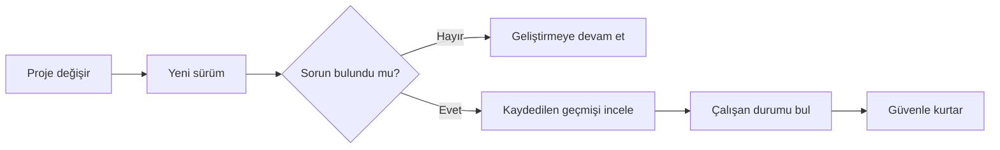
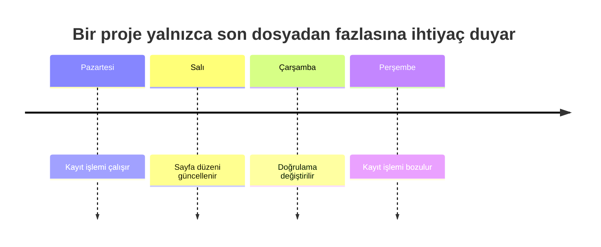
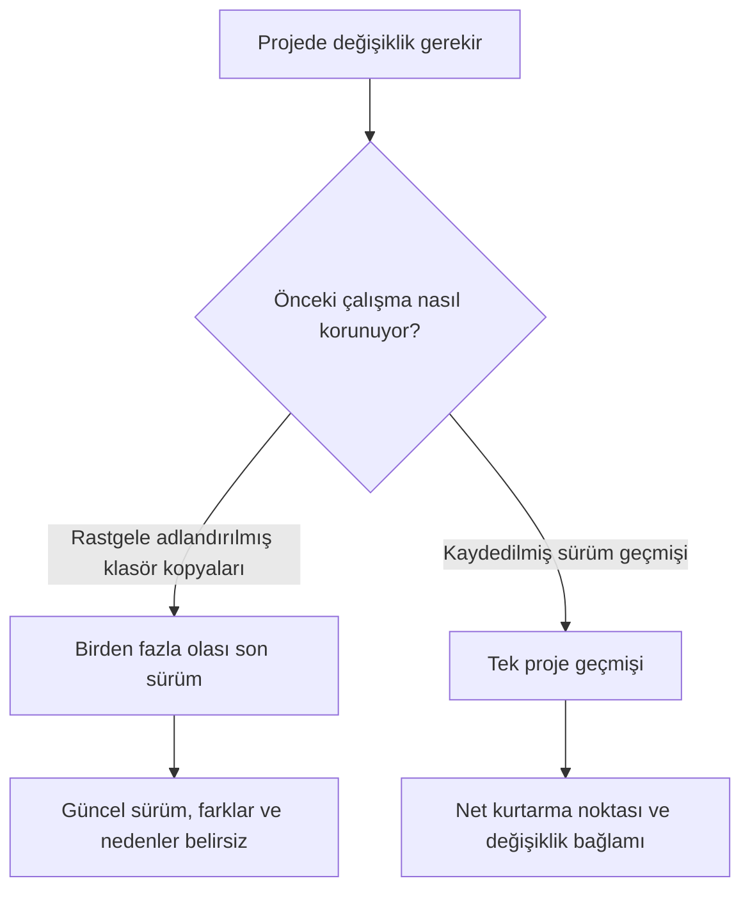
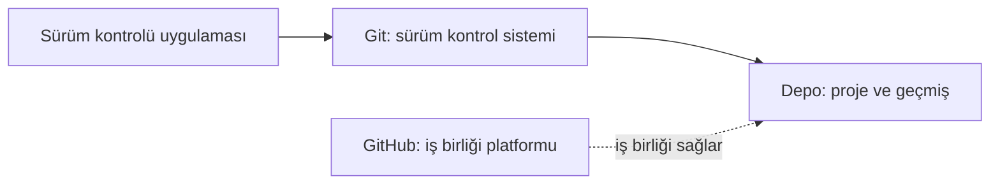

> **Gezinme:** Önceki: Yok | [Yol Haritası](../../ROADMAP.md) | Sonraki: Bölüm 02 yakında
>
> **Seviye:** Başlangıç · **Tahmini Süre:** 60 dakika · **Önkoşullar:** Yok

# Sürüm Kontrolü Neden Gerekli?

## Öğrenme Hedefleri

Bu bölümün sonunda şunları yapabileceksiniz:

- Sürüm kontrolünün hangi proje sorunlarını çözdüğünü açıklamak.
- Yedek ile anlamlı değişiklik geçmişi arasındaki farkı ayırt etmek.
- Kurtarma, izlenebilirlik, güvenli deneme ve iş birliği kavramlarını bir proje senaryosuna uygulamak.
- Git ile GitHub'ın rollerini kavramsal düzeyde ayırmak.

## Giriş

Elif, portfolyo sitesindeki iletişim formunu bir iş başvurusu tesliminden önce günceller. Düzeni değiştirir, doğrulama ekler ve dosyayı kaydeder. Yeni sürüm hem daha kötü görünür hem de form artık gönderilmez. Çalışan önceki sürüm ortada yoktur.

Elif'in geçen haftadan kalma bir kopyası vardır: `portfolyo-son-v2`. Başka bir kopyanın adı da `portfolyo-son-son`dur. Bu isimler hangi kopyanın çalışan formu içerdiğini, arada neyin değiştiğini veya hangi kopyanın güncel olduğunu söylemez.

Bu durum yeni başlayanlara özgü bir hata değildir. Bir proje güvenilir bir değişiklik kaydı olmadan zaman içinde değiştiğinde doğal olarak ortaya çıkar. Sürüm kontrolü, değişimi yönetilebilir hale getirmek için vardır.

## Görsel Öğrenme



_Şekil 1. Kaydedilen geçmiş, hatalı bir değişikliği kurtarılabilir bir incelemeye dönüştürür._



_Şekil 2. Zaman çizelgesi, son çalışan durum ile ilk hatalı durum arasındaki inceleme aralığını gösterir._

## Neden Önemli?

Yazılım sabit kalmaz. Bir portfolyo sitesine proje sayfası eklenir, bir ödev geri bildirimden sonra düzeltilir, müşteri hatası giderilir veya uygulamanın yeni bir ortamda çalışması için ayar değiştirilir.

Bu durumlarda geliştiricinin yalnızca en yeni dosyaya değil, şu soruların cevaplarına ihtiyacı vardır: Ne değişti? Neden değişti? Ne zaman değişti? Kim değiştirdi? Çalışan sürüme dönebilir miyiz?

Profesyonel ekipler sürüm kontrolünü her gün kullanır çünkü değişikliklere güvenilir bir geçmiş verir. Bu geçmiş; incelemeyi, hata araştırmayı, bakım yapmayı ve paylaşmayı kolaylaştırır. Tek kişilik portfolyo için de değerlidir; ekip çalışmasında ise zorunlu hale gelir.

## Temel Kavramlar

| Kavram            | Açıklama                                                                                                                    |
| ----------------- | --------------------------------------------------------------------------------------------------------------------------- |
| Sürüm kontrolü    | Projedeki değişiklikleri zaman içinde kaydeden ve eski durumların anlaşılmasını veya geri getirilmesini sağlayan sistemdir. |
| Sürüm geçmişi     | Projenin anlamlı değişikliklerinin sıralı kaydıdır.                                                                         |
| İzlenebilirlik    | Bir değişikliği nedeni, zamanı ve kaynağıyla ilişkilendirebilme yeteneğidir.                                                |
| Depo (repository) | Projenin ve sürüm geçmişinin kavramsal evidir.                                                                              |
| Git               | Proje geçmişini kaydetmek ve yönetmek için kullanılan sürüm kontrol sistemidir.                                             |
| GitHub            | Git depoları etrafında iş birliği sağlayan platformdur.                                                                     |
| Yedek             | Öncelikle kayıp veya arızaya karşı tutulan kopyadır.                                                                        |

## Kuram

### Değişiklik Bağlama İhtiyaç Duyar

Bir üniversite etkinlik sitesinin kayıt düğmesinin tasarım güncellemesinden sonra çalışmadığını düşünün. Yalnızca güncel dosyalara bakmak ekibi tahmine zorlar. Yararlı bir geçmiş, ilgili değişikliği ve amacını bulmaya yardım eder.



_Şekil 3. Klasör kopyaları dosyaları korur; kayıtlı geçmiş ise sürümlerin ilişkisini ve bağlamını korur._

Her anlamlı değişiklik için gelecekteki okuyucu şunları cevaplayabilmelidir:

- Ne değişti?
- Neden değişti?
- Ne zaman değişti?
- Değişikliği kim yaptı veya istedi?

Bu gereksiz belge üretmek değildir. Altı hafta sonra değişikliği yapan kişi ayrıntıları unutabilir; sürece katılmamış bir ekip arkadaşı ise anlaşılır bir kayda ihtiyaç duyar.

### Klasör Kopyaları Neden Yetersizdir?

Sürüm kontrolü olmadan insanlar riskli bir işten önce kopya oluşturur:

```text
portfolyo/
|- proje-son/
|- proje-son-v2/
|- proje-son-son/
`- proje-bunu-kullan/
```

Kopyalar ilk anda güvenli görünebilir; ancak dosya adları iki sürüm arasındaki gerçek farkı, değişikliğin nedenini veya hangi kopyanın yetkili olduğunu göstermez. Kopyalar çoğaldıkça yanlış klasörde çalışmak, ekip arkadaşının işini kaybetmek veya eski sürümü yayımlamak kolaylaşır.

### Sürüm Kontrolünün Sağladıkları

| Sürüm kontrolü olmadan                                     | Sürüm kontrolüyle                                      |
| ---------------------------------------------------------- | ------------------------------------------------------ |
| Dosya adları sürümü anlatmaya çalışır.                     | Projede sıralı değişiklik geçmişi vardır.              |
| Güncel kopyayı belirlemek zordur.                          | Ortak bir doğruluk kaynağı vardır.                     |
| Çalışan eski sürüme dönmek doğru klasörü bulmaya bağlıdır. | Kayıtlı durumlar belirlenip geri getirilebilir.        |
| Değişikliğin nedeni unutulur.                              | Değişiklikler gelecekte okunacak bağlam taşıyabilir.   |
| Ekip üyeleri birbirinin kopyasını ezebilir.                | Çalışma aynı proje geçmişi çevresinde koordine edilir. |

Sürüm kontrolü; kurtarma, izlenebilirlik, güvenli deneme, iş birliği, ortak doğruluk kaynağı ve bakım kolaylığı sağlar. Projeyi yalnızca hayatta tutmaz, nasıl geliştiğini de anlaşılır kılar.

### Yedek, Sürüm Kontrolü Değildir

Yedek; bozuk disk, yanlışlıkla silme veya cihaz kaybı gibi durumlarda veriyi geri getirmek içindir. Ana sorusu şudur: "Veriyi geri alabilir miyiz?"

Sürüm kontrolü başka bir soru sorar: "Bu proje nasıl değişti ve bu geçmişle güvenle nasıl çalışabiliriz?" Yedek dünkü klasörü içerebilir; fakat hangi düzenlemenin hataya yol açtığını veya iki geliştiricinin işinin nasıl ilişkili olduğunu açıklamayabilir. İkisi birlikte kullanılmalıdır.

### Git ve GitHub'ın Yeri

Git bir sürüm kontrol sistemidir. Sonraki bölümlerde proje geçmişini kaydetmek için kullanacağınız araçtır. GitHub ise Git depoları etrafında iş birliği sağlayan bir platformdur. GitHub, Git değildir.



_Şekil 4. Git depo geçmişini yönetir; GitHub Git depoları etrafında iş birliğini destekler._

## Uygulamalı Örnekler

### Portfolyo Sitesi: Kurtarma

Can, portfolyo sitesinin menüsünü değiştirirken iletişim sayfası bağlantısını siler. Yalnızca güncel dosya varsa önceki menüyü hafızadan kurması gerekir. Sürüm geçmişi varsa son çalışan durumu bulur, farkı karşılaştırır ve doğru değişikliği geri getirir.

### Üniversite Ödevi: İzlenebilirlik

İki öğrenci veri analizi raporunu teslimden önce düzenler. Biri hesaplama hatasını düzelttikten sonra sonucu değiştirir. Öğretim görevlisi neden değiştiğini sorarsa sürüm geçmişi, sonucu düzeltmeye bağlayabilir.

### Ekip Projesi: Ortak Doğruluk Kaynağı

Üç geliştirici etkinlik kayıt uygulamasında çalışır. Biri etkinlik sayfasını günceller, biri e-posta doğrulama hatasını düzeltir, diğeri README dosyasını değiştirir. Mesajlaşma uygulamasından klasör kopyaları gönderirlerse herkesin "en güncel" sürümü farklı olabilir. Sürüm kontrolü ekibe tek proje geçmişi sağlar.

## Kendiniz Deneyin

1. Adında `son`, `yeni`, `kopya` veya tarih bulunan bir dosyanızı düşünün.
2. Dosya adının neyi söylediğini ve değişiklik hakkında neyi söylemediğini yazın.
3. Dosyanın açık bir geçmişi olsaydı daha kolay cevaplayacağınız bir soru belirleyin.

## En İyi Uygulamalar

- Değişiklikleri dosya adına saklanan geçici ayrıntılar değil, projenin bir parçası olarak ele alın.
- Ekip için tek bir ortak doğruluk kaynağı koruyun.
- Anlamlı değişikliklerin amacını kaydedin; kısa bir açıklama ileride uzun hata araştırmalarını önleyebilir.
- Veri kaybına karşı yedek, proje gelişimini anlamak için sürüm kontrolü kullanın.

## Sık Yapılan Hatalar

| Hata                                                               | Neden sorun çıkarır?                                 | Nasıl önlenir?                                                                |
| ------------------------------------------------------------------ | ---------------------------------------------------- | ----------------------------------------------------------------------------- |
| Sürüm kontrolünü yalnızca yedek sanmak                             | Geçmiş, bağlam ve iş birliği gözden kaçar.           | Anlamlı proje değişikliklerini kaydedin; yedekleri kayıp kurtarma için tutun. |
| `son`, `son-v2` ve `son-son` adlarını kullanmak                    | İsimler belirsizdir ve gerçek farkları göstermez.    | Rakip klasör kopyaları yerine tek geçmiş kullanın.                            |
| Sadece büyük ekiplerin sürüm kontrolüne ihtiyaç duyduğunu düşünmek | Kişisel projeler de bozulur ve geri alma gerektirir. | Kişisel projelerde ve ödevlerde erken başlayın.                               |
| Git ile GitHub'ı aynı ürün sanmak                                  | Araç ile iş birliği platformu karışır.               | Git'in geçmişi, GitHub'ın iş birliğini yönettiğini hatırlayın.                |

## Özet

- Yazılım değiştiği için yalnızca güncel dosya projenin nasıl geliştiğini açıklamaz.
- Sürüm kontrolü kurtarma, izlenebilirlik, güvenli deneme, iş birliği ve bakım kolaylığı sağlar.
- El ile oluşturulan kopyalar bağlamı korumadığı için ölçeklenmez.
- Yedek veri kaybına karşı korur; sürüm kontrolü proje gelişimini yönetir ve açıklar.
- Git sürüm kontrol sistemidir; GitHub Git depoları etrafında iş birliği platformudur.

## Sonraki Bölüm

Sürüm kontrolünün neden gerekli olduğunu öğrendiniz. Sonraki bölüm, Git'in proje geçmişini nasıl kaydettiğine dair zihinsel modeli tanıtacaktır.

### İlgili İçerik

- Önceki bölüm: Yok
- Sonraki bölüm: Bölüm 02 - Git Mimarisi (yakında)
- İlgili alıştırma: [Sürüm Kontrolü Analizi](../../exercises/tr/01-surum-kontrolu-analizi.md)
- İlgili laboratuvar: [El ile Sürümlendirme Laboratuvarı](../../labs/tr/01-el-ile-surumlendirme-laboratuvari.md)
- İlgili quiz: [Sürüm Kontrolü Neden Gerekli? Quiz](../../quizzes/tr/01-surum-kontrolu-neden-gerekli-quiz.md)

## İleri Okuma

- [Git Book: About Version Control](https://git-scm.com/book/en/v2/Getting-Started-About-Version-Control)
- [Git Book: What is Git?](https://git-scm.com/book/en/v2/Getting-Started-What-is-Git%3F)
- [GitHub Docs: About Git](https://docs.github.com/en/get-started/using-git/about-git)
