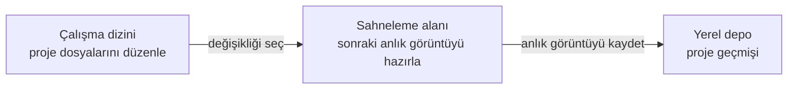
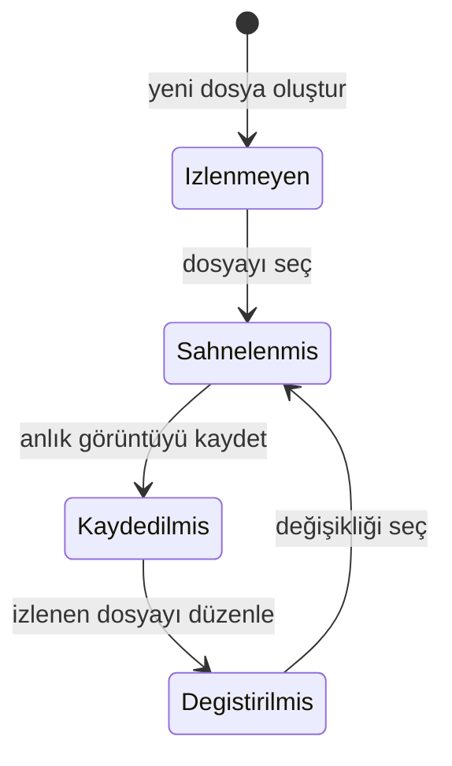
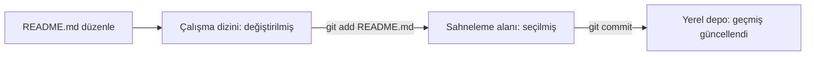

> **Gezinme:** [Önceki: Bölüm 01](01-surum-kontrolu-neden-gerekli.md) | [Yol Haritası](../../ROADMAP.md) | Sonraki: Bölüm 03 yakında
>
> **Seviye:** Başlangıç · **Tahmini Süre:** 75 dakika · **Önkoşullar:** [Bölüm 01: Sürüm Kontrolü Neden Gerekli?](01-surum-kontrolu-neden-gerekli.md)

# Git Mimarisi

## Öğrenme Hedefleri

Bu bölümün sonunda şunları yapabileceksiniz:

- Git'in çalışma dizinini, sahneleme alanını ve yerel depoyu tanımlamak.
- Bir değişikliğin düzenlenmiş dosyadan kayıtlı proje geçmişine nasıl ilerlediğini açıklamak.
- Hazırlanmış depoda `git status` çıktısıyla değişikliğin durumunu açıklamak.
- Git'in değişiklik seçimini kaydetmekten neden ayırdığını açıklamak.

## Giriş

İlk bölümde yazılımın güvenilir geçmişe neden ihtiyaç duyduğunu öğrendiniz. Git bu geçmişi sağlar; ancak kaydedilmiş her düzenlemeyi kalıcı kayıt olarak görmez.

Bir geliştiricinin portfolyo sitesini güncellediğini düşünün. README dosyasında yazım hatasını düzeltir, iletişim formu mesajını dener ve daha büyük bir menü tasarımına başlar. Bu değişikliklerin hepsi aynı tarihsel kayda ait değildir. Yazım hatası kaydedilmeye hazır olabilir; menü çalışması ise tamamlanmamıştır.

Git mimarisi, sıradan dosya düzenlemelerinden kayıtlı geçmişe giden bilinçli bir yol sağlar. Bu yolu görmek, komutları ezberlemekten daha önemlidir.

## Görsel Öğrenme



_Şekil 1. Git; düzenleme, seçme ve kaydetmeyi ayırarak geçmişte odaklı değişiklikler oluşturur._



_Şekil 2. Yeni veya değiştirilmiş dosya, seçilmiş sürümü geçmişe eklenmeden önce temel Git durumlarından geçer._

## Neden Önemli?

Profesyonel yazılım çalışmasında aynı anda birçok değişiklik yapılır. Bir geliştirici hatayı düzeltirken belgeyi güncelleyebilir ve yeni özelliği deneyebilir. Ekiplerin, ilgisiz veya tamamlanmamış düzenlemeleri kazara dahil etmeden anlamlı bir işi kaydetmeye ihtiyacı vardır.

Git; düzenlemeyi, seçmeyi ve kaydetmeyi ayırır. Böylece proje geçmişi daha kesin ve gelecekte daha anlaşılır olur. Ekip arkadaşı hata araştırırken veya kayıt incelerken her gün dokunulan bütün dosyaları içeren anlık görüntü yerine odaklı kayıt çok daha faydalıdır.

## Temel Kavramlar

| Kavram                             | Açıklama                                                                     |
| ---------------------------------- | ---------------------------------------------------------------------------- |
| Çalışma dizini (working directory) | Proje klasörünüzde görünen ve düzenleyebildiğiniz dosyalardır.               |
| Sahneleme alanı (staging area)     | Sonraki kayıt için hazırlanmış, gözden geçirilebilir dosya sürümü seçimidir. |
| Yerel depo (local repository)      | Bilgisayarınızdaki Git tarafından yönetilen proje geçmişidir.                |
| Anlık görüntü (snapshot)           | Seçilmiş proje dosyalarının belirli andaki kaydedilen durumudur.             |
| Commit (kayıt)                     | Seçilmiş anlık görüntüyü proje geçmişine ekleyen isimli kayıttır.            |
| `git status`                       | İzlenmeyen, değiştirilmiş ve sahnelenmiş değişiklikleri raporlayan komuttur. |

## Kuram

### Çalışma Dizini

Çalışma dizini, düzenleyicide açtığınız proje klasörüdür. `index.html` dosyasını değiştirir, README günceller veya yeni dosya oluşturursanız çalışma dizinini değiştirirsiniz.

Bu aşamada değişiklik yalnızca güncel dosyalarda vardır. Git onu algılayabilir; ancak sonraki tarih kaydı için henüz seçilmemiştir. Dosyayı düzenlemek, proje kararını kaydetmek değildir.

### Sahneleme Alanı

Sahneleme alanı, düzenleme ile geçmiş arasındaki bilinçli kontrol noktasıdır. Git'in sonraki commit için kullanacağı, seçilmiş her dosyanın tam sürümünü tutar.

Örneğin `README.md` içinde yazım hatasını düzeltirken `index.html` içinde yarım kalmış tasarım deniyorsanız, yalnızca belge düzeltmesini seçebilirsiniz. Böylece sonraki kayıt tek ve anlaşılır amacı açıklar.

Sahneleme alanına bazen _index_ denir. Bu kursta "sahneleme alanı" ifadesini kullanın; görevi daha iyi açıklar: sonraki anlık görüntüyü hazırlar.

### Yerel Depo

Yerel depo, bilgisayarınızda tutulan proje geçmişidir. Git seçilmiş anlık görüntüyü kaydettiğinde bu geçmişte commit oluşturur. Yerel depo elle düzenlediğiniz ayrı bir klasör değildir; Git tarafından yönetilir.

Bu bölüm yerel mimariye odaklanır. Uzak hizmete paylaşım ve GitHub ile iş birliği sonraki bölümlerde ele alınacaktır.

### Bir Dosya, Birden Fazla Durum

Tek dosyanın her Git alanında farklı sürümü bulunabilir. Depoda dünün README sürümü, sahneleme alanında seçilmiş yazım düzeltmesi ve çalışma dizininde henüz taslak olan ek paragraf olabilir.

Bu sadeleştirilmiş modelde önemli nokta şudur: Git tamamlanmamış işi, seçilmiş işi ve kayıtlı geçmişi birbirinden ayırır.

### Seçim Neden Geçmişten Önce Gelir?

| Durum                                                 | Sahneleme alanı olmadan                         | Sahneleme alanıyla                               |
| ----------------------------------------------------- | ----------------------------------------------- | ------------------------------------------------ |
| Hata düzeltmesi ve biçim değişikliği birlikte yapılır | İkisi tek, belirsiz kayıtta toplanabilir.       | Hata düzeltmesi ayrı seçilip kaydedilebilir.     |
| Özellik tamamlanmamıştır                              | Dosya kaydetmek tamamlanmış aşama gibi görünür. | Yalnızca hazır kısım geçmişe seçilir.            |
| Ekip arkadaşı geçmişi sonra okur                      | Geniş anlık görüntünün amacını anlamak zordur.  | Her kayıt anlaşılır bir iş birimini temsil eder. |

Seçim bürokrasi değildir. Git'in, geçmişin niyeti ifade etmesini sağlama yoludur.

## Uygulamalı Örnekler

### Bir Değişikliği Git İçinde İzlemek

Hazırlanmış portfolyo deposunda `README.md` dosyasındaki yazım hatasını düzelttiğinizi varsayın.



_Şekil 3. `git add` belge düzeltmesini seçer; `git commit` seçilmiş sürümü yerel geçmişe kaydeder._

```bash
git status
git add README.md
git status
git commit -m "docs: kurulum yönergesini düzelt"
git status
```

| Komut                 | Mimari anlamı                                                            |
| --------------------- | ------------------------------------------------------------------------ |
| İlk `git status`      | README'nin çalışma dizininde değiştiğini gösterir.                       |
| `git add README.md`   | README'nin güncel sürümünü sahneleme alanına seçer.                      |
| İkinci `git status`   | Seçilmiş sürümün sonraki commit için hazır olduğunu gösterir.            |
| `git commit -m "..."` | Seçilmiş anlık görüntüyü yerel depoya kaydeder.                          |
| Son `git status`      | Çalışma dizininde veya sahneleme alanında kalan değişiklikleri gösterir. |

### Ayrı ve Tamamlanmamış Değişiklik

`index.html` dosyasındaki menü tasarımı henüz tamamlanmadıysa, durum raporu kavramsal olarak şöyle görünür:

```text
Kaydedilecek değişiklikler:
  modified: README.md

Sahnelenmemiş değişiklikler:
  modified: index.html
```

Seçilmiş README sürümünü kaydetmek, tamamlanmamış HTML çalışmasını otomatik olarak kaydetmez.

```mermaid
timeline
    title Odaklı belge değişikliği
    09:00 : README.md düzenle
    09:05 : Çalışma dizini değişikliğini incele
    09:07 : README'yi sonraki anlık görüntü için seç
    09:10 : Seçilmiş anlık görüntüyü yerel olarak kaydet
    09:11 : İlgisiz menü çalışmasına devam et
```

_Şekil 4. Seçilmiş belge değişikliği, ilgisiz iş tamamlanmadan geçmişe eklenir._

## Kendiniz Deneyin

1. Aynı projede `README.md` ve `index.html` değiştirdiğinizi düşünün.
2. Hangi dosyanın tamamlanmış ve açıklanabilir değişiklik olduğunu, hangisinin devam eden iş olduğunu belirleyin.
3. Kayıt oluşturmadan önce her dosyanın hangi Git alanında bulunması gerektiğini yazın.

## En İyi Uygulamalar

- Sahneleme alanını inceleme noktası olarak kullanın; tek bir amaca ait değişiklikleri seçin.
- Seçimden önce ve sonra `git status` çalıştırın.
- İlgisiz veya tamamlanmamış işi mümkün olduğunca kayıt dışında tutun.
- Commit mesajında o gün yapılan her düzenlemeyi değil, seçilmiş değişikliğin amacını açıklayın.

## Sık Yapılan Hatalar

| Hata                                                   | Neden sorun çıkarır?                                        | Nasıl önlenir?                                       |
| ------------------------------------------------------ | ----------------------------------------------------------- | ---------------------------------------------------- |
| Kaydedilen her dosyanın Git geçmişinde olduğunu sanmak | Dosya kaydetmek çalışma dizinini değiştirir, geçmişi değil. | Dosyanın durumunu `git status` ile kontrol edin.     |
| Sahneleme alanını projenin ikinci kopyası saymak       | Sonraki anlık görüntü seçimindeki rolünü gizler.            | Onu tek kayıt için seçim listesi olarak düşünün.     |
| Değişen bütün dosyaları otomatik seçmek                | İlgisiz değişiklikler geçmişi ve incelemeyi zorlaştırır.    | Tek anlamlı değişikliği destekleyen dosyaları seçin. |
| Commit oluşturmanın işi ekiple paylaştığını sanmak     | Commit geçmişi yalnızca yerel olarak kaydeder.              | Yerel geçmiş ile uzak paylaşımı ayırın.              |

## Özet

- Git; düzenlemeler için çalışma dizini, seçilmiş değişiklikler için sahneleme alanı ve kayıtlı geçmiş için yerel depo kullanır.
- Dosya değiştirilebilir, sahnelenebilir, kaydedilebilir ve çalışma devam ederken yeniden değiştirilebilir.
- Sahneleme alanı, ilgisiz işi dışarıda bırakıp odaklı kayıt oluşturmayı sağlar.
- Değişikliklerin nerede olduğunu anlamak için ilk komut `git status` olmalıdır.

## Sonraki Bölüm

Yerel Git alanlarını anladınız. Sonraki bölüm Git'i bilgisayarınıza kurarak bu mimariyi gerçek projede kullanmaya hazırlar.

### İlgili İçerik

- Önceki bölüm: [Bölüm 01 - Sürüm Kontrolü Neden Gerekli?](01-surum-kontrolu-neden-gerekli.md)
- Sonraki bölüm: Bölüm 03 - Git Kurulumu (yakında)
- Alıştırma: [Git Alanlarını Sınıflandırma](../../exercises/tr/02-git-alanlarini-siniflandirma.md)
- Laboratuvar: [Git Değişiklik Akışı Laboratuvarı](../../labs/tr/02-git-degisiklik-akisi-laboratuvari.md)
- Quiz: [Git Mimarisi Quiz](../../quizzes/tr/02-git-mimarisi-quiz.md)

## İleri Okuma

- [Git Book: Recording Changes](https://git-scm.com/book/en/v2/Git-Basics-Recording-Changes-to-the-Repository)
- [Git Book: Viewing the Commit History](https://git-scm.com/book/en/v2/Git-Basics-Viewing-the-Commit-History)
