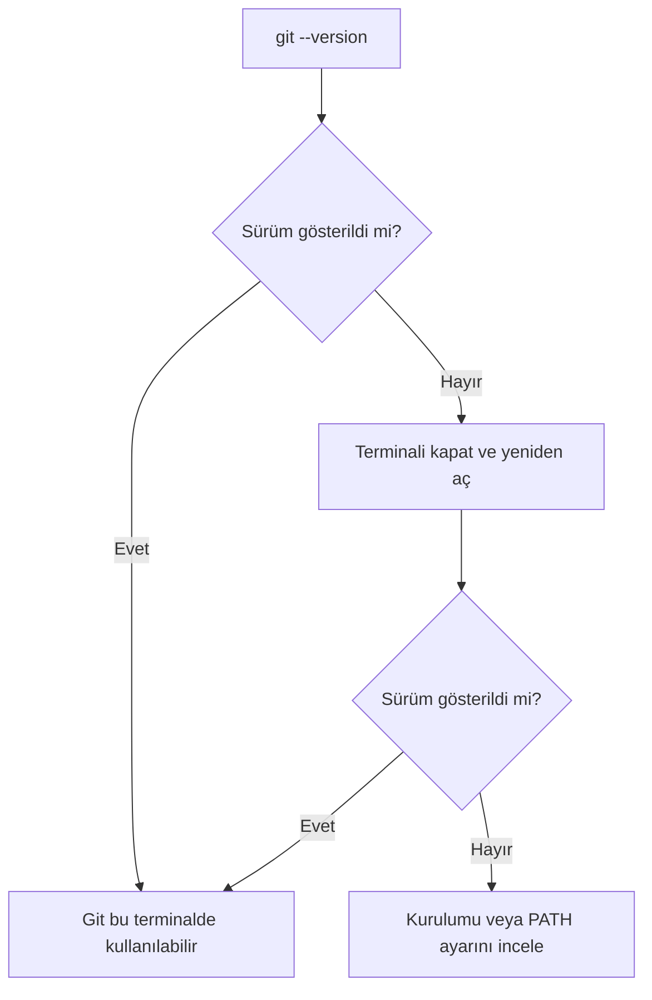
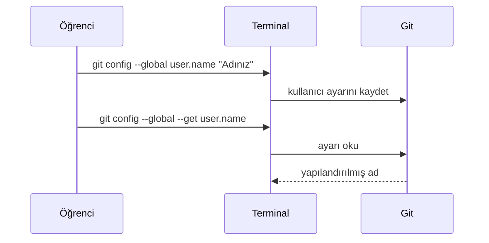

> **Gezinme:** [Önceki: Bölüm 02](02-git-mimarisi.md) | [Yol Haritası](../../ROADMAP.md) | Sonraki: Bölüm 04 yakında
>
> **Seviye:** Başlangıç · **Tahmini Süre:** 60 dakika · **Önkoşullar:** [Bölüm 02: Git Mimarisi](02-git-mimarisi.md)

# Git Kurulumu

## Öğrenme Hedefleri

Bu bölümün sonunda şunları yapabileceksiniz:

- işletim sisteminize uygun kurulum yöntemiyle Git'i kurmak;
- terminalin Git komutunu çalıştırabildiğini doğrulamak;
- yeni commitler için ad ve e-posta adresi yapılandırmak;
- ayarları değiştirmeden önce okumak ve doğrulamak.

## Giriş

Git bilgisayarınızda çalışan bir programdır. GitHub ileride depoları barındırabilir; fakat bilgisayarınızdaki değişiklikleri kaydeden yerel Git programının yerini almaz. İlk depoyu oluşturmadan önce terminalinizin `git` komutunu bulabilmesi ve Git'in commitler için bir kimlik bilgisine sahip olması gerekir.

Bu bölüm kurulumu küçük ve doğrulanabilir adımlara ayırır: Git'i kurun, terminalden doğrulayın ve commitlerde görünecek bilgileri yapılandırın. Depo oluşturma sonraki bölümün konusudur.

## Görsel Öğrenme


_Şekil 1. Güvenilir kurulum, her aşaması doğrulanabilen kısa bir akıştır._



_Şekil 2. Kurulumun başarılı olduğunu varsaymak yerine kullanacağınız terminali doğrulayın._

## Neden Önemli?

Eksik kurulum, daha sonra anlaşılması zor hatalara dönüşür. Git ilk commit sırasında yazarı tanımlayamadığı için durabilir veya kurulumdan önce açılmış terminal Git'i hiç bulamayabilir. Her adımı şimdi doğrulamak, sonraki Git komutlarını daha anlaşılır kılar.

Commit kimliği aynı zamanda proje geçmişinin parçasıdır. Gelecekteki okuyucuların bir kaydı kimin oluşturduğunu anlamasına yardım eder. Özellikle uzak hizmette yayımlanacak depolarda paylaşmakta sakınca görmediğiniz bir kimlik kullanın.

## Temel Kavramlar

| Kavram             | Açıklama                                                          |
| ------------------ | ----------------------------------------------------------------- |
| Kurulum programı   | Yazılımı ve gerekli dosyaları bilgisayara ekleyen programdır.     |
| Paket yöneticisi   | İşletim sistemi paketlerini kuran ve güncelleyen araçtır.         |
| Terminal           | Komut çalıştırmak için kullanılan metin tabanlı arayüzdür.        |
| PATH               | Terminalin çalıştırılabilir programları aradığı konum listesidir. |
| Genel yapılandırma | Geçerli kullanıcı için yerel depolara uygulanan Git ayarlarıdır.  |
| Commit kimliği     | Git'in commit ile birlikte kaydettiği ad ve e-posta adresidir.    |

## Kuram

### İşletim Sisteminize Git Kurmak

İşletim sisteminiz için güncel ve desteklenen kurulumu seçmek üzere resmi Git indirme sayfasını kullanın. Kurulum sürümleri zamanla değişir; eski bir öğreticideki sürüm numarasını izlemek yerine resmi kaynağı tercih edin.

| İşletim sistemi | Önerilen yaklaşım                                                               | Doğrulama terminali                        |
| --------------- | ------------------------------------------------------------------------------- | ------------------------------------------ |
| Windows         | Resmi sayfadan Git for Windows kurun.                                           | Git Bash, PowerShell veya Windows Terminal |
| macOS           | Geliştirici komut satırı araçlarını veya güvenilir paket yöneticisini kullanın. | Terminal                                   |
| Linux           | Dağıtımınızın paket yöneticisiyle Git kurun.                                    | Terminal                                   |

Windows kurulumunda, kuruluşunuz farklı bir yönerge vermediyse Git'i komut satırından kullanılabilir yapan varsayılan seçeneği koruyun. Kurulumdan sonra açık terminalleri kapatın ve yeni terminal açın; yeni PATH ayarı ancak böyle yüklenir.

### Kurulumu Doğrulamak

Yeni terminalde şu komutu çalıştırın:

```bash
git --version
```

Git örneğin `git version 2.x.y` biçiminde bir sürüm yazdırmalıdır. Bu derste sürüm numarasının kendisi önemli değildir; komutun çalışması ve sürüm raporlaması önemlidir.

Terminal `git` komutunu tanımıyorsa Git henüz o terminalde kullanılamaz. Önce terminali yeniden açın. Sorun sürerse kurulum sonucunu veya işletim sisteminin PATH ayarını inceleyin.

### Commit Kimliğini Yapılandırmak

Git her committe yazar adı ve e-posta adresi kaydeder. İlk deponuzu oluşturmadan önce bunları ayarlayın:

```bash
git config --global user.name "Adınız Soyadınız"
git config --global user.email "siz@example.com"
```

`--global` seçeneği bu değerleri mevcut işletim sistemi kullanıcısı için saklar. Bir proje onaylı farklı bir kimlik gerektirirse, bu ayarı daha sonra yalnızca o depoda geçersiz kılabilirsiniz.

Herkese açık commit geçmişinde görünmesini istemediğiniz e-posta adresini kullanmayın. Kurumsal depolarda ekip politikasını kontrol edin.

### Tahmin Etmeyin, Ayarı Okuyun

Yapılandırılmış kimliği okumak için şu komutları kullanın:

```bash
git config --global --get user.name
git config --global --get user.email
```



_Şekil 3. Bir ayarı yapılandırdıktan sonra, kesin değeri okuyarak doğrulayın._

## Uygulamalı Örnekler

### Windows ve Git for Windows

1. Resmi Git sitesinden Git for Windows indirin.
2. Kurulum programını çalıştırın ve komut satırı kullanımını etkinleştiren seçeneği koruyun.
3. PowerShell veya Windows Terminal'i kapatıp yeni pencere açın.
4. `git --version` çalıştırın.

### macOS veya Linux Terminali

Onaylı sistem yönteminizle Git'i kurduktan sonra yeni terminalde şunları çalıştırın:

```bash
git --version
git config --global user.name "Adınız Soyadınız"
git config --global user.email "siz@example.com"
git config --global --get user.name
git config --global --get user.email
```

Son iki komut ayarladığınız değerleri yazdırır. Bu komutlar yalnızca yapılandırmayı doğrular; depo veya commit oluşturmaz.

## Kendiniz Deneyin

1. İşletim sisteminiz için resmi yöntemle Git'i kurun.
2. Yeni terminal açıp `git --version` çalıştırın.
3. Uygun ad ve e-posta adresi yapılandırın.
4. Her iki değeri `git config --global --get` ile okuyun.

## En İyi Uygulamalar

- Resmi Git indirme sayfasını veya işletim sisteminin güvenilir paket yöneticisini kullanın.
- Git'in bulunmadığı sonucuna varmadan önce kurulum sonrası yeni terminal açın.
- Commit oluşturmadan önce Git'in kullanacağı kimliği doğrulayın.
- Ortak veya herkese açık geçmiş için bilinçli ve uygun bir e-posta adresi seçin.

## Sık Yapılan Hatalar

| Hata                                      | Neden sorun çıkarır?                                     | Nasıl önlenir?                            |
| ----------------------------------------- | -------------------------------------------------------- | ----------------------------------------- |
| Kurulumdan sonra açık terminali kullanmak | Terminal güncellenen PATH değerini tanımayabilir.        | Terminali kapatıp yeni terminal açın.     |
| `git --version` adımını atlamak           | Sonraki hata kurulum mu Git kullanımı mı belirsiz kalır. | Kurulumu hemen doğrulayın.                |
| Yanlışlıkla örnek e-posta ayarlamak       | Örnek değer commit geçmişine kaydedilir.                 | Committen önce değeri okuyun.             |
| GitHub hesabını Git kurulumu sanmak       | Barındırma hesabı yerel `git` komutunu sağlamaz.         | Önce bilgisayarda Git'i kurup doğrulayın. |

## Özet

- Git komutlarının geçmiş kaydedebilmesi için Git yerel olarak kurulmalıdır.
- `git --version`, mevcut terminalin Git'i çalıştırabildiğini doğrular.
- `user.name` ve `user.email`, gelecekteki commitleri tanımlar.
- `git config --global --get`, depo oluşturmadan ayarları okur.

## Sonraki Bölüm

Git artık yerel çalışmayı kaydetmeye hazırdır. Sonraki bölüm ilk depoyu oluşturur ve Bölüm 02'deki mimariyi uygular.

### İlgili İçerik

- Önceki bölüm: [Bölüm 02 - Git Mimarisi](02-git-mimarisi.md)
- Sonraki bölüm: Bölüm 04 - İlk Git Deponuzu Oluşturma (yakında)
- Alıştırma: [Git Kurulumunu Doğrulama](../../exercises/tr/03-git-kurulumunu-dogrulama.md)
- Laboratuvar: [Git'i Kurma ve Yapılandırma](../../labs/tr/03-git-kurma-ve-yapilandirma.md)
- Quiz: [Git Kurulumu Quiz](../../quizzes/tr/03-git-kurulumu-quiz.md)

## İleri Okuma

- [Git Downloads](https://git-scm.com/downloads)
- [Git Book: First-Time Git Setup](https://git-scm.com/book/en/v2/Getting-Started-First-Time-Git-Setup)
